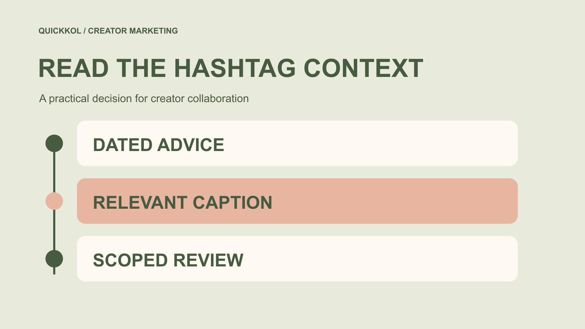
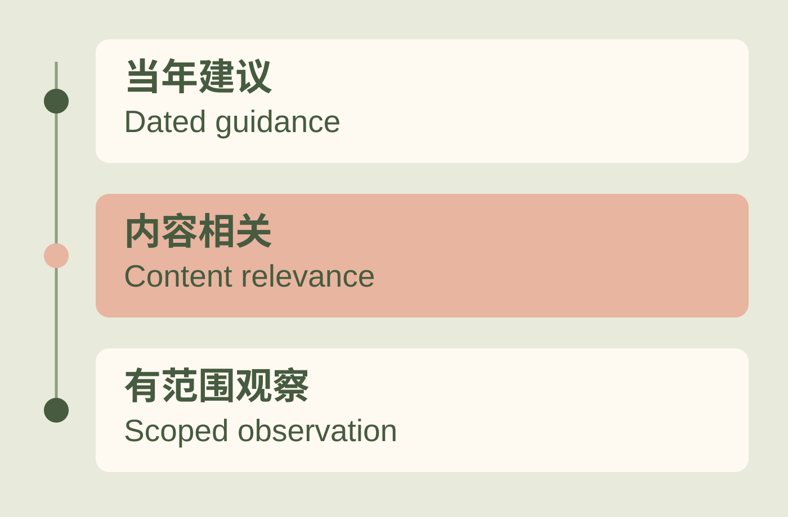

# 2025 Facebook 标签建议怎样应用

状态：本地审阅稿；正式发布日期待确认。

把 Meta 2025 年“最多五个标签”的建议放回原创内容与相关文案的语境，帮品牌与达人决定哪些标签值得保留。

QuickKOL 编辑图形；不呈现真实账号指标或平台界面。

针对 facebook hashtags strategy 2025 how many to use，Meta 2025 年 7 月的葡语官方文章提到：相关的高质量文案，并将不含链接、少用大写字母和最多五个标签放在一组表现观察中。这可以作为当年建议的依据，不能读成五个必胜、超过五个必受限，或 2026 年所有账户统一硬上限。达人合作先保留准确、与作品有关的标签，再核对文案、商业说明和实际结果，不为了凑数量加入无关热门词。

## 先回答数量，再说明它的范围

如果你要回看 2025 年的官方建议，可以记录“最多五个”及其来源时间。它是理解当年内容建议的起点，不需要再编一个精确的最佳数量。

[Meta 的 2025 年原创内容建议](https://about.fb.com/br/news/2025/07/combatendo-conteudo-nao-original-para-proteger-e-elevar-criadores-no-facebook/amp/)并没有在这段话里提供独立标签数量实验。文案链接、大写使用和标签数量共同出现，不能从中拆出一个适用于所有达人帖子的因果结论。

因此不要把四个改成五个当成已经优化，也不要把六个直接写成违规。具体内容与账户的当前问题，需要当前资料与实际状态支持。

本篇服务品牌与创作者的文案决定：用多少标签由相关性和表达需要决定，并把历史建议放回正确时间。不是把一个旧数字升级为永远适用的平台规则。

## 相关标签应说明作品，而不是替代作品

标签可以帮助说明主题、场景或活动，但它不能补回画面里不存在的达人贡献。先让作品解释清楚，再判断是否需要相应标签。

例如创作者展示小厨房的收纳取舍，标签应与这种内容有关。一个热门娱乐词即使当时有人使用，也不能因为可能带来曝光就自动加入这条作品。

品牌可以要求一个确有用途的活动标签，但需要解释它用于组织哪项活动。不要把所有品牌、品类、季节和想象受众都写成必填，最后让文案难以阅读。

与创作者共同判断哪些词准确，比照搬另一条高浏览帖子更有意义。标签是文字表达的一部分，实际内容仍要让读者理解为什么值得看。

## 反垃圾内容语境不是单个数字的处罚线

[Meta 的 2025 年反垃圾内容公告](https://about.fb.com/br/news/2025/04/reduzindo-conteudo-com-spam-no-facebook/)在 4 月讨论过冗长、分散注意力的文案、过多标签和与画面无关的文字。需要把这些放在文章所说的行为语境中理解。

它不支持研究者只看某一条作品有几个标签，就对具体创作者下账号受罚的结论。品牌沟通时应指出实际问题，例如标签与作品主题不符，而不是声称已经证明平台如何处理。

如果团队关心分发异常，让账户持有人查看当前提供的状态和说明。没有资料时保留未知，不把内容审稿变成对个人的推测。

对本次文案，最直接的动作是删去不相关部分并保留必要语境。这是改善表达的建议，不承诺某个删减动作能立即恢复或增加分发。

最多五个是当年建议的语境，不是每个账户的效果保证。

## 先审阅自然语言文案

把标签暂时拿开，读者是否仍知道创作者在展示什么、自己的体验是什么、产品起什么作用？如果不能，先修改正文。

文案可以说明实际条件、关键步骤和作品没有覆盖的范围。不要只留一句笼统好评，然后指望一串标签补足全部信息。

[Facebook 原创内容复盘文章](https://www.quickkol.com/zh/blog/facebook-2025-original-creator-content-review/#answer)可以帮助把文案与作品贡献放在一起看。这里关注的是一条合作帖子的文字：每句话应有用，不因为添加了品牌名称就自动成为必要内容。

创作者的表达可以与品牌常用文风不同，只要事实准确、关系清楚且符合约定。审稿应解决实际问题，不把全部句子改成同一种广告语言。

## 给每个标签一个保留理由

逐个询问标签在做什么：说明具体主题、组织真实活动，还是帮助读者识别确实相关的内容？没有合理作用，就不必为数量留下。

同一个意思不一定需要多个拼写近似的标签。品牌与创作者可以检查是否重复，而不是先把所有备选写入最终文案。

如果活动规定一个专用标签，确认拼写与实际用途，再考虑是否还需要品类或场景词。不要承诺这个标签会建立完整检索结果或收集到所有参与者。

最终数量可以少于历史建议的上限。这里不提出新的统一最佳数，而是要求保留的每个词都有内容上的理由。数量是选择之后的结果。

## 不要用话题标签代替商业说明

一个品牌标签说明讨论对象，不一定清楚表达商业关系。不能只因为出现品牌名，就认为读者已经理解付费、赠品或其他关系。

[FTC 的达人披露指南](https://www.ftc.gov/business-guidance/resources/disclosures-101-social-media-influencers)针对美国适用情境说明实质关系的清楚披露。实际内容应结合关系与形式确认，不把内部“有合作”记录当成公开说明。

品牌在减少标签时，也要检查是否误删了必要的关系表达。精简是为了让信息更清楚，不是让商业上下文更难看见。

同样，不要把一句说明写进统一模板后就完全停止审阅。最终作品、文案和发布形式可能不同，创作者与品牌都需要确认实际呈现。

## 跨平台改写时重新判断标签

从 Instagram 或 TikTok 带来的文案，可以保留真实主题，但不应直接假定所有标签都需要照搬。每个平台的作品形式与观众语境可能不同。

先核对媒体是否需要重新裁切、说明是否仍然完整、原来的提及是否仍指向正确账户，再处理标签。只改标签数量，不能修复一个已经失去语境的转载。

如果本次使用的是达人授权素材，确认适用于 Facebook 的使用范围。不要把平台建议、素材授权和文案相关性混成一个“可以发布”的结论。

给执行者保留一份明确的 Facebook 版本。相似内容可以复用研究，但真正公开的文字应对应这次发布，而不是依赖别人记住哪个平台需要删什么。

## 比较结果时不要把变化全归给标签

如果品牌比较两条作品，要同时记录内容主题、创作者、形式、发布时间和观察期。标签数量只是其中一个差异，通常不能单独解释结果。

[社媒互动口径文章](https://www.quickkol.com/zh/blog/social-media-engagement-rate-monthly-explanation/#answer)帮助说明指标定义。浏览、互动和链接动作各自回答不同问题，不应因为一个数较高就宣布标签策略已被证明。

可以把发现写成待研究假设：这组更贴合主题的文案值得继续观察。若其他条件变化很多，就明确比较有限，而不是挑选一个最吸引人的原因。

对创作者反馈，优先说明什么表达让人更容易理解，哪些问题需要补充。没有隔离证据，就不要把一次表现变化归责给个人用了几个标签。

## 用一条假设文案完成决定

假设创作者演示小厨房收纳，品牌原来要求加上多个无关活动词。双方先保留清楚的使用说明，再考虑两个与场景真正有关的标签，以及确有用途的活动标签。

这不是推荐所有作品都用同样数量。例子只说明从内容出发选择，比为了接近五个而补词更合理；最终保留多少，需要实际判断。

发布前再核对商业关系、正确账户和素材版本。上线后记录真实帖子与观察期，后续结果不预先写好。

如果后来没有达到品牌期望，复盘整条内容与分发背景，不立即把原因归结为少了一个标签。标签决定应是内容策划的一部分，而不是代替达人营销判断的万能公式。

## 保留历史结论与更新条件

本篇回答的是带 2025 年的搜索问题。历史建议可以保留，但今天发布前仍应查看当前可用规则与账户说明，不应让旧文章替代现实检查。

如果以后出现新的官方数量建议，记录来源和日期，再更新受影响部分。新资料不必改变关于相关性、真实体验与明确商业关系的全部内容判断。

团队可以交付一句范围清楚的结论：参考当年最多五个的建议，实际按作品相关性选择，不声称固定数量决定分发。比只给一个没有出处的数字更便于合作。

对达人营销，最终问题仍是观众是否看懂创作者的贡献，以及品牌是否用准确方式参与。标签数量帮助整理表达，却不能替这两个问题作答。

## 保留标签前的问题

| 候选标签 | 保留依据 | 需要避免 |
| --- | --- | --- |
| 主题词 | 准确描述作品 | 无关热词 |
| 场景词 | 确实帮助理解 | 重复近义词 |
| 活动词 | 对应真实活动用途 | 声称完整收集参与者 |
| 品牌词 | 讨论对象确实相关 | 代替清楚商业说明 |

编辑选择框架；不提出新的统一最佳数量。

## 确认 Facebook 达人文案

让标签服务作品中的实际信息。

- [ ] 记录 2025 年建议的时间范围。
- [ ] 先读没有标签的正文。
- [ ] 逐项说明标签用途。
- [ ] 核对商业关系与素材使用。
- [ ] 保留这次 Facebook 版本。
- [ ] 复盘不作单一因素归因。

## 研究日期与使用边界

资料核验于 2026 年 11 月 18 日。文中方法、表格和决策规则为编辑建议，标为假设的示例不是实际客户结果或行业基准。外部资料的适用地区与时期按各段说明。

## 从任务开始达人研究

用 QuickKOL 理解 Brief、发现相关达人并研究作品与联系路径；数据、合作条件和结果仍需核验。

[了解 QuickKOL](https://www.quickkol.com/#capabilities)

## 来源

- [Meta 的 2025 年原创内容建议](https://about.fb.com/br/news/2025/07/combatendo-conteudo-nao-original-para-proteger-e-elevar-criadores-no-facebook/amp/)
- [Meta 的 2025 年反垃圾内容公告](https://about.fb.com/br/news/2025/04/reduzindo-conteudo-com-spam-no-facebook/)
- [FTC 的达人披露指南](https://www.ftc.gov/business-guidance/resources/disclosures-101-social-media-influencers)
