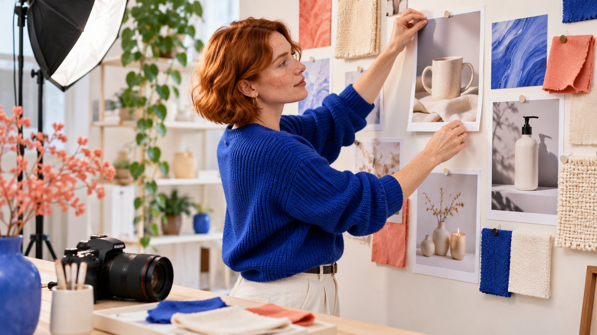

# A Cohesive Instagram Aesthetic With Creators

Status: local review draft; confirm the publication date before release.

A cohesive Instagram aesthetic across creators comes from a few shared principles, accurate products and recognizable individual expression.

For a multi-creator Instagram aesthetic, start with three shared principles: represent the product accurately, retain recognizable brand cues and make text and action understandable. Choose a small set of necessary color, framing or graphic conventions, stating what creators can interpret freely. Do not require identical people, homes or lighting, or use a uniform filter that changes product color. Review a small set of actual works before refining the brief; a tidy grid does not establish content value or marketing return.

## Define what should be recognizable

Looks consistent is too broad. Ask what viewers should recognize: one product range, one campaign or a clear content structure? Different answers require different visual conventions.

If the task explains use, visible action can matter more than an identical background. For a set of explanatory graphics, title position and information hierarchy may matter more than clothing color.

Write assessable principles rather than an aesthetic adjective alone. Preserve the product's actual color and show the important action fully are easier to execute than premium and natural.

Visual principles should serve the assignment. Making every asset resemble one shoot should not remove the setting and expression that make each creator useful. A team can then explain why a particular visual detail is necessary, which helps distinguish a genuine brand requirement from a personal preference introduced late during review.

## Separate invariants from room for interpretation

Shared principles can include accurate products, necessary identification and text hierarchy. Creator interpretation can include setting, language, expression and explanation. Both can coexist.

State them separately in the brief rather than make the creator guess what follow the brand style means. Do not promise complete freedom and then require an entirely fixed image during review.

The [UGC production-roles article](https://www.quickkol.com/blog/ugc-content-creator-on-camera-production-role/#answer) distinguishes brand, on-camera and production responsibilities. Visual collaboration likewise needs an owner for direction, production and approval of changes.

If a requirement prevents a genuine demonstration, discuss alternatives. A setting that cannot become the brand color may still connect through a limited prop or graphic cue without reconstructing a creator's living environment. This gives the team something specific to solve while respecting the actual production conditions. The outcome should preserve the content contribution, not merely reproduce a reference image regardless of what is being explained.

## Explain why each visual reference is included

A reference board can include color, material, framing and text examples, with a purpose attached to each. Is it about space, action distance or hierarchy? The creator should not have to guess whether the entire photograph must be copied.

Use several relevant examples instead of making one image carry every rule. If an example concerns mood alone, say that its product, person and personal experience are not the elements to reproduce.

The [U.S. Copyright Office’s copyright overview](https://www.copyright.gov/what-is-copyright/) explains protection for original expression. Referencing work and obtaining permission to use its image are different tasks; confirm intended uses for actual assets and publicly shared references.

Retain necessary sources and scope. A photograph inside a reference board should not become an assumed deliverable asset for the creator. Production still needs original work and appropriate permission, allowing inspiration to guide decisions without silently turning somebody else's expression into a brand-owned material library.

## Do not let color styling change factual information

A shared tone should not distort product, material or skin color. Identify colors and details needing accurate representation before discussing coordination through background, props and editing.

[Adobe’s product-photography guide](https://www.adobe.com/creativecloud/photography/type/product-photography.html) discusses lighting, angles and color treatment. It supplies production background, not a claim that one filter suits every product and setting.

The creator can supply a sample from the actual location and check whether the product remains credible. If a blue background changes its appearance, adjust lighting or the relationship with the background rather than tint every work identically.

Do not hide an important product characteristic in pursuit of consistency. Viewers use creator work to understand a real item; recognition should help that understanding rather than replace it. Review the final export too, because a correct source photograph can be altered later when the team applies a shared preset or prepares another crop.

Reference color and material relationships without making different creators copy one setting.

## Create framing consistency through information tasks

Creators need not place the product in the same corner. Agree on shared information tasks: identify the subject at the opening, retain the important action and keep explanatory text from covering it.

Different settings can then connect. A kitchen and a studio can both use the same information priorities to help viewers understand the work.

Review should identify a particular gap: hands too near the edge, an invisible model detail or text covering a relevant part. This gives a producer more to act on than make it more on brand.

If work needs several placements, discuss crop versions before filming. A creator's account and a brand channel may have different needs, but delivery should not imply that every frame can be cropped into any shape. A sample can reveal those limits early and allow a practical second angle rather than a later demand that the editor recover information never captured.

## Confirm text readability before decorative styling

Consistent type and color can aid recognition, but viewers first need to read. Check actual phone-size presentation instead of only an enlarged design canvas; thin text, busy backgrounds and low contrast can interfere.

[W3C’s text-contrast explanation](https://www.w3.org/WAI/WCAG22/Understanding/contrast-minimum.html) emphasizes sufficient contrast between text and background. It is web-accessibility material used here as editorial reference, not an Instagram visual certification.

For creator graphics, reduce unnecessary wording, give important information space and then choose a brand-compatible treatment. A reference board's pale palette should not make essential conditions difficult to see.

Retain several text treatments suitable for different photographic backgrounds. The shared principle is clarity rather than identical pale lettering or decoration in every setting. Checking a real-size sample also lets the creator and brand resolve the issue before applying the same hard-to-read treatment to a whole series of finished assets.

## Use more than color for meaningful distinctions

When graphics distinguish steps, models or states through color, add text or another recognizable cue. Viewers may perceive color differently or encounter only part of a screenshot.

[W3C’s use-of-color explanation](https://www.w3.org/WAI/WCAG22/Understanding/use-of-color.html) discusses not relying on color alone for meaningful information. In a creator brief, name comparison subjects, number steps or state the distinction explicitly.

Those additions need not damage the aesthetic. Clear hierarchy can be part of the shared style and is more useful than making viewers infer meaning from several similar shades.

Check that the finished work stands alone. Someone who never saw the reference board should understand the comparison without knowing which color the internal team assigned to which product. This check matters when several creators contribute to the same project, because their audiences may encounter one piece in isolation rather than the complete sequence the brand sees arranged together.

## Review actual samples before the full batch

Before expanding production, review a small set of samples from actual settings together. Check recognizable cues, individual expression and any factual or readability problems across the work.

Samples need not be publicly posted tests, and they are not research guaranteeing performance. They first reveal whether production instructions are clear and suitable for these conditions.

If several creators misunderstand the same principle, improve the brief rather than treat each person as having failed to execute. An unclear reference can generate repeated rework across a batch.

Once direction is agreed, retain concrete samples and explanations without requiring pixel-for-pixel copying later. A sample supports understanding; it should not erase the actual context of new work. The team can distinguish an agreed invariant from an incidental detail in the sample, reducing late requests to reproduce a background, pose or object that was never necessary to the assignment.

## Write feedback as an executable visual change

Not cohesive enough is difficult to execute. Identify the unmet principle and what should remain: improve subtitle contrast while retaining the creator's language, or add one detail shot instead of rebuilding the setting.

The [Canva creator-template article](https://www.quickkol.com/blog/canva-instagram-templates-creator-kit-rights/#answer) offers another way to handle shared graphic elements. A template can carry clear principles without deciding whether a photographed product or action is accurate.

If a request exceeds the agreement, discuss scope and time. A newly introduced aesthetic preference should not automatically become rework the creator was always expected to supply without compensation.

After revision, inspect the actual change rather than assume a renamed file resolves the issue. Feedback should improve accuracy, clarity and connection, not merely bring work closer to a reviewer's personal taste. This keeps multiple creators working toward a shared content purpose while giving each a concrete reason for a requested visual adjustment.

## Keep the shared style in a maintainable brief

The final brief can contain shared principles, interpretation space, actual samples and a revision owner. It need not become an exhaustive document that makes the current task difficult to find.

Review whether the visual approach helped understanding before deciding which principles to retain. A tidy grid, similar color or repeated composition does not independently establish partnership success.

When product, creator or setting changes, revisit the affected part. A useful treatment in one batch should not permanently control every later assignment.

The creator-marketing answer to how to create a cohesive Instagram aesthetic is work with a clear connection that still preserves why each person contributes. Shared style should support that contribution rather than replace it. A maintainable brief leaves the next team able to continue the visual direction while explaining which choices are necessary and where a new creator can bring a different, relevant perspective.

## Shared principles and individual expression

| Dimension | Shared principle | Room to vary |
| --- | --- | --- |
| Product | Accurate color, model and details | Actual use setting |
| Framing | Important action is visible | Suitable angle and distance |
| Text | Clear, readable hierarchy | Creator wording |
| Style | A few necessary brand cues | Person, environment and explanation |

Editorial design guidance, not an Instagram distribution rule or performance guarantee.

## Before handing off a multi-creator visual brief

Make shared principles understandable and revisable.

- [ ] Define what should be recognizable.
- [ ] Separate invariants and interpretation.
- [ ] Explain and source references.
- [ ] Check product accuracy and text readability.
- [ ] Review samples from real settings.
- [ ] Write feedback as specific changes.

## Research date and limitations

Sources reviewed November 18, 2026. Methods, tables and decision rules are editorial recommendations. Hypothetical examples are not actual client results or industry benchmarks. Source geography and periods are specified where relevant.

## Start creator research with a clear task

Use QuickKOL to interpret a brief, discover relevant creators and research their work and contact routes. Verify data, commercial terms and outcomes at their source.

[Explore QuickKOL](https://www.quickkol.com/#capabilities)

## Sources

- [U.S. Copyright Office’s copyright overview](https://www.copyright.gov/what-is-copyright/)
- [Adobe’s product-photography guide](https://www.adobe.com/creativecloud/photography/type/product-photography.html)
- [W3C’s text-contrast explanation](https://www.w3.org/WAI/WCAG22/Understanding/contrast-minimum.html)
- [W3C’s use-of-color explanation](https://www.w3.org/WAI/WCAG22/Understanding/use-of-color.html)
