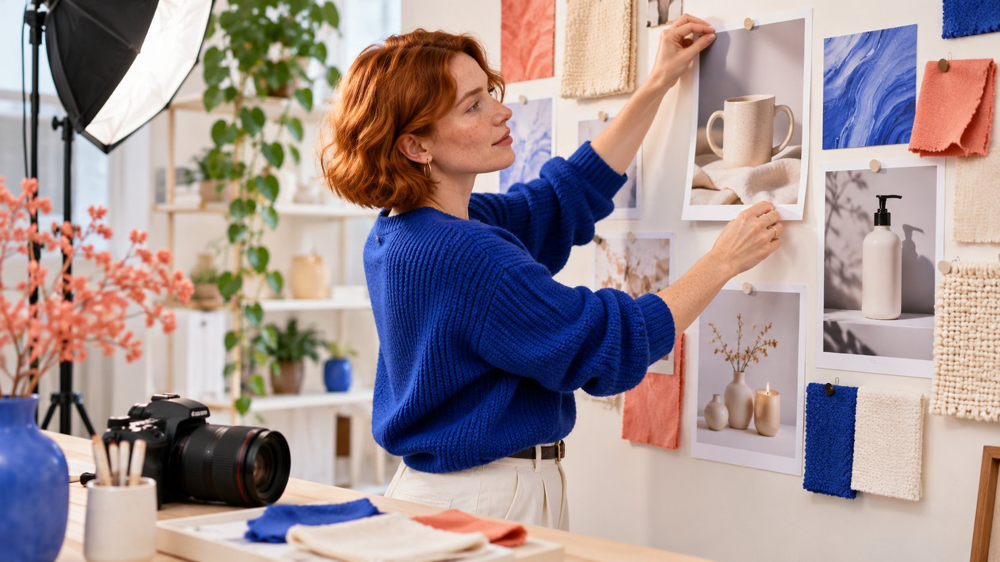
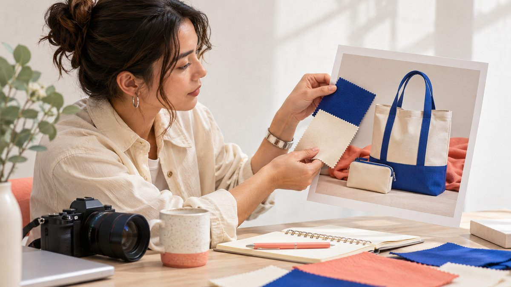

# 多达人内容怎样保持视觉一致

状态：本地审阅稿；正式发布日期待确认。

多人达人合作的 Instagram 视觉一致性，来自少量共同原则、准确产品与可辨认的个人表达，不是让每位创作者拍成同一个人。

多人合作时，Instagram 视觉一致性可以从三类共同原则开始：准确呈现产品，保留可辨认的品牌线索，让文字与动作易于理解。再为配色、构图或图文样式选择少量必要约定，明确哪些可由创作者自由表达。不要要求所有人的脸、家居与光线相同，也不要用统一滤镜改变商品颜色。先用少量实际作品检查共同效果，再修订 Brief；整齐的九宫格不是内容价值或营销结果的证明。

## 一致性先回答品牌需要被认出什么

“看起来统一”太宽泛。先问观众需要认出什么：同一个产品系列、同一场活动，还是一种清楚的内容结构？不同答案会带来不同的视觉约定。

如果品牌主要需要说明使用过程，动作清楚可能比背景完全一致更重要。如果是一组图文解释，标题位置与信息层次可能比创作者穿什么颜色更相关。

把这些需求写成能判断的原则，而不是只给一个审美形容词。例如“保留产品原色、让关键动作完整出现”，比“高级自然”更方便创作者执行。

视觉原则应当服务实际任务。不要为了让所有素材看起来像同一次拍摄，删除每位创作者最有价值的场景与表达。

## 把必须保留与可自由表达分开

共同原则可以包括准确产品、必要标识和文字层次。创作者自由表达可以包括自己的拍摄场景、语言、表情和解释方式，两者可以同时存在。

在 Brief 中分别写明，避免一句“参考品牌风格”让对方猜测哪些不可改变。也不要先说完全自由，审阅时才要求全部改成固定画面。

[UGC 制作职责文章](https://www.quickkol.com/zh/blog/ugc-content-creator-on-camera-production-role/#answer)帮助区分品牌、出镜者与制作人的工作。视觉合作同样需要知道谁提出方向、谁制作、谁能确认修改。

如果某项约定让创作者无法真实展示，就讨论替代方式。例如背景无法完全变成品牌色，可以用少量道具或图文线索保持联系，而不要求重建对方的生活环境。

## 参考板要说明原因，不只是收集漂亮图片

参考板可以放配色、材料、构图与文字示例，但每个例子都说明用途。是参考留白、动作距离，还是文字层次？不要让创作者猜测整张照片必须复制。

选择多个相关示例，避免一张图片同时承担全部规则。如果一个示例只是背景气氛，就明确产品、人物和个人经历不是需要照搬的部分。

[美国版权局的版权说明](https://www.copyright.gov/what-is-copyright/)介绍原创表达的保护。参考他人作品与获得其画面使用权是不同事情；正式素材和可公开使用的参考要按用途确认。

保留必要出处与范围，团队内部也不要把参考板中的照片直接当成创作者可交付素材。真正拍摄仍需要自己的作品与合适授权。

## 配色不能改变商品与肤色的真实信息

统一色调不应让产品、材料或人物肤色失真。品牌先说明哪些颜色与细节需要准确呈现，再讨论背景、道具和后期如何协调。

[Adobe 的产品摄影指南](https://www.adobe.com/creativecloud/photography/type/product-photography.html)讨论灯光、角度与色彩处理。它为制作提供基础，不能被理解为一种滤镜适合全部产品与拍摄条件。

创作者可以先提供实际场景试拍，比较产品在画面中是否仍然可信。若蓝色背景影响商品观感，优先调整布光或背景关系，而不是强行把所有内容染成同一种色。

尤其不要为了视觉一致掩盖重要产品特征。观众需要从达人作品理解真实物品，品牌辨识应帮助这种理解，而不是替代它。

参考颜色与材料关系，不要求不同创作者复制同一个场景。

## 构图一致可以来自相同的信息任务

不必要求所有创作者把产品放在画面同一个角落。可以约定共同信息任务：开场能看清主体，关键动作不被裁掉，说明文字不遮住演示。

这样不同场景仍然能形成联系。有人在厨房拍，有人在工作室拍，都可以通过相同的信息优先级让观众容易理解。

审核时指出具体缺失：手部动作太靠边、产品型号看不见，或文字覆盖关键部件。比要求“更像品牌”更能帮助制作人修改。

若需要用于不同位置，提前讨论裁切版本。创作者个人账户与品牌渠道可以有不同需求，但不要在交付以后默认所有画面都能任意裁成任何比例。

## 文字易读比装饰风格更先需要确认

统一字体与颜色可以帮助辨认，但观众首先需要读得清。检查真实手机尺寸，不只看设计软件里放大的版面；细字、复杂背景和低对比都可能影响阅读。

[W3C 的文字对比度说明](https://www.w3.org/WAI/WCAG22/Understanding/contrast-minimum.html)强调文字与背景有足够对比。这是网页可访问性资料，本文把其原则用于编辑参考，不把它说成 Instagram 官方视觉认证。

对达人图文，先减少不必要文字，给重要信息足够空间，再选择符合品牌的表达。不要因为参考板喜欢浅色，就把关键条件也做得难以看清。

可以保留几种适合不同图片背景的文字方案。共同原则是清楚，而不是每个场景必须使用相同的浅色字或装饰效果。

## 不要只用颜色表达重要区别

如果图文用不同颜色区分步骤、型号或状态，增加文字或其他可辨认线索。观众不一定以相同方式看见颜色，也可能只看到局部截图。

[W3C 的颜色使用说明](https://www.w3.org/WAI/WCAG22/Understanding/use-of-color.html)讨论了不应只靠颜色传递重要信息。对品牌与创作者，这可以转成简单做法：给对比对象命名，给步骤编号，或明确写出区别。

这些补充不需要破坏美感。清楚的文字层次可以成为共同风格的一部分，比用许多相近色让观众猜测更实用。

检查最终作品能否独立理解。即使没有看到参考板，也应知道创作者在比较什么，不依赖内部人员早已记住某个颜色代表哪个产品。

## 先看一组实际样本，再确认全批方向

在正式扩展前，拿少量实际场景样本放在一起看。检查品牌线索是否可辨认、创作者是否仍有个人表达，以及不同图片之间有没有事实或文字可读性问题。

样本不是一定要公开发布的测试，也不是保证表现的研究。它首先帮助团队发现制作约定是否足够清楚、是否适合这些真实拍摄条件。

如果多人都误解同一原则，先修改 Brief，而不是把每个人都当成没有执行。参考不清楚，往往会在整批内容里重复制造返工。

方向确认后保留具体样本与说明，但不要求后续作品逐像素复制。样本是帮助理解的依据，不应抹掉新内容中的实际情境。

## 把反馈写成能执行的视觉修改

“不够统一”很难直接修改。说明是哪项原则没有满足，以及希望保留什么。例如提高字幕与背景对比，同时保留创作者自己的语言；或补一个细节镜头，而不是重做全部场景。

[Canva 达人模板文章](https://www.quickkol.com/zh/blog/canva-instagram-templates-creator-kit-rights/#answer)提供另一种处理共同图文元素的方法。但模板只能承接清楚原则，不能替团队判断每张照片里的真实产品与动作。

如果修改超出原来约定，先讨论范围与时间。不要把新的审美偏好直接算成创作者本应免费完成的返工。

完成后检查具体改动，不因为文件换了名字就认为问题解决。反馈应帮助作品更准确、清楚且有联系，而不只是更接近审阅者个人喜好。

## 把共同风格留在可维护的简短说明里

最终说明可以包括共同原则、可自由表达的部分、实际样本和修改负责人。不必写成覆盖一切的厚规范，让创作者难以找到本次任务真正需要什么。

复盘时先看视觉是否帮助内容理解，再决定哪些原则值得保留。九宫格整齐、颜色接近或构图重复，都不能直接证明合作成功。

当产品、创作者或使用场景变化时，重新看受影响的部分。不要因为上一批好用，就让某种图文样式永久控制所有内容。

How to create a cohesive Instagram aesthetic 的达人营销答案，是让多人作品拥有清楚联系，同时保留每个人提供解释的理由。共同风格应该支持这种贡献，而不是取代它。

## 共同原则与个人表达

| 维度 | 共同原则 | 可变化部分 |
| --- | --- | --- |
| 产品 | 原色、型号与关键细节准确 | 真实使用场景 |
| 构图 | 关键动作可辨认 | 合适的角度与距离 |
| 文字 | 清楚、可读、层次明确 | 创作者的表达语言 |
| 风格 | 少量必要品牌线索 | 人物、环境与解释方式 |

编辑设计建议，不是 Instagram 分发规则或品牌效果保证。

## 交付多人视觉 Brief 之前

让共同原则容易理解，也容易修改。

- [ ] 说明需要被认出的具体内容。
- [ ] 区分必须保留与自由表达。
- [ ] 为参考示例注明原因与来源。
- [ ] 核对产品准确性与文字可读性。
- [ ] 用真实场景样本确认方向。
- [ ] 把反馈写成具体改动。

## 研究日期与使用边界

资料核验于 2026 年 11 月 18 日。文中方法、表格和决策规则为编辑建议，标为假设的示例不是实际客户结果或行业基准。外部资料的适用地区与时期按各段说明。

## 从任务开始达人研究

用 QuickKOL 理解 Brief、发现相关达人并研究作品与联系路径；数据、合作条件和结果仍需核验。

[了解 QuickKOL](https://www.quickkol.com/#capabilities)

## 来源

- [美国版权局的版权说明](https://www.copyright.gov/what-is-copyright/)
- [Adobe 的产品摄影指南](https://www.adobe.com/creativecloud/photography/type/product-photography.html)
- [W3C 的文字对比度说明](https://www.w3.org/WAI/WCAG22/Understanding/contrast-minimum.html)
- [W3C 的颜色使用说明](https://www.w3.org/WAI/WCAG22/Understanding/use-of-color.html)
