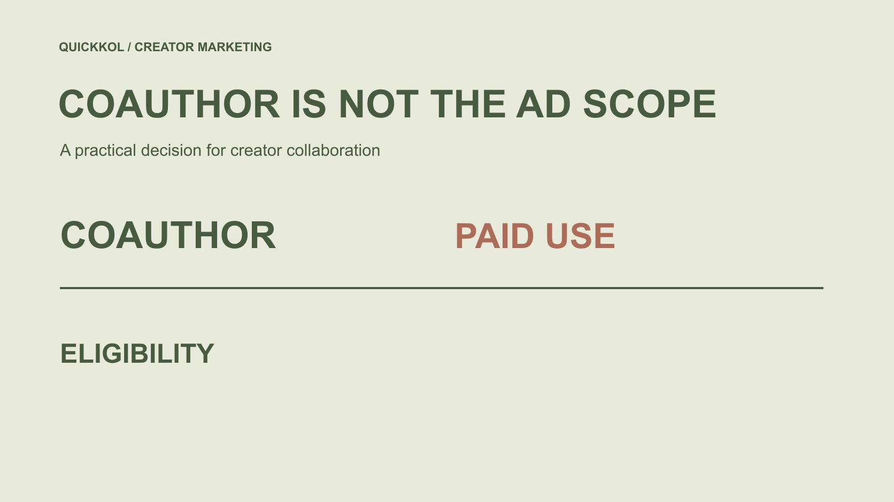
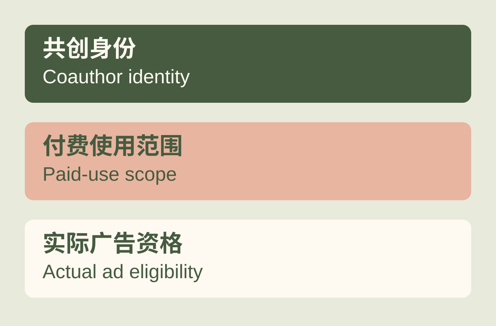

# Can You Boost Collab Posts on Instagram?

Status: local review draft; confirm the publication date before release.

Co-authoring, partnership-ad permission and ad eligibility are different questions. Assess the actual post and agreement before paid amplification.

QuickKOL editorial graphic; not actual account metrics or a platform interface.

Eligible Instagram creator content can be used in partnership ads, but a Collab co-author credit does not mean every account can directly tap Boost. Distinguish co-publication from paid advertising, then check the actual post’s current advertising route or eligibility messages, account permissions and the creator’s agreement for this use. Meta describes turning organic work into partnership ads and includes Collabs in its content-hub discussion; this is not a universal boosting guarantee. A visible original post is not confirmation of eligibility or permission.

## Define what boosting means in this assignment

When a team says boost the Collab, it may mean a promotion route on the post or a partnership ad created in an advertising interface. Establish the actual objective instead of letting one word conceal different execution methods.

Record the work, public identity, destination and intended usage period. Organic publication and paid use may concern one asset without being one commercial decision.

The [Instagram advertising-handoff article](https://www.quickkol.com/blog/instagram-ads-creator-placement-preflight/#answer) separates content from ad execution. This guide focuses on the next decision for co-authored work rather than a fixed button path for every account.

If publisher and ad operator differ, confirm the exact post first. A screenshot or similar title does not replace its address and version. The resulting request should be clear enough that neither person needs to infer whether the brand wants the existing public work amplified or a separately prepared advertising version. That distinction affects both creator discussion and execution.

## Co-authoring describes the publication relationship

[Meta’s Instagram Collabs announcement](https://about.fb.com/news/2023/08/music-and-collabs-on-instagram/amp/) described co-authoring and invitation acceptance for posts, carousels and Reels in 2023. It explains a publication role, not every current advertising condition.

Accepting a Collab places the work in a shared public relationship without granting arbitrary ad uses. A name on a post is not automatic consent to continuing paid distribution.

Retain the publisher, collaborators and public-work record, then confirm the advertising task separately. A co-author invitation, commercial disclosure and ad permission should not become one supposedly automatic checkbox.

Resolve differences in scope before paid use. Technical access to a route does not replace agreement about the actual purpose. A clear record lets the brand explain what is changing from the original publication and lets the creator decide whether that change fits the work, duration and identity use they are prepared to authorize.

## Partnership ads provide a paid-use route

[Meta’s partnership-ad introduction](https://about.fb.com/news/2024/02/creator-marketplace-for-brands-and-creators-to-collaborate-on-instagram/) explains in 2024 that advertisers can use organic content for partnership ads or create new partnership ads in Ads Manager. It describes an advertising route rather than an identical Boost button on every original post.

Decide whether the task preserves the original work or prepares separate ad content. If crop, caption or destination differs, identify that relationship instead of quietly changing expression already agreed by the creator.

When the creator's account identity forms part of advertising, state the scope. Ordinary brand-asset permission should not silently expand to every ad using that identity.

Once the route is chosen, the actual operator checks current account and post support. This research did not test a signed-in ad account and supplies no universally guaranteed interface location. The public product explanation is a starting point for the work decision, while the account's actual available route determines what can be executed now.

## Discovery in a content hub is not permission

[Meta’s partnership-content hub update](https://about.fb.com/br/news/2025/12/novas-ferramentas-com-ia-para-escalar-parcerias-entre-criadores-e-marcas/amp/) discusses discovery in late 2025 and notes Collabs added to its recommendation area that year. Its 2026 update should be read through the dates attached to each passage.

That supports researching existing creator work, while discovered, recommended and permitted for advertising remain different outcomes. A work appearing in a system does not establish permission for the asset and identity uses.

Permission methods described for different platforms should not merge into fixed Instagram instructions. Check the actual current route instead of importing every menu from another platform's example.

For a candidate work, retain source and intended use before discussing it with the creator. Research helps formulate a request without completing the request. This distinction prevents a convenient discovery interface from being treated as a substitute for the brand's own responsibility to establish why and how the work may be used.

One work still involves separate publication, permission and advertising decisions.

## Check eligibility on the actual post

Use the operations offered by the current post and advertising account to inspect an available route or specific message. Record the post, account and version concerned instead of saying only cannot boost.

If a message concerns content or permission, route it to the relevant owner. One missing entry point does not establish creator unsuitability, account enforcement or incompatibility of every Collab.

Use current official help for unresolved conditions and retain uncertainty. This guide invents no universal repair involving account type, audio selection or collaborator count.

The check should establish whether this assignment can proceed and whether a verified alternative exists. It should not mean trying arbitrary changes until a warning disappears. A useful handoff states the actual obstacle and the information needed next, keeping the work decision tied to evidence rather than an unsupported diagnosis of the creator's account.

## Include audio and modifications in usage checks

Check music, footage and other materials against the proposed ad use. Public playback of the original does not establish the brand's advertising scope.

The [U.S. Copyright Office’s copyright overview](https://www.copyright.gov/what-is-copyright/) explains protection for original expression. Return to source and intended use for specific permission instead of deriving every right from downloadability or exportability.

If music replacement or re-editing is needed, confirm that the new expression remains accurate with the creator. A technical adjustment should not alter experience, product conclusions or the relationship of people shown.

Retain a definite version for this advertising task. It can differ from the organic version with explainable changes, rather than leave the operator to select a similar-looking file. This also makes later review possible: the brand can identify what was actually advertised instead of assuming that every public and paid version contained the same words and conditions.

## Hand off purpose and responsibility before execution

Give the operator the work URL, confirmed version, intended use and relevant permission state. Parties agree compensation, term and modifications for the task; this article invents no universal industry rate.

The brand owns destination, product facts and advertising arrangements, while the creator confirms their expression and agreement. Responsibilities can vary without being left for the person clicking a button to infer.

The [whitelisting-and-partnership use article](https://www.quickkol.com/blog/what-is-whitelisting-creator-ad-permissions/#answer) distinguishes advertising permission from account ownership. Use the formal permission route rather than turn collaboration into a request for a password.

If something is unconfirmed, state what waits. Preparation can have a clear status without merging commercial agreement and technical availability into done merely to make progress appear faster. A precise handoff helps the operator execute the authorized work while recognizing which proposed uses have not yet become part of the agreement.

## Check a hypothetical co-authored Reel

Imagine a brand and creator co-authoring an equipment Reel that the brand later wants to promote. Confirm the actual original, the agreed paid use and whether the version will remain or change.

The operator checks the current route and eligibility. If an asset needs replacement, identify the change, review expression and obtain the corresponding agreement. Successful organic publication does not remove the need to check the ad version.

If execution is unavailable, hand off the particular reason and next action without reporting a launched ad. Do not delete the original automatically unless the actual decision and scope call for it.

This is an editorial hypothetical without a real account test or client result. It separates visible co-authored work, a paid-use request, completed permission and actual execution. That gives the team a practical decision path without implying that every Collab can follow exactly the same route or that one successful setup establishes support for every later post.

## Review paid and organic observations separately

Once advertising begins, retain the version, period, objective and actual record. Do not add every organic and paid number and label the total natural creator distribution.

The [creator-ad measurement article](https://www.quickkol.com/blog/creator-campaign-measurement/#answer) helps keep metrics in scope. Without appropriate deduplication or attribution, state the limit instead of assuming similar counts represent different people or purchases.

For another round, consider actual observation, contribution and agreement term. One ad's performance does not create permanent permission, and strong organic interaction does not guarantee paid results.

Review should tell both parties what was learned: which explanation needs improving, whether the destination matched and whether another format is worth producing. That makes the paid-use decision part of a continuing content judgment rather than a conclusion that amplification alone proves the creator was successful or unsuccessful for every future assignment.

## Give a scoped decision to proceed or wait

The conclusion can be specific: this content can proceed through the current account route and the intended use is agreed, or a qualification, asset or permission remains pending with a named owner.

Avoid universal answers that all Collabs can or cannot be boosted. Product updates, account conditions and particular work affect execution; a scoped conclusion supports the next action.

The reliable answer to can you boost collab posts on Instagram is that eligible content has partnership-ad routes, while co-authoring alone completes neither eligibility nor commercial agreement. Check before deciding on this assignment.

That protects creator contribution and gives the operator genuinely executable material instead of treating an organic public post as an asset for arbitrary amplification. The useful endpoint is a clear decision about the particular work, including what is authorized now and what information must still be established.

## Separate checks before amplifying co-authored work

| Question | Confirm | Does not replace |
| --- | --- | --- |
| Co-publication | Original work and participating accounts | Paid-use agreement |
| Asset and identity use | Specific version and scope | Technical eligibility |
| Account and post eligibility | Current route and messages | Asset permission |
| Execution and review | Actual ad and observation period | Permanent rights or guaranteed results |

Decision framework; no claim of identical Boost access or a universal fix for every Collab.

## Before moving a Collab into advertising

Connect the organic work with the proposed paid use.

- [ ] Confirm the post and version.
- [ ] Separate co-authoring and paid agreement.
- [ ] Check current advertising route and eligibility.
- [ ] Check audio, assets and modifications.
- [ ] Hand off permission state and owner.
- [ ] Record organic and paid observations separately.

## Research date and limitations

Sources reviewed November 18, 2026. Methods, tables and decision rules are editorial recommendations. Hypothetical examples are not actual client results or industry benchmarks. Source geography and periods are specified where relevant.

## Start creator research with a clear task

Use QuickKOL to interpret a brief, discover relevant creators and research their work and contact routes. Verify data, commercial terms and outcomes at their source.

[Explore QuickKOL](https://www.quickkol.com/#capabilities)

## Sources

- [Meta’s Instagram Collabs announcement](https://about.fb.com/news/2023/08/music-and-collabs-on-instagram/amp/)
- [Meta’s partnership-ad introduction](https://about.fb.com/news/2024/02/creator-marketplace-for-brands-and-creators-to-collaborate-on-instagram/)
- [Meta’s partnership-content hub update](https://about.fb.com/br/news/2025/12/novas-ferramentas-com-ia-para-escalar-parcerias-entre-criadores-e-marcas/amp/)
- [U.S. Copyright Office’s copyright overview](https://www.copyright.gov/what-is-copyright/)
