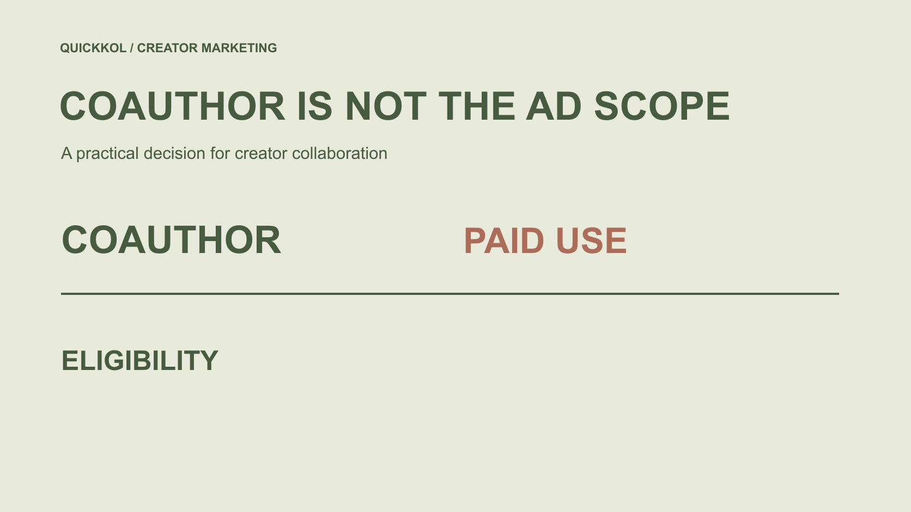
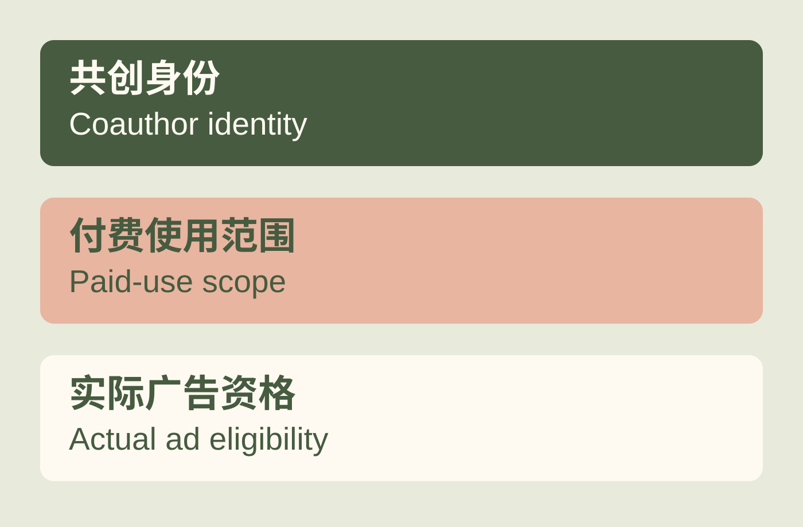

# Instagram 共创帖能否推广

状态：本地审阅稿；正式发布日期待确认。

共创署名、合作广告权限和实际广告资格是不同问题，按具体帖子与约定决定能否付费推广。

QuickKOL 编辑图形；不呈现真实账号指标或平台界面。

符合条件的 Instagram 创作者内容可以用于合作广告，但一个帖子有 Collab 共创署名，不代表所有账户都能直接点 Boost。先区分共同发布与付费广告，再核对具体帖子的当前广告入口或资格提示、相关账户权限，以及创作者对这次用途的约定。Meta 的官方资料讨论了将自然内容转为合作广告，也提到 Collabs 出现在相关内容中心；它不构成所有共创帖通用的推广保证。没有确认资格与许可前，不要把原帖可见当成已经可以投放。

## 先明确你说的推广是哪种工作

团队说“把共创帖推一下”，可能指原帖的推广入口，也可能指通过广告后台建立合作广告。先确认实际目标，不要让同一个词掩盖不同执行方式。

品牌希望推广的内容、公开署名、目标去处和使用期间，都需要有明确记录。自然发布与付费使用可能涉及同一作品，但不是同一个合作决定。

[Instagram 广告交接文章](https://www.quickkol.com/zh/blog/instagram-ads-creator-placement-preflight/#answer)帮助把素材与广告工作分开。本篇集中在原帖拥有共创署名时，怎样判断下一步，而不是提供适用于全部账户的固定按钮路径。

如果发布者和广告操作者不是同一个人，先让双方确认正在讨论哪个帖子。一个截图或相似标题，不能替代实际地址和版本。

## 共创署名说明共同发布关系

[Meta 的 Instagram 共创说明](https://about.fb.com/news/2023/08/music-and-collabs-on-instagram/amp/)在 2023 年介绍了帖子、轮播和 Reel 的共同署名与接受邀请。它帮助理解 Collabs 的发布角色，不应被当成所有当前广告条件的完整说明。

创作者接受共创，让内容出现在相关公开关系中，不等于同意任意广告用途。品牌不能只根据名字已经出现在帖子上，就默认对方同意后续长期投放。

保留实际发布者、协作者与公开作品记录，再单独确认广告任务。不要把共创邀请、商业合作说明和广告权限当成一个自动联动的勾选。

如果有人对合作范围理解不同，先在投放前解决。技术上能操作某个入口，也不应代替双方确认实际同意的用途。

## 合作广告提供一种付费路线

[Meta 的合作广告介绍](https://about.fb.com/news/2024/02/creator-marketplace-for-brands-and-creators-to-collaborate-on-instagram/)在 2024 年说明，广告主可以将自然内容用于合作广告，也可以在 Ads Manager 建立新的合作广告。文章讨论的是广告路线，不是承诺每个原帖都有相同 Boost 按钮。

因此团队可以先确认希望沿用原作还是另建广告内容。若需要不同裁切、文案或目标页，就明确它与原作的关系，不要悄悄改变创作者已经确认的表达。

创作者的账户身份是广告的一部分时，使用范围也要说清。不要把普通品牌素材授权，未经讨论就扩大为带创作者身份的所有广告。

选择路线后，再由实际广告操作者核对当前账户与帖子支持。本文没有登录账户测试，不提供一个保证适用的界面位置。

## 内容中心里的发现不等于已经获准使用

[Meta 的合作广告内容中心更新](https://about.fb.com/br/news/2025/12/novas-ferramentas-com-ia-para-escalar-parcerias-entre-criadores-e-marcas/amp/)在 2025 年底说明相关内容发现，并提到当年加入推荐区的 Collabs。页面也有 2026 年更新，需要按各段日期理解。

这支持品牌研究现有创作者内容，但被发现、被推荐和已经获准投放是不同结果。不要把系统中出现一条作品，当成素材与身份用途都已完成确认。

文章里不同平台的权限方式，也不能全部混成 Instagram 的固定操作。品牌应核对当前实际路线，而不是从另一平台的示例推导所有菜单相同。

对候选作品，先保留来源和拟议用途，再与相关创作者沟通。内容研究帮助提出请求，不自动完成请求。

同一条作品，仍有不同的发布、授权与广告决定。

## 按具体帖子核对资格提示

进入当前帖子与广告账户能够提供的操作范围，查看是否出现可用路线或具体提示。记录问题对应哪个帖子、账户与版本，不只写“不能推”。

如果提示涉及内容或权限，由相应负责人核对。不要因为一个入口没有出现，就推断创作者不适合合作、账号被处罚，或所有共创帖都不支持。

可以向当前官方帮助确认仍不清楚的条件，保留未知。本文不编造一个账号类型、音乐选择或协作者数量的万能修复方法。

资格核对的目标是决定本次能否执行，以及如果不能，是否有经过确认的替代方案。不是要求团队尝试各种改动直到系统不再提示问题。

## 素材用途包括音乐与修改范围

自然内容中的音乐、画面或其他素材，需要与拟议广告用途一起核对。作品已经公开、能够被播放，不能单独证明品牌广告使用范围。

[美国版权局的版权说明](https://www.copyright.gov/what-is-copyright/)介绍原创表达保护。具体素材的许可，需要回到来源与实际用途，不从可下载或可导出推导全部权利。

若需要替换音乐或重剪，先与创作者确认新的表达是否仍准确。不要让一项技术调整改变个人体验、产品结论或画面中人物的实际关系。

保留一份适合这次广告任务的明确版本。它可以与自然版本不同，但应有可说明的变化，而不是投放者临时选一份看起来相近的文件。

## 投放前把用途与责任交接清楚

给实际操作者交付作品地址、确认版本、拟议用途与相关权限状态。费用、使用期间、可以修改什么，由双方按任务确认，不在文章里编行业统一价格。

品牌负责目标页、产品事实与广告安排，创作者确认与本人有关的表达和约定。具体分工可以不同，但不能留给最后点击按钮的人临时猜测。

[白名单与合作广告用途文章](https://www.quickkol.com/zh/blog/what-is-whitelisting-creator-ad-permissions/#answer)帮助区分广告权限和账号所有权。执行时使用正式权限方式，不需要让合作沟通变成对方交出密码。

如果某项尚未确认，说明什么需要等待。准备完成可以有明确状态，但不要为了让进度看起来更快，把商业同意与技术可用合并成一个模糊“好了”。

## 用一条假设共创 Reel 检查决定

假设品牌与创作者共同发布一条器具 Reel，品牌想继续付费推广。先确认实际原帖、创作者同意的付费用途，以及准备沿用或调整的版本。

操作者检查当前路线与资格。如果某项素材需要更换，先说明变化、核对表达并完成相应确认；不能因为原帖曾经发布成功，就跳过广告版本检查。

如果当前不能执行，交接具体原因与下一步，不写成已经投放。也不要直接删除原帖，除非实际决定需要且有明确范围。

这是编辑假设，没有真实账户测试或客户结果。它说明可见共创、可以请求付费使用、完成许可与真正执行广告，是不同阶段。

## 广告结果与自然表现分别复盘

广告开始以后，保留广告版本、时间、目标与实际记录。不要把自然内容与付费内容的所有数字直接相加，再写成创作者自然传播效果。

[创作者广告测量文章](https://www.quickkol.com/zh/blog/creator-campaign-measurement/#answer)帮助把不同指标放回各自范围。没有合适的去重或归因资料，就明确限制，不把两个相似计数默认视为不同的人或已经发生购买。

如果品牌希望下一轮继续使用，回到实际表现、内容贡献与协议期间判断。不把某次广告表现推导为永久授权，也不把自然互动较好当成投放保证。

复盘应让创作者和品牌知道具体学到了什么，例如哪个解释需要改进、目标页是否一致，以及是否值得再做一种内容。

## 给出有范围的可以或暂不能

最后结论可以很具体：这条内容在当前账户路线中可执行，并且这次用途已确认；或者仍缺某项资格、素材或许可，需要谁继续处理。

不要只交付“共创都能推”或“共创都不能推”的全局答案。产品更新、账户情况与具体内容都会影响实际工作，范围清楚才能继续执行。

Can you boost collab posts on Instagram 的可靠答案，是符合条件的内容有合作广告路线，但共同署名本身不完成广告资格与商业同意。先核对，再对本次任务作决定。

这样品牌能保护创作者贡献，也让广告负责人收到真实可执行的材料，不把公开自然帖误当成可以任意放大的资产。

## 推广共创内容前的不同确认

| 问题 | 确认什么 | 不能替代 |
| --- | --- | --- |
| 共同发布 | 实际原帖与参与账户 | 付费同意 |
| 素材与身份用途 | 具体版本与范围 | 技术广告资格 |
| 账户与帖子资格 | 当前可用路线与提示 | 素材许可 |
| 执行与复盘 | 实际广告与观察期 | 永久授权或保证结果 |

决策框架，不宣称每个共创帖有相同 Boost 按钮或通用修复方式。

## 从共创帖进入广告之前

把自然作品与拟议付费用途连接清楚。

- [ ] 确认具体帖子与版本。
- [ ] 分开共同署名与付费同意。
- [ ] 核对当前广告路线与资格。
- [ ] 检查音乐、素材和修改范围。
- [ ] 交接权限状态与负责人。
- [ ] 分别记录自然与付费表现。

## 研究日期与使用边界

资料核验于 2026 年 11 月 18 日。文中方法、表格和决策规则为编辑建议，标为假设的示例不是实际客户结果或行业基准。外部资料的适用地区与时期按各段说明。

## 从任务开始达人研究

用 QuickKOL 理解 Brief、发现相关达人并研究作品与联系路径；数据、合作条件和结果仍需核验。

[了解 QuickKOL](https://www.quickkol.com/#capabilities)

## 来源

- [Meta 的 Instagram 共创说明](https://about.fb.com/news/2023/08/music-and-collabs-on-instagram/amp/)
- [Meta 的合作广告介绍](https://about.fb.com/news/2024/02/creator-marketplace-for-brands-and-creators-to-collaborate-on-instagram/)
- [Meta 的合作广告内容中心更新](https://about.fb.com/br/news/2025/12/novas-ferramentas-com-ia-para-escalar-parcerias-entre-criadores-e-marcas/amp/)
- [美国版权局的版权说明](https://www.copyright.gov/what-is-copyright/)
