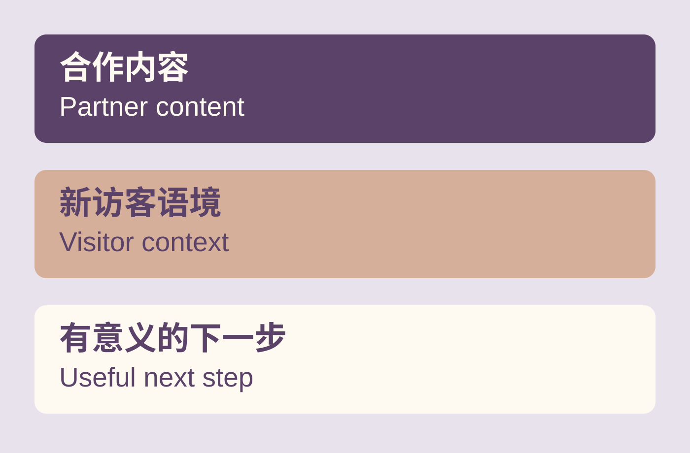

# Instagram Follower Growth: Welcome New Visitors

Status: local review draft; confirm the publication date before release.

When creator work brings new visitors, let the brand account continue the explanation and help people decide whether following is useful.

QuickKOL editorial graphic; not actual account metrics or a platform interface.

If you ask how could I get more followers on Instagram, start a creator partnership with what a new visitor will understand after arriving. Choose a relevant creator, make the work independently useful and ensure the destination account explains its identity, continuing value and related content. Following is a visitor’s choice, not an inevitable result of watching a partnership video. Check continuity from work to profile and observe visits, follows and later interaction separately instead of reporting distribution as attributable net follower growth.

## Define who would benefit from following

A brand does not need every viewer to follow. Identify who would benefit from continuing content and why a creator can reach and explain the relevant question to them.

A storage-equipment brand serving small-space users should research creators who can explain those settings. A large account alone does not establish that its work will bring visitors interested in that subject.

Frame the goal as an invitation grounded in content rather than a follower number detached from the work. Numbers can support observation without requiring a creator to turn every viewer into a brand follower.

This also clarifies the contribution: explanation, real setting, understanding of a problem or connection with existing brand content. The answer directs research. A useful shortlist should say why the person's work relates to the continuing value the brand plans to offer, not merely that the creator has enough people who might be asked to follow.

## Assume visitors may have encountered only a fragment

A visitor may not have seen the complete partnership. A friend's share, text fragment or reply may come first, so the destination should not require full campaign knowledge to understand basic information.

[Meta’s 2025 Instagram sharing-feature guide](https://about.fb.com/news/2025/08/new-instagram-features-help-you-connect/amp/) describes public-content reposting, original attribution and possible discovery by people who do not yet follow. This is context for an opportunity, not identical exposure promised to every partnership.

The brand's task is an understandable route: correct account, clear subject and relevant explanation. A visitor lacking context should not automatically be classified as outside the intended audience.

When checking the route with the creator, consider someone who encountered only a fragment. Related work should help them continue understanding instead of sending them through unrelated campaigns to find an answer. This makes visitor preparation a concrete content task rather than an attempt to predict exactly where every new viewer will come from.

## Explain identity and continuing subject on the profile

A profile should establish which brand or creator it represents and what it regularly offers. Name, bio and recent work should support one another rather than describe unrelated campaigns.

The question raised by the creator needs a clear public destination. If the work concerns small-space use, the profile need not discuss only that product, but relevant explanation should be findable.

The [Instagram account-identity article](https://www.quickkol.com/blog/instagram-accounts-collaboration-identity-map/#answer) helps check the actual collaboration account. A similar display name is insufficient for a mention; confirm destination and current username before publication.

The bio need not become a long sales pitch. Preserve identity and content value so a visitor can decide whether to continue instead of encountering every promotion first. A simple profile review can ask what a newcomer would believe the account is about and whether that understanding matches the reason the creator gave them to visit.

## Welcome visitors through useful related work

A welcome message can be friendly, but useful related work carries the handoff. Prepare explanation connected to the partnership question: different conditions, an easily missed step or a distinction needed for selection.

Reposting the same creator work does not automatically give visitors new information. The brand can supply its own facts and context while preserving the creator's expression and source.

For original creator material, confirm reposting, editing and channel scope. Welcoming visitors does not expand permission automatically or allow changes to meaning.

Inspect existing relevant work before commissioning many new posts for one collaboration. The purpose is to close a comprehension gap, not increase publication volume. A newcomer should be able to recognize why the supporting content follows from the work they saw, rather than encounter a set of loosely related assets assembled only because they were available.

Visitors first understand the work and account, then choose whether to follow.

## Do not treat platform guidance as a universal growth formula

[Meta’s Instagram creator-guidance announcement](https://about.fb.com/news/2024/10/best-practices-education-hub-creators-instagram/) introduced creation, engagement and reach topics in 2024, including personalized advice. That supports account context rather than identical posting frequency or video length for everyone.

Ask the account owner to inspect current available guidance and consider the collaboration's work. Do not impose an older tutorial's number on every creator when questions and conditions differ.

If newcomers cannot understand the profile, first improve identity, subject or relevant content instead of continually increasing output. More publication does not necessarily restore a missing explanation.

Retain the problem each adjustment is intended to solve. A justified small change is easier to understand than changing every profile element simultaneously, and makes later observation clearer. It also lets the creator assess how their work connects to the destination without being asked to compensate for unrelated gaps in the brand's account preparation.

## Keep the reason to follow consistent with actual delivery

If a creator invites people to the brand account for further explanation, the account should offer it. More should not become a promise without a plan, owner or actual work.

Continuing value might be practical content on the subject, event follow-up or product explanation. It need not exaggerate frequency or suggest that people must follow to receive essential information.

Provide important product conditions directly rather than hide them to obtain follows. Following should remain an informed choice instead of an additional gate to understanding the work.

Check invitation wording with the creator so it fits their expression and actual scope. A person commissioned for one piece should not appear to promise a continuing role on the brand account. The audience should understand both what the account offers and what the creator has actually contributed, without a short-term partnership being presented as an ongoing relationship that has not been agreed.

## Keep commercial context understandable to visitors

New visitors should also understand the relationship between work and brand. Payment, gifts or another material connection remain relevant when content is shared, captured or excerpted.

[FTC’s influencer disclosure guide](https://www.ftc.gov/business-guidance/resources/disclosures-101-social-media-influencers) explains the principles for applicable US contexts. Inspect the final public content instead of assuming that readers know what the internal team knows about the partnership.

If destination content continues quoting personal experience, retain meaning and conditions. A stronger follow invitation should not turn one genuine observation into unconditional endorsement.

These checks support accurate expression. They do not require identical wording for every work; they require the relationship, experience and facts to be understandable in the actual format. Keep them connected when preparing a brand-owned explanation so the visitor does not encounter a commercial recommendation stripped of the context that was present in the creator's original post.

## Observe visits, follows and continuing interaction separately

Record public-work performance, available account-visit information, follower changes and later interaction separately. They may relate without being interchangeable.

The [creator-engagement data article](https://www.quickkol.com/blog/read-creator-engagement-data/#answer) explains metric scope. Total follower change can involve unfollows, other content and other sources; timing during a partnership does not attribute everything to that creator.

If the available information cannot connect a visit with a follow, state that limit. Do not use an account total as a precise conversion rate or turn an unknown into zero.

Review the continuity first: can visitors identify the account, understand relevant content and receive answers? Those observations inform the next action without replacing attribution evidence. A clear report can describe both the operational improvement and the measurement limit, allowing the brand to learn from a useful collaboration without assigning an unsupported follower result to the person who produced it.

## Check continuity through a hypothetical storage partnership

Imagine a creator showing an item placed in a small kitchen. The brand confirms account identity, prepares relevant dimensions and actual-use content, then assigns specification questions to the appropriate responder.

A visitor can understand the demonstration without following. If continuing content seems useful, they can choose to follow; the brand need not repeat the request in every reply.

Review identifies unanswered questions and whether another explanation under different conditions would help. Without supporting evidence, do not credit the week's entire net follower increase to this work.

This is an editorial hypothetical, not a customer result. It shows growth preparation starting with accurate continuity instead of demanding more promotional sentences from a creator. The collaboration has a content purpose whether or not every visitor follows, and the brand can evaluate what it learned before deciding how to invite the next relevant audience. The next brief should reflect that learning rather than simply raise the requested follower target.

## Carry a specific improvement into the next partnership

Hand off one specific improvement: revise identity wording, organize a relevant demonstration or assign a question's responder. Continue growing followers is not an actionable next step without ownership.

If work attracts people unrelated to the task, revisit subject and creator relevance. The profile does not always need changing, and the same creator should not automatically be asked to post more.

Retain observations and scope, reassessing when product, market or contribution changes. A previously useful welcome approach can inform the next collaboration without permanently governing every assignment.

The brand-side answer to how could I get more followers on Instagram connects creator contribution with continuing account value. Help arriving people understand why staying may be useful, then observe outcomes honestly. That leaves both parties with a clearer next decision and preserves following as the audience's choice rather than an outcome the content producer was assumed to guarantee.

## What to check for new visitors

| Touchpoint | Reader needs | Brand action |
| --- | --- | --- |
| Creator work | Question and actual contribution | Confirm work and destination |
| Brand profile | Identity and regular value | Keep a clear subject |
| Related work | Useful further explanation | Organize actual information |
| Response | Who can answer | Assign the appropriate owner |
| Review | Observations and limits | Separate visits, follows and attribution |

Visitor-continuity framework; no follower or partnership-return guarantee.

## Visitor check before creator publication

Review as someone without campaign background.

- [ ] Define who benefits from continuing content.
- [ ] Verify the destination account.
- [ ] Make relevant explanation findable.
- [ ] Promise only content that will be provided.
- [ ] Assign factual and experience responses.
- [ ] Record visits, follows and later interaction separately.

## Research date and limitations

Sources reviewed November 18, 2026. Methods, tables and decision rules are editorial recommendations. Hypothetical examples are not actual client results or industry benchmarks. Source geography and periods are specified where relevant.

## Start creator research with a clear task

Use QuickKOL to interpret a brief, discover relevant creators and research their work and contact routes. Verify data, commercial terms and outcomes at their source.

[Explore QuickKOL](https://www.quickkol.com/#capabilities)

## Sources

- [Meta’s 2025 Instagram sharing-feature guide](https://about.fb.com/news/2025/08/new-instagram-features-help-you-connect/amp/)
- [Meta’s Instagram creator-guidance announcement](https://about.fb.com/news/2024/10/best-practices-education-hub-creators-instagram/)
- [FTC’s influencer disclosure guide](https://www.ftc.gov/business-guidance/resources/disclosures-101-social-media-influencers)
