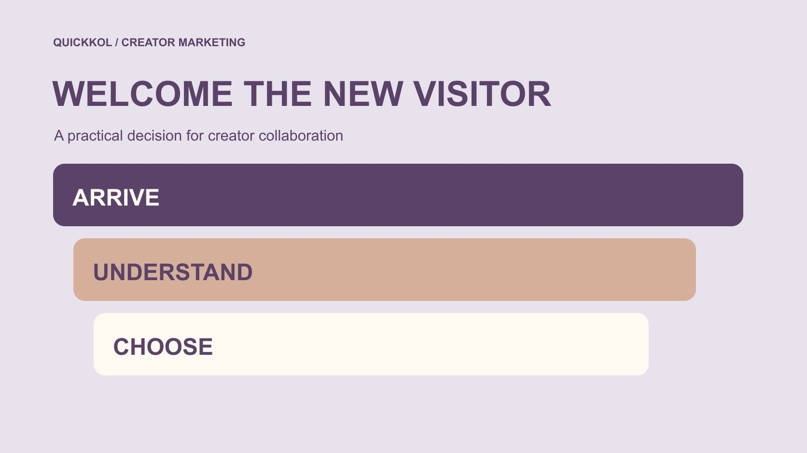
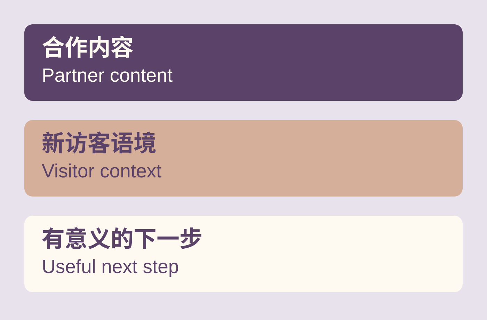

# 达人合作怎样迎接新访问者

状态：本地审阅稿；正式发布日期待确认。

达人作品带来新访问时，让品牌账户继续提供同一问题的清楚解释，帮助读者判断关注是否对自己有用。

QuickKOL 编辑图形；不呈现真实账号指标或平台界面。

如果你问 how could I get more followers on Instagram，达人合作可以从“新访客来了以后能理解什么”着手。选择真正相关的创作者，让作品提供独立价值，再让目标账户清楚说明自己是谁、继续提供什么、相关内容在哪里。关注是一项由访客作出的选择，不是看过合作视频就必然发生。品牌应检查作品到主页的语境是否连贯，分别观察访问、关注与后续互动，不把传播量直接写成合作带来的净增关注。

## 先说明希望谁关注以及为什么

品牌不需要让每一个看到作品的人都关注。先写清哪些人会从持续内容得到帮助，以及创作者为什么能够触达和解释相关问题。

例如收纳器具品牌希望为小空间使用者持续提供演示，就应研究能讲清这些场景的创作者。仅仅有很大账号规模，不说明其作品会带来对这个内容有兴趣的访客。

把目标写成有内容依据的邀请，而不是一个脱离作品的关注数字。数字可以用于项目观察，但不能先决定创作者必须把所有观众都转换成品牌粉丝。

这一步也帮助选择贡献方式：需要的是解释、真实场景、对问题的理解，还是与品牌已有内容的连接？明确之后，研究才有方向。

## 为只看过一个片段的访客补充语境

新访客不一定看过完整合作。他们可能先看到朋友分享、某段文字或一条回复，因此品牌账户不应要求他们先了解全部活动才能理解基本信息。

[Meta 的 2025 年 Instagram 分享功能说明](https://about.fb.com/news/2025/08/new-instagram-features-help-you-connect/amp/)介绍了公开内容的转载与原作者署名，也说明作品可能到达尚未关注的读者。这是分发机会的背景，不是承诺每次合作都获得相同曝光。

品牌要做的是保留容易理解的入口：正确账户、清楚主题与相关说明。不要把访客不知道背景，误认为他们不属于目标受众。

与创作者检查这条路径时，模拟一个只看过片段的人会遇到什么。相关作品应能带人继续理解，而不是让其在大量无关活动中寻找答案。

## 主页先交代身份与持续主题

主页需要让访客知道这是哪个品牌或创作者，以及平常提供什么。名称、简介与近期内容应当互相支持，而不是每处都表达不同活动。

达人带来的问题可以在公开内容中有清楚去处。若作品讨论小空间使用，主页不必只讲这一件产品，但应让相关说明容易找到。

[Instagram 账号身份文章](https://www.quickkol.com/zh/blog/instagram-accounts-collaboration-identity-map/#answer)帮助核对合作中的实际账户。不要只凭显示名称相似就让创作者提及，发布前确认目标地址与当前用户名。

不需要把简介写成长篇销售文案。先保留清楚身份与内容价值，让访客有依据判断是否继续看，而不是把所有促销都放在最先遇到的位置。

## 让相关作品完成承接，而不是只发欢迎语

欢迎语可以友好，但真正承接需要内容。准备与合作问题有关的解释，例如不同使用条件、一个容易遗漏的步骤或产品选择中需要理解的区别。

不要只把创作者作品再次发一遍，就认为访客获得了新信息。品牌可以提供自己的事实与补充，创作者则保留其个人表达与来源。

如果使用达人原作，确认转载、剪辑和渠道范围。欢迎访客的需要，不自动扩大素材授权，也不让品牌可以随意改变原意。

可以先检查已有相关内容是否足够，不必为一次合作自动新增很多帖子。内容承接的目标是减少理解缺口，而不是增加发布数量。

访客先理解内容与账户，再决定是否持续关注。

## 不要把平台建议当成统一增长公式

[Meta 的 Instagram 创作者建议入口](https://about.fb.com/news/2024/10/best-practices-education-hub-creators-instagram/)在 2024 年介绍了创作、互动、触达等主题，也提到个性化建议。这说明需要结合账户情况理解，不支持所有人采用同一发布频率或片长。

品牌可以请账户负责人查看当前实际可用建议，再结合合作内容判断。不要只用一条旧教程中的数值要求所有创作者，因为不同作品的问题和条件可能不同。

如果新访客无法理解主页，优先修正身份、主题或相关内容，而不是不断增加次数。发布更多不一定补回缺失的解释。

每次调整保留要解决的问题。一个有依据的小修改，比把所有资料同时改掉更容易理解，也更方便在后续观察中说明发生了什么。

## 关注理由应该与账户实际承诺一致

如果创作者邀请人们去品牌账户看更多说明，账户应当能提供相关内容。不要把“更多”写成一个没有计划、没有负责人也没有实际作品的承诺。

说明持续关注会得到什么，可以是同一主题的实用内容、活动后续或新品解释。它不需要夸大频率，也不应把用户不关注说成将会错过必需信息。

如果某条重要说明涉及产品条件，应当直接提供，不为了获得关注故意藏起来。关注应由用户判断后选择，而不是作为理解这次作品的额外门槛。

与创作者核对邀请用语，让其符合本人表达和真实合作范围。不要让一位只完成单次内容的人，被误解为以后会长期在品牌账户持续出现。

## 把商业关系留在访客能理解的地方

新访客也应理解作品与品牌的关系。付费、赠品或其他实质关系，不会因为内容被转发、截图或摘出一段就变得不重要。

[FTC 的达人披露指南](https://www.ftc.gov/business-guidance/resources/disclosures-101-social-media-influencers)针对美国适用情境说明相关原则。品牌与创作者应检查最终公开内容，不把内部已经知道合作，误认为读者也已经知道。

承接内容如果继续引用个人体验，要保留原意与适用条件。不要让品牌为了增强关注邀请，把创作者一次真实观察包装成无条件背书。

这些检查服务准确表达。不是要求所有作品用同一套句子，而是让具体关系、真实经验与品牌事实在当前形式中都清楚。

## 分别观察访问、关注与互动

项目可以分别记录公开内容表现、账户可用的访问资料、关注变化与后续互动。它们彼此有关，但不能任意互换。

[达人互动数据文章](https://www.quickkol.com/zh/blog/read-creator-engagement-data/#answer)帮助解释指标范围。总关注变化可能同时涉及取关、其他内容和其他来源，不能仅因为发生在合作期间就全部归给这位创作者。

如果没有资料把单次访问连接到关注，就说明无法确认这条路径。不用拿一个总数当成精确转换率，也不把未知写成零。

复盘可以先看承接是否完整：访客能否认出账户，相关内容是否易懂，问题有没有回应。这些观察能指导下一步，但不替代需要专门资料支持的归因。

## 用一场假设收纳合作检查承接

假设创作者展示一件物品在小厨房中的摆放。品牌预先确认账户身份，整理相关尺寸说明与实际使用内容，发布后由合适的人回应规格问题。

访客不必关注也能理解这次演示。如果觉得持续内容有用，可以自行决定关注；品牌不需要在每个回复中重复要求。

复盘记录哪些问题仍未讲清，是否需要补充一条不同条件的说明。没有对应资料，就不把当周全部关注净增算作这条作品带来。

这是编辑假设，没有真实客户结果。它说明涨粉可以从准确承接开始，而不是从向创作者要求更多宣传句子开始。

## 将承接改进用于下次合作

最后交接一个具体改进：更新一段身份说明、整理一条相关演示，或安排一个问题的回应者。不要把“继续涨粉”作为没有负责人的下一步。

如果作品吸引的是与品牌任务不同的人，重新看选题与创作者相关性。不是每次都需要改主页，也不是每次都应该要求同一位达人发更多。

保留实际观察与范围，下一次换产品、市场或内容贡献时重新判断。上次有用的承接方式可以参考，不代表永远适合全部合作。

How could I get more followers on Instagram 的品牌答案，应让创作者贡献与账户持续价值相接。先让来到这里的人看懂为什么值得继续，再诚实观察结果。

## 新访客承接需要检查什么

| 接触点 | 读者需要知道 | 品牌动作 |
| --- | --- | --- |
| 达人作品 | 问题与真实贡献 | 确认内容与目标账户 |
| 品牌主页 | 是谁、平常提供什么 | 保留清楚主题 |
| 相关内容 | 进一步的有用解释 | 整理真实资料 |
| 回应 | 谁能回答问题 | 安排适当负责人 |
| 复盘 | 观察与限制 | 不混淆访问、关注与归因 |

承接设计框架；不保证关注数量或合作回报。

## 达人作品发布前的访客检查

从一个没有活动背景的人开始查看。

- [ ] 明确谁会从持续内容获益。
- [ ] 核对实际目标账户。
- [ ] 让相关解释容易找到。
- [ ] 邀请只承诺实际会提供的内容。
- [ ] 安排事实与体验问题的回应者。
- [ ] 分别记录访问、关注与后续互动。

## 研究日期与使用边界

资料核验于 2026 年 11 月 18 日。文中方法、表格和决策规则为编辑建议，标为假设的示例不是实际客户结果或行业基准。外部资料的适用地区与时期按各段说明。

## 从任务开始达人研究

用 QuickKOL 理解 Brief、发现相关达人并研究作品与联系路径；数据、合作条件和结果仍需核验。

[了解 QuickKOL](https://www.quickkol.com/#capabilities)

## 来源

- [Meta 的 2025 年 Instagram 分享功能说明](https://about.fb.com/news/2025/08/new-instagram-features-help-you-connect/amp/)
- [Meta 的 Instagram 创作者建议入口](https://about.fb.com/news/2024/10/best-practices-education-hub-creators-instagram/)
- [FTC 的达人披露指南](https://www.ftc.gov/business-guidance/resources/disclosures-101-social-media-influencers)
