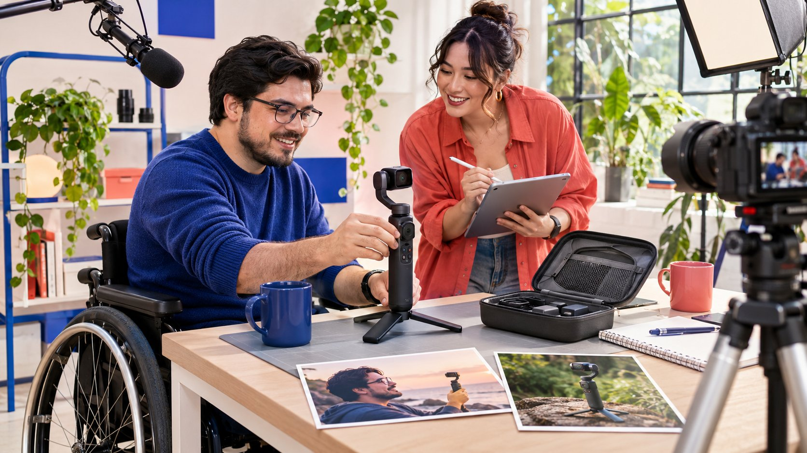
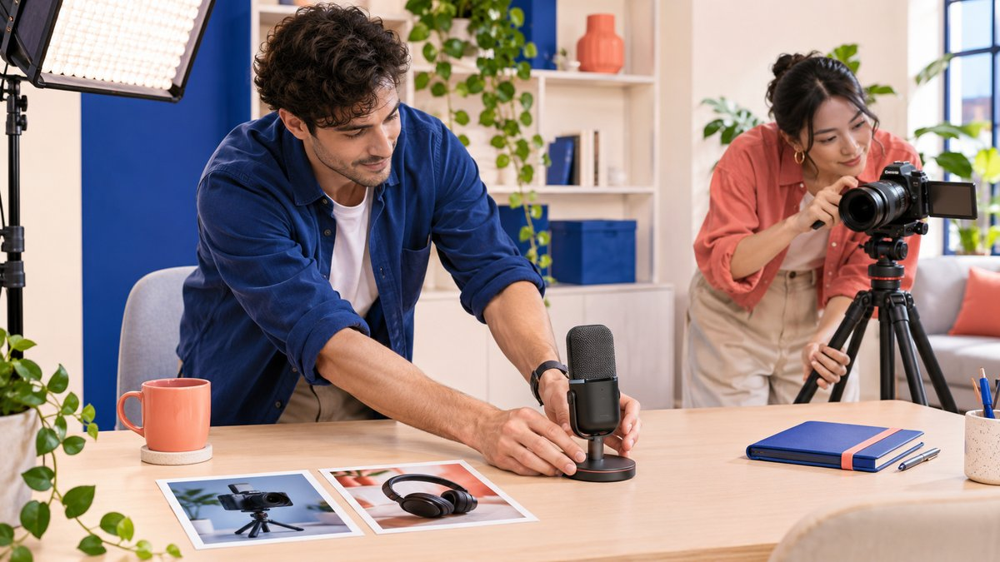

# Get Instagram Followers Through a Useful Creator Series

Status: local review draft; confirm the publication date before release.

Make each creator-series installment useful on its own and clear about what comes next, giving viewers a real reason to continue following.

For how do we get followers on Instagram, brands and creators can build a series worth continuing: each installment answers one specific question, the next adds something useful and viewers know which account carries it. Do not withhold a basic answer to demand follows or promise updates not prepared. A series needs continuing value rather than repeated selling points. Confirm contribution, production scope and destination accounts before publication, then separate views, follower changes and later interaction without attributing all concurrent growth to the series.

## Start with a question that supports useful continuation

A series is not repeated selling points. Establish whether the subject contains genuinely different questions that the creator can answer through experience, action or explanation.

Travel packing might cover frequently used items, access during travel and organization after arrival. These are topic examples, not a prescribed episode count or sequence for every product.

If there is only one answer, explain it clearly instead of dividing it to manufacture a series. Each installment should provide a complete piece of understanding rather than only ask people to wait.

Confirm which questions deserve this creator's contribution before deciding volume. Let structure determine the number of works rather than buy a fixed post package and search for filler. This gives the creator a stronger basis for accepting the assignment and lets the brand assess whether there is enough useful substance to justify continuing publication.

## Make the first installment useful by itself

The first work should do more than announce future content. Supply a real question, explanation and conditions so someone unfamiliar with the brand can understand it.

Mentioning a series should not require readers to finish every installment for important product facts. Conditions belong clearly in the work they affect.

The [Instagram Reels content-assignment article](https://www.quickkol.com/blog/reels-brand-education-content-assignment/#answer) defines an individual work's explanatory role. A series adds connection without removing the need for each piece to complete its task.

If the first explains placing frequently used items, complete that explanation. The next can address a new condition instead of hiding a necessary answer until later and making following a gate to comprehension. That structure respects the way people encounter creator content: they may find one piece through a share, revisit it independently or never see the series in the order the brand planned.

## Make the next installment add different information

For each installment, identify new information instead of changing only the opening or background. It might be another real condition, an action or a choice the previous work did not address.

Several similar edits do not necessarily provide more learning. If every conclusion is identical, consider one complete work and use remaining resources for explanation genuinely needed.

The creator can propose sequence because they may understand which questions need answering first. The brand supplies facts and offer limits without prewriting every personal experience.

Include the addition in the brief to make later review meaningful. Each work should justify an independent viewing as well as fit the visual direction. That gives an editor something more useful to check than whether the clip resembles the previous one, and gives the audience a reason to continue beyond recognizing the same product again.

## Identify where continuation lives without assuming delivery

If some work lives on the creator account and some on the brand account, explain what each provides. Avoid sending readers to the wrong place or presenting a one-off assignment as ongoing management of brand content.

[Meta’s Instagram Collabs announcement](https://about.fb.com/news/2023/08/music-and-collabs-on-instagram/amp/) explains co-authoring and acceptance as a publication relationship. It does not establish that every follower of each participant sees every installment.

Agree publishing roles for the actual task. Co-authoring, an ordinary mention and brand-owned publication can do different work; two visible names do not make them identical arrangements.

Check the current username and public destination. Continuity first needs the right place, then actual content that supports further viewing instead of asking people to infer the campaign relationship. The invitation should be clear enough for a newcomer while remaining accurate about what the creator and brand have each agreed to publish.

## Offer a reason to follow that can be delivered

Tell viewers what useful help comes next only when a real plan supports it. Do not promise indefinite updates, fixed cadence or continuing appearances without agreement.

If the series is finite, describe it that way. The account may offer other value afterward without implying that the creator will remain permanently on the brand channel.

Following is not proof of purchase, payment or brand approval. Frame the invitation as a choice: people who find these explanations useful can continue at the identified account.

Do not insert a follow request into every shot. Complete the contribution first, then explain continuation at an appropriate moment so the invitation connects with the work instead of replacing it. A clear, deliverable promise is more useful than a broad slogan about never missing out, because the audience can understand what they would actually receive by staying.

## Use a production structure that remains manageable

A series can reuse preparation such as equipment, product references and shot organization while each installment still needs real substance. Replacing a few nouns in one script does not create different experiences.

[Meta’s 2026 Edits creation guide](https://about.fb.com/news/2026/04/one-year-of-edits-built-for-and-with-creators/) describes video creation and idea organization. A tool can help manage material while the team owns assignments and confirmed versions.

Allow preparation, checking and revision for each work. If an answer depends on an observation that happens later, reflect the wait instead of filming a conclusion in advance and presenting it as an actual result.

When conditions change, identify the affected installment. Revise later topics or sequence with the creator rather than treat a series as an unlimited source of additional tasks. A manageable structure reduces repeated setup while keeping each person's commitments explicit, making it easier to preserve quality across the series instead of concentrating all production pressure near the next release.

The next installment needs a real new contribution and agreed production preparation.

## Keep context when an installment travels alone

An installment may be shared alone or become someone's entry point in the middle. Each needs its question and necessary conditions rather than leaving all background in the first episode.

[Meta’s 2025 Instagram sharing-feature guide](https://about.fb.com/news/2025/08/new-instagram-features-help-you-connect/amp/) discusses public-work reposts, attribution and possible discovery by non-followers. It does not guarantee that the complete series reaches people in order.

Clear names and short explanations can identify the relationship without relying only on internal numbering. A new reader needs to know the subject, not just that this is episode three.

When pointing to related work in a caption, establish that the destination exists. A series preview should not indefinitely refer to unpublished or outdated material. This is a practical continuity check: the team can prepare a useful viewing path while acknowledging that real audiences may encounter the work through several different routes.

## Follower change does not establish series attribution

Observe individual work, relevant visits, account follower changes and later interaction through the information actually available. Without a connection, do not invent a follower contribution for each episode.

The [creator-measurement method](https://www.quickkol.com/blog/creator-campaign-measurement/#answer) distinguishes observation from attribution. Weekly net follower change may include other content and unfollows, so it should not all be assigned to the series or one creator.

Continuing questions can become content leads without converting every reply into a common monetary value. Counts and questions inform different decisions.

First assess whether the series added real explanation and delivered its promised continuation. Retain evidence limits around growth outcomes to improve the next choice. A report can recognize a useful creator contribution while remaining uncertain about its exact follower effect, instead of forcing the work into an unsupported success or failure conclusion.

## Check a finite series for meaningful connection

Imagine three travel-packing works about everyday access, organization during travel and placement after arrival. Each independently answers a question; three is an example, not an industry recommendation.

The brand supplies accurate information and the creator describes their actual conditions. A preview concerns only confirmed next work, not uncertain material packaged as a promise.

Review identifies questions still needing explanation and whether the same person should continue. Without attribution evidence, do not assign all concurrent account change to these three works.

This hypothetical has no client result. It illustrates progression in content rather than dividing one script to publish more often. The sequence can also end once its useful questions have been answered, leaving the brand free to select a different creator or format for the next assignment instead of extending the series solely to preserve its label.

## Decide continuation from what the work revealed

After a series, add, revise or stop. Matching covers do not justify indefinite continuation, and one modest count should not erase feedback about the actual explanation.

Hand off the next question, relevant observations and owner. Confirm a new creator, condition or usage scope in the next assignment instead of letting the old partnership expand automatically.

The influencer-marketing answer to how do we get followers on Instagram can be continuing work worth following while recognizing that the choice remains with the audience. A series organizes that value without supplying a fixed growth formula. The agreed work should remain assessable even when the audience chooses different viewing paths.

Make each work useful, ensure the next adds something different and identify where continuation lives. That explains why a brand deserves a place in someone's feed more concretely than repeated follow requests. It also gives the creator a task grounded in their contribution rather than a promise to deliver a number beyond what the work and evidence can support.

## Check each series installment

| Element | Establish | Avoid |
| --- | --- | --- |
| Standalone question | What this work explains | Only a preview |
| Added information | What differs from the last | Repeated selling points |
| Continuation | Which account offers what | Undelivered promises |
| Production scope | Agreed work and conditions | Unlimited additions |
| Review | Observations and limits | Attributing all growth to the series |

Content-structure example, without prescribed episode count, cadence or follower outcome.

## Before starting a creator series

Give viewers a real reason to continue.

- [ ] Give each work a complete question.
- [ ] Identify what the next adds.
- [ ] Check the actual continuation account.
- [ ] Promise only planned work.
- [ ] Confirm creator production and usage scope.
- [ ] Separate observation, follower change and attribution.

## Research date and limitations

Sources reviewed November 18, 2026. Methods, tables and decision rules are editorial recommendations. Hypothetical examples are not actual client results or industry benchmarks. Source geography and periods are specified where relevant.

## Start creator research with a clear task

Use QuickKOL to interpret a brief, discover relevant creators and research their work and contact routes. Verify data, commercial terms and outcomes at their source.

[Explore QuickKOL](https://www.quickkol.com/#capabilities)

## Sources

- [Meta’s Instagram Collabs announcement](https://about.fb.com/news/2023/08/music-and-collabs-on-instagram/amp/)
- [Meta’s 2026 Edits creation guide](https://about.fb.com/news/2026/04/one-year-of-edits-built-for-and-with-creators/)
- [Meta’s 2025 Instagram sharing-feature guide](https://about.fb.com/news/2025/08/new-instagram-features-help-you-connect/amp/)
