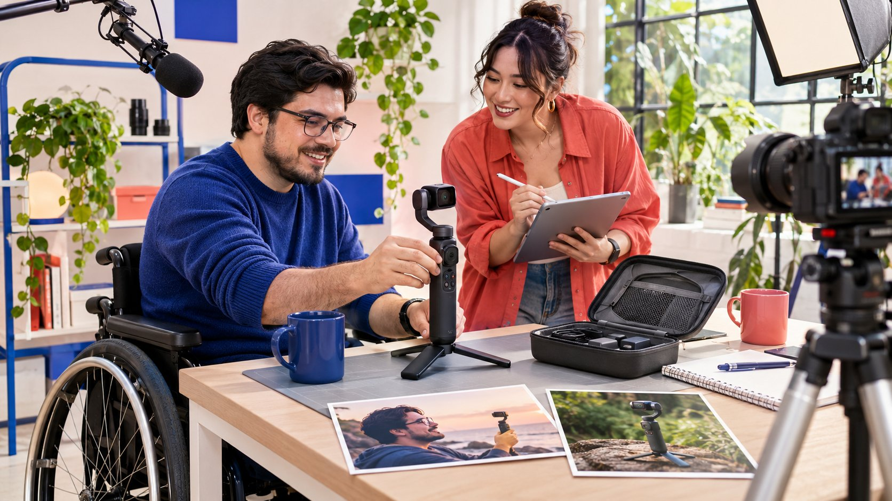

# 品牌与达人怎样安排内容系列

状态：本地审阅稿；正式发布日期待确认。

让达人系列每一条都独立有用，同时明确下一条会增加什么，给观众一个真实而可兑现的持续关注理由。

品牌与达人要讨论 how do we get followers on Instagram，可以从一个值得继续看的系列开始：每条解决一个具体问题，下一条提供不同的有用补充，并说明在哪个账户继续。不要把基本答案故意拆开来索取关注，也不要承诺尚未准备的更新。系列的价值来自持续内容，不是重复同一卖点。发布前确认创作者贡献、实际制作范围和目标账户；复盘时把浏览、关注变化与后续互动分开，避免把同期全部增长归给系列。

## 系列需要可继续展开的问题

系列不是把一次卖点重复几遍。先看主题是否包含几个真正不同的问题，每个问题都能通过创作者的经验、动作或解释提供价值。

例如旅行收纳可以分别讨论常用物品、临时取用和到达后的整理。这些只是选题例子，不意味着所有产品都应套用同样集数或相同顺序。

如果其实只有一个答案，就把它讲清，不必为了制造系列强行切开。观众应能从每条获得完整的一点理解，而不是只有一个要求等待的预告。

品牌与创作者先确认哪些问题值得本人解释，再讨论需要多少作品。内容结构决定数量，比先买固定发帖包再寻找填充主题更可执行。

## 让第一条本身就有价值

第一条不应只宣布接下来会有内容。给出一个真实问题、实际解释与适用条件，让从未看过品牌的人也能理解。

可以说明这是系列的一部分，但不要让读者必须追完全部才能知道重要产品事实。涉及使用条件的信息应当在对应内容中清楚出现。

[Instagram Reel 内容任务文章](https://www.quickkol.com/zh/blog/reels-brand-education-content-assignment/#answer)帮助确定一条作品的解释角色。系列只是提供关联，不免除每条完成自身任务的需要。

如果第一条讲常用物品怎样摆放，就完成这个说明。下一条可以讨论新的条件，而不是把这一次必要答案藏到以后，让关注成为补全信息的门槛。

## 下一条要增加不同信息

为每条写出新增内容，而不是只改开场或换背景。可以是另一个真实条件、一个实际动作，或上一条没有处理的选择问题。

不要把多条相似成片当成更多学习。如果每次结论完全相同，判断是否更适合做一个完整作品，再把剩余制作资源用于有必要的解释。

创作者可以提出内容顺序，因为本人更清楚哪些问题需要先讲。品牌提供产品事实和活动限制，不应把个人体验全部预先写完。

把新增信息写进 Brief，有助于后续审阅。每条不只需要符合视觉风格，也需要说明自己为什么值得成为独立一次观看。

## 明确在哪个账户继续，而不假定所有人都看到

如果一部分在创作者账户，一部分在品牌账户，说明两者各自提供什么。不要让读者去错地方，也不让创作者的单次工作看起来像长期托管品牌内容。

[Meta 的 Instagram 共创说明](https://about.fb.com/news/2023/08/music-and-collabs-on-instagram/amp/)介绍共同署名与接受邀请的发布关系。它可以帮助理解合作形式，但不表示每个参与账户的全部粉丝一定看到每一条。

发布安排应按实际任务确认。共同署名、普通提及与品牌自行发布可以承担不同角色，不能只因为都出现两个名字就当成同一种合作。

检查实际用户名与公开入口。系列连贯性首先需要到达正确地方，再由真实内容支持继续观看，而不是依赖观众猜测活动关系。

## 持续关注的理由应当可以兑现

可以告诉观众后续会提供什么具体帮助，但要有实际计划。不要承诺无限更新、固定频率或持续出镜，除非已经与相关人确认。

如果只安排了有限系列，就按有限内容说明。活动结束后的账户价值也可以不同，但不应让读者误以为创作者会永久留在品牌频道。

持续关注不是购买、付款或对品牌认同的证明。把邀请写成选择：如果这类解释对你有用，可以在对应账户继续看。

不要每个镜头都加入关注要求。先完成内容贡献，再在合适位置说明后续价值，让邀请与作品自然相接，而不是替代实际解释。

## 为系列保留可维护的制作结构

系列可以复用部分准备，例如相同设备、必要产品资料和清楚的镜头安排，但每条仍需真实内容。不要用同一个脚本替换几个名词，就当成不同体验。

[Meta 的 2026 年 Edits 创作说明](https://about.fb.com/news/2026/04/one-year-of-edits-built-for-and-with-creators/)介绍了视频制作和灵感整理。工具能帮助组织素材，实际任务与确认版本仍要由团队安排。

给每条作品留出准备、检查和修改的容量。若一个问题需要后来才会发生的观察，日历要反映等待，不能让预先拍好的结论冒充实际结果。

发生条件变化时，先看受影响哪一集。可以调整后续主题或顺序，但应与创作者确认范围，不把系列理解为随时可以追加的无限任务。

下一条需要真实的新贡献，也需要已经约定的制作准备。

## 单独分享时仍保留语境

作品可能被单独分享，观众也可能从中间一条开始。每条都应说明实际问题与必要条件，不把所有背景只放在第一集。

[Meta 的 2025 年 Instagram 分享功能说明](https://about.fb.com/news/2025/08/new-instagram-features-help-you-connect/amp/)讨论公开作品转载与原作者署名，也提到可能到达未关注的人。品牌不能因此保证整个系列会按顺序触达。

可以用清楚名称与简短说明帮助识别关系，但不要只用内部编号。新读者需要知道这条内容讲什么，而不只是看到“第三集”。

如果在文案中指向相关作品，确认目标确实存在。不要让系列预告长期指向尚未发布或已经不再适用的内容。

## 关注变化不能独立证明归因

可以观察单条作品、系列相关访问、账户关注变化和后续互动，但先确认实际可得资料与范围。没有连接数据，不自行编出每集贡献多少关注。

[达人测量方法](https://www.quickkol.com/zh/blog/creator-campaign-measurement/#answer)帮助区分观察与归因。某周净增关注可能同时涉及其他内容和取关，不能全部记到系列或某一位创作者身上。

如果观众继续提出不同问题，可以记录为内容线索，不必把每条回复都换算成统一价值。数字和问题各自帮助不同决定。

复盘先看系列是否增加了真实解释，以及后续是否兑现。对增长结果保留证据边界，才能让下一轮选择更有依据。

## 用一个有限系列检验内容连接

假设品牌与创作者安排三条旅行收纳内容：日常取用、途中整理与到达后的摆放。每条独立解释一个问题，具体数量只是例子，不是行业建议。

品牌提供准确产品资料，创作者说明自己的实际条件。下一条预告只讲已经确认会提供的内容，未确认部分不提前包装为承诺。

团队复盘哪些问题仍需要补充，是否适合由同一人继续。没有归因资料，就不把账户同期变化全部写成这三条带来的增长。

这个假设没有客户结果。它说明系列应有内容上的递进，而不是为了多发几次把同一篇脚本切成几段。

## 从实际学习决定续篇或结束

系列结束后，可以补充、调整或停止。不要因为已有统一封面，就让主题无限延续；也不要因为某条数字不高，就忽略实际解释得到的反馈。

交接下一步时写明问题、相关观察与负责人。若需要新创作者、新条件或新授权，在新的任务里确认，不让旧合作自然扩大。

How do we get followers on Instagram 的达人营销答案，可以是持续提供值得关注的作品，同时诚实说明关注仍由观众选择。系列帮助组织这种价值，不提供固定增长公式。即使观众采用不同观看顺序，已经约定的内容贡献仍应能够判断。

最终让每条都值得看、下一条真的有不同内容，并让观众知道在哪里继续。这样的安排比重复要求关注更能解释品牌为什么值得留在信息流里。

## 系列每条内容的检查

| 要素 | 应该明确 | 避免 |
| --- | --- | --- |
| 独立问题 | 这一条解释什么 | 只剩预告 |
| 新增内容 | 与上一条不同在哪里 | 重复卖点 |
| 继续去处 | 哪个账户提供什么 | 未兑现承诺 |
| 制作范围 | 已确认的任务与条件 | 无限追加 |
| 复盘 | 观察与限制 | 把总增长全归系列 |

内容结构示例；不规定统一集数、频率或涨粉结果。

## 开始达人系列之前

给观众真实的继续观看理由。

- [ ] 每条保留一个完整问题。
- [ ] 明确下一条新增的信息。
- [ ] 核对继续观看的实际账户。
- [ ] 只承诺已经安排的内容。
- [ ] 确认创作者制作与使用范围。
- [ ] 分开观察、关注变化与归因。

## 研究日期与使用边界

资料核验于 2026 年 11 月 18 日。文中方法、表格和决策规则为编辑建议，标为假设的示例不是实际客户结果或行业基准。外部资料的适用地区与时期按各段说明。

## 从任务开始达人研究

用 QuickKOL 理解 Brief、发现相关达人并研究作品与联系路径；数据、合作条件和结果仍需核验。

[了解 QuickKOL](https://www.quickkol.com/#capabilities)

## 来源

- [Meta 的 Instagram 共创说明](https://about.fb.com/news/2023/08/music-and-collabs-on-instagram/amp/)
- [Meta 的 2026 年 Edits 创作说明](https://about.fb.com/news/2026/04/one-year-of-edits-built-for-and-with-creators/)
- [Meta 的 2025 年 Instagram 分享功能说明](https://about.fb.com/news/2025/08/new-instagram-features-help-you-connect/amp/)
