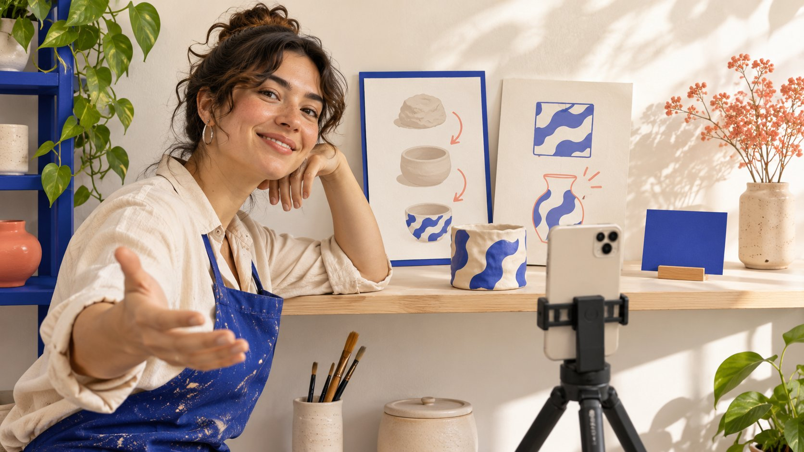
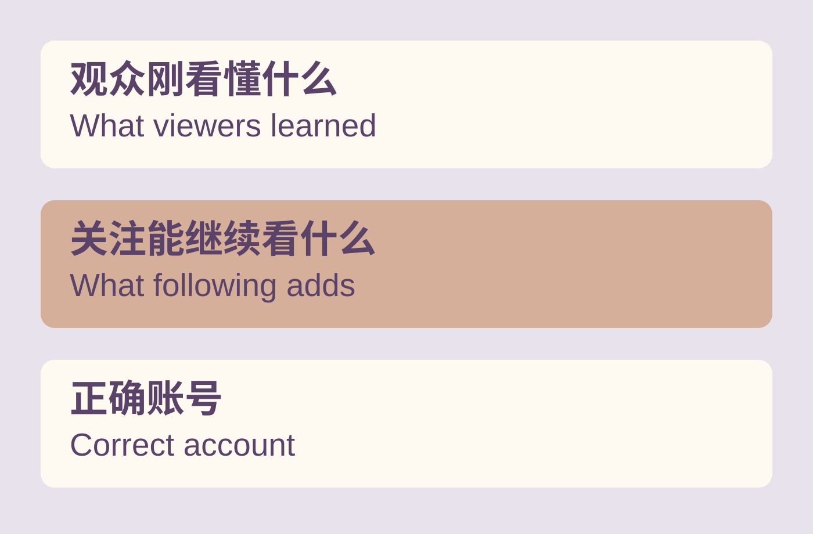

# Get Instagram Followers With a Clear Invitation

Status: local review draft; confirm the publication date before release.

Place a follow invitation appropriately in creator content, identifying the account and real continuing value without obscuring the explanation.

To get Instagram followers through creator content, an invitation should identify the account, what it will offer and why that relates to the work just seen. Complete a useful explanation before placing a concise invitation in suitable speech, visual text or the public caption; repetition in every shot is unnecessary. Confirm identity and actual continuation, with the creator agreeing that the wording fits the assignment. Following remains the viewer’s choice. Exposure to an invitation, a profile visit and a follow are separate observations, not a fixed outcome one post can guarantee.

## Give the invitation a specific reason

Follow us names an action without explaining value. Connect it with actual continuation: another process explanation, a prepared next installment or an ongoing subject related to the work.

The reason should match what the account normally offers. An equipment demonstration should not promise continuing travel guidance unless that account actually supplies it with an owner.

Brand and creator can ask whether the sentence helps a reader choose or merely satisfies a follower target. Without a clear reason, improve the content and destination before adding a louder slogan.

A useful invitation can be short. What matters is delivery, not emotional vocabulary or making viewers believe following is necessary for the basic answer in this work. The invitation should add a next option after a contribution, allowing someone to benefit from the content even if they decide that ongoing updates are not relevant to them.

## Complete the explanation before requesting another action

First answer why the viewer came, then consider another action. Do not deliberately hide a step, product condition or conclusion behind a follow requirement.

A pottery creator explaining a production choice should complete the process and judgment. Another installment can address a new question rather than require a follow to learn what happened here.

The [creator Reel shot-assignment article](https://www.quickkol.com/blog/make-a-reel-creator-explanation-shot-list/#answer) places explanation in actual footage. An invitation should build on that contribution instead of replacing the action viewers need to see.

If time is limited, retain necessary information and consider putting the invitation in the caption. Not every work needs the same spoken ending; the creator can choose a suitable expression. This lets the brand request a meaningful next step without making the deliverable feel like a sequence of interruptions competing with the creator's explanation.

## Identify the account accurately enough to find it

Establish whether the invitation concerns the brand, creator or an actual co-authored account relationship. Check display name, username and public destination instead of making readers choose among similar results.

The [Instagram account-identity article](https://www.quickkol.com/blog/instagram-accounts-collaboration-identity-map/#answer) helps record the actual partnership subject. Recheck mention and URL before publication, especially when details change during production.

If speech, visual text and caption point to different places, explain the reason or align them. The creator should not say follow me while subtitles identify only the brand, leaving the received invitation unclear.

Include language versions in the identity check. Translation can alter expression without silently changing the target or turning a brand name into an unrelated real username. Accurate routing is a practical part of the creative handoff, not a detail that can be assumed correct because the wording sounded natural during filming.

## Choose an appropriate spoken, visual or caption placement

Speech can explain continuation in the creator's voice, visual text can identify the account and the caption can add detail. All three are not mandatory and need not repeat identical words.

Identify when the viewer has enough understanding before placing the invitation. Large text or gestures should not cover a part at the moment its action matters most.

For silent viewing, check that text conveys target and reason; with speech, the relationship to the work should remain clear. Inspect the combined version instead of approving each element separately and overlooking the result.

For a photograph or written collaboration, one caption sentence may be sufficient. Choose according to format and creator expression instead of a template requiring the same ending from everyone. The placement is successful as communication when it offers a clear option without weakening the work it is supposed to support. If the brand later resizes the video, check the invitation again rather than assume it remains visible. A crop can remove the account name while retaining the follow request, leaving a sentence that sounds complete but no longer tells viewers where to go.

Complete the contribution before letting viewers decide whether following is useful.

## Consider how an invitation travels with an excerpt

Shares and reposts can bring work to people who never see the full caption. Preserve identity and necessary context appropriately instead of relying on internal knowledge of the partnership.

[Meta’s 2025 Instagram sharing-feature guide](https://about.fb.com/news/2025/08/new-instagram-features-help-you-connect/amp/) describes public reposts, attribution and possible discovery by non-followers. That is distribution context, not guaranteed invitation exposure or follows.

Check whether a likely excerpt remains understandable without claiming control over every sharing route. Keep published and authorized versions accurate and clarify known confusion where appropriate.

If an invitation loses its original context, restore the relationship between account, content and continuing value instead of adding stronger outcome promises. This lets the team prepare a clearer expression while remaining realistic about how audiences encounter and reinterpret creator work outside the complete version arranged by the brand.

## Recheck the invitation when repurposing for paid use

Repurposing organic work into advertising can change the account, destination or continuation. The original invitation may no longer be accurate and needs review with the actual version.

[Meta’s partnership-ad introduction](https://about.fb.com/news/2024/02/creator-marketplace-for-brands-and-creators-to-collaborate-on-instagram/) describes organic-to-paid collaboration routes. Converting work into an ad does not mean every original sentence needs no further checking.

If the creator originally said follow me and the clip moves into brand advertising, establish that viewers still understand the target. Confirm asset use, identity presentation and commercial context for this assignment.

Do not make an ad more direct by turning finite content into indefinite updates or personal experience into a brand guarantee. Parties agree modifications rather than let editing convenience decide. A separate paid version can be useful while preserving the meaning of the creator's contribution and the actual destination of the invitation.

## Match the invitation to what the account actually offers

Before inviting a follow, inspect the destination for relevant explanation and continuation. A strong ending cannot repair an empty profile or obsolete content route.

[Meta’s Instagram creator-guidance announcement](https://about.fb.com/news/2024/10/best-practices-education-hub-creators-instagram/) covers creation, engagement and reach with personalized guidance. It does not support one invitation formula guaranteeing growth for every account.

If account content does not connect with the partnership question, organize relevant material first. Revise the invitation where necessary instead of asking the creator to compensate through greater enthusiasm.

When continuation changes, update the public explanation and versions still under your control. A lasting work should not indefinitely promise a cancelled series or event. Matching the invitation to current reality gives viewers a meaningful choice and gives the creator confidence that the brand will provide what their work tells people to expect.

## Observe invitation exposure, visits and follows separately

Watching the work does not establish seeing the invitation; seeing it does not establish a visit; visiting does not establish following. Report through actual available information instead of treating these stages as one number.

State limits where actions cannot be connected. Total follower change can include unfollows, other work and other channels rather than net growth caused by this sentence.

Content observations can still help: people may remain unsure which account is meant or find the continuation difficult to understand. Improve expression from those leads without inventing a precise conversion rate.

Feedback should concern whether the expression matched the task. An unattributed account total should not determine whether a creator tried hard or supplied useful work. The team can make a justified editorial improvement while recognizing that the available measurement does not isolate the effect of the invitation itself.

## Check an invitation in a hypothetical pottery partnership

Imagine a creator explaining a pottery choice while the brand account has related material information and confirmed follow-up. After the explanation, one sentence identifies which account will offer what next.

Keep the important action visible, use text for the correct identity and add necessary conditions in the caption. The creator checks voice and confirms that the sentence does not imply permanent appearances on the brand channel.

Inspect the live version and destination before observing questions and available metrics. Without corresponding evidence, do not assign a whole week's follower growth to the invitation.

This is hypothetical content, not a client case. A natural invitation comes from a real content connection rather than an identical slogan attached to arbitrary work. The sentence has a purpose because the continuation is prepared and related, while the viewer can still choose to leave after receiving a useful complete explanation.

## Revise the part the next round actually needs

If the target is unclear, revise identity wording. If the promise mismatches the account, change the destination or invitation. If the work itself is incomplete, improve the explanation rather than only replace the slogan.

Retain a specific reason for a change. Do not revise everything simultaneously and attribute any result to the new invitation.

The creator-marketing answer to get Instagram followers connects reason, placement and real continuation. It does not demand an unguaranteed headcount from the creator; it offers a clear choice to relevant viewers.

Respect the work and audience while preparing the brand to deliver its promise. A short invitation then becomes part of the partnership rather than an extra advertisement obscuring the contribution. The next review can judge that particular communication decision honestly, without pretending it controls all the other reasons someone might choose to follow or leave an account.

## Check a follow invitation

| Element | Question | Revision |
| --- | --- | --- |
| Reason | Why continue? | Match actual continuation |
| Target | Which account? | Check username and route |
| Placement | Does it interrupt explanation? | Adjust speech, visual or caption |
| Promise | Can it be delivered? | Remove unconfirmed claims |
| Observation | What information exists? | Separate behavior and attribution |

Communication framework without fixed follower counts, optimal scripts or conversion guarantees.

## Before confirming a follow invitation

Make the sentence accurate, relevant and deliverable.

- [ ] Complete an independently useful explanation.
- [ ] Identify real continuing value.
- [ ] Verify target account and language versions.
- [ ] Choose a placement that preserves the work.
- [ ] Recheck meaning and use when repurposing.
- [ ] Distinguish invitation exposure, visits and follows.

## Research date and limitations

Sources reviewed November 18, 2026. Methods, tables and decision rules are editorial recommendations. Hypothetical examples are not actual client results or industry benchmarks. Source geography and periods are specified where relevant.

## Start creator research with a clear task

Use QuickKOL to interpret a brief, discover relevant creators and research their work and contact routes. Verify data, commercial terms and outcomes at their source.

[Explore QuickKOL](https://www.quickkol.com/#capabilities)

## Sources

- [Meta’s 2025 Instagram sharing-feature guide](https://about.fb.com/news/2025/08/new-instagram-features-help-you-connect/amp/)
- [Meta’s partnership-ad introduction](https://about.fb.com/news/2024/02/creator-marketplace-for-brands-and-creators-to-collaborate-on-instagram/)
- [Meta’s Instagram creator-guidance announcement](https://about.fb.com/news/2024/10/best-practices-education-hub-creators-instagram/)
