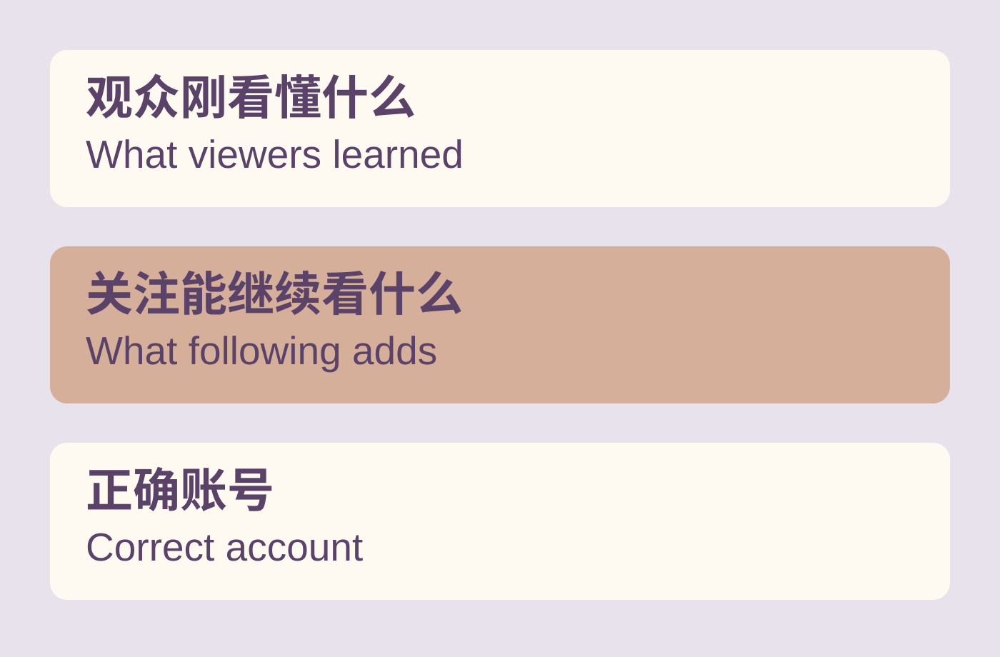

# 达人怎样提出清楚的关注邀请

状态：本地审阅稿；正式发布日期待确认。

在达人内容中选择合适位置提出关注邀请，说明正确账户和真实后续价值，让邀请服务解释而不是遮住内容。

要通过达人内容 get Instagram followers，关注邀请需要回答三个问题：关注哪个账户、以后能得到什么、为什么与刚看的作品有关。先完成有用解释，再在合适的口播、画面或公开文案位置提出简短邀请；不必每个镜头都重复。发布前确认账户身份与后续内容确实存在，创作者也认可这句话符合合作范围。关注由观众选择，看到邀请、访问主页和实际关注应分开观察，不能承诺一条作品带来固定人数。

## 先让邀请有一个具体理由

“关注我们”只是动作，不说明价值。可以改成与这条作品有关的实际后续，例如同类过程说明、已经准备的下一段内容，或某个持续主题。

理由应当与账户平常提供的东西相符。不要在一次器具演示后承诺持续旅行指导，除非那个账户真的有相应内容与负责人。

品牌与创作者可以先核对：这句话是否帮助读者作选择，还是只是为了完成一个关注指标？没有明确理由时，先改善内容和去处，不急于加更响亮的口号。

一个清楚邀请可以很短。重要的是它能够兑现，而不是包含很多情绪词或让观众以为不关注就无法获得本次作品的基本答案。

## 让内容先完成自己的解释任务

作品先回答观众为什么来看，再考虑关注邀请。不要把关键步骤、产品条件或真实结论故意藏在关注之后。

例如陶艺创作者解释一种制作选择，就先把实际过程与判断讲清。下一条可以讨论新的问题，而不是要求观众先关注才能知道这一次到底怎样做。

[达人 Reel 镜头任务文章](https://www.quickkol.com/zh/blog/make-a-reel-creator-explanation-shot-list/#answer)帮助把解释安排到具体画面。邀请应当接在这个贡献上，不是取代原本要展示的动作。

若片长紧张，优先保留理解所需内容，再判断是否把邀请放在文案中。并不是每条作品都需要相同口播结尾，创作者可以选择适合其表达的方式。

## 准确提供账户身份与入口

确认邀请指向品牌账户、创作者账户，还是本次实际共创账户。显示名、用户名与公开地址需要核对，不让读者猜测该关注哪个相似结果。

[Instagram 账号身份文章](https://www.quickkol.com/zh/blog/instagram-accounts-collaboration-identity-map/#answer)帮助记录实际合作对象。发布前再次确认提及与地址，尤其是资料在制作期间发生变化时。

如果画面、口播和文案指向不同地方，先解释原因或统一目标。不要让创作者说关注本人，字幕却只标品牌，最后无法判断观众收到什么邀请。

身份检查也应该覆盖不同语言版本。翻译可以改变表达，不能悄悄换掉账户对象或把品牌名称误当成另一个真实用户名。

## 选择口播、画面或文案中的合适位置

口播可以由创作者自然说明后续，画面文字可以帮助识别正确账户，文案可以补充细节。三种位置不一定都要使用，更不需要逐字重复。

先看观众在哪个时刻已经理解内容，再安排邀请。不要在动作最需要看清时，用大字或手势遮住关键部件。

无声观看时，检查文字是否仍能说明对象和理由；听到口播时，也应理解与作品的关系。实际版本需要一起看，不能分别确认后就忽略组合效果。

对单张照片或文字型合作，文案中的一句可能已经足够。选择应来自内容形式与创作者表达，不是品牌模板规定所有人都用相同结尾。品牌后来调整视频比例时，再检查邀请是否完整。裁切可能只保留关注要求，却删掉账户名称，让一句听起来完整的话不再说明去处。

先完成内容贡献，再让观众判断继续关注是否有用。

## 考虑邀请可能被单独分享

作品可能通过分享或转载到达新读者，他们未必看到完整文案。重要身份与必要语境应在合适位置保留，不全靠内部知道活动关系。

[Meta 的 2025 年 Instagram 分享功能说明](https://about.fb.com/news/2025/08/new-instagram-features-help-you-connect/amp/)介绍转载公开作品与原作者署名，也提到可能接触未关注读者。它是传播背景，不保证邀请一定被看到或转成关注。

可以检查一个常见片段是否仍然可理解，但不能宣称能控制全部传播路径。自己发布和授权使用的版本应准确，已知误解可以及时补充。

如果邀请已经离开原来上下文，避免继续加更强的结果承诺。先恢复账户、内容与后续价值的清楚关系。

## 付费复用时确认邀请含义

一条自然作品被重新剪成广告时，账户、目标页或后续安排可能不同。原邀请未必仍然准确，需要与实际版本一起核对。

[Meta 的合作广告介绍](https://about.fb.com/news/2024/02/creator-marketplace-for-brands-and-creators-to-collaborate-on-instagram/)区分自然内容与付费合作广告的使用路线。把内容转成广告，不等于原来每句话在新形式下都无需检查。

若创作者原来说关注本人，却被移到品牌广告里，要确认观众是否仍能理解实际对象。素材用途、身份呈现和合作关系都应按这次任务明确。

不要为了让广告更直接，就把有限内容承诺改成长期更新，或把创作者个人体验改成品牌保证。改动范围由双方确认，不由剪辑方便决定。

## 让邀请对应账户真实内容

发出邀请前，检查目标账户里是否有对应说明与后续安排。一个吸引人的结尾，不能补回空白主页或已经失效的内容入口。

[Meta 的 Instagram 创作者建议入口](https://about.fb.com/news/2024/10/best-practices-education-hub-creators-instagram/)介绍了创作、互动与触达等不同主题，并有个性化建议。它不支持品牌用一个统一邀请句式保证所有账户增长。

如果账户内容与合作问题不相接，先整理相关资料。必要时调整邀请，而不是让创作者用更热情语气弥补目标去处的问题。

后续计划变化时，更新自己仍可控制的公开说明与版本。不要让一条长期留存的内容持续承诺已经取消的系列或活动。

## 把邀请、访问与关注分别观察

观看作品不代表一定看到邀请，看到邀请不代表访问，访问也不代表关注。报告时按照实际可得资料记录，不把这些阶段当成同一个数字。

如果没有资料连接具体行为，就说明限制。账户总关注变化还可能涉及取关、其他内容与其他渠道，不能直接写成这句话带来的净增。

可以观察内容上的问题，例如很多人仍不清楚关注对象，或后续入口不易理解。这些线索可以帮助修改表达，不需要先编出精确转换率。

对创作者反馈，讨论实际表达与目标相符程度。不要用一个不具备归因证据的总数，断定本人有没有努力或作品有没有价值。

## 用一次陶艺合作检查邀请是否自然

假设创作者解释一种杯子制作选择，品牌账户准备好相关材料说明与已确认后续。作品完成解释后，用一句话指出哪个账户会继续提供什么内容。

画面保留关键动作，字幕说明正确对象，文案补充必要条件。创作者确认表达符合本人语气，也确认没有暗示自己将永久出现在品牌频道。

上线后检查真实版本与去处，再观察问题与可用指标。没有对应资料，就不把一周全部涨粉写成这句邀请的效果。

这是假设内容，不是客户案例。它说明一个自然邀请来自已经建立的内容联系，而不是在任意作品后都加同一段关注口号。

## 下一轮只修改实际需要的部分

如果问题是对象不清楚，就改身份表达；如果承诺与目标账户不符，就改内容去处或邀请；如果作品本身没讲清，先补解释，不只换一句口号。

一次可以保留一个明确修改理由。不要同时改全部内容，再把任何变化都归因于新的关注邀请。

Get Instagram followers 的达人营销答案，应把关注理由、表达位置和真实后续相接。它不是从创作者那里索取一个无法保证的人数，而是给相关观众清楚选择。

让邀请尊重作品与观众，也让品牌准备好兑现承诺。这样一句简短表达才成为合作的一部分，而不是盖住达人贡献的额外广告。

## 一句关注邀请需要确认什么

| 要素 | 问题 | 修改方向 |
| --- | --- | --- |
| 理由 | 为什么值得继续 | 对应真实后续 |
| 对象 | 哪个账户 | 核对用户名与入口 |
| 位置 | 是否打断关键解释 | 调整口播、画面或文案 |
| 承诺 | 能否实际提供 | 移除未确认内容 |
| 观察 | 实际有什么资料 | 分开行为与归因 |

表达检查框架；不提供固定涨粉人数、最佳句式或转化保证。

## 确认关注邀请之前

让一句话同时准确、相关且可以兑现。

- [ ] 先完成独立有用的解释。
- [ ] 指出真实后续价值。
- [ ] 核对目标账户与语言版本。
- [ ] 选择不遮挡内容的位置。
- [ ] 复用时重新确认含义与用途。
- [ ] 分别记录邀请、访问与关注。

## 研究日期与使用边界

资料核验于 2026 年 11 月 18 日。文中方法、表格和决策规则为编辑建议，标为假设的示例不是实际客户结果或行业基准。外部资料的适用地区与时期按各段说明。

## 从任务开始达人研究

用 QuickKOL 理解 Brief、发现相关达人并研究作品与联系路径；数据、合作条件和结果仍需核验。

[了解 QuickKOL](https://www.quickkol.com/#capabilities)

## 来源

- [Meta 的 2025 年 Instagram 分享功能说明](https://about.fb.com/news/2025/08/new-instagram-features-help-you-connect/amp/)
- [Meta 的合作广告介绍](https://about.fb.com/news/2024/02/creator-marketplace-for-brands-and-creators-to-collaborate-on-instagram/)
- [Meta 的 Instagram 创作者建议入口](https://about.fb.com/news/2024/10/best-practices-education-hub-creators-instagram/)
