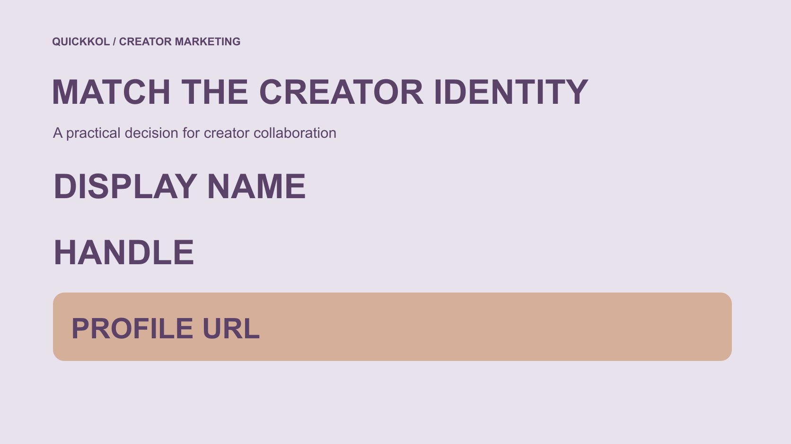
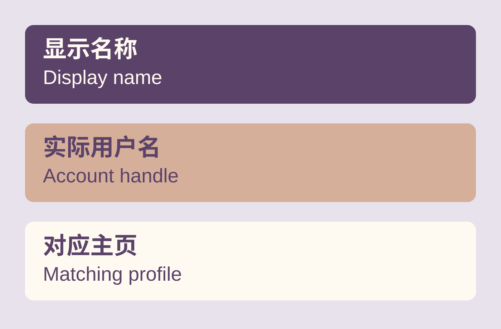

# IG Handle: Identify the Right Creator Account

Status: local review draft; confirm the publication date before release.

Record Instagram username, display name, profile URL and chat nickname separately so creator research, mentions and handoff identify the right account.

QuickKOL editorial graphic; not actual account metrics or a platform interface.

An IG handle usually means an Instagram username, commonly written with @ before it. It is distinct from a readable display name, complete profile URL and chat nickname. In a creator partnership, reach the actual profile through a creator-owned public source or confirmed route, save the current username and URL separately, then check work and counterpart. Similar names do not establish identity, and a handle is neither a business-contact agreement nor permission. Recheck mentions before publication, especially after renaming or account-role changes during production.

## Turn familiar labels into clear fields

When a team asks for a creator account, one person may supply a name, another an @ username and another a screenshot. Specify the field instead of leaving the next owner to guess.

A display name helps reading, a username identifies the actual account and a profile URL returns someone to the source. They are related while serving different work in a record.

Every creator need not acquire a complicated dossier. Retain the project-relevant name, current route, source and observation date rather than hand off memory alone.

A useful entry lets someone absent from research return to the same account and work. It is more than an attractive name in a list and should not automatically label the person a confirmed business partner. Clear fields help the team continue research, prepare a correct mention and distinguish these operations from a later commercial agreement.

## Return to the actual profile when names resemble one another

A display name may contain a brand, personal name or content description; it should not carry identity checking alone. Similar images, language or subject matter also need an actual source relationship.

Return from known work to the author and inspect the current profile and public connections. A repost or aggregation result needs further checking instead of the first result becoming the assumed counterpart.

The [Instagram account-identity article](https://www.quickkol.com/blog/instagram-accounts-collaboration-identity-map/#answer) distinguishes personal, brand and other collaboration roles. A brand, team account and on-camera person's account can use similar labels without being the same task subject.

Record what was actually established. Confirming a page exists does not simultaneously establish willingness for outreach, platform-guaranteed identity or every cross-platform connection. A narrow accurate record remains useful while preventing later team members from treating an early research observation as a completed commercial or identity determination.

## A chat nickname is not the public username

[Meta’s Instagram DM-nickname guide](https://about.fb.com/news/2024/11/new-ways-to-connect-through-dms/) states that chat nicknames appear within the relevant messages and do not change the username elsewhere on Instagram. Do not copy a conversational nickname directly into a public mention.

Internal team notes have the same limitation. A familiar label can help recognize a contact, while public work still needs the actual current account rather than an internally assigned name.

When receiving an older conversation record, return to the profile instead of relying only on text displayed in the chat. Participation in discussion does not make every account associated with the person identical.

Separate conversational recognition from public identification so communication can remain natural while captions, co-author invitations and lists stay accurate. Internal convenience should not alter public facts. Recheck the target before publishing again. A publishing owner should receive the verified public target, not be expected to infer it from a nickname meaningful only to the person who saved the contact.

## Search is an entry point rather than the identity conclusion

[Meta’s partnership-content hub update](https://about.fb.com/br/news/2025/12/novas-ferramentas-com-ia-para-escalar-parcerias-entre-criadores-e-marcas/amp/) describes finding candidates through creator names or Instagram usernames. Search can start research while the result still needs checking against actual work and account.

Do not merge similar spellings automatically or split one person's differing labels into unrelated people. Retain the source relationship before deciding whether they concern one creator.

A public username is a current route, not willingness for brand work, expertise or fit for the intended audience. Selection still concerns contribution and conditions.

Leave identity pending when sources are insufficient. Research can continue through established facts, while a formal invitation or permission request should not inherit an unexplained guess. This gives a discovery tool a useful, bounded role: it helps locate work without replacing the team's responsibility to understand who is being considered and why.

## Hand off the username with the complete route

A profile URL helps the next owner open the destination, while the username supports caption and mention checking. Record both instead of providing only an unclickable screenshot.

Open the route and confirm the account and work. Constructing an address from a name does not establish that it was checked, and an Instagram-looking address is not the end of verification.

If a brand has market or product accounts, identify the one for this assignment. The creator's mention should match the agreed target instead of changing to a more familiar name during editing.

Include relevant work and its source rather than unrelated personal information. The recipient needs enough to continue the task, not an entire private profile. This also makes errors easier to locate: the team can see whether a problem concerns the copied destination, the public username or the account chosen for the project.

The correct route supports the work without automatically establishing partnership or asset permission.

## Update affected work when a username changes

When a username or route changes, establish the new state and source before updating the record. One unavailable older address does not prove retirement or enforcement.

Check pending captions, visual text, co-author arrangements and handoff files. Editing one list field does not change an exported video or scheduled content automatically.

Do not promise that an older route redirects or that a name can be recovered. This guide supplies no unverified renaming frequency, reservation period or username-trading advice.

Date the change and retain reasonable traceability. An older label can explain historical work while current operations use the confirmed route, avoiding two versions both presented as latest. The update should identify which deliverables need correction so a limited identity change does not cause unnecessary rework across unrelated assets.

## A correct mention is not co-author or advertising permission

[Meta’s Instagram Collabs announcement](https://about.fb.com/news/2023/08/music-and-collabs-on-instagram/amp/) describes invitation and acceptance in co-publication. An accurate username finds the account without establishing acceptance or agreement to every paid use.

Separate checked account, started conversation, confirmed co-authoring and agreed use in the record. These should not collapse into creator confirmed.

An ordinary mention should be described as such rather than packaged as co-publication or endorsement of all content. The public relationship should match the actual agreement.

Advertising, asset permission and commercial terms still concern this assignment. An @ label resolves direction without completing every later partnership decision. Keeping these states separate lets the publishing owner use the correct identity while recognizing which permissions and arrangements require another explicit step, instead of assuming that a verified handle is a complete approval record.

## Use a business route the creator actually provides

A public username can locate a creator without guaranteeing that a message is read or answered. Inspect a business route they actually provide and prepare a relevant inquiry.

Do not guess an email or contact several unrelated people because their usernames resemble one another. Identity checking improves relevance rather than expanding indiscriminate outreach.

The [creator outreach-brief article](https://www.quickkol.com/blog/write-a-useful-campaign-brief/#answer) helps explain the reason for contact, required contribution and next confirmation step. The handle routes the question while the message still needs substance.

If the contact route remains unresolved, retain public-work research. No reply should not automatically become rejection, partnership failure or inactivity without supporting information. This distinction keeps a useful research lead available while avoiding the assumption that finding a profile gives the brand a complete and responsive commercial relationship.

## Check a hypothetical identity record

Imagine a researcher recording a craft creator's display name, current username, actual profile URL, source and relevant work. A chat nickname stays separate from public mentions.

Before publication, a rename appears. The team checks the source, updates caption and pending visual text, and considers whether co-authoring or usage arrangements need revision. Date the older record instead of erasing every source connection.

This is a method, not a real account or client result. Identity handoff continues beyond finding a name so the assignment can proceed accurately.

If information remains missing, state what the next owner should check. Do not complete the appearance of a record by guessing a route, inventing a business contact or reporting agreement that never occurred. If a representative supplies an updated handle, check the public source relationship and record who provided the update. The contact person and the public account can have different names without being inconsistent, but that does not let the team assume which person can approve every use. Keep the identity route and commercial counterpart understandable as separate parts of the assignment. The value is a reliable next action, not a row that looks fully populated regardless of its evidence.

## Keep identity records inside maintainable work

After the project, retain necessary source and historical scope, checking affected current fields before reuse. One profile inspection is not a permanent identity guarantee.

On handoff, distinguish public facts, creator-confirmed details and pending work. A new owner should understand the record without relying on the original researcher's memory of every conversation.

The influencer-marketing meaning of an IG handle on Instagram is accurate identification and connection with the actual account. Keeping username, display name, profile and nickname distinct also keeps research, mentions and partnership decisions distinct.

The record need not be complex, but should be truthful, return to its source and indicate when updating is needed. It respects creator identity and helps the operator deliver the right work to the right counterpart, without pretending that a routing field settles every question about suitability or commercial permission.

## Use Instagram identity fields

| Field | Use | Does not replace |
| --- | --- | --- |
| Display name | Human-readable recognition | An identity conclusion |
| Username / handle | Identify the current account | Commercial agreement |
| Profile URL | Return to the actual source | Assessment of work fit |
| Chat nickname | Convenient conversation label | Public mention |
| Observation date | State the record period | Permanent validity |

Identity-handoff framework without username availability, transfer, recovery or permanent old-link guarantees.

## Hand a creator account to an operator

Let the recipient return to the same account and work.

- [ ] Separate display name, username and URL.
- [ ] Open the profile from a confirmed public source.
- [ ] Do not use chat nicknames as public mentions.
- [ ] Update affected versions after renaming.
- [ ] Separate account checking and permission.
- [ ] Retain source, date and next action.

## Research date and limitations

Sources reviewed November 18, 2026. Methods, tables and decision rules are editorial recommendations. Hypothetical examples are not actual client results or industry benchmarks. Source geography and periods are specified where relevant.

## Start creator research with a clear task

Use QuickKOL to interpret a brief, discover relevant creators and research their work and contact routes. Verify data, commercial terms and outcomes at their source.

[Explore QuickKOL](https://www.quickkol.com/#capabilities)

## Sources

- [Meta’s Instagram DM-nickname guide](https://about.fb.com/news/2024/11/new-ways-to-connect-through-dms/)
- [Meta’s partnership-content hub update](https://about.fb.com/br/news/2025/12/novas-ferramentas-com-ia-para-escalar-parcerias-entre-criadores-e-marcas/amp/)
- [Meta’s Instagram Collabs announcement](https://about.fb.com/news/2023/08/music-and-collabs-on-instagram/amp/)
