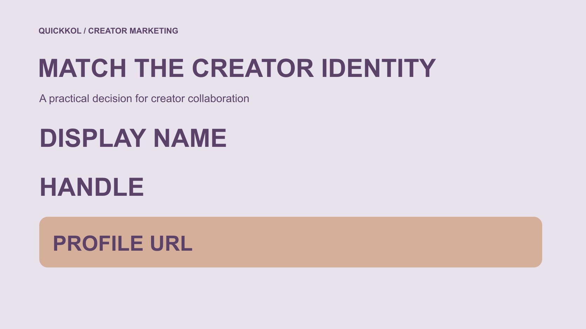
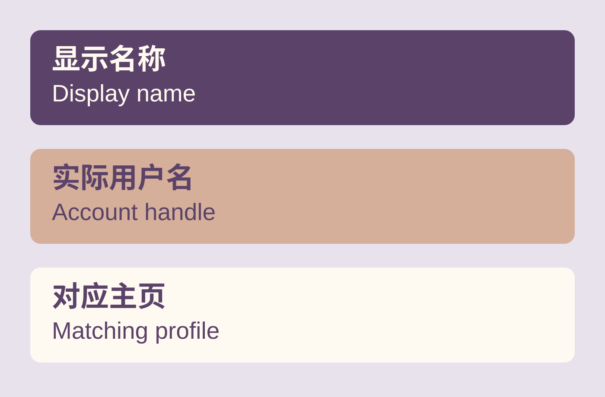

# Instagram 用户名怎样准确交接

状态：本地审阅稿；正式发布日期待确认。

把 Instagram 用户名、显示名、资料页地址与聊天昵称分开记录，让达人研究、提及和合作交接指向正确账户。

QuickKOL 编辑图形；不呈现真实账号指标或平台界面。

IG handle 通常指 Instagram 用户名，常以 @ 加用户名表示。它与可读的显示名称、完整资料页地址和聊天昵称不是同一字段。达人合作时，从本人公开资料或确认过的来源进入实际主页，分别保存当前用户名与地址，再核对作品和合作对象。名字相似不证明是同一个人，用户名也不代替商务联系或授权。发布前再次检查提及，尤其是在制作期间发生改名或账户用途变化时。

## 先把常用称呼写成清楚字段

团队说达人账号时，可能有人给出名字，有人给出 @ 用户名，还有人只发截图。先说明需要哪个字段，避免接手人自行猜测。

显示名称可以用于阅读，用户名用于识别实际账户，资料页地址用于回到来源。它们相关，但在记录中承担不同工作。

不需要为每个创作者建立复杂档案。保留与项目有关的名称、当前入口、来源与观察日期，通常就能避免只凭记忆交接。

一个有用记录应让未参加研究的人回到同一账户和作品。它不只是名单里好看的一个名字，也不应直接写成已经确认的商务伙伴。

## 显示名相似时回到实际主页

显示名称可以包含品牌、姓名或内容说明，不能单独承担身份核对。头像相似、语言相同或主题相近，也需要结合实际来源判断。

从已知作品回到原作者，查看当前资料页与公开连接关系。若来源只是转发或聚合结果，继续确认，不把最先出现的人默认当成目标。

[Instagram 账户身份文章](https://www.quickkol.com/zh/blog/instagram-accounts-collaboration-identity-map/#answer)帮助区分个人、品牌与其他合作角色。一个品牌 Store、团队账号和出镜者个人账号，也可能使用相似称呼，却不是同一个任务对象。

记录你实际确认了什么。只确认页面存在，就不要同时写入本人已同意接洽、身份已由平台担保，或所有跨平台账号都已建立关系。

## 聊天昵称不是公开用户名

[Meta 的 Instagram 私信昵称说明](https://about.fb.com/news/2024/11/new-ways-to-connect-through-dms/)指出，聊天里的昵称只在对应私信中显示，不改变 Instagram 其他位置的用户名。不要从聊天称呼直接复制为公开提及。

团队内部备注也有相同问题。你可以把联系人记成某个熟悉称呼，但对外发布仍需要真实当前账户，不由内部命名决定。

如果有人从旧聊天记录交接资料，回到实际主页确认，不只依赖群里的显示文字。对方参与过讨论，也不说明正在使用的所有账号都相同。

把聊天识别与公开识别分开，可以让沟通更自然，同时让文案、共创邀请和名单继续准确。内部便利不应改变公开事实。

## 搜索后继续核验身份

[Meta 的合作广告内容中心更新](https://about.fb.com/br/news/2025/12/novas-ferramentas-com-ia-para-escalar-parcerias-entre-criadores-e-marcas/amp/)提到按创作者名称或 Instagram 用户名寻找相关候选。搜索方式可以帮助开始研究，但结果仍需回到实际作品与账户核对。

不要因为两个结果拼写接近就合并，也不要因为同一个人使用不同称呼就自动拆成无关对象。保留来源关系，再判断是否对应同一位创作者。

公开用户名只是当前入口，不说明对方会接受品牌任务、拥有某种专业能力或适合本次受众。候选选择仍看作品贡献与条件。

如果来源不够，保留待确认。研究记录可以继续使用已有事实，但正式邀请或授权不应携带一个没有说明的身份猜测。

## 把用户名与完整入口一起交接

资料页地址帮助接手人打开目标，用户名帮助文案和提及核对。两者一起记录，避免只收到一张无法点开的截图。

实际打开一次入口，确认到达的账户与作品。不要从某个名字自行拼地址后，就认为已经查过；也不要只看地址看起来像 Instagram 就停止核对。

如果品牌有多个地区或产品账号，明确本次对应哪个。创作者提及应与已确认目标一致，不因编辑习惯换成另一个熟悉名字。

交接时附上一条相关作品和来源，比加入许多无关个人信息更有用。下一位负责人需要能继续任务，不需要完整私人资料。

正确入口让工作继续，但不自动完成合作同意与素材授权。

## 改名后更新受影响的素材

用户名或资料入口变化时，先确认实际新状态与来源，再更新对应记录。不要从一次旧地址不可用，就推断对方不再工作或账号出现处罚。

检查待发布文案、画面文字、共创安排与交接文件是否受影响。改了名单中的一格，不会自动修改已经导出的视频或排期内容。

不需要承诺旧入口一定跳转，或某个名字一定可以取回。本文不提供未经核验的改名次数、保留时间与用户名交易建议。

给变化注明日期，保留合理追溯。历史记录中的旧称呼可以解释原作品，但当前操作应使用已确认的新入口，避免两个版本同时被当成最新。

## 区分提及、共创与广告许可

[Meta 的 Instagram 共创说明](https://about.fb.com/news/2023/08/music-and-collabs-on-instagram/amp/)介绍邀请与接受的共同发布关系。准确用户名帮助找到正确账户，但找到不等于邀请已接受，更不等于全部付费用途已同意。

品牌记录可以分开写：账户已核对、沟通已开始、共创安排已确认、某项使用已获同意。不要把这些都压成一个“达人已确认”。

如果一个帖子只是普通提及，就按实际形式描述，不包装成对方共同发布或认可全部内容。公开关系应与实际约定一致。

广告、素材授权和商务条件继续按本次任务处理。一个 @ 标签解决的是指向问题，不自动完成后续所有合作决定。

## 使用本人提供的商务路径

公开用户名可以帮助找到创作者，但不保证私信一定被阅读或答复。查看本人公开提供的商务入口，按实际任务准备相关询问。

不要猜测邮箱，也不因为看到相似用户名就给多个无关对象发送同一邀请。身份核对帮助外联更有针对性，不是扩大无差别联系。

[达人外联 Brief 文章](https://www.quickkol.com/zh/blog/write-a-useful-campaign-brief/#answer)可以帮助说明为什么联系、需要什么贡献和下一步如何确认。用户名只负责让问题送到正确地方，内容仍需有相关性。

如果联系路径尚未确认，可以先保留公开作品研究。没有回复不能自动被写成拒绝、合作失败或账户不活跃，除非有对应信息。

## 用一条虚构记录检查是否可以交接

假设研究者找到一位手作创作者，保存显示名、当前用户名、实际主页地址、来源与一条相关作品。聊天中使用的昵称另外保留，不用于公开提及。

发布前发现用户名变化，团队核对来源后更新文案与待发布画面，确认共创或使用安排是否也需要调整。旧记录注明日期，不直接删除所有来处。

这里只是记录方法，没有真实账号或客户结果。它说明身份交接不是找到一个名字就结束，而是让实际任务能够准确继续。

如果仍缺某项信息，就写明下一位负责人需要核对什么。如果由代表提供更新用户名，核对公开来源关系，并记下谁提供信息。联系人与公开账户可以名称不同，但不能因此猜测谁有权确认全部用途。身份入口与商务对象分别说明。不要为了让记录看起来完整，猜一个地址、补一个商务联系或虚构对方已经同意。

## 让身份记录保持可更新

项目结束后，保留需要的来源与历史范围；下次重新使用时，核对受影响的当前字段。不要把一次资料页查看当成永远有效的身份保证。

如果负责人交接，说明哪些是公开事实、哪些来自本人确认、哪些仍待处理。新负责人应能理解记录，而不依赖原研究者记住每次聊天。

IG handle Instagram 的达人营销意义，是准确识别与连接实际账户。用户名、显示名、资料页和昵称各归其位，研究、提及与合作决定才不会混在一起。

这样的记录不需要很复杂，但应真实、可回到来源，并知道什么时候需要更新。它帮助品牌尊重创作者身份，也帮助执行者把正确作品交给正确对象。

## Instagram 身份字段怎样使用

| 字段 | 用途 | 不能代替 |
| --- | --- | --- |
| 显示名 | 帮助人阅读与识别 | 唯一身份结论 |
| 用户名／Handle | 指向当前账户 | 商务同意 |
| 资料页地址 | 回到实际来源 | 作品适合性判断 |
| 聊天昵称 | 对话中的方便称呼 | 公开提及 |
| 观察日期 | 说明记录时期 | 永久有效保证 |

身份交接框架，不承诺用户名可用、转移、取回或所有旧链接持续有效。

## 把达人账户交给执行者

让对方能准确回到同一账户与作品。

- [ ] 分开显示名、用户名与地址。
- [ ] 从确认过的公开来源打开主页。
- [ ] 不把聊天昵称用于公开提及。
- [ ] 改名时更新受影响版本。
- [ ] 分开账户核对与合作许可。
- [ ] 保留来源、日期与下一步。

## 研究日期与使用边界

资料核验于 2026 年 11 月 18 日。文中方法、表格和决策规则为编辑建议，标为假设的示例不是实际客户结果或行业基准。外部资料的适用地区与时期按各段说明。

## 从任务开始达人研究

用 QuickKOL 理解 Brief、发现相关达人并研究作品与联系路径；数据、合作条件和结果仍需核验。

[了解 QuickKOL](https://www.quickkol.com/#capabilities)

## 来源

- [Meta 的 Instagram 私信昵称说明](https://about.fb.com/news/2024/11/new-ways-to-connect-through-dms/)
- [Meta 的合作广告内容中心更新](https://about.fb.com/br/news/2025/12/novas-ferramentas-com-ia-para-escalar-parcerias-entre-criadores-e-marcas/amp/)
- [Meta 的 Instagram 共创说明](https://about.fb.com/news/2023/08/music-and-collabs-on-instagram/amp/)
