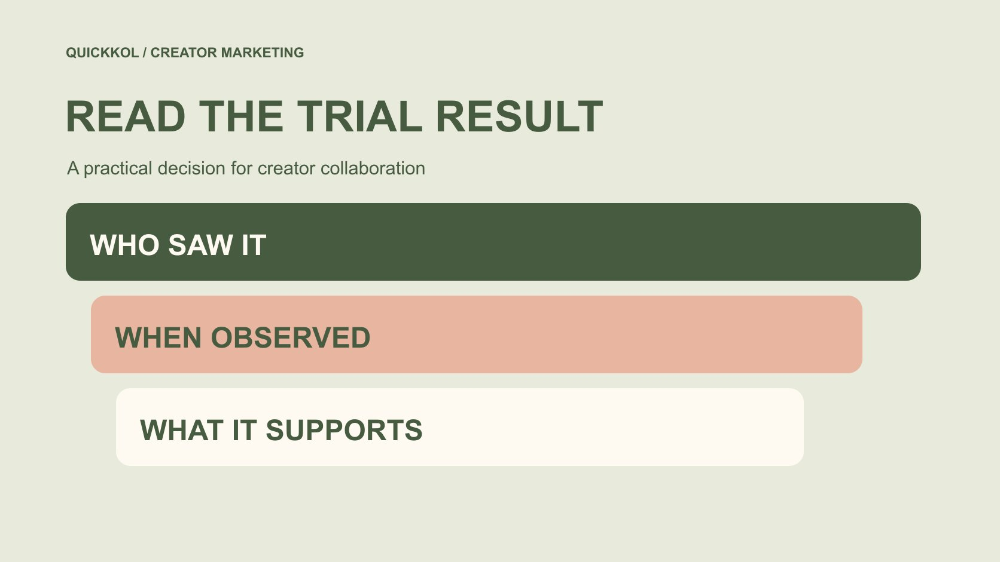
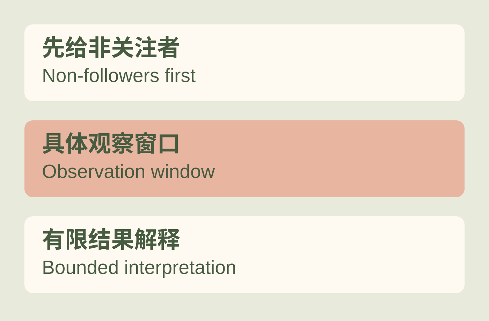

# Instagram Trial Reels: Interpret Creator Results

Status: local review draft; confirm the publication date before release.

Interpret Instagram Trial Reels through non-follower-first distribution, observation windows and sharing state, separating creative learning from proven partnership impact.

QuickKOL editorial graphic; not actual account metrics or a platform interface.

Instagram Trial Reels show work to non-followers first and can help creators learn about expression, but they are not private review or a randomized controlled experiment. Meta also notes that followers can encounter trials through other routes. Record the version, observation period and whether sharing to everyone has occurred before interpreting views, interactions and actual questions. Official growth figures concern defined groups and before-and-after comparisons, not expected results for this partnership. Use observations for the next content decision rather than declare a creative approach guaranteed to succeed.

## Define the decision the result should support

The brand may need to know whether the opening is clear, a question deserves another explanation or a different shot would help. These decisions differ and should not all depend only on total views.

Keep the question beside the work's version. Without one, it is easy to select an attractive number afterward and claim it was always the objective.

The [Trial Reels content-design article](https://www.quickkol.com/blog/trial-reels-creator-concept-test-design/#answer) plans what to explore. This guide concerns interpreting an existing result within scope instead of manufacturing an industry benchmark.

Agree how learning will be discussed before treating exploratory work as a guaranteed percentage outcome. The creator can then explain actual changes and the brand can make a particular decision. A useful review should identify the contribution and remaining uncertainty, giving both parties more than a ranking of which trial happened to accumulate the largest count.

## Non-follower-first does not mean private

[Meta’s official Trial Reels guide](https://about.fb.com/news/2024/12/trial-reels-try-content-non-followers-first-see-what-perfoms-best/) describes non-follower-first distribution while noting that followers may encounter work through direct-message sharing or audio, location and filter pages. It is not a private review space for material the brand has not agreed to publish.

Confirm assets, actual experience and scope before sharing. A trial does not temporarily remove those responsibilities or imply that only team members will see it.

Record actual use rather than rewrite unknown audience composition as entirely non-followers or a wholly different group. Distribution mode affects interpretation.

If internal review is needed, use a process suited to that purpose. Do not discover after exposure that creator and brand meant different things by test. The distinction lets trial publishing remain a legitimate creative activity without presenting its public audience as if it were an access-controlled group selected by the project.

## Record the window and sharing state together

[Meta’s official Trial Reels guide](https://about.fb.com/news/2024/12/trial-reels-try-content-non-followers-first-see-what-perfoms-best/) describes key metrics after approximately 24 hours and optional automatic sharing based on views in the first 72 hours. That is feature context, not a universal evaluation deadline for every assignment.

If the work later reaches everyone, subsequent counts may include another phase. Early trial observations and later totals should not be treated as identical conditions.

Record observation time, sharing state and version changes. Screenshots every minute are unnecessary, but a comparison record should explain what is being compared.

Automatic-sharing arrangements should fit the agreement. Brand and creator should know whether they are enabled rather than retrospectively present a system action as a strategy both had confirmed beforehand. For example, keep a snapshot taken before broader sharing distinct from a later snapshot after that change. Subtracting their cumulative totals can show a change in the recorded count, but does not isolate the number of new people attributable to one distribution mode. If the first snapshot was missed, state that rather than reconstruct an exact early-phase result from memory. The team can still review the creative work while acknowledging that the available observations do not separate those phases cleanly. A short state note can preserve this distinction and stop a report from attributing every later count to the original trial-only period.

Confirm audience scope, period and sharing phase before comparing results.

## Interpret views and interactions by their own meanings

Views, likes, comments and shares describe different actions. Do not call them one interchangeable kind of participation or interpret repeat actions and counts across phases as independent people.

The [creator-engagement data article](https://www.quickkol.com/blog/read-creator-engagement-data/#answer) explains definitions. Retain source, period and metric name at minimum, leaving unconfirmed fields unknown.

Comments may reveal confusion or disagreement. Volume alone does not establish brand support or purchases.

Read particular questions alongside the work before deciding what the next piece needs. Numbers help locate observations while creator and brand still interpret the content, rather than make one metric decide every creative choice. A result can show that an explanation attracted activity while leaving open whether people understood the central point, so include relevant substance instead of treating a total as a complete account of the audience response.

## Different trials are not automatically randomized experiments

Two works may differ in subject, footage, publishing time and distribution phase. Separate trials do not establish that identical audiences were randomly assigned to two versions.

If opening, music and product all changed, describe the multiple differences. A larger count does not isolate which element caused an increase.

Frame a result as a follow-up hypothesis: an explanation angle deserves another look or a shot may need addition. Hypotheses are useful without being presented as established causality.

Retain actual similarities and differences. Without enough information about comparable audiences and conditions, a limited comparison is more reliable than experimental language creating an appearance of precision. The team can still decide what to try next, while keeping clear that an editorial choice informed by observation is different from a proven universal performance rule.

## Keep the population and method with official research

[Meta’s 2025 Trial Reels analysis](https://about.fb.com/news/2025/06/inspiring-creativity-that-brings-people-together/) describes an internal before-and-after study of over 400,000 active creators: 40% posted Reels more frequently, and 80% of that subgroup increased non-follower reach. The 80% does not concern every creator.

The note compares a month before and after first use and controls for confounding factors. It is not a randomized test of this brand's work or a guarantee, so it should not become a project forecast or qualification threshold.

Keep limitations beside numbers. Copying only 80% growth changes the conclusion by losing denominator and scope.

The material can explain the creative exploration the product intends to support, while this collaboration needs its own work and evidence. General platform analysis cannot provide an earnings or reach promise for a particular creator. Use it as background rather than a result that the creator has already agreed to reproduce.

## Turn the observation into a specific content revision

Ask whether the opening identifies the question, action is visible, captions retain conditions and viewers need another explanation. A lower result should not trigger only requests for faster or louder work.

[Meta’s Instagram creator-guidance announcement](https://about.fb.com/news/2024/10/best-practices-education-hub-creators-instagram/) covers creation and engagement with personalized advice. It reminds the team to consider account and content instead of applying one number to every work.

If facts are missing, the brand supplies them; for experience, the creator confirms; for visual understanding, the producer handles a shot. Different revisions need different owners.

Give a clear reason for a change instead of revising everything and claiming one factor was validated. A small, explicit learning is easier to carry into the next partnership. It lets the team improve the work without asking the creator to defend an entire creative approach based on one trial's incomplete measurement.

## Return to the agreement before broader sharing

Sharing to everyone after a trial still depends on the work and agreement. An attractive count does not expand creator permission or alter the version the brand agreed.

For advertising, re-editing or another channel, check use and identity presentation separately. A trial result is an observation, not a new commercial license.

If a condition expired, update it instead of preserving outdated information to retain an early result. Accuracy belongs in the broader-sharing decision.

Record the decision and owner. Not every trial needs to become a complete campaign; some support further research and others need not continue. That preserves the purpose of exploration while keeping actual publication within the scope both parties can explain, rather than letting one performance number silently authorize every later use of the work.

## Illustrate a limited conclusion through a hypothetical trial

Imagine a creator trialing equipment-organization content while viewers repeatedly ask about a poorly visible step. Brand and creator review the work and choose a detail shot for the next version.

Retain the observation window and sharing state rather than assign later everyone-sharing totals entirely to the early non-follower-first phase. A larger subsequent count also does not prove the detail shot alone caused growth.

The usable handoff is a learning: the explanation had a gap, the next version adds the relevant action and observation continues within a suitable scope.

This example contains no real data. Trials can inform a content decision even when the team cannot isolate the effect of every element precisely. The improvement is an executable production request, not a fabricated claim that a hypothetical result has established a guaranteed formula.

## Keep the review within explainable boundaries

Retain version, observation period, sharing state, findings, unknowns and next decision. A trial successful label alone leaves future readers unable to assess its meaning.

Incomplete information can justify further research without invented attribution. Creator contribution, viewer understanding and commercial effects can be assessed separately.

A reliable Trial Reels Instagram review learns how to explain more clearly within actual scope and identifies what remains unproven. Non-follower-first distribution and automatic sharing do not provide an unrestricted experiment or a performance guarantee.

That record helps brand and creator continue: what to change, why and which information the next round needs. It replaces debate about percentages without denominators with a production and observation plan both parties can understand, while leaving uncertainty visible where the evidence has not resolved it.

## What Trial Reels observations support

| Observation | Can inform | Does not establish |
| --- | --- | --- |
| Views and interactions | Response to the work | Purchases or universal approval |
| Trial and broader sharing | Observations across phases | Identical-condition comparison |
| Two creative versions | A follow-up hypothesis | Randomized causal result |
| Official before-and-after analysis | Scoped product context | Guaranteed partnership performance |

Editorial interpretation framework without benchmark thresholds, guaranteed growth or private-trial promises.

## Before interpreting a trial result

Establish the result’s scope first.

- [ ] Record the work and version.
- [ ] State period and sharing phase.
- [ ] Interpret counts separately.
- [ ] Retain comparison differences and study limits.
- [ ] Assign the content revision owner.
- [ ] Check further use against the agreement.

## Research date and limitations

Sources reviewed November 18, 2026. Methods, tables and decision rules are editorial recommendations. Hypothetical examples are not actual client results or industry benchmarks. Source geography and periods are specified where relevant.

## Start creator research with a clear task

Use QuickKOL to interpret a brief, discover relevant creators and research their work and contact routes. Verify data, commercial terms and outcomes at their source.

[Explore QuickKOL](https://www.quickkol.com/#capabilities)

## Sources

- [Meta’s official Trial Reels guide](https://about.fb.com/news/2024/12/trial-reels-try-content-non-followers-first-see-what-perfoms-best/)
- [Meta’s 2025 Trial Reels analysis](https://about.fb.com/news/2025/06/inspiring-creativity-that-brings-people-together/)
- [Meta’s Instagram creator-guidance announcement](https://about.fb.com/news/2024/10/best-practices-education-hub-creators-instagram/)
