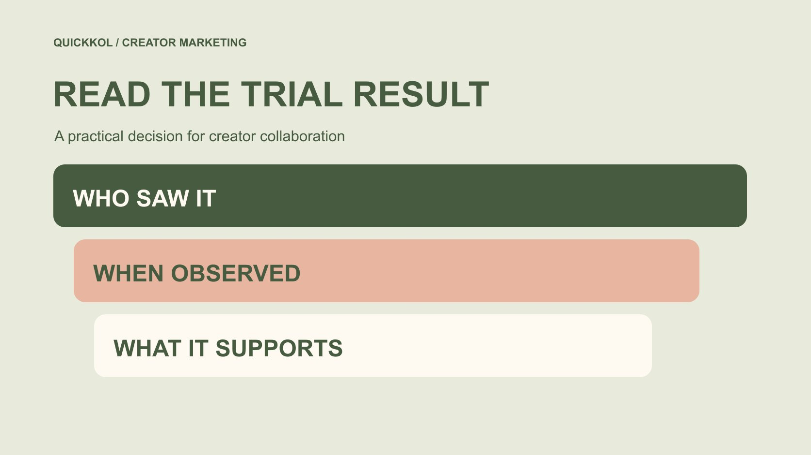
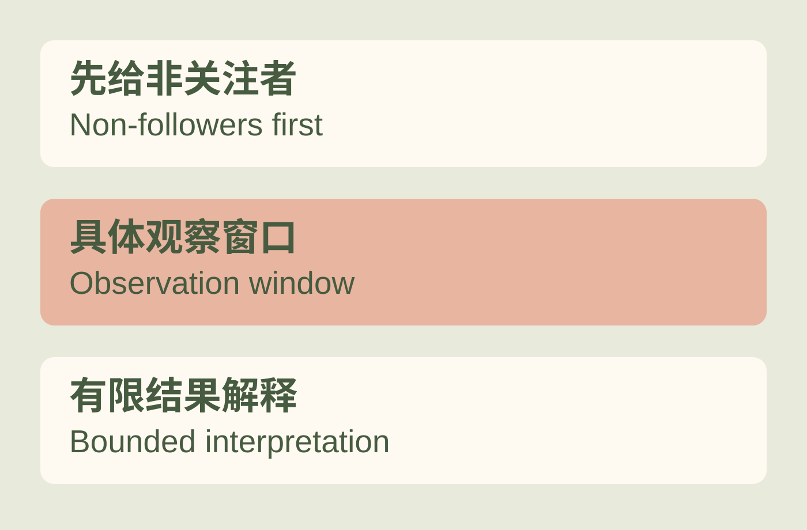

# Trial Reels 结果怎样进入达人复盘

状态：本地审阅稿；正式发布日期待确认。

解读 Instagram Trial Reels 时保留非关注者优先、观察窗口与分享状态，区分内容学习和已经证明的合作效果。

QuickKOL 编辑图形；不呈现真实账号指标或平台界面。

Instagram Trial Reels 先向非关注者展示内容，结果可以帮助创作者研究表达，但不能直接当成私密审稿或随机对照实验。Meta 的说明也提到粉丝仍可能从其他入口遇到作品。复盘先记录发布版本、观察期、当时是否已向所有人分享，再分别看浏览、互动与实际问题。官方报告中的增长数字也有特定群体和前后比较范围，不是本次达人合作的预期。品牌应从结果形成下一项内容决定，而不是宣布某种创意必然成功。

## 先问这次结果要支持什么决定

品牌可能想知道开场是否清楚、某个问题是否值得继续解释，或下一条是否需要不同镜头。这些决定不同，不应都只看一个总浏览。

把问题与作品版本写在一起。若没有明确研究问题，结果出来以后很容易挑一个好看的数字，事后宣称原来就是为了它。

[Trial Reels 内容设计文章](https://www.quickkol.com/zh/blog/trial-reels-creator-concept-test-design/#answer)帮助规划要探索什么。本篇集中在结果已经出现以后，怎样把观察放回正确范围，不重复制作一份虚构的行业基准。

对达人合作，先约定如何讨论学习，而不是把探索性作品包装成必须达到某个比例的保证。这样创作者可以解释实际变化，品牌也能作具体决定。

## 非关注者优先不等于完全私密

[Meta 的 Trial Reels 官方说明](https://about.fb.com/news/2024/12/trial-reels-try-content-non-followers-first-see-what-perfoms-best/)把它描述为先向非关注者展示，同时说明粉丝可能通过私信分享、相同音频、位置或滤镜等入口看到。不能把它作为品牌尚未同意公开内容的私密审稿区。

因此发布前仍需确认素材、真实体验与合作范围。试发不是暂时免去这些确认的理由，也不应被理解成观众只有团队内部人员。

复盘时记录实际使用方式，不把未知受众自动改写成全部非粉丝或完全不同的一组人。作品分发方式影响解释范围。

如果品牌需要内部审阅，使用适合该用途的工作方式。不要等到内容已经被看到，才发现双方把“测试”理解成不同的公开程度。

## 同时记录观察期与分享状态

[Meta 的 Trial Reels 官方说明](https://about.fb.com/news/2024/12/trial-reels-try-content-non-followers-first-see-what-perfoms-best/)介绍了约 24 小时后的关键指标，也介绍可选择的自动分享：依据最初 72 小时的浏览表现决定是否进一步分享。这里是该说明中的功能背景，不是所有项目统一的评估截止时间。

如果作品后来向所有人分享，后续计数可能涉及不同阶段。不要把试发早期与进一步分享后的总数当成完全相同条件下的结果。

例如把进一步分享前的记录与分享后的记录分开。两个累计数相减，可以说明记录计数的变化，却不能分离某种分发方式带来的独立人数。若错过早期记录，就保留缺失，不凭记忆还原精确结果。仍可研究创意本身，但要承认资料无法清楚分离不同阶段。记录实际观察时间、当时状态和是否发生版本变化。不需要每分钟截屏，但用于比较的记录应能够说明自己在比较什么。

自动分享安排也要与合作范围相符。品牌和创作者应知道是否启用，不把一个系统决定发生以后才补写成双方事先确认的发布策略。

比较结果之前，先确认观看范围、时期与分享阶段。

## 浏览与互动先按各自含义阅读

浏览、点赞、评论和分享描述不同动作。不要把它们都称为同一种参与，也不要把重复动作或不同阶段的计数直接解释成独立人数。

[达人互动数据文章](https://www.quickkol.com/zh/blog/read-creator-engagement-data/#answer)帮助说明口径。报告至少保留来源、时期与指标名称，无法确认的字段不要填入推测值。

评论可以暴露观众不懂的地方，也可能表达不同意。数量本身不证明品牌支持，更不能直接写成购买。

结合作品看具体问题，再判断下一条需要什么。数字帮助定位观察，创作者和品牌仍需解释实际内容，而不是让单一指标替他们作全部创意判断。

## 不同试发不自动构成随机实验

两条作品可能在主题、镜头、发布时间与分发阶段上都不同。即使分别试发，也不能直接宣称系统把完全相同人群随机分配给两个版本。

如果同时改变开场、音乐和产品，就说明比较包含多项变化。一个版本计数较高，不单独证明其中某个元素导致提升。

可以把结果写成后续假设：这个解释角度值得再研究，或者某个镜头可能需要补充。假设有用，不需要被包装为已经证实的因果结论。

比较时保留真实相似点与差异。如果没有足够资料确认受众与条件一致，承认有限比较，比使用实验术语制造精确感更可靠。

## 官方研究保留群体与方法

[Meta 的 2025 年 Trial Reels 分析](https://about.fb.com/news/2025/06/inspiring-creativity-that-brings-people-together/)提到超过 40 万名活跃创作者的内部前后比较：40% 开始更频繁发布，在这些人中，80% 的非关注者触达增加。80% 不是全部创作者的比例。

方法说明比较首次使用前后各一个月，并控制混杂因素；它不是品牌本次作品的随机试验，也不保证未来表现。不要把这组数字直接写成项目预测或行业合格线。

引用时让限定条件紧挨数字。只复制“80% 增长”会改变结论，让读者无法知道分母与观察范围。

品牌可以从中理解产品希望支持的创作探索，但自己的合作仍需自己的作品与数据。平台总体材料不能替具体创作者作收益或触达承诺。

## 把结果转成下一项内容修改

复盘可以问开场是否准确提出问题，动作是否看清，字幕是否保留条件，以及观众还需要哪种解释。不要只在结果低时要求更快、更热闹。

[Meta 的 Instagram 创作者建议入口](https://about.fb.com/news/2024/10/best-practices-education-hub-creators-instagram/)介绍不同创作与互动主题，并提供个性化建议。这可以提醒团队结合账户与内容，不拿一个统一数值决定全部作品。

如果问题在产品事实，品牌补资料；如果在体验表达，创作者确认；如果在画面理解，制作人处理具体镜头。不同改动需要不同负责人。

一次修改给出清楚理由，不同时改掉所有内容后又声称已经验证某一个因素。小而明确的学习，更方便带入下一轮合作。

## 进一步分享先确认合作范围

试发之后是否向所有人分享，仍要结合内容与约定。一个看起来好的计数，不会自动扩大创作者的授权或改变品牌已经确认的版本。

如果打算改成广告、重剪或搬到其他渠道，单独核对用途与身份呈现。试发结果是内容观察，不是新的商业许可。

若某个条件已经过期，先更新而不是为了保留早期表现继续沿用旧信息。实际发布的准确性应当与是否进一步分享一起判断。

记录这次决定与负责人。没有必要把每条试发都升级成完整活动；有些结果适合补充研究，也有些内容可以不继续。

## 用一次假设试发说明有限结论

假设一个创作者试发器具整理内容，观众持续问一个没有看清的步骤。品牌与本人核对后，认为下一版应该补一个细节镜头。

同时保留观察期与分享状态，不把后来向所有人分享后的总数，全部当成早期非关注者阶段结果。也不从补拍后的较高计数证明细节镜头单独导致增长。

真正可以交接的是具体学习：原解释存在缺口，下一版补充相应动作，然后在合适范围继续观察。

这个例子没有真实数据。它说明试发可以帮助内容决定，即使团队还没有足够资料精确分离每个元素的效果。

## 复盘结论保留可以解释的边界

最终记录作品版本、观察期、分享状态、主要观察、未知与下一项决定。不要只留下一个“试发成功”标签，让后来的人无法判断含义。

资料不完整时可以继续研究，但不需要用推测补成完整归因。创作者贡献、观众理解与商业效果可以分别评估。

Trial Reels Instagram 的可靠复盘，是在真实范围内学习怎样讲得更清楚，并说明哪些结果尚未得到证明。非关注者优先与自动分享功能，不提供无限制实验或表现保证。

这样的记录能让品牌和创作者继续合作：知道该改什么、为什么改，以及下一轮需要什么资料，而不是围绕没有分母的百分比反复争论。

## Trial Reels 观察支持什么

| 观察 | 可以讨论 | 不能直接证明 |
| --- | --- | --- |
| 浏览与互动 | 实际作品反应 | 购买或全部用户认同 |
| 试发与进一步分享 | 不同阶段的观察 | 完全同条件比较 |
| 两条创意差异 | 下一步假设 | 随机对照因果结果 |
| 官方前后分析 | 有范围的产品背景 | 本次合作必然表现 |

编辑解读框架；不提供行业合格线、保证增长或私密试发承诺。

## 解释试发结果之前

先确认结果属于什么范围。

- [ ] 记录具体作品与版本。
- [ ] 注明观察期与分享状态。
- [ ] 分别理解各项计数。
- [ ] 保留比较差异与研究限制。
- [ ] 为内容修改安排负责人。
- [ ] 将进一步使用回到合作约定。

## 研究日期与使用边界

资料核验于 2026 年 11 月 18 日。文中方法、表格和决策规则为编辑建议，标为假设的示例不是实际客户结果或行业基准。外部资料的适用地区与时期按各段说明。

## 从任务开始达人研究

用 QuickKOL 理解 Brief、发现相关达人并研究作品与联系路径；数据、合作条件和结果仍需核验。

[了解 QuickKOL](https://www.quickkol.com/#capabilities)

## 来源

- [Meta 的 Trial Reels 官方说明](https://about.fb.com/news/2024/12/trial-reels-try-content-non-followers-first-see-what-perfoms-best/)
- [Meta 的 2025 年 Trial Reels 分析](https://about.fb.com/news/2025/06/inspiring-creativity-that-brings-people-together/)
- [Meta 的 Instagram 创作者建议入口](https://about.fb.com/news/2024/10/best-practices-education-hub-creators-instagram/)
