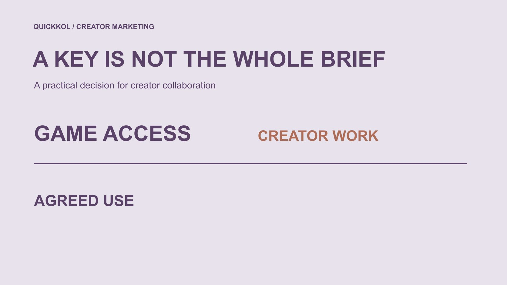
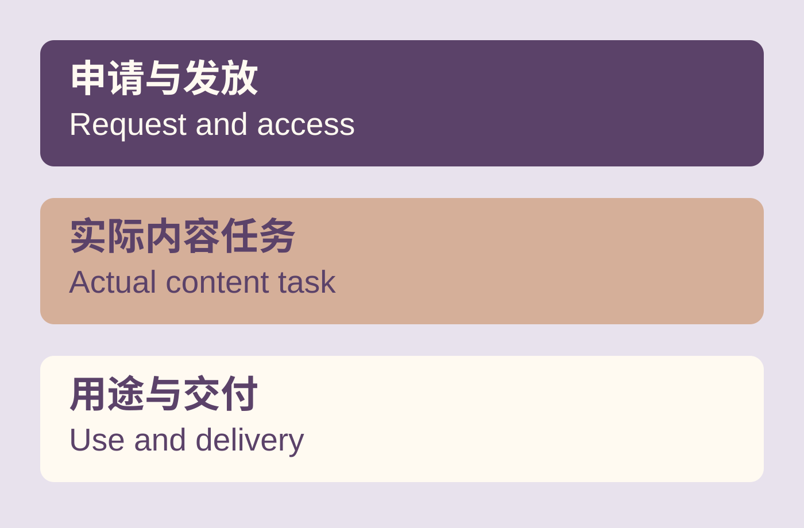

# Key Mailer: Define the Creator Assignment

Status: local review draft; confirm the publication date before release.

Resolve key mailer to Keymailer for game-creator partnerships, then separate requests, game access, editorial coverage and a specifically commissioned assignment.

QuickKOL editorial graphic; not actual account metrics or a platform interface.

Key mailer generally refers to Keymailer, a game-partnership platform for publishers, developers, creators and press. Separate requesting a game, receiving a code, accepting specific conditions and completing content. Code delivery should not become proof of purchased praise or a finished sponsored video; the actual commitment depends on the invitation and agreement. Define the game version, relevant channel, proposed contribution and release conditions before managing work and outcomes, rather than evaluate the program only through codes sent.

## Start with interest, then examine relevant work

[Keymailer’s official FAQ](https://www.keymailer.co/allfaq) describes creators requesting games of interest and publishers deciding allocation using relevant information. Supply and selection have limits; a request does not guarantee access.

For the brand, interest is a lead to investigate rather than a completed fit decision. A channel explaining strategy systems can have a different role from one primarily producing entertainment streams.

The [game-key coverage-pilot guide](https://www.quickkol.com/blog/keymailer-game-key-coverage-pilot/#answer) covers basic distribution and coverage. This article focuses on the work actually accepted, avoiding every positive platform state becoming a completed partnership.

Retain relevant work, the real channel and proposed task. Follower size provides context without independently establishing suitability for this game or capacity under the current arrangement. An initial review should be able to explain why the person's work belongs in the discussion, allowing the invitation to identify a contribution instead of merely offering a code and hoping both sides imagine the same outcome.

## Confirm game access and the assignment separately

A code provides access under applicable conditions without independently specifying content volume, review or reuse. Describe a review copy, editorial coverage and paid collaboration according to the actual arrangement.

Different FAQ passages address general expectations, coverage commitments and conditions accepted with invitations. Do not isolate one sentence to promise that every code has no obligations or that every redemption guarantees timely publication.

The agreement should identify format, main task, participating channel and conditions needing discussion. If the game is only provided for consideration, do not record a purchased video internally.

For commissioned content, give the creator an assessable brief and commercial scope. Access, production, publication and later use can connect while remaining separately answerable. That distinction also makes a refusal useful: a creator may be interested in trying the game but unable to accept a particular filming deadline, or able to explain one game system without committing to a longer broadcast the brand had assumed was included.

## Make version and platform ready for production

Confirm game identity, build, code platform and region, plus the conditions for actual experience. A code for one platform should not be sent to a creator using another without confirmation.

Multiplayer work can need participants, separate codes and an available environment. Identify who supplies and confirms them instead of treating a successful single-player launch as readiness for the entire broadcast.

If servers, builds or features are unavailable, record the dependency. Reminders cannot complete an assignment when a creator has a code but cannot enter the experience they need to show.

A short readiness record can identify the experience, current scope and contact before production. It does not guarantee the game is problem-free everywhere; it makes the next dependency actionable. This also prevents an ordinary technical issue from becoming an immediate judgment about creator reliability, giving the publisher an opportunity to resolve access before asking why content has not appeared.

## Make release conditions executable

Preview material can involve an embargo, display boundaries or asset conditions. Check the actual invitation, name the date and time zone, and establish applicability to streams, videos, stills and clips.

Friday publication leaves people in different regions guessing. Recording, upload, visible release and the start of a stream are different actions; connect timing with the one actually restricted.

Notify relevant owners when conditions change and confirm understanding. Editing a shared document alone should not leave an operator scheduling from an older record.

Ask the appropriate contact about uncertainty rather than expand display scope by guessing. Creative expression can retain autonomy while release conditions remain executable. A useful final note identifies the accepted condition and who needs to act on it, so the creator does not have to reconstruct the latest instruction from several messages sent by different people on the publisher's team.

A code opens game access; specific confirmation defines the assignment.

## Preserve experience and brand claims accurately

A game partnership can ask for explanation of a system or an actual experience without making receipt of a code a requirement to like the product. The creator should be able to distinguish what they experienced from what remains unexplored.

[FTC’s influencer disclosure guide](https://www.ftc.gov/business-guidance/resources/disclosures-101-social-media-influencers) addresses free products, material connections and actual experience in applicable US contexts. Do not request an experience-based conclusion about unused content or make praise the unstated exchange for every access invitation.

Separate factual correction from controlling opinion. A wrong build name can be checked; a genuine experience should not simply become promotional dialogue.

If an intended statement depends on an unopened feature, revise the task or retain uncertainty. Accurate content supports a more workable partnership than a strong conclusion unsupported by experience. This gives a reviewer a practical question: is the proposed correction fixing a fact, clarifying an observation or asking the creator to say something different about what they actually encountered?

## Check the publishing channel and commercial context

Specify the participating channel rather than assume publication anywhere satisfies the same task because several accounts are connected. Shorts, long videos and streams may have different deliverable arrangements.

[YouTube’s branded-content disclosure guide](https://support.google.com/youtube/answer/154235?hl=en) requires relevant creators to notify the platform of commercial content and notes other applicable obligations. A platform label does not replace every disclosure or establish every brand use of the video.

Before release, check content, wording, game build and relationship context. Record the channel and version when the actual link appears, distinguishing uploaded, public and completed work.

If content cannot be found at the expected location, ask before alleging nonperformance. A link, category, visibility or status issue may explain the discrepancy. Specific records help both sides locate what needs action instead of argue over whether a broad label such as posted means the same thing to the creator, publisher and person preparing the campaign report.

## Review material beyond the gameplay itself

Game access does not independently resolve every use of music or other material across channels. If an invitation carries asset-specific conditions, both producer and creator need to understand them.

The [U.S. Copyright Office’s copyright overview](https://www.copyright.gov/what-is-copyright/) distinguishes original works and associated uses. Advertising edits, translation or continuing display of a creator video need scope confirmation rather than an inference from a code-distribution record.

The [creator-ad permission guide](https://www.quickkol.com/blog/what-is-whitelisting-creator-ad-permissions/#answer) separates publication from later use. Make a defined request for each planned use and version instead of seeking control of the whole account for convenience.

If reporting needs only a work link, collecting all source files is unnecessary. Keep access proportional to the business task. This produces a clearer handoff and reduces the chance that unconfirmed material enters an advertisement merely because someone received it in a production folder and assumed every included file had the same commercial status.

## Work through a hypothetical strategy-game explanation

Suppose a publisher wants a strategy creator to explain one system. After the creator requests the game, the team reviews relevant work and confirms platform, build and available experience.

If both sides commission an explanation video, confirm the task and commercial terms separately, including channel and release conditions. The creator experiences the game and the brand supplies factual material without a predetermined positive opinion.

After publication, inspect the actual work against the assignment before reviewing scoped observations. Report codes offered, redeemed access and completed content separately; redemption is not audience exposure.

This hypothetical contains no client result. It connects a Keymailer access lead with real creator work instead of importing platform features or promotional claims into the campaign's results. The final record can identify the next question, such as whether a supplied link is public or an additional use was agreed, allowing an owner to continue without guessing what was included in the original offer.

## Deliver a partnership record the next owner can use

Retain game, build, creator, channel, accepted conditions, content and next action. An unknown is not zero, and an unanswered request should not automatically become a reliability judgment.

The brand-side value of key mailer research is finding relevant interest and turning it into an assessable collaboration, not guaranteeing a specified outcome for every code. Platform material provides context, agreement identifies work and actual links establish completion.

With status, task and use separated, the publisher knows where support is needed and the creator knows what was accepted. Improvement can address a real stage rather than merely send more codes, issue more reminders or raise a follower threshold. A clear closing note can identify completed work and continuing obligations together, leaving the next owner a usable record rather than a distribution total that cannot explain what actually happened.

## Check tracking gaps before judging completion

The FAQ explains tracking through authorized channels and information such as game tags or categories. That supplies a recording route rather than proof that every item appears automatically without omissions.

If a creator reports publication but the report is missing it, check the actual link, channel, game identity and visibility. Route category or support questions to the appropriate owner instead of requesting a pointless duplicate release merely to make a dashboard record appear.

Completion should return to the task and actual content. Retain a missing report entry as pending verification, not a true zero or a judgment of commercial integrity. A concise reconciliation note can identify what was observed directly and what the platform still needs to associate, allowing the campaign report to remain accurate without withholding recognition of work that has already been verified.

## Separate code and work status

| Record | Can establish | Cannot establish alone |
| --- | --- | --- |
| Request | Interest in the game | Access or agreement |
| Code access | Access under conditions | Praise or a defined deliverable |
| Defined assignment | Accepted format, channel and scope | Public release |
| Actual content | Corresponding work and status | Every future use or causal sales |

Editorial handoff framework; actual invitations and confirmed terms determine code and content obligations.

## Turn a code invitation into a defined task

Establish what was actually accepted.

- [ ] Research relevant work and channel.
- [ ] Confirm game, build, region and platform.
- [ ] Separate access, coverage and commissioned work.
- [ ] State release conditions and time zone.
- [ ] Retain actual experience and commercial context.
- [ ] Record completion and later use against actual work.

## Research date and limitations

Sources reviewed November 18, 2026. Methods, tables and decision rules are editorial recommendations. Hypothetical examples are not actual client results or industry benchmarks. Source geography and periods are specified where relevant.

## Start creator research with a clear task

Use QuickKOL to interpret a brief, discover relevant creators and research their work and contact routes. Verify data, commercial terms and outcomes at their source.

[Explore QuickKOL](https://www.quickkol.com/#capabilities)

## Sources

- [Keymailer’s official FAQ](https://www.keymailer.co/allfaq)
- [FTC’s influencer disclosure guide](https://www.ftc.gov/business-guidance/resources/disclosures-101-social-media-influencers)
- [YouTube: branded-content restrictions and labels](https://support.google.com/youtube/answer/154235?hl=en)
- [U.S. Copyright Office’s copyright overview](https://www.copyright.gov/what-is-copyright/)
