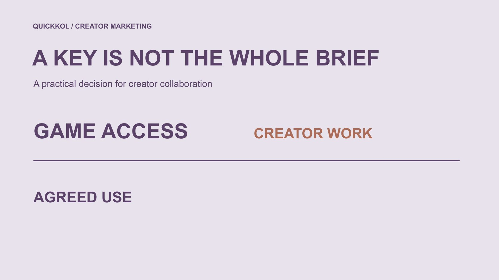
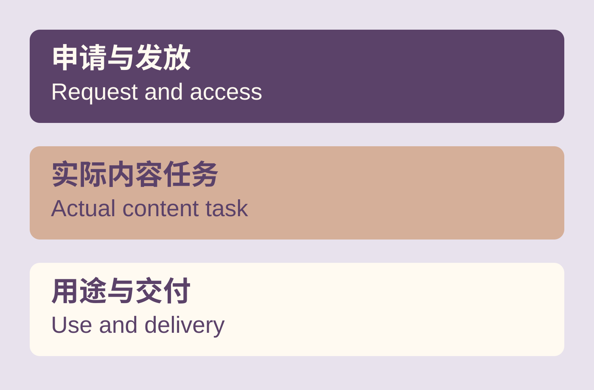

# Keymailer 申请怎样转成明确合作

状态：本地审阅稿；正式发布日期待确认。

把 key mailer 搜索对应到 Keymailer 的游戏创作者合作，再分清申请、游戏访问、编辑报道和明确委托的内容工作。

QuickKOL 编辑图形；不呈现真实账号指标或平台界面。

Key mailer 通常是在搜索 Keymailer，面向游戏发行商、开发者、创作者与媒体的游戏合作平台。品牌需要区分创作者申请游戏、获得代码、接受具体条件和完成内容。发放代码不应被直接写成已购买好评或已完成某条赞助视频；实际承诺要看具体邀请和双方确认。先说明游戏版本、相关频道、希望讨论的贡献与发布条件，再管理实际工作和结果，而不是只统计发出了多少代码。

## 先从申请者兴趣进入作品研究

[Keymailer 的官方问答](https://www.keymailer.co/allfaq)说明，创作者可以申请感兴趣的游戏，发行方再依据相关信息决定发放。游戏代码供应与选择有实际限制，申请并不是保证获得访问。

对品牌而言，申请提供一条愿意了解游戏的线索，下一步仍要看作品与任务。擅长解释策略系统的频道，与主要提供娱乐直播的频道，可以有不同合作角色。

[游戏代码合作试点指南](https://www.quickkol.com/zh/blog/keymailer-game-key-coverage-pilot/#answer)讨论基础发放与覆盖。本篇聚焦“具体接受了什么工作”，避免把平台里任何一个积极状态都解释成完成合作。

研究记录保留相关作品、实际频道与拟讨论任务。粉丝规模可以提供背景，但不能单独回答作品是否适合介绍本次游戏，或创作者是否有能力在当前安排中完成它。

## 游戏访问与内容委托分开确认

获得代码意味着可以按条件访问相应游戏，不自动说明要交多少内容、由谁审阅或品牌能复用什么。免费试玩、编辑报道与付费合作应按实际安排说明。

Keymailer 问答不同段落同时谈到一般内容预期、覆盖承诺和接受邀请中的条件。因此不能抽出一句概括，就宣称所有代码都无义务，或所有领取都保证按时发布。

实际合作确认应写清内容形式、主要任务、参与频道与需要讨论的条件。若只是提供游戏供了解，不要在内部报表里记成已购买视频。

如果确实委托内容，给出可评估的 Brief 与商业范围，让创作者确认。访问、制作、发布和后续用途可以关联，但应能分别回答，而不是全部藏在“合作一下”里。

## 版本与平台先达到可制作状态

确认游戏名称、版本、代码适用平台和地区，以及实际能开始体验的条件。面向某个平台的代码，不应在没有确认时发给使用另一平台的创作者。

多人内容可能还需要其他参与者、各自代码或联机环境。提前说明谁提供、谁确认，不把一个单人可启动的测试当成整场多人内容已经准备好。

如果服务器、版本或功能还没可用，标明等待条件。创作者拿到代码但无法进入需要展示的内容，增加提醒不会让实际任务完成。

制作前可以用一份简短准备记录核对：需要展示的体验、当前可用范围和问题联系人。它不是保证游戏在所有环境都没有问题，而是让双方知道下一项依赖由谁处理。

## 把禁发条件写成可执行时间

预览内容可能有禁发时间、可展示范围或素材条件。确认实际邀请附带的要求，写明日期和时区，再检查直播、视频、截图与短片是否分别适用。

不能仅凭“周五发布”让分处不同地区的人自行猜时间。预录、上传、可见发布和直播开始也不是同一动作；时间安排应对应真正受限制的动作。

若条件变化，通知相关负责人并取得实际理解。不要只在一个共享文档里改时间，却让已经准备排期的人继续按旧记录执行。

有疑问时向合适联系人确认，不用猜测扩展可展示范围。创作者的表达可以有自主空间，约定的发行条件仍需要能准确执行的版本。

代码打开游戏入口，具体确认才定义合作任务。

## 把体验与品牌主张保留真实

游戏合作可以要求说明某项系统或展示实际体验，不能把收到代码当成必须喜欢产品的理由。创作者应能真实说明自己看到什么，以及还没有体验什么。

[FTC 的达人披露指南](https://www.ftc.gov/business-guidance/resources/disclosures-101-social-media-influencers)在适用美国语境下说明免费产品等关系和实际体验。品牌不能要求对未使用的内容给出体验式结论，也不应把好评作为所有访问邀请的默认交换。

审稿需要区分事实更正与观点控制。版本名称写错可以核对，创作者对体验的真实看法不能简单改成宣传台词。

如果某个观点来自尚未开放的功能，先调整任务或保留未知。准确内容比一条无法由真实体验支持的强结论，更适合形成可持续的达人合作。

## 发布频道与商业标注一起核对

参与频道需要在任务中明确，不能因为创作者连接多个账号，就默认任何一个发布都满足同一任务。短片、长视频和直播也可能有不同交付安排。

[YouTube 的商业内容标注说明](https://support.google.com/youtube/answer/154235?hl=en)要求符合情境的创作者向平台声明商业关系，并提醒还存在其他适用要求。平台标签不替代全部实际说明，也不代表品牌已经取得视频所有用途。

发布前检查内容、文字、游戏版本与关系表达。实际链接出来后记录对应频道和版本，区分已上传、已公开与已完成约定工作。

没有在预期位置找到内容时先询问，不立即指控未履约。可能存在链接、分类、可见性或状态问题，具体记录有助于双方找到真正需要处理的部分。

## 游戏画面之外的素材也要确认

获得游戏访问，不自动解决其中音乐或其他材料在所有渠道的使用安排。邀请中若有特定素材条件，制作人与创作者都应知道如何处理。

[美国版权局的版权说明](https://www.copyright.gov/what-is-copyright/)区分原创作品与相应用途。品牌希望把创作者视频剪成广告、翻译或长期保留，需要确认具体范围，而不是从一份代码发放记录推断。

[达人广告许可指南](https://www.quickkol.com/zh/blog/what-is-whitelisting-creator-ad-permissions/#answer)帮助把发布与后续使用分开。为每项计划用途提出明确请求，说明实际版本与范围，让对方能判断，而不要求开放整个账号作为方便。

若只需要报告作品链接，就不必把全部原始文件收走。实际业务需要与素材访问保持对应，交接更清楚，也减少将未确认材料误带入广告的机会。

## 用一项策略游戏讲解作例子

假设发行方希望一位擅长策略内容的创作者介绍一项系统。对方申请游戏后，团队先研究相关作品，再确认平台、版本与可体验范围。

如果双方决定委托一条讲解视频，就单独确认任务与商业条件，写明实际发布频道和适用时间。创作者收到访问后体验产品，品牌提供事实资料，不能预先要求正面评价。

内容发布后核对实际作品与约定任务，再观察有范围的记录。代码数量、领取数量和完成内容数量分别报告，不把一个领取动作写成已经触达观众。

这是假设工作过程，没有真实客户结果。它让 Keymailer 的访问线索连接到实际达人工作，而不是把平台功能或供应商的推广说法移用为本项目成绩。

## 交付可继续处理的合作记录

最终记录保留游戏、版本、创作者、频道、实际接受条件、内容与下一步。未知事项不要写成零，申请未回应也不应自动解释为对方不可靠。

Key mailer 的品牌侧价值，在于帮助发现相关兴趣并把它转为可以讨论的合作，而不是保证每个代码都产生指定结果。平台资料提供背景，双方确认说明工作，实际链接说明完成情况。

当状态、任务和用途分开，发行方能判断哪里需要支持，创作者也知道自己接受什么。下一轮改进可以针对真实环节，而不是只要求多发代码、多催几次或把粉丝门槛抬高。

## 先复核追踪遗漏，再判断完成

Keymailer 问答说明内容追踪会使用获得授权的频道，以及游戏标签或分类等信息。它提供一种记录路径，不表示所有内容都能无遗漏地自动出现。

若创作者说已发布但报表缺少，先核对实际链接、频道、游戏名称与可见性。由适当负责人处理分类或支持问题，不要求创作者为了让后台出现记录而无意义重复发布。

完成判断应回到任务与实际内容。报告中的缺失保留为待核对，不当成真实零，也不把技术追踪状态直接等同于对方的商业诚信。

## 把代码状态与工作状态分开

| 记录 | 可以说明 | 不能直接说明 |
| --- | --- | --- |
| 申请 | 希望了解游戏 | 已获代码或已签约 |
| 代码访问 | 按条件获得访问 | 好评或指定交付 |
| 明确任务 | 接受的形式、频道与范围 | 已经公开发布 |
| 实际作品 | 对应内容与完成状态 | 所有未来用途或销售因果 |

编辑交接框架；具体代码与内容义务以实际邀请和确认条件为准。

## 把代码邀请变成明确任务

先问对方实际接受什么。

- [ ] 研究相关作品与实际频道。
- [ ] 确认游戏、版本、地区与平台。
- [ ] 区分访问、报道与委托内容。
- [ ] 写明发布条件与时区。
- [ ] 保留真实体验与商业背景。
- [ ] 按实际作品记录完成与后续用途。

## 研究日期与使用边界

资料核验于 2026 年 11 月 18 日。文中方法、表格和决策规则为编辑建议，标为假设的示例不是实际客户结果或行业基准。外部资料的适用地区与时期按各段说明。

## 从任务开始达人研究

用 QuickKOL 理解 Brief、发现相关达人并研究作品与联系路径；数据、合作条件和结果仍需核验。

[了解 QuickKOL](https://www.quickkol.com/#capabilities)

## 来源

- [Keymailer 的官方问答](https://www.keymailer.co/allfaq)
- [FTC 的达人披露指南](https://www.ftc.gov/business-guidance/resources/disclosures-101-social-media-influencers)
- [YouTube：商业内容限制与标注](https://support.google.com/youtube/answer/154235?hl=en)
- [美国版权局的版权说明](https://www.copyright.gov/what-is-copyright/)
