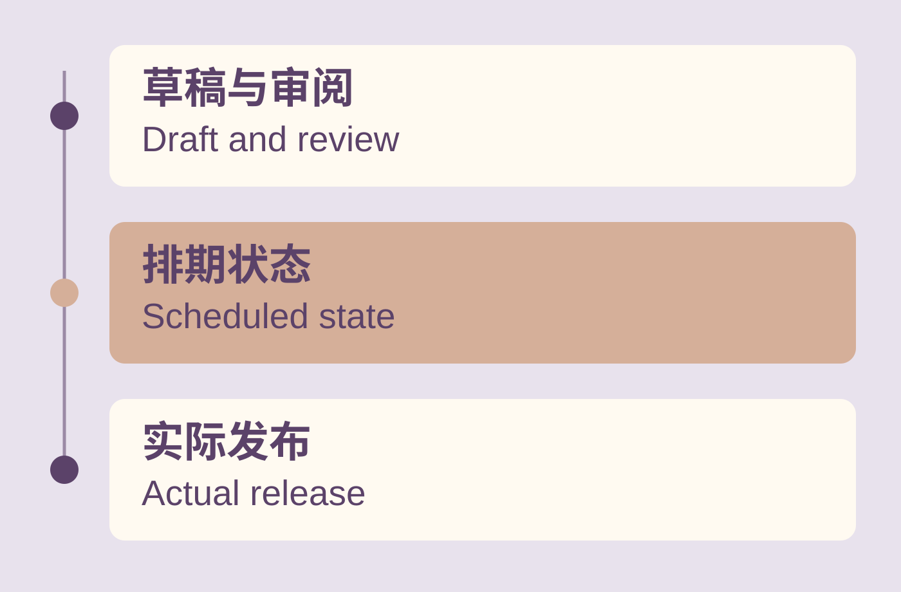

# Later Social Media: Review Before Scheduling

Status: local review draft; confirm the publication date before release.

Separate Later Social drafts, approval and scheduling, then hand off the creator version, account permissions and actual publishing method.

Later Social can help prepare, review and schedule creator content for brand channels, but submitted for approval does not mean blocked from publication. Its July 2026 guidance states that scheduled posts publish on time regardless of approval status; keep work as a draft when it must wait and have the account owner check relevant publishing permissions. Also confirm the asset version, creator permission, supported format and automatic or notification-based publishing method. The workflow below concerns content handoff, not identical capabilities across every plan, account and platform.

## Define what Later manages in this partnership

Specify what the team is scheduling: a licensed creator video on a brand account, the creator's own post or a brand follow-up after an event. A calendar the team controls does not automatically control publication on the creator's account.

The [Later product-selection article](https://www.quickkol.com/blog/later-social-influence-services-task-fit/#answer) distinguishes social publishing from other creator-business tasks. This guide focuses on Later Social handoff rather than importing campaign-review functions from another product.

For example, a creator may supply a brand-channel video while separately publishing an experience on their own account. Those are two publication records with their own version, owner and agreement, even when the material looks similar.

Establish account and content ownership before assigning a tool's role. A calendar entry should not imply that the entire partnership is confirmed. It should tell the creator which work is under review and tell the publishing owner which account and deliverable the record actually concerns.

## Draft, approval and schedule are different states

[Later’s team-approval guide](https://help.later.com/hc/en-us/articles/40954654500375-Team-Collaboration-and-Content-Approvals), updated in July 2026, states that waiting for approval does not stop a scheduled post from publishing. Work that must wait can remain a draft, and the account owner should verify the relevant user's publishing permissions.

For a brand, the operational rule is simple: before asking whether something can be scheduled, identify the asset and caption version, the people who agreed and the unresolved work. An approval label is not a substitute for publication control.

If a creator requests a change to an experience statement, the content owner should identify the version still waiting. The publishing owner must handle the scheduling state instead of assuming a comment tells the system not to publish.

Connect these states in a handoff note without collapsing them into one checkbox. Correct content, completed review and scheduled publication answer different questions. A team can agree on a creative concept while still withholding a particular file from publication because the final words or permissions have changed.

An approval label is not publication control; check draft status and permissions when work must wait.

## Make review refer to an actual version

Review should mean more than someone watched the video. Identify the file, caption, cover and destination account, adding subtitle or audio versions where relevant. The creator's agreement then refers to something specific.

Express changes as concrete issues: the model shown differs, a subtitle omits a condition, voiceover alters the experience or a crop hides the important action. A general request to improve it makes the person editing guess what matters.

The [creator-content handoff method](https://www.quickkol.com/blog/ugc-content-creator-on-camera-production-role/#answer) places these details inside a deliverable. A short record can still tell someone absent from the discussion which version is usable and which previous versions have left the workflow.

Copied posts need fresh checking too. The same product and creator do not establish that an older caption, offer or usage scope remains applicable. Duplication prepares work; it does not renew permission or confirm current facts. Keep the copied record linked to its new review rather than relying on an old approval attached to a different publication.

## Choose the final action for the actual format

[Later’s platform-and-format guide](https://help.later.com/hc/en-us/articles/360060842914-Supported-Social-Platforms-Post-Types) separates support by platform, account type and post type. Its October 2026 table also lists unsupported Instagram native effects, so support for Instagram alone does not establish that an entire creative concept can be automated.

List what this deliverable actually needs: ordinary video, native music, a sticker, a collaborator invitation or an interaction. Check current tool and account support before choosing automatic publication or a final action in the native app.

If someone must complete that action, assign a person and handoff time, identifying what remains to be added. A notification is not a publication result, and a promised element should not quietly disappear merely to simplify scheduling.

A format restriction may change execution without removing creative context. Discuss how the creator's contribution will remain intact, then confirm whether the revised method still fits the agreement. The final publishing record should explain the chosen route so the team does not repeat the same unsupported setup for the next deliverable.

## Separate creator permission from tool access

Being able to upload a file does not establish a brand's permission to repost, edit or advertise with it. Confirm channels, uses, term and permitted modifications in the collaboration record rather than substitute access credentials.

The [U.S. Copyright Office’s copyright overview](https://www.copyright.gov/what-is-copyright/) explains protection for original expression. In brand operations, attach the relevant permission status to the asset handoff so the publishing owner can see why the content is usable.

If a creator agreed to organic publication and the brand later wants advertising, check the agreement again. A platform offering a button and a creator agreeing to that use are different decisions.

Conversely, a creator's willingness to license content does not require unrelated account permissions. Give creative review, commercial confirmation and publication the work routes each actually needs. This keeps a legitimate review invitation from being mistaken for operational access and keeps an operational user's abilities from being mistaken for ownership of the material they handle.

## Keep experience and disclosure with the final content

Commercial copy should not become smoother by changing the creator's real experience. A brand can supply product facts, while the person speaking should confirm their own experience statement.

[FTC’s influencer disclosure guide](https://www.ftc.gov/business-guidance/resources/disclosures-101-social-media-influencers) addresses material relationships in applicable US contexts. Check appropriate wording in the final content instead of writing a general disclosure request in the brief and assuming the published version will contain it.

Include crop, subtitles, cover and voiceover in that review. A disclosure in one version can disappear in a later edit, and a correct text document does not establish that the actual video communicates the same thing.

This is review of a specific work, not a demand to attach identical wording to every post. Confirm the real relationship, format and applicable requirements while preserving context. The publishing owner should receive a clear final version rather than be expected to reconstruct legal or experiential meaning from scattered comments at the moment of scheduling.

## Use a hypothetical revision to assign responsibility

Imagine a brand preparing an equipment demonstration. The creator notices that the final subtitle has changed an observation from this use into an always-applicable conclusion. Identify the edit and its owner rather than leave the issue in a chat thread.

If the entry is a draft, keep it there until the revised version is checked. If already scheduled, someone with the appropriate access handles that state and records when the replacement returns to review. Confirm the actual condition instead of relying on color or a verbal impression.

After editing, attach agreement to the specific file and caption. A reply saying done is insufficient if two conflicting versions still leave the next person to choose.

This is a workflow example, not a Later customer case. It connects three responsibilities in one deliverable: the creator confirms experience, the editor changes the version and the publishing owner controls the state. The purpose is a usable handoff, not a larger approval chain for every minor change.

## Close the record with the actual publication

Successful scheduling completes preparation. After publication, check the actual post, media order, caption, tags and necessary context, then return its URL to the deliverable record.

For notification publishing, establish that the assigned person completed the native-app action. A sent notification, a received notification and a live post remain different outcomes.

If publication differs from the agreed version, record the particular difference and available correction instead of marking the entire project a failure. Do not publish again without checking, leaving conflicting versions live at once.

Retain a practical learning for next time, such as arranging native-app work earlier for a particular format. That improves the next creator handoff without turning a smooth scheduling process into proof of marketing return. Later can support a disciplined operation, but the team still needs to evaluate the actual creative contribution and project outcome using the appropriate evidence after the work is live.

## Handle a change close to the publishing time

When a product becomes unavailable, an event time changes or voiceover needs replacement near publication, identify the part affected first. A product issue may not require reshooting everything, and an audio change may not alter the destination account. Assign work according to the actual impact.

Name who pauses the existing arrangement, who supplies the corrected facts and who asks the creator to confirm. A person raising an issue in chat does not establish that another person with publishing access has changed the tool's state.

If no usable replacement exists, retain an explicit waiting condition instead of filling the calendar with unreviewed material. Discuss a new delivery or publishing time with the creator without automatically treating a brand-side change as extra work already included in their promise.

Before resuming, check how the replacement relates to the original agreement. Record a factual reason, such as an updated destination or a sentence awaiting confirmation, rather than broadly attributing delay to the creator. The resulting note should explain the decision to the next owner without requiring them to reconstruct a last-minute conversation.

## Content state and next owner

| State | Check | Next action |
| --- | --- | --- |
| Draft | Specific version and pending work | Continue review |
| In review | Whether also scheduled | Handle actual publication control |
| Agreed version | Permission, caption and format | Choose publishing method |
| Scheduled | Account, time and owner | Check the live result |

Editorial handoff framework; verify current plan, permissions and official format support.

## Before scheduling creator content

Give the publishing owner one executable version.

- [ ] Confirm destination account and content ownership.
- [ ] Identify asset, caption and cover versions.
- [ ] Separate approval and scheduling states.
- [ ] Check permission, experience wording and disclosure.
- [ ] Assign automatic or manual publishing ownership.
- [ ] Record the actual URL after publication.

## Research date and limitations

Sources reviewed November 18, 2026. Methods, tables and decision rules are editorial recommendations. Hypothetical examples are not actual client results or industry benchmarks. Source geography and periods are specified where relevant.

## Start creator research with a clear task

Use QuickKOL to interpret a brief, discover relevant creators and research their work and contact routes. Verify data, commercial terms and outcomes at their source.

[Explore QuickKOL](https://www.quickkol.com/#capabilities)

## Sources

- [Later’s team-approval guide](https://help.later.com/hc/en-us/articles/40954654500375-Team-Collaboration-and-Content-Approvals)
- [Later’s platform-and-format guide](https://help.later.com/hc/en-us/articles/360060842914-Supported-Social-Platforms-Post-Types)
- [U.S. Copyright Office’s copyright overview](https://www.copyright.gov/what-is-copyright/)
- [FTC’s influencer disclosure guide](https://www.ftc.gov/business-guidance/resources/disclosures-101-social-media-influencers)
