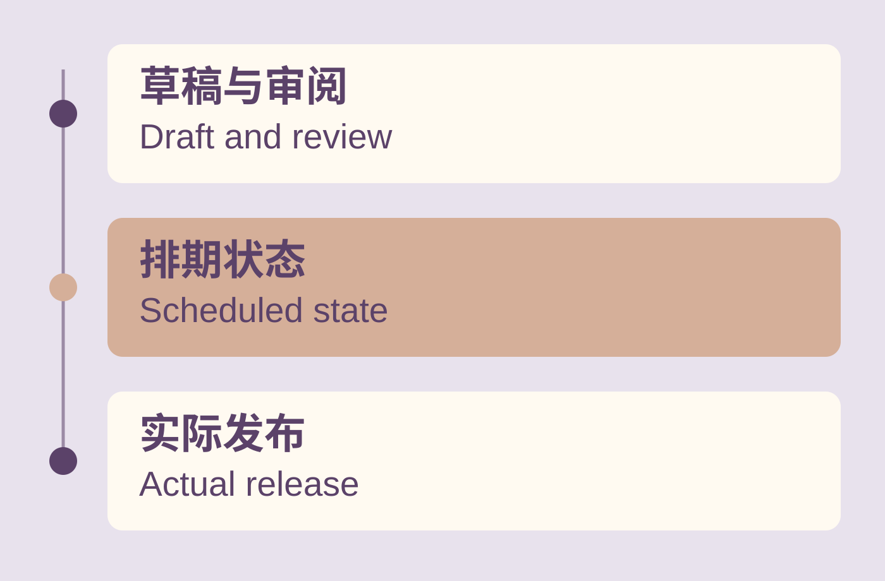

# Later 怎样连接达人审阅与发布

状态：本地审阅稿；正式发布日期待确认。

把 Later Social 的草稿、审批与排期分开，围绕达人版本、账户权限和实际发布方式建立可执行交接。

Later Social 可以帮助团队准备、审阅和排期品牌渠道的达人内容，但不能把“已提交审批”当成“不会发布”。Later 2026 年 7 月的官方说明明确：已排期内容会按时发布，审批状态本身不阻止发布；需要等待时应保留草稿，并由账户负责人核对相关发布权限。品牌还应确认具体素材版本、创作者授权、格式支持与自动或通知发布方式。下面的方法用于内容交接，不宣称所有套餐、账号和平台都支持同一流程。

## 先说明 Later 在本次合作中管理什么

先写清哪些内容由团队排期：品牌账户上的达人授权视频、创作者自己发布的作品，还是活动后的品牌补充说明。团队能够管理的日历，不自动控制创作者自己的发布安排。

[Later 产品选择文章](https://www.quickkol.com/zh/blog/later-social-influence-services-task-fit/#answer)帮助区分社媒发布与其他达人业务。本文集中在 Later Social 的内容交接，不把其他产品中的活动审核功能直接套用到这里。

例如创作者交付一条品牌渠道视频，同时自己另发体验内容，这可以是两个不同的发布记录。两者各自有版本、负责人和约定，不应因为素材相似就共用一个“已排期”状态。

先确定账户和内容归属，再决定工具负责哪一步。这样团队不会把日历上的一个条目误读为整场达人合作都已经确认，也能给创作者明确的审阅对象。

## 草稿、审批与排期是三个不同状态

[Later 的团队审批说明](https://help.later.com/hc/en-us/articles/40954654500375-Team-Collaboration-and-Content-Approvals)在 2026 年 7 月更新，明确已排期内容不会因为等待审批而停止发布。需要等待确认的内容，可以先作为草稿保存；相关用户权限也需要账户负责人核对。

这对品牌意味着一个简单工作规则：讨论“可以排期吗”之前，先确认素材和文案是什么版本、谁已经同意、还有什么未完成。不要依赖一个审批标签代替实际发布控制。

如果创作者要求修改一句体验描述，负责内容的人应说明哪个版本继续等待。发布负责人则需要处理排期状态，不能认为留下评论以后系统自然知道不该发布。

团队可以用一条交接说明连接这三个状态，但不要把它们压成同一个勾选框。内容正确、有人审过、将会发布，是不同的问题。

审批标签不能代替实际发布控制；等待时核对草稿与权限。

## 让审稿对象对应一个实际版本

审阅不能只写“看过视频”。记录文件版本、文案版本、封面和目标账户，必要时说明字幕或音乐版本。这样创作者说可以，才有明确指向。

把修改意见写成具体问题：镜头里的型号不符、字幕省略条件、配音改变真实体验，或画面裁切看不到关键动作。不要把这些都写成“优化一下”，让执行者猜测。

[达人内容交接方法](https://www.quickkol.com/zh/blog/ugc-content-creator-on-camera-production-role/#answer)帮助把这些信息放回一个交付任务。审稿记录可以很短，但应让未参加讨论的人知道可以使用哪一版，以及哪些旧版已退出流程。

如果团队复制了一条旧帖子，新的内容仍需检查。相同商品、相同创作者，不说明旧文案、折扣或使用范围仍然适用，复制只是准备动作，不是复用许可。

## 按实际格式决定在哪完成最后一步

[Later 的平台与格式说明](https://help.later.com/hc/en-us/articles/360060842914-Supported-Social-Platforms-Post-Types)按平台、账户类型和帖子类型列出支持范围。其 2026 年 10 月版本也指出 Instagram 的部分原生效果不受支持，因此不能只看“支持 Instagram”就认定整个创意都可以自动完成。

先列出这条达人内容真正需要的东西，例如普通视频、原生音乐、贴纸、协作者邀请或某种互动。再核对当前工具和账户支持，决定是自动发布，还是有人在原生应用完成。

如果需要人工完成，安排具体人和交接时间，说明哪些部分仍待添加。不要把一个通知当成发布结果，也不要为了方便排期而悄悄删除 Brief 中承诺的内容。

格式限制可能使执行方式改变，但不必让创意判断失去上下文。先讨论怎样保留创作者贡献，再确认新方式是否仍然符合合作约定。

## 把创作者授权与工具权限分开

能够在工具里上传文件，不说明品牌已经获得转载、剪辑或广告投放授权。合作记录应确认渠道、使用方式、期限和可以修改的范围，不能用登录权限代替。

[美国版权局的版权说明](https://www.copyright.gov/what-is-copyright/)介绍原创表达受到保护。对品牌工作，实际做法是把授权状态附在素材交接里，让发布负责人看得见这条内容为什么可以使用。

如果达人同意自然发布，而品牌希望后来用于广告，需要另行核对约定。排期平台是否提供按钮，与创作者是否同意这次用途，是两个层面的决定。

反过来，创作者愿意授权，也不意味着应给其无关账户权限。让内容审阅、商务确认和实际发布各自使用必要的工作入口即可。

## 让体验与披露跟随最终内容

商业合作中的文案不能为了更流畅而改变创作者真实体验。产品事实可以由品牌提供，但实际使用感受应由说这句话的人确认。

[FTC 的达人披露指南](https://www.ftc.gov/business-guidance/resources/disclosures-101-social-media-influencers)说明美国适用情境下的实质关系披露。品牌应在最终内容里检查合适表达，而不是只在内部 Brief 写“请披露”，然后假定发布版本自然完整。

把检查对象扩展到裁切、字幕、封面与配音。某一版已有说明，下一版可能因为删减而丢失；文字版正确，也不代表实际视频表达了同样的信息。

这属于针对具体内容的审阅，不是要求每条帖子都加相同句子。根据真实合作关系、内容形式和适用规则确认，保留必要上下文。

## 用一次假设修改说明责任

假设品牌准备发布一条器具演示，创作者发现最终字幕把“这次使用”改成了始终适用的结论。此时先确认修改内容和负责编辑的人，不能让评论停在聊天记录里。

如果条目仍是草稿，保持草稿直到新版本核对。如果已经排期，由有权限的人处理排期，再记录新版本何时进入审阅。这个步骤需要确认实际状态，不依赖颜色或口头印象。

修改完成后，把确认放到具体文件和文案上。不要只回复“好了”，却仍然保留两个不同版本等待别人选择。

这是工作示例，不是 Later 客户案例。它展示同一条内容里，创作者负责真实体验、编辑负责版本修改、发布负责人负责状态控制，三种责任怎样连接。

## 发布以后用实际链接完成记录

排期成功只说明准备步骤完成。发布以后，负责人应检查实际帖子、媒体顺序、文案、标签和需要保留的说明，再把链接放回这条内容记录。

如果采用通知发布，核对负责的人是否完成原生应用中的操作。通知已发、有人收到和内容已上线，仍然是不同结果。

若发现发布版本与确认版不同，先记录具体差异和能够采取的修正，不把整个项目笼统标为失败。也不要没有核对就重复发布，造成两个不同版本同时存在。

复盘时保留这次流程的教训，例如某种格式需要更早安排人工操作。这样的信息能改善下一次达人交接，但不能从一次顺利排期推导内容一定带来合作回报。

## 临近发布时变更怎么办

临近发布才发现商品暂不可售、活动时间调整或需要更换配音时，先说明变更影响哪部分。商品问题不一定需要重拍所有画面，配音问题也不一定改变目标账户；应按实际影响安排处理。

同时说明由谁暂停当前安排、谁提供正确事实、谁联系创作者确认。一个人在聊天里提出问题，不代表另一个有权限的人已经处理工具中的状态。

若暂时没有可用替代版，就保留明确等待状态，不为了填满日历临时拼接未经确认的素材。可以与创作者讨论新的交付或发布时间，但不要自动把品牌侧变更算作其已承诺的额外工作。

恢复流程时，先核对新版本与原约定的关系，再进入排期。把原因记录为事实，例如目标页面已更新或需要重新确认一句话，比笼统写“达人延误”更准确，也更有利于后续协作。

## 内容状态与下一位负责人

| 状态 | 需要确认 | 下一动作 |
| --- | --- | --- |
| 草稿 | 具体文件与未完成事项 | 继续审阅 |
| 审批中 | 是否同时已排期 | 安排真实发布控制 |
| 已确认版本 | 授权、文案与格式 | 决定实际发布方式 |
| 已排期 | 账户、时间与负责人 | 核对实际上线结果 |

编辑交接框架；具体功能以当前套餐、账户权限和官方支持范围为准。

## 把达人素材交给排期之前

让发布负责人收到一个可执行版本。

- [ ] 确认目标账户与实际内容归属。
- [ ] 指出文件、文案和封面版本。
- [ ] 分开记录审批与排期状态。
- [ ] 核对授权、体验表达和披露。
- [ ] 确定自动或人工发布负责人。
- [ ] 上线后回填实际链接。

## 研究日期与使用边界

资料核验于 2026 年 11 月 18 日。文中方法、表格和决策规则为编辑建议，标为假设的示例不是实际客户结果或行业基准。外部资料的适用地区与时期按各段说明。

## 从任务开始达人研究

用 QuickKOL 理解 Brief、发现相关达人并研究作品与联系路径；数据、合作条件和结果仍需核验。

[了解 QuickKOL](https://www.quickkol.com/#capabilities)

## 来源

- [Later 的团队审批说明](https://help.later.com/hc/en-us/articles/40954654500375-Team-Collaboration-and-Content-Approvals)
- [Later 的平台与格式说明](https://help.later.com/hc/en-us/articles/360060842914-Supported-Social-Platforms-Post-Types)
- [美国版权局的版权说明](https://www.copyright.gov/what-is-copyright/)
- [FTC 的达人披露指南](https://www.ftc.gov/business-guidance/resources/disclosures-101-social-media-influencers)
