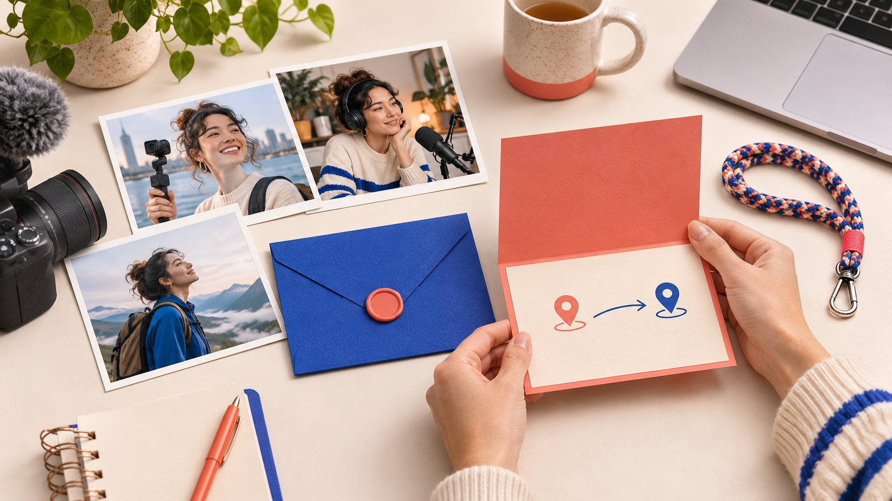
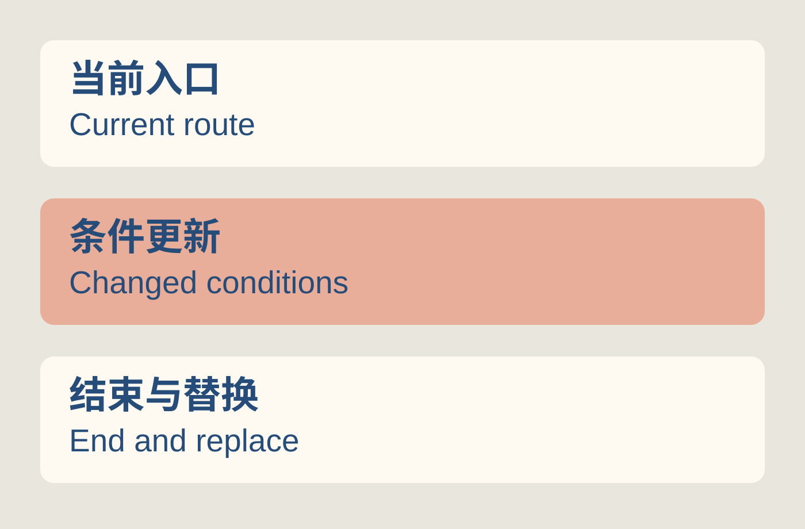

# Linktree Campaign Routes for Creators

Status: local review draft; confirm the publication date before release.

Plan the start, changes, pauses and end of creator campaign links. Distinguish hiding, archiving and deletion while preserving an accurate route for older work.

If linktr means Linktree in your search, the creator-marketing task here is maintaining a campaign route as its conditions change. Assign the original promise, destination, release time, change conditions and owner. Pausing visibility, preserving a record and permanently deleting a link are different decisions. A working button alone cannot establish that an older creator invitation is still accurate.

## Define the partnership served by this route

Start with the creator, piece of work and audience task served by the route. Reading an explanation, booking an event and claiming an offer are different invitations even when they share a profile page.

The [creator-link hierarchy article](https://www.quickkol.com/blog/linktree-brand-destination-hierarchy/#answer) addresses arranging several destinations. This article follows what happens over time: whether today's button should remain visible at the next stage and who decides.

Avoid recording only brand link. Retain the actual invitation in the creator's work so a page change can be evaluated against its promise. A correct address can still conflict with an expired campaign statement.

Discuss maintenance scope within the partnership. Continuing to rewrite the creator's words, remake content or extend display time can require an additional task rather than being assumed within one publication. That discussion gives the brand a defined service and the creator a manageable responsibility, with a clear point at which a new request needs agreement.

## Confirm the operator before making a route public

Let an authorized operator manage the route. The brand supplies facts, destination and offer conditions; the creator confirms expression on their page; the operator acts within the agreed scope. Unrelated people do not need the account password.

[Linktree’s link-creation guide](https://linktr.ee/help/articles/5434135-create-link), updated in October 2026, says that completing the URL, title and related settings makes the link live. Creation should not be treated as a guaranteed private drafting mechanism.

Prepare the agreed content before the authorized operator handles visibility. If it should remain off the public page, check the available hiding function instead of relying on an unverified working habit.

This article did not sign in and perform those actions. Confirm current controls, permission and actual visitor visibility before release. A help-page illustration is not evidence that the account has completed the operation. Keep that distinction in the handoff so a prepared entry is not reported as an already published campaign route.

## Make launch conditions observable

Launch conditions involve more than a date. Confirm that the destination provides the promised material, that market, product or offer conditions match the work, and that the publisher knows which version to use.

A short record can include the original invitation, URL, intended display period, confirming person, actual release time and maintenance owner. These are editorial recommendations rather than fields Linktree officially requires.

If the product page remains unsettled, a finished-looking button should not hide that state. State what is missing and which evidence would allow publication.

After the operation, inspect the visitor route. Seeing content in an editor differs from an outside reader opening and understanding it. Both acceptance questions should correspond to the partnership's actual purpose. Record the observed result with its time rather than assuming that preparation, approval and public availability occurred together simply because one person marked the overall task complete.

## Compare the whole invitation when conditions change

When the brand changes a page, decide whether this is a wording correction, a change in offer conditions or a completely different destination. A URL continuing to open does not settle whether the creator's work needs attention.

If the work promises a particular benefit that the page no longer provides, the mismatch concerns promise and fact. Relevant owners should choose a correction, pause or explanation rather than silently substitute a new sales campaign.

Changing an address in a shared sheet does not update existing video, screenshots, speech or reshares automatically. Identify affected materials and which parts can actually be changed.

The [sponsored-link naming method](https://www.quickkol.com/blog/linktree-spelling-sponsored-link-labels/#answer) can help rewrite the button, but naming alone cannot resolve expired content. Read the old invitation, current destination and new explanation together to determine whether the visitor is being moved into an unexpected task. This comparison protects continuity without assuming that every historical copy of a creator's work can be recalled or edited.

Route state follows the partnership; each transition needs facts, authority and an owner.

## Separate a temporary pause from list cleanup

[Linktree’s hide-link guide](https://linktr.ee/help/articles/5434145-how-to-hide-or-make-a-link-inactive), updated in October 2026, explains that hiding removes visitor visibility without deleting the link and allows it to be shown again. This can fit material that is not ready or a temporary pause.

Before using it, define the pause reason and restoration condition. Technical reversibility does not establish that campaign information is accurate again or that the creator agreed to a new display period.

If the pause comes from a brand-page issue, assign the page owner to resolve it. The creator should not be left repeatedly asking for facts that nobody is responsible for confirming.

If another campaign request arrives during the pause, discuss it as a new assignment. A later event might involve a different product, new creator wording or another market. Confirm those changes rather than assuming that a restorable button carries the old approval into a new commercial arrangement. The operator can retain the earlier record for context while leaving the new conditions visibly pending. This prevents a technically simple action from silently becoming a much larger extension of the partnership.

On restoration, walk through invitation and destination again. Earlier confirmation supplies context but cannot establish that a changed version still meets the conditions. Retain this actual check instead of copying the previous complete state. The pause then has a reason, an owner and an exit condition rather than becoming a forgotten item on a campaign list.

## Plan later visits when the campaign ends

A campaign ending does not mean every viewer has already encountered the work. Retained content can continue to bring visitors, so check how it remains available instead of assuming every post disappears immediately.

If an explanation that the offer has ended is needed, confirm who supplies accurate wording and an appropriate destination. This might be a brand-controlled explanatory page or another agreed arrangement, depending on the actual content and permissions.

Do not silently connect an expired benefit invitation to unrelated merchandise or imply the original creator endorses a new campaign they did not join. Administrative convenience cannot replace partnership facts.

At closure, record what happened to the public route and which older materials may remain. A maintenance owner can then answer visitor questions without reconstructing the partnership from memory. Also record who received maintenance responsibility: sending a file does not establish that the next owner knows what action is expected. The record should explain the decision, rather than merely saying that someone removed a button and therefore considered the whole campaign closed.

## Treat archiving and deletion as different decisions

[Linktree’s archive-and-delete guide](https://linktr.ee/help/articles/5434146-how-to-archive-or-delete-your-links), updated in October 2026, distinguishes archiving, which removes the public link while retaining Insights and allowing restoration, from deletion out of the archive, which permanently removes the link and its Insights.

Keeping a page tidy is therefore insufficient by itself to choose permanent deletion. Ask whether the team still needs the record, who preserves any authorized report and whether the route might be used again.

Record retention also does not justify keeping every personal detail. Preserve information needed for the partnership and appropriately handled, rather than expanding into unrelated visitor identification.

Leave the decision with someone actually authorized. This article explains the distinction without performing account actions or treating archiving as an indefinite extension of commercial permission. Link state and partnership rights remain separate records. A restored button still needs its destination, wording and display scope checked against the agreement currently in force.

## Retain route version and period in reporting

Before reviewing results, mark the periods when the route was visible, changed destination or paused. Combining observations across different versions makes it difficult to determine what visitors actually encountered.

When using platform metrics, retain their current definitions and source. This article did not verify a particular account's report fields and does not promise that clicks equal independent people, orders or qualified leads.

Comparing website outcomes requires connecting evidence and an aligned observation period. Do not assign every concurrent conversion to the creator route or record unavailable information as zero.

Maintenance records primarily explain whether the path stayed accurate. They give measurement useful context, but a change log alone cannot establish incremental commercial effect from the creator. A report can therefore state both that the route was correctly maintained and that outcome attribution remains unresolved, without treating those two conclusions as contradictory.

## Rehearse closure with a hypothetical campaign

Imagine a travel creator introducing a temporary experience, with a route providing booking information during the campaign. The brand controls the destination, the creator controls their page, and both agree release and closure timing.

When conditions change, the brand supplies the facts first. The operator updates or pauses within the agreed scope and checks whether older work still promises an unavailable benefit.

At the end, both confirm explanatory and archiving arrangements. If a record is needed, list cleanup should not trigger immediate permanent deletion, and the old route should not become an unrelated promotion.

This example contains no actual traffic or sales outcome. It brings the linktr task back to creator marketing: an invitation in the work needs an explainable destination and real owner at launch, during changes and after closure. A complete handoff gives the next person enough context to continue that responsibility without inventing a new promise on the creator's behalf.

## Campaign-route state decisions

| Situation | Decision | Record |
| --- | --- | --- |
| Preparing | Whether release is ready | Promise, URL and confirmer |
| Conditions change | Update, pause or explain | Affected versions |
| Temporary pause | Hiding and restoration condition | Reason and owner |
| Campaign ends | Later-visitor handling | Explanation and retention scope |
| List cleanup | Archive or permanently delete | Whether Insights are still needed |

Editorial execution framework; verify functions against the current account and official guidance.

## Route-maintenance handoff

Each route should answer these questions.

- [ ] Retain the work’s promise and actual URL.
- [ ] Define release conditions and authorized operator.
- [ ] Assign confirmation of factual changes.
- [ ] Distinguish hiding, archiving and permanent deletion.
- [ ] Plan an explanation for visitors after closure.
- [ ] Save version, period and actual handling result.

## Research date and limitations

Sources reviewed November 18, 2026. Methods, tables and decision rules are editorial recommendations. Hypothetical examples are not actual client results or industry benchmarks. Source geography and periods are specified where relevant.

## Start creator research with a clear task

Use QuickKOL to interpret a brief, discover relevant creators and research their work and contact routes. Verify data, commercial terms and outcomes at their source.

[Explore QuickKOL](https://www.quickkol.com/#capabilities)

## Sources

- [Linktree’s link-creation guide](https://linktr.ee/help/articles/5434135-create-link)
- [Linktree’s hide-link guide](https://linktr.ee/help/articles/5434145-how-to-hide-or-make-a-link-inactive)
- [Linktree’s archive-and-delete guide](https://linktr.ee/help/articles/5434146-how-to-archive-or-delete-your-links)
