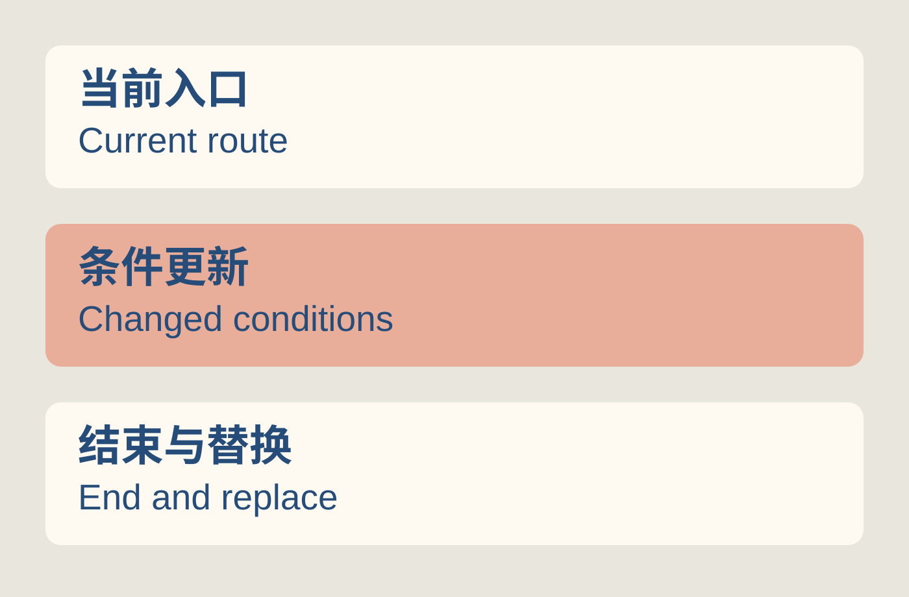

# Linktree 怎样维护达人合作入口

状态：本地审阅稿；正式发布日期待确认。

为达人合作入口安排开始、变更、暂停和结束，分清隐藏、归档与永久删除，并让旧内容的访客仍得到准确说明。

搜索 linktr 时，若你指的是 Linktree，本篇解决达人营销中一个具体问题：合作链接怎样随活动变化而维护。为每个入口明确原始承诺、实际去处、可公开时间、变化条件和负责人。暂停展示、保留记录与永久删除不是同一种决定；技术上可点击，也不代表旧作品的邀请仍然准确。

## 先界定这次入口服务哪项合作

先写明入口对应哪位创作者、哪项内容与哪种观众任务。看说明、预约活动与领取优惠是不同邀请，不能因为共用一个主页就被视为同一件事。

[达人入口层级文章](https://www.quickkol.com/zh/blog/linktree-brand-destination-hierarchy/#answer)解决多个目的地如何安排。本篇继续处理时间变化：今天可见的按钮，到了下一阶段是否仍然应该存在，以及由谁判断。

不要只记录“品牌链接”。保留创作者作品中的实际表述，才知道页面变化是否会影响原承诺。一个准确地址，也可能与已经失效的活动文案不一致。

维护范围应该进入合作讨论。若需要持续改写创作者自己的文字、重新制作内容或增加展示期，就明确相应任务，不默认它们包含在一次发布里。

## 公开之前先确认谁有权操作

由实际拥有权限的人管理入口。品牌提供事实、目标页与活动条件，创作者确认其主页上的表达，执行者按照已确认范围操作，不需要向无关人员索取密码。

[Linktree 的创建链接指南](https://linktr.ee/help/articles/5434135-create-link)在 2026 年 10 月更新的流程中说明，加入地址、标题及相关设置后，链接已在页面公开。不要把创建动作当成保证私密的草稿机制。

因此先准备好经过确认的内容，再由授权操作者处理可见状态。若要暂不展示，应核对当前可用的隐藏功能，而不是靠一个尚未验证的工作习惯判断。

本文没有登录账户执行这些动作。真正上线前仍要在当前界面确认入口、权限与实际可见效果，不能把帮助文档截图当作已完成操作的证据。

## 把开始条件写成可判断的事项

开始条件不只是一个日期。确认目标页已经有承诺的内容，适用地区、产品或活动条件与作品一致，而且负责发布的人知道使用哪个版本。

可以使用一份简短记录：原邀请、目标地址、预定展示期、确认人、实际公开时间与维护负责人。它是编辑建议，不是 Linktree 官方要求填写的字段。

若产品页还在变动，不必用一个看似完整的入口掩盖未完成状态。说明尚缺什么，以及在什么证据出现后可以公开。

操作完成后，从访客路径检查一次。编辑界面能看到内容，与外部读者能打开并理解内容，是不同验收问题；两者都应与实际合作目的对应。

## 内容变化时比较整个邀请

品牌更新页面时，先判断变化属于文字修正、活动条件变化，还是完全不同的目标。不能只因为地址仍然能打开，就认为创作者作品无需关注。

若作品写着某项专属利益，而页面已不再提供，问题涉及承诺与事实。由相关负责人决定修改、暂停或解释的方式，而不是悄悄把入口换成新销售活动。

改变共享表中的地址，也不会自动改掉既有视频、截图、口播或转载。记录哪些材料受影响，以及实际可以修改哪些部分。

[达人合作链接命名方法](https://www.quickkol.com/zh/blog/linktree-spelling-sponsored-link-labels/#answer)可帮助重新写清按钮，但命名不能单独解决过期内容。应把旧邀请、当前去处与新的说明一起读，确认访客不会被带到另一项未预期任务。

入口状态随合作变化；每次转换都需要事实、权限与负责人。

## 临时暂停与清理列表分别处理

[Linktree 的隐藏链接指南](https://linktr.ee/help/articles/5434145-how-to-hide-or-make-a-link-inactive)在 2026 年 10 月更新时说明，隐藏会让访客看不到该链接，但并非删除，之后可以再次显示。适用情形可能是内容尚未准备好，或需要临时暂停。

团队使用这一功能前，先说明暂停原因和恢复条件。技术上可以恢复，不代表活动资料已经重新准确，也不代表创作者同意新的展示期。

如果暂停源于品牌页面的问题，安排页面负责人解决。不要只让创作者反复询问，而缺少能确认事实的人。

若暂停期间收到新的合作要求，把它当作新任务讨论。例如下一期活动需要不同产品、创作者新表述或另一地区，就重新确认这些条件。一个按钮可恢复，不表示旧批准可以覆盖新的商业安排。

恢复时重新走读邀请与目标。旧确认记录可以提供背景，但无法证明变更后的版本仍满足条件；应保存这次实际检查，而不是机械复制之前的完成状态。

## 结束合作时安排后续访问

活动结束不代表所有观众都已看过内容。保留下来的作品可能继续带来访问，先核对实际保留方式，不假定所有帖子都会立即消失。

如果需要说明活动已结束，确认谁提供准确文字与适当去处。可能是品牌控制的说明页，也可能是其他双方认可的安排，具体取决于实际内容与权限。

不要把过期的优惠邀请悄悄接到无关商品，或暗示原创作者仍推荐一项未参与的新活动。页面管理方便不能替代合作事实。

结束时记录公开入口采取了什么处理，以及哪些旧材料仍可能存在。维护人可以据此回答访客问题，而不必靠记忆猜测当时合作的范围。也保留谁接收了维护职责；将文件发出，不代表下一位负责人已经知道要做什么。

## 归档与永久删除需要不同决定

[Linktree 的归档与删除说明](https://linktr.ee/help/articles/5434146-how-to-archive-or-delete-your-links)在 2026 年 10 月更新时区分：归档移走公开链接并保留 Insights，可恢复；从归档中删除，则永久移除链接与其 Insights。

因此“保持页面整洁”不足以自动选择永久删除。先问团队是否还需要相关记录，谁负责保存已获准保留的报告，以及后续是否可能重新使用入口。

保留记录也不等于可以保留所有个人资料。只保存合作所需且可合法处理的信息，不扩大成对访客身份的无关收集。

把决定交给实际有权的人。本文解释操作差别，不代用户执行账户动作，也不把归档当作可无限延长原商业许可的机制。链接状态与合作权限仍是两份不同记录。

## 让报告保留入口版本与时期

复盘前标明入口在哪些时期可见、何时更换目标或暂停。把不同版本下的观察混成一个数字，会让团队难以判断访客实际遇到了什么。

使用平台提供的指标时，保留当前定义与来源。本文没有核验某一账户的具体报表字段，不承诺点击等于独立人数、订单或有效线索。

如果需要比较网站结果，应有对应连接证据与观察期。不要把所有同期转化归到达人入口，也不要把不可用数据记为零。

维护记录首先帮助解释路径是否准确。它能为测量提供背景，但单独一份链接变更表，不能证明达人带来了增量商业效果。

## 用假设活动演练一次结束交接

假设一位旅行创作者介绍某项短期体验，入口在活动期间提供预约说明。品牌管理目标页，创作者管理自己的主页，双方明确公开与结束时间。

活动条件改变时，品牌先说明事实；操作者按双方确认范围更新或暂停，并核对旧作品是否仍包含已失效的利益承诺。

结束后，双方确认后续说明与归档安排。若需要保留记录，就不因列表清理而直接永久删除，也不把旧入口指向另一项无关促销。

这个案例没有真实流量或销售结果。它展示 linktr 相关任务怎样回到达人营销：让作品中的邀请在开始、变化与结束时，都有可解释的去处和实际负责人。

## 合作入口的状态决定

| 情形 | 需要决定 | 保留记录 |
| --- | --- | --- |
| 准备开始 | 是否可以公开 | 承诺、地址与确认人 |
| 条件变化 | 更新、暂停或解释 | 受影响版本 |
| 临时不可用 | 隐藏与恢复条件 | 原因与负责人 |
| 活动结束 | 后续访客安排 | 说明与保留范围 |
| 清理列表 | 归档或永久删除 | Insights 是否仍需要 |

编辑执行框架；具体功能按当前账户与官方指南确认。

## 入口维护交接清单

每个入口至少要能回答这些问题。

- [ ] 记录作品原承诺与实际地址。
- [ ] 明确公开条件与授权操作者。
- [ ] 指定事实变化的确认人。
- [ ] 区分临时隐藏、归档与永久删除。
- [ ] 安排活动结束后的访客说明。
- [ ] 保存版本、时期与实际处理结果。

## 研究日期与使用边界

资料核验于 2026 年 11 月 18 日。文中方法、表格和决策规则为编辑建议，标为假设的示例不是实际客户结果或行业基准。外部资料的适用地区与时期按各段说明。

## 从任务开始达人研究

用 QuickKOL 理解 Brief、发现相关达人并研究作品与联系路径；数据、合作条件和结果仍需核验。

[了解 QuickKOL](https://www.quickkol.com/#capabilities)

## 来源

- [Linktree 的创建链接指南](https://linktr.ee/help/articles/5434135-create-link)
- [Linktree 的隐藏链接指南](https://linktr.ee/help/articles/5434145-how-to-hide-or-make-a-link-inactive)
- [Linktree 的归档与删除说明](https://linktr.ee/help/articles/5434146-how-to-archive-or-delete-your-links)
