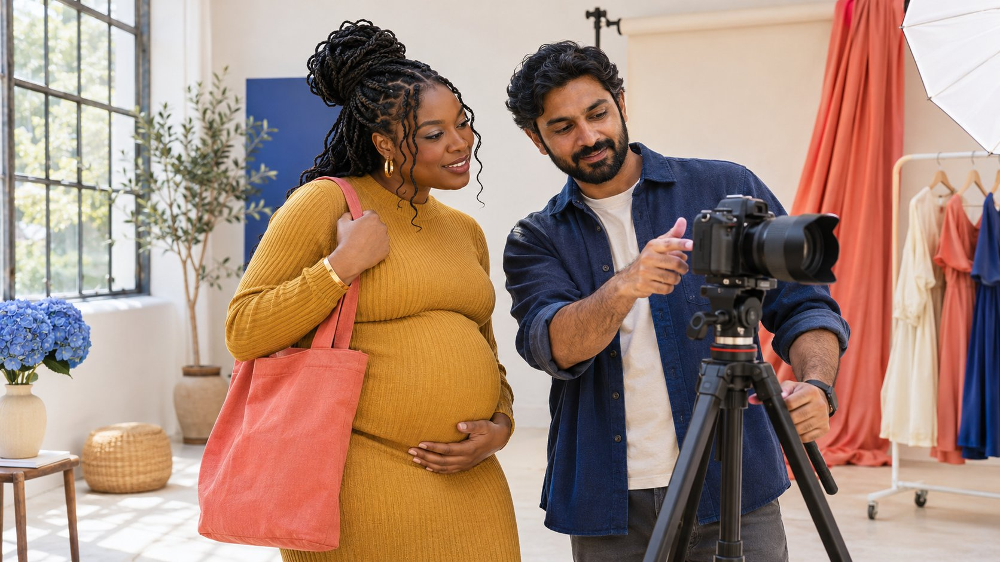

# 孕期摄影合作怎样选择公开画面

状态：本地审阅稿；正式发布日期待确认。

孕期摄影进入达人合作时，先定义照片要讲的故事，再共同选择适合公开的画面，分别确认人物表达、商品事实和使用范围。

品牌安排 maternity photography，应该先确认达人愿意公开的故事与具体内容任务，再共同选择照片。人物可以参与姿态、服装、场景和最终画面的决定，品牌负责准确的产品信息，摄影师负责拍摄表达。最终选择要同时看画面、图注、裁切和实际用途，不能把拍过、选过与已获准公开当成同一状态。本文讨论品牌与创作者的摄影合作，不提供孕期医疗、拍摄时机或姿势安全建议。

## 先确定照片为合作完成什么

一个孕期摄影主题可以服务创作者的生活叙事，也可以在适当情境中展示服装、日常物品或真实使用体验。品牌先写一项观众能理解的任务，而不是把孕期身份当成所有产品都适合出现的理由。

例如本次需要呈现创作者如何整理外出物品，画面里的布袋就有明确角色。若只是希望借助人生阶段吸引注意，却没有相关内容贡献，应重新考虑任务。创作者不需要为产品补出自己没有的体验。

[孕期摄影制作 Brief 指南](https://www.quickkol.com/zh/blog/maternity-photographer-kol-production-brief/#answer)讨论开工前的角色与输入。本篇继续解决样片怎样成为可公开内容：选择理由、人物表达、产品语境和具体版本分别留有依据。

可以先写一句简明故事，再列必要画面。不需要把整个私人生活都放进一个商业项目，也不要让一张照片承担无法验证的生活方式承诺。

## 人物沟通先于画面选择

[Adobe 的孕期摄影指南](https://www.adobe.com/creativecloud/photography/discover/maternity-photography.html)强调准备、与拍摄对象沟通以及关注舒适感。这里引用的是摄影准备原则，不把其中时间或姿态建议扩写为个人健康判断。

合作前可以讨论服装、希望呈现的气氛、哪些内容不希望进入画面，以及是否有其他成年人参与。人物提出限制，不意味着不专业；明确偏好可以减少反复拍摄与后续争议。

在样片选择阶段再确认实际画面是否符合这些意图。某个姿态或表情在现场感觉合适，不代表放大裁切、换图注或广告复用后仍表达同一件事。

沟通记录只保留完成任务需要的决定。团队通常需要知道选用哪张和哪些限制，不需要收集医疗细节或与项目无关的私人资料。让合适的人能作决定，同时减少无关信息在制作团队传播。

## 用一组画面完成故事

先按用途区分主画面、动作细节和补充环境，而不是仅按漂亮程度挑最多照片。主要照片让人理解人物和任务，细节说明产品角色，环境提供适当语境；不是每一项都必须单独拍一张。

假设任务是展示一次外出准备，主画面可以是人物与已整理物品，细节可以是布袋内部安排。它们要能互相补充，而不是重复同一姿态却缺少真正需要的说明。

选择表记录文件编号、画面作用、建议用途和待确认部分。摄影师可以解释构图理由，创作者判断自己的表达，品牌核对商品事实。不要让一个“都不错”的回复代替具体选择。

如果没有一张照片清楚完成关键任务，就讨论补拍或修改内容范围。增加更多近似样片不能自动弥补缺失的动作，也不应要求图注凭空讲出画面和实际体验都没有支持的结果。

## 产品应有真实且适量的角色

人物可以自然使用某件物品，但画面不能单独证明舒适、健康效果、所有人适用或长期性能。品牌需要区分照片可见的事实和希望表达的主张。

[FTC 的达人披露指南](https://www.ftc.gov/business-guidance/resources/disclosures-101-social-media-influencers)在适用美国语境下讨论真实体验和商业关系。不能要求创作者谈论未使用产品的体验，也不能让一张亲密生活画面掩盖实际合作关系。

先核对具体产品版本、颜色和必要条件，再看图注是否准确。某张照片好看但使用了不同样品，可以调整选择或说明，不能因为视觉效果好就忽略差异。

图中产品大小、位置和是否需要细节画面，也按任务决定。不是每张照片都必须突出包装；品牌识别可以与人物故事协调，但不能通过不真实的使用方式来强化出现。

## 把修图与人物表达一起审阅

先确定修图是调整色彩、去除临时背景杂物，还是会改变人物或产品实际含义。不要把所有处理都叫常规美化，再要求创作者接受任何结果。

对照原图与拟发布版本，检查皮肤、服装、产品颜色和环境。品牌需要的是准确表达，不是通过修改人物身体去制造产品效果。对方没有确认的变化，应回到实际讨论。

同样的照片如果加上新标题或话题，可能出现新的含义。样片确认时可以同时看拟用文字，而不是先让人物选一张，再由其他团队独立写出完全不同的故事。

最终记录应对应具体文件，而不只说摄影师已处理。文件继续改变，就标明新版本和需要复查的人。这样创作者审阅的是实际表达，品牌也能区分视觉调整与事实变化。

## 裁切要保留人物与商品语境

横图、竖图和方图可能从同一张照片导出，但不自动保持同样含义。一个宽幅场景里的自然物品，裁成特写后可能变成主要产品推荐，关系与说明都需要重新看。

为实际位置检查人物、动作、商品和文字是否完整。不能用一个未经验证的固定安全区保证所有屏幕；在准备发布的位置看实际显示更有价值。

样片选择配图说明如何把原始照片与选用记录放在一起。团队可以保留几个明确用途的版本，而不是把所有导出都交给下一位编辑猜测。

如果裁切丢失关键条件，先调整构图或使用位置。不要无限缩小文字，也不要把理解必须的说明放到观众可能看不到的其他帖子。每个版本应能独立准确表达自己的任务。

选片记录同时说明故事作用与具体使用版本。

## 确认选片不等于所有用途

[美国版权局的版权说明](https://www.copyright.gov/what-is-copyright/)解释原创照片等作品受到保护。人物愿意拍摄、摄影师交付文件、品牌选定画面，是不同决定；不能从其中任一项推断所有渠道和未来用途都已包含。

具体确认本次公开位置、编辑范围、时间和是否有付费推广。若需要更多语言或后续广告，提出可以评估的请求，而不是用原始选片回复代替新的范围讨论。

[达人素材使用指南](https://www.quickkol.com/zh/blog/what-is-whitelisting-creator-ad-permissions/#answer)进一步区分平台操作与商业许可。共享文件夹能打开，不表示账号里每个操作人都有权改变人物表达；访问权限与内容用途应分别安排。

交接只需保留相关依据与接手人，不必把所有私人对话发给所有团队。有人能够回答哪张、什么用途和到什么时候，后续执行才不会靠猜。

## 用一项外出准备合作完成选片

假设创作者与品牌合作呈现外出整理，摄影师提供宽幅人物照、布袋细节和环境照。团队先选择能说明准备动作的一组，再检查产品版本、图注与公开范围。

其中一张特写虽然漂亮，却让布袋看起来像有未确认的专门用途。团队可以不选它，或改为准确表达实际收纳的画面，而不是让创作者承诺不存在的效果。

创作者确认人物表达，品牌确认产品事实，摄影师提供对应导出，发布人检查实际显示。没有完成的部分留作待定，不把样片选择写成已经上线。

这个假设没有客户结果。它说明 maternity photography 在达人营销里怎样成为一个明确内容任务：故事有意义，人物有参与，产品有真实角色，最终版本能被下一位负责人准确接手。

## 把修改意见对应到一张图

例如品牌希望把布袋移到画面中央，应说明是为了看清实际使用，还是希望改变产品突出程度。前者可能只需要选择另一张照片，后者可能改变原来故事与用途，不能让摄影师自行猜测。

一条可执行意见包含文件、具体问题、希望保留的部分和需要谁确认。不要在同一批样片里只写“这一张不合适”，却不说明哪一张、哪里不合适。

若创作者不希望某张公开，先将它从待发布集合移开，再讨论替代。无需让所有团队看到私人理由，只要保留实际限制与能继续的版本。

## 选片时分别回答四个问题

| 问题 | 确认什么 | 不能代替 |
| --- | --- | --- |
| 故事 | 照片完成哪项内容任务 | 所有产品都适合 |
| 人物表达 | 实际画面与文字 | 所有未来修改 |
| 产品事实 | 版本、条件与真实体验 | 医学或性能证明 |
| 用途 | 位置、编辑与时间 | 无限渠道许可 |

品牌制作与选片建议，不是个人医疗、拍摄时机或姿态安全判断。

## 把选片交给发布人之前

让实际版本与实际确认对应。

- [ ] 写清一项有意义的故事任务。
- [ ] 保留人物偏好与必要限制。
- [ ] 记录文件编号与选择理由。
- [ ] 一起检查产品、文字与裁切。
- [ ] 确认本次用途和显示时间。
- [ ] 说明待定事项与接手人。

## 研究日期与使用边界

资料核验于 2026 年 11 月 18 日。文中方法、表格和决策规则为编辑建议，标为假设的示例不是实际客户结果或行业基准。外部资料的适用地区与时期按各段说明。

## 从任务开始达人研究

用 QuickKOL 理解 Brief、发现相关达人并研究作品与联系路径；数据、合作条件和结果仍需核验。

[了解 QuickKOL](https://www.quickkol.com/#capabilities)

## 来源

- [Adobe 的孕期摄影指南](https://www.adobe.com/creativecloud/photography/discover/maternity-photography.html)
- [FTC 的达人披露指南](https://www.ftc.gov/business-guidance/resources/disclosures-101-social-media-influencers)
- [美国版权局的版权说明](https://www.copyright.gov/what-is-copyright/)
