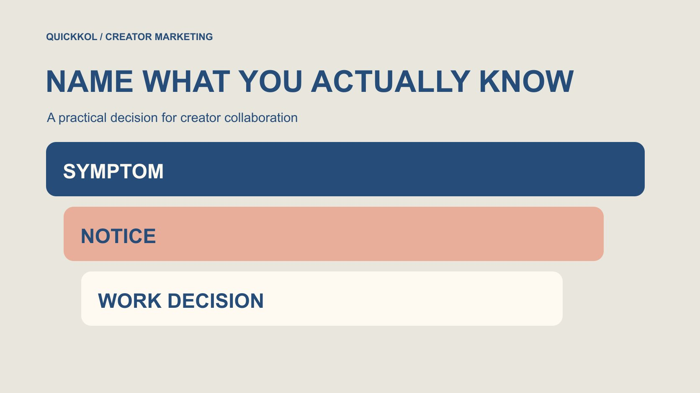
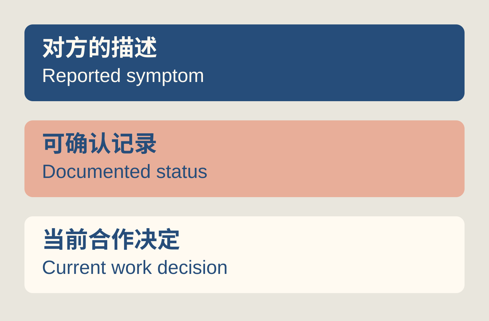

# Shadowbanned Meaning in a Creator Status Update

Status: local review draft; confirm the publication date before release.

Turn a creator’s shadowbanned report into a scoped partnership update: what was observed, what the platform confirms and what work decision is needed.

QuickKOL editorial graphic; not actual account metrics or a platform interface.

Shadowbanned commonly describes content seeming harder to see, recommend or find. In a creator partnership, treat it first as a report to clarify rather than a completed account diagnosis. Identify the work, period and observed symptom, then separately check actual platform notices and available account status. Low views alone do not establish a hidden restriction, while recommendation ineligibility, removal and login limits are different outcomes. An update should state knowns, unknowns and the next owner without presenting speculation as creator misconduct or partnership failure.

## Translate the label into a checkable observation

When a creator reports a shadowban, ask what they mean: lower views on a work, a changed recommendation source or an official notice? Each answer needs different information.

Do not immediately require them to prove there is no problem. Start with facts and the assignment so an ambiguous description does not circulate internally as a confirmed penalty.

Retain scope, such as one work during one observation period. An unsuccessful search, one person's feed or a screenshot should not become a claim that nobody can see the content.

A neutral initial update can say that the creator reports a distribution change and relevant information is being checked. This acknowledges the issue without going beyond evidence. It also gives the project owner something concrete to ask next, instead of triggering a broad debate about a term that different people may be using for different experiences.

## Separate allowed content, eligibility and actual distribution

[Meta’s recommendation-eligibility explanation](https://about.fb.com/news/2020/08/recommendation-guidelines/) publicly distinguished in 2020 between content allowed on the platform and content included in recommendations. The concept helps separate eligibility from removal without diagnosing a particular account today.

Eligibility also does not mean everyone sees a work, and a view change does not automatically mean removal. These are different questions rather than interchangeable labels.

The brand needs to know which state affects the assignment instead of inferring a hidden cause for the platform. If a relevant notice or record is unavailable, retain that limit in the update.

Keep conceptual explanation separate from account facts. Public guidance helps formulate the right question, while a particular work still needs corresponding evidence. A platform article cannot stand in for checking the creator's actual situation, and the absence of a known notice should not be rewritten either as proof of a hidden action or proof that no issue exists.

## Record an official notice according to its actual scope

[TikTok’s content-action and appeal guide](https://support.tiktok.com/en/safety-hc/account-and-user-safety/content-violations-and-bans) separates removal from For You recommendation ineligibility and describes reason review and appeal. A notice about one post should not expand into every account function being unavailable.

Retain the affected work, notice date and actual impact without asking the creator to give the brand credentials or unrelated personal information. The project usually needs relevant evidence, not account takeover.

Where a formal route is provided, the account holder can use it. Submitting an appeal starts review; it does not establish recovery or justify a guaranteed completion time.

These records support an accurate update without independently deciding contractual responsibility. Commercial decisions still concern the agreement and confirmed facts rather than one label. Keep the platform's stated action separate from the team's interpretation of what it means for a particular deliverable.

## Use a suitable comparison without diagnosing from low views

Works can differ in subject, format, observation period and publication conditions. State the comparison instead of placing a new post's short-window count against another's long-term accumulation.

[TikTok’s content-recommendation guide](https://support.tiktok.com/en/using-tiktok/exploring-videos/how-tiktok-recommends-content) describes personalization. Two people following the same creators may see different content, so one person's viewing experience does not represent all recommendations.

The [creator-data definition article](https://www.quickkol.com/blog/read-creator-engagement-data/#answer) helps state observation scope. Data can show a change while its cause needs more information; an explanation need not be forced where evidence is absent.

Retain a limited accurate finding, such as lower public views than selected references over a matching period. That supports further inquiry without proving a hidden restriction. A careful comparison can improve a content discussion while leaving platform action unconfirmed, keeping the team from treating every disappointing result as either misconduct or a technical diagnosis.

## Write knowns, unknowns and the next action

Knowns contain observations and visible notices; unknowns contain cause, scope or pending information; the next action names who does what. These layers can be short without substituting for one another.

For example: the work is visible, the creator reports changed recommendation sources, cause is unconfirmed, and the account holder will inspect current notices before updating. That is more accurate and actionable than account banned, partnership failed.

Date the update and revise the affected part when information arrives. Do not leave an outdated conclusion circulating after the record changes.

An operational update should not carry unrelated judgments. Long-term creator fit needs broader content and commercial assessment rather than a conclusion from one unexplained symptom. The purpose is to help the project proceed on shared facts, not to persuade everyone that a preferred explanation has already been established.

An update should state facts and next action without characterizing a creator through speculation.

## State the particular impact on current work

The brand needs the task impact: can production continue, must agreed publication wait, is existing work visible or is measurement temporarily insufficient?

A distribution symptom should not automatically pause every task. Conversely, do not ignore a real publishing limitation while claiming the original plan is unchanged.

The [creator-project status method](https://www.quickkol.com/blog/creator-campaign-status-system/#answer) connects facts to tasks. Different owners can handle different decisions: the account holder addresses platform notices, while creator and brand agree delivery arrangements.

Discuss time, scope or compensation changes explicitly rather than turn uncertainty into unilateral additional obligations. A project decision should have a specific reason instead of depend on an emotive label. This keeps the partnership focused on what can actually be completed and what requires another agreement, reducing the chance that a limited technical issue becomes an inaccurate explanation for every unresolved part of the work.

## Use legitimate next actions with an explainable purpose

Next actions can include checking a notice, inspecting the affected work, confirming comparison definitions or using the platform's appeal and support routes. Each should address an unanswered question.

Do not promise recovery from a fixed posting break, deletion count or account change. Nor should a creator abandon useful records or evade actual restrictions to make the issue appear solved.

The brand does not need a universal repair list. It needs to know what can continue, what information is missing, when to review again and who acts.

If the cause remains unknown, retain a pending check while continuing unaffected agreed work. An incomplete diagnosis does not require an invented one or prevent every project decision. A scoped action keeps uncertainty manageable without making the creator responsible for producing a certainty the available evidence cannot provide.

## Use accurate language in internal communication too

A confident statement in an internal chat can quickly enter a client report or another owner's judgment. Do not shorten creator reports a shadowban to creator violated policy, particularly without a corresponding notice.

Use reported, observed, unconfirmed and the notice states to identify each statement's basis. This makes factual layers clearer rather than making the report vague.

Avoid broad circulation of private account screenshots. Share the project-relevant scope with date and context so an older image does not become a permanent label.

If earlier wording was inaccurate, update the record and affected communication. Corrections should follow new facts rather than replace one unsupported explanation with another. Careful internal language helps both the brand and creator maintain a usable working relationship while the account holder pursues whatever official information is actually available.

## Check the wording through a hypothetical report

Imagine a creator saying that a partnership post was shadowbanned. The brand sees the work remains visible and a lower observation-window count, but has no relevant platform notice.

An update can say: the work is visible, observed performance is below selected references, cause is unconfirmed; the account holder checks notices while the brand reviews this round's materials and release arrangements.

If later evidence establishes recommendation ineligibility for one work, update that scope without writing that the whole account is banned. If nothing new arrives, retain the unknown instead of turning elapsed time into a diagnosis.

This hypothetical has no actual account result. It illustrates an update that supports tasks without expanding a symptom into an accusation about a creator. The team can act on confirmed work conditions while allowing the unanswered platform question to remain unanswered until appropriate evidence becomes available.

## Update the conclusion affected by new evidence

New information may confirm a restriction, show a changed state or clarify only a comparison definition. Update the relevant conclusion without treating one fact as proof or disproof of every project judgment.

If a notice is no longer visible later, record that observation and its date without rewriting the earlier record as if it never existed. Likewise, a new notice should be attached to the work and period it concerns rather than used to explain every earlier result retrospectively. Retain the current owner and conditions for another check. Repeating the same submission or an unchanged confident statement is not necessary merely to display progress.

The practical influencer-marketing answer to shadowbanned meaning translates informal language into an evidence-based work update: what happened, what remains unknown and which action is reasonable now.

That communication takes the creator's report seriously while keeping brand decisions within evidence. The partnership needs an actual next step rather than unsupported recovery guarantees or accusations. A precise update can remain useful even when it cannot supply the hidden cause someone originally hoped the term would explain.

## Translate an ambiguous description into work status

| Layer | Useful record | Avoid extending to |
| --- | --- | --- |
| Report | The particular reported symptom | Confirmed platform enforcement |
| Observation | Work, period and definition | Invisible to every user |
| Notice | Actual message and scope | Every account function unavailable |
| Decision | Task impact and owner | Undiscussed commercial conclusions |

Editorial communication method; no account diagnosis, recovery guarantee or accusation about an individual.

## Before sending a status update

Make the basis of each statement clear.

- [ ] Record the report and specific work.
- [ ] Check period and comparison scope.
- [ ] Retain actual platform notices separately.
- [ ] State unknowns without inferring causes.
- [ ] Identify the effect on current work.
- [ ] Assign a reasonable next action and owner.

## Research date and limitations

Sources reviewed November 18, 2026. Methods, tables and decision rules are editorial recommendations. Hypothetical examples are not actual client results or industry benchmarks. Source geography and periods are specified where relevant.

## Start creator research with a clear task

Use QuickKOL to interpret a brief, discover relevant creators and research their work and contact routes. Verify data, commercial terms and outcomes at their source.

[Explore QuickKOL](https://www.quickkol.com/#capabilities)

## Sources

- [Meta’s recommendation-eligibility explanation](https://about.fb.com/news/2020/08/recommendation-guidelines/)
- [TikTok’s content-action and appeal guide](https://support.tiktok.com/en/safety-hc/account-and-user-safety/content-violations-and-bans)
- [TikTok’s content-recommendation guide](https://support.tiktok.com/en/using-tiktok/exploring-videos/how-tiktok-recommends-content)
