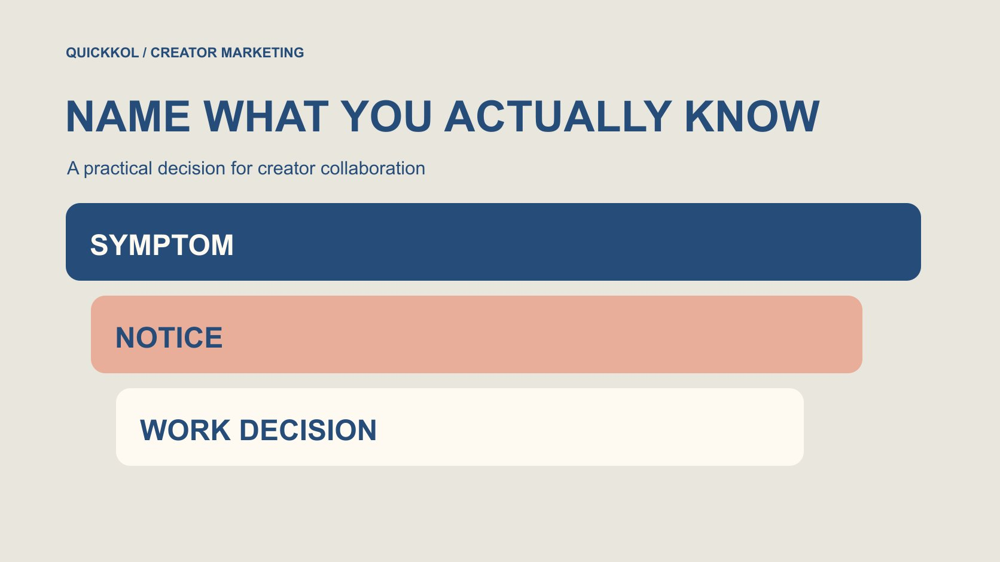
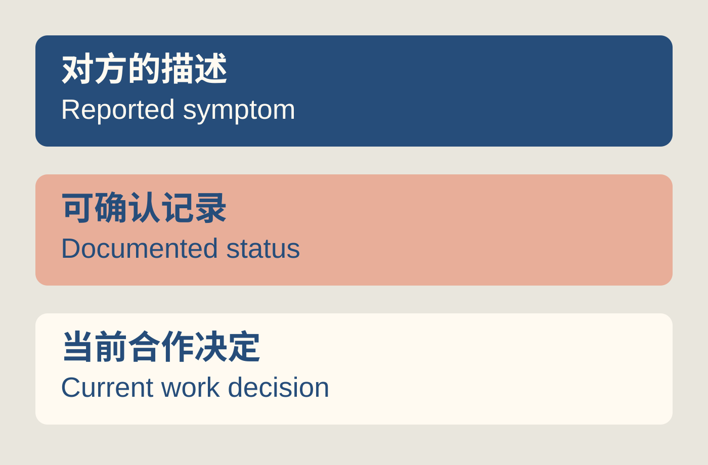

# 达人说被限流时怎样更新合作状态

状态：本地审阅稿；正式发布日期待确认。

把创作者说的“被限流”转成有范围的合作状态：观察到什么、平台确认什么、当前工作需要什么决定。

QuickKOL 编辑图形；不呈现真实账号指标或平台界面。

Shadowbanned 常被用来描述内容似乎更难被看见、推荐或找到的情况；在达人合作里，这句话首先是一个需要澄清的报告，不是品牌已经完成的账号诊断。先记录哪条作品、什么时期、哪项现象，再分别核对平台实际通知与账户可用状态。低浏览本身不能证明隐藏限制，正式不推荐、内容移除和登录受限也不是同一结果。状态更新应说明已知、未知和下一步负责人，避免把推测写成创作者违规或合作失败。

## 把一个词拆成能够核对的现象

当创作者说被限流，先询问具体意思：这条作品浏览较低、某个推荐来源变化，还是看到正式通知？不同回答对应不同资料。

不要立刻要求对方证明自己没有问题。合作沟通先解决事实与任务，能够避免一句模糊描述在团队里被转述成确定处罚。

记录现象时保留范围，例如某条作品在某一观察期的情况。不要把一次搜索未找到、一个人的信息流体验或一个截图扩展为全部用户都看不到。

可以先使用中性表达：创作者报告触达变化，正在核对相关资料。这样不忽视问题，也不让状态更新越过证据。

## 可保留、可推荐与实际触达不是一回事

[Meta 的推荐资格说明](https://about.fb.com/news/2020/08/recommendation-guidelines/)在 2020 年公开解释过：某些内容可以保留在平台，却不进入推荐。这个概念有助于区分资格与移除，不能直接诊断今天某个具体账户。

即使作品符合推荐条件，也不代表每个人都会看到；反过来，某个浏览变化也不能自动说明作品被移除。不要把几个不同问题压成一个词。

品牌需要知道的是哪个状态影响本次工作，而不是替平台推断隐藏原因。如果没有相关通知或资料，就在报告里保留这一限制。

讨论时把概念说明与账户事实分开。公开规则帮助提出正确问题，具体作品仍然需要对应记录，不能用一篇平台文章替代实际核对。

## 正式通知要按它实际说明的范围记录

[TikTok 的内容处理与申诉说明](https://support.tiktok.com/en/safety-hc/account-and-user-safety/content-violations-and-bans)区分内容移除与不适合进入 For You 推荐，并介绍查看原因与提出申诉。不要把某个帖子的通知扩大为整个账户全部功能失效。

核对时保留相关作品、通知日期与具体影响，不需要把账号凭据或无关私人资料交给品牌。品牌通常需要项目相关信息，而不是接管创作者账户。

如果通知有正式处理方式，由账户持有人按当前提供的途径处理。提交申诉表示进入复核，不等于已经恢复，也不能预告某个固定时长必然结束。

这类资料可以支持真实状态更新，但仍不能替品牌决定合同责任。商务判断需要回到实际约定和可确认事实，不能由一个标签自动完成。

## 低浏览需要合适比较，不能单独作诊断

作品之间的主题、形式、观察期和公开条件可能不同。先说明拿什么与什么比较，不把一条新作品短时间内的计数直接与另一条长期累计结果相比。

[TikTok 的内容推荐说明](https://support.tiktok.com/en/using-tiktok/exploring-videos/how-tiktok-recommends-content)讨论了个性化分发。即使两个人关注相同创作者，看到的内容也可能不同，因此一个人的查看不能代表全部推荐情况。

[达人数据口径文章](https://www.quickkol.com/zh/blog/read-creator-engagement-data/#answer)帮助把观察范围写清。数据可以说明发生变化，但变化原因通常需要更多资料；没有原因证据时，不必强行给出一个。

保留准确的有限结论，例如这条作品在相同观察期的公开浏览低于选定参考。它支持继续研究，不等于已经证明隐藏限制。

## 状态更新写三层：已知、未知、下一步

已知写实际观察与可见通知；未知写原因、范围或仍待确认的信息；下一步写由谁做什么。三层可以很短，但不能互相代替。

例如“作品可见，创作者报告推荐来源变化，尚未确认原因，账户持有人查看当前通知后更新”。这比“账号被封，合作失败”更准确，也更容易执行。

给状态注明日期，后续有新资料时更新受影响部分。不要在一次修改后仍让旧版本流传，造成有人继续按已经过期的结论处理项目。

状态更新不应夹带无关评价。创作者是否值得长期合作，需要更多内容与商务判断，不从一项尚未解释的现象直接得出。

状态更新应说明事实与下一步，不用推测给创作者定性。

## 把当前工作影响写具体

品牌需要知道哪些任务真正受影响：素材制作是否仍能继续，约定发布是否需要等待，已上线内容是否可见，或复盘数据是否暂时不足。

不要把一个分发现象自动扩展成全部工作暂停。也不要反过来忽视真实发布限制，继续声称原计划没有变化。

[达人项目状态方法](https://www.quickkol.com/zh/blog/creator-campaign-status-system/#answer)帮助把事实连接到任务。不同决定可以由不同人负责，账户持有人处理平台通知，品牌与创作者共同确认交付安排。

如果涉及调整时间、范围或费用，明确讨论，不把不确定状态直接转成单方追加义务。项目决定应有具体理由，而不是依赖一个情绪化标签。

## 只使用能够说明的正式下一步

下一步可以是核对实际通知、查看对应作品、确认比较口径，或使用平台提供的申诉与支持。每个动作应服务尚未回答的问题。

不要承诺某个停更天数、删除数量或更换账号做法一定恢复。也不要让创作者为了看似解决问题，放弃已有记录或规避真实限制。

品牌不需要一份万能修复清单。需要的是当前工作能否继续、什么信息还缺、何时重新沟通，以及由谁处理。

若原因仍不明，可以保留待核验，同时继续不受影响的已约定工作。没有完整诊断，不等于必须编一个，也不等于项目所有部分都无从判断。

## 对内沟通也保留准确措辞

内部群聊里的确定说法，可能很快进入客户报告或其他负责人判断。避免把“创作者说被限流”缩写成“创作者违规”，尤其在没有对应通知时。

可以使用报告、观察到、尚未确认与平台通知显示等措辞，明确每句话来自哪里。不是让报告更含糊，而是让事实层次更清楚。

不需要广泛传播私人账户截图。分享项目所需范围，并说明时间与内容，避免让一张旧图成为永久标签。

如果此前说法不准确，更新具体记录与受影响沟通。更正应指向新事实，而不是再用另一个同样没有依据的解释替换。

## 用一条假设报告检查表述

假设创作者说某条合作作品被限流。品牌看到作品仍可见，资料显示一个较低的观察期计数，但尚未收到相关平台通知。

报告可以写：当前作品可见，观察到的表现低于所选参考，原因未确认；下一步由账户持有人核对通知，品牌继续检查本轮素材与发布安排。

若后来确认某条作品不适合推荐，就更新这一条的范围，不自动写成全账户被封。若没有新资料，就保留未知，不把等待时间变成确定诊断。

这个例子没有真实账户结果。它展示状态更新如何支持任务，同时避免把一个现象扩展成对创作者个人的指控。

## 每次新资料只更新受影响结论

后续资料可能确认某项限制、显示状态改变，或只补充一个比较口径。分别更新，不因为有一条新信息，就把全部项目判断一次推翻或全部证实。

如果后来不再看到通知，记录这次观察与日期，不把此前真实记录改写成从未发生。新通知也只关联它对应的作品与时期，不倒推解释所有旧结果。保留当前负责人和下一次检查条件。无需为了显示进度反复提交相同内容，也不需要每天重复一个没有变化的确定说法。

Shadowbanned meaning 在达人合作中的实用答案，是把日常用语转成有依据的工作状态：什么发生了，什么尚不知道，什么动作现在合理。

这样的沟通既认真对待创作者报告，也让品牌在证据范围内作决定。合作需要真实下一步，不需要没有依据的保证恢复或确定指控。

## 把模糊描述变成工作状态

| 层次 | 合适记录 | 避免扩展 |
| --- | --- | --- |
| 报告 | 本人描述的具体现象 | 已经确认的平台处罚 |
| 观察 | 作品、时期与口径 | 全部用户都看不到 |
| 通知 | 实际内容与适用范围 | 整个账户全部失效 |
| 决定 | 任务影响与负责人 | 未经讨论的商务结论 |

编辑沟通方法；不提供账号诊断、恢复保证或针对个人的指控。

## 发送状态更新之前

让每句话都能说明它的依据。

- [ ] 记录本人报告与具体作品。
- [ ] 核对时期与比较口径。
- [ ] 分别保留实际平台通知。
- [ ] 写明未知，不自动推断原因。
- [ ] 说明当前任务受什么影响。
- [ ] 安排合理下一步与负责人。

## 研究日期与使用边界

资料核验于 2026 年 11 月 18 日。文中方法、表格和决策规则为编辑建议，标为假设的示例不是实际客户结果或行业基准。外部资料的适用地区与时期按各段说明。

## 从任务开始达人研究

用 QuickKOL 理解 Brief、发现相关达人并研究作品与联系路径；数据、合作条件和结果仍需核验。

[了解 QuickKOL](https://www.quickkol.com/#capabilities)

## 来源

- [Meta 的推荐资格说明](https://about.fb.com/news/2020/08/recommendation-guidelines/)
- [TikTok 的内容处理与申诉说明](https://support.tiktok.com/en/safety-hc/account-and-user-safety/content-violations-and-bans)
- [TikTok 的内容推荐说明](https://support.tiktok.com/en/using-tiktok/exploring-videos/how-tiktok-recommends-content)
