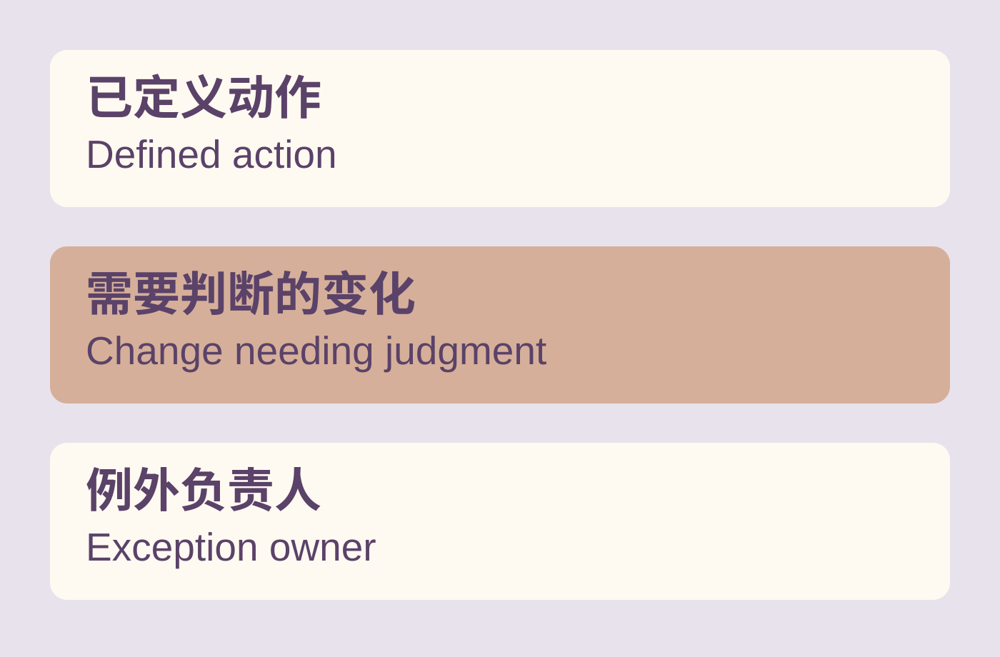

# Social Media Automation With Creator Oversight

Status: local review draft; confirm the publication date before release.

Use social-media automation for defined preparation and publishing actions, with named owners for creator judgment, changed facts and exceptions.

In influencer marketing, social media automation suits well-defined preparation, reminders and publishing actions: placing an agreed version in a draft, reminding an owner to check a destination or scheduling through a supported method. Each action needs an input, evidence of completion and an exception owner. A sent notification does not establish completed work, and scheduling does not establish creator agreement. Actual experience, commercial terms, changed facts and questions requiring understanding still need human judgment; automation should help those decisions reach the right person.

## Name the action before choosing automation

Do not begin with automate social media. Name one action: create a draft after receiving an agreed file, or remind someone to check a link before publication. A specific action makes completion assessable.

A creator partnership contains different work. Preparing files, confirming experience, checking offer facts and responding to readers do not become the same automatable task because they appear in one calendar.

Explain why this action deserves automation, such as reducing repeated entry or missed handoffs. Do not convert a decision into an unattended rule merely to increase tool usage.

A reasonable starting point is a repeated action with stable scope and a checkable result. Make it work before extending it according to actual need. This is an operational recommendation, not a requirement that every brand adopt the same system. The team should be able to explain what work has been removed and what responsibility remains, rather than judge the setup by the number of steps labeled automatic.

## Make the input refer to the agreed version

When creating a draft automatically, the input needs more than an ambiguous filename. It should identify the work, version, destination account and caption so the next owner knows what the system received.

If the asset changes, an earlier version should not continue as the assumed latest. A named owner can update the record and explain whether scheduling is affected; the newest file in a folder is not necessarily the agreed one.

The [UGC production-roles article](https://www.quickkol.com/blog/ugc-content-creator-on-camera-production-role/#answer) separates appearing, producing and publishing. Moving a file does not complete creator-experience confirmation or permission for brand use.

Retain information needed for the next action rather than add unrelated personal details or whole commercial conversations to every task. A useful input is sufficient and specific. It should let the owner check that the correct work has arrived without making them reconstruct the entire relationship before carrying out a routine, already defined operation.

## Separate notification, approval and completion

[Later’s team-approval guide](https://help.later.com/hc/en-us/articles/40954654500375-Team-Collaboration-and-Content-Approvals) provides an important example: its July 2026 guidance says approval status alone does not stop a scheduled post publishing on time. State labels must therefore be interpreted through the actual tool.

A brand's own reminders have the same issue. Sending an email completes the reminder action; whether a reviewer looked, requested changes or caused the publishing owner to adjust scheduling needs separate confirmation.

Define completion evidence for each action: a draft exists, a specific version is agreed or the actual post is live. One automatic checkbox should not carry all those facts.

When the required result is absent, route the task to its owner rather than let the workflow manufacture an appearance of completion. Making unfinished work visible is a useful role for automation. The person reading a status should understand what happened, what did not happen and which next decision remains theirs to make.

## Platform format determines what can be completed automatically

[Later’s platform-and-format guide](https://help.later.com/hc/en-us/articles/360060842914-Supported-Social-Platforms-Post-Types) lists support limits, including unsupported Instagram native effects. A platform name in a support table does not mean every creator concept can be published unchanged through automation.

Separate what the actual deliverable can complete automatically from what needs a person. A video file may be ready while a native interaction requires an app action. Assign that work instead of assuming the tool will add it.

If a restriction changes the concept, confirm the alternative with the creator. Do not silently remove a promised contribution and substitute successful scheduling for complete delivery.

For repeated formats, retain an execution note based on the current check and identify conditions requiring an update. One supported setup should not become a claim about every account forever. A practical automation record should describe the specific combination of account, content format and publishing method the team actually intends to use.

## Route exceptions to someone who can act

An exception needs more than a notification. Identify who can change scheduling, supply facts and contact the creator so the issue reaches someone able to take the next action.

Suppose a destination offer ends and a check finds it no longer matches the video's promise. The publishing owner can pause the arrangement, the brand supplies current terms and the creator confirms whether their wording must change.

Do not send everyone the same vague instruction to handle it. Route the issue to one owner who coordinates necessary help, reducing the chance that everyone assumes someone else is acting.

Record the particular exception rather than only its severity. A mismatched page, missing file and unconfirmed creator version need different actions; a shared red status does not explain how to proceed. The owner should receive the affected work, the observed problem and the decision needed, keeping the handoff short enough to act on without losing its meaning.

Completing one action automatically does not complete every team decision.

## Check whether an action happened before retrying

A missing expected confirmation does not necessarily mean publication failed. Inspect the actual destination and record before retrying, avoiding duplicate public posts.

[Later’s web-scheduling guide](https://help.later.com/hc/en-us/articles/1500010572781-Schedule-Copy-Posts-With-Later-on-the-Web) distinguishes drafts, scheduling and automatic or notification publishing. A brand's own operations record should preserve those differences rather than infer that every later action failed from one incomplete reminder.

If nothing happened, continue the current task. If the work is already live, verify its actual version and update the record. Do not publish the same file again merely to make a spreadsheet status turn green.

Apply the same check to reminders and handoffs. Duplicate notifications create confusion, especially when old and new versions coexist. Keeping the task connected to its version is more reliable than asking everyone to remember which message is newer. A retry should resolve a verified incomplete action, not conceal uncertainty about the action's current state.

## Keep real conversation connected to understanding

An automatic reply can acknowledge receipt or provide a clear service route, but should not imply that a creator read and answered a specific experience question. Questions needing personal judgment should reach the appropriate person.

Keep brand facts separate from creator experience. A template cannot invent steps the creator never performed; an order question should reach service rather than cause the creator to collect private details publicly.

Define response ownership and scope. Do not let automation continually generate additional creator obligations that were never agreed before the partnership.

Some questions deserve follow-up content. Read their meaning before choosing another explanation instead of treating similar keywords as identical needs. The system can help collect or route questions, while the person responsible decides whether a response is accurate and useful. That division preserves a practical role for automation without making the public conversation depend on statements nobody has actually considered.

## Keep commercial-context checks with the final version

When applying a caption template, check that the commercial relationship still matches. Payment, gifts and other connections do not become settled because the previous post used particular wording.

[FTC’s influencer disclosure guide](https://www.ftc.gov/business-guidance/resources/disclosures-101-social-media-influencers) explains relevant principles for applicable US contexts. Automatic text insertion can assist preparation, while clarity and presence in the actual work still require final presentation review.

Subtitle crops, replacement media or a platform change can alter what readers encounter. Return those changes to review rather than check only that a disclosure field exists inside a system.

Preserve actual creator experience too. A template can reuse structure, not someone else's feelings, and a product conclusion from one assignment does not automatically become a confirmed fact in the next. The final owner needs a usable version that expresses the real relationship and experience, rather than a completed template whose accuracy has been assumed from its format.

## Try one small workflow before extending it

Imagine automating a reminder to check the destination for a creator Story. Start with one set of agreed work, defining the recipient, what to inspect, how to record the result and who pauses the next arrangement if it does not match.

Observe whether omissions decrease instead of counting only successful reminder deliveries. If nobody knows which version to inspect, improve the input and handoff rather than add more notifications.

Record an actual execution sequence: preparation, check, exception, resolution and publication. This example is a method, not a claimed customer-efficiency result from a particular system.

After establishing usefulness, decide whether to extend it. Other formats and creator conditions may differ, requiring another judgment rather than copying the whole set of assumptions. A small workflow that the team understands is easier to maintain than a broad chain whose apparent success depends on people silently repairing missing context outside the record.

## Use review to improve operations without inventing return

Review the task automation actually owned: reducing duplicate entry, routing exceptions earlier or preventing an old version from continuing toward publication. Do not supply numerical improvements that were never recorded.

The [creator-campaign execution workflow](https://www.quickkol.com/blog/step-by-step-campaign-tracking-evidence-log/#answer) connects these operations with delivery. Smoother work can be a valuable finding without becoming a claim of increased sales or better creator performance.

Retain a list of decisions requiring people and identify steps that can be simplified. Automation does not become more complete merely by becoming longer; redesign an action that only creates extra checking.

The final arrangement should be explainable: what the tool completes, where judgment is needed, who receives exceptions and where actual publication is confirmed. That is how automation can continue supporting influencer marketing. It makes the team's responsibilities visible instead of hiding them behind a sequence that appears automatic only because people repeatedly intervene without their work being acknowledged.

## Define each automated action

| Element | Question | Evidence |
| --- | --- | --- |
| Input | Which work and version? | Identified record |
| Action | What does the tool do? | Checkable result |
| Exception | What change needs judgment? | Specific issue |
| Owner | Who can act next? | Assigned next action |

Editorial design framework; no claim that every tool implements these actions or guarantees efficiency gains.

## Before automating an action

Define one repeated action the team actually needs.

- [ ] Define input and agreed version.
- [ ] Name the action and completion evidence.
- [ ] Check current format and account support.
- [ ] Assign an owner able to handle exceptions.
- [ ] Check actual state before retrying.
- [ ] Review operational outcomes without inventing marketing results.

## Research date and limitations

Sources reviewed November 18, 2026. Methods, tables and decision rules are editorial recommendations. Hypothetical examples are not actual client results or industry benchmarks. Source geography and periods are specified where relevant.

## Start creator research with a clear task

Use QuickKOL to interpret a brief, discover relevant creators and research their work and contact routes. Verify data, commercial terms and outcomes at their source.

[Explore QuickKOL](https://www.quickkol.com/#capabilities)

## Sources

- [Later’s team-approval guide](https://help.later.com/hc/en-us/articles/40954654500375-Team-Collaboration-and-Content-Approvals)
- [Later’s platform-and-format guide](https://help.later.com/hc/en-us/articles/360060842914-Supported-Social-Platforms-Post-Types)
- [Later’s web-scheduling guide](https://help.later.com/hc/en-us/articles/1500010572781-Schedule-Copy-Posts-With-Later-on-the-Web)
- [FTC’s influencer disclosure guide](https://www.ftc.gov/business-guidance/resources/disclosures-101-social-media-influencers)
