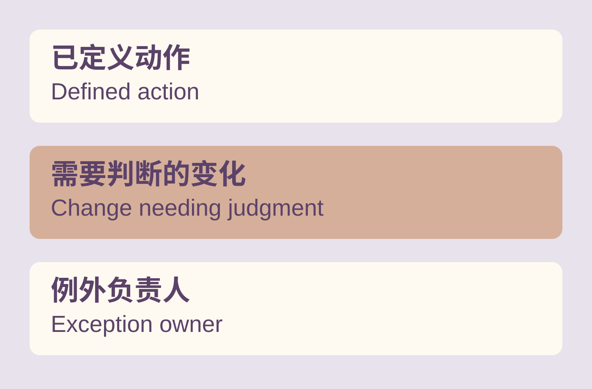

# 达人内容自动化怎样处理例外

状态：本地审阅稿；正式发布日期待确认。

让社媒自动化处理清楚定义的准备与发布动作，把需要创作者判断、事实更新和异常处理的工作交给明确负责人。

达人营销中的 social media automation，适合处理规则明确的准备、提醒与发布动作，例如把确认版本送入草稿、提醒负责人检查目标页，或按受支持方式排期。每个动作都要说明输入、完成证据和异常时由谁处理。工具发出通知不等于人已完成工作，已排期也不等于创作者已同意。真实体验、合作条件、事实变化和需要理解的问题，仍需要有人判断；自动化应让这些判断更容易到达合适的人。

## 把要自动化的动作写成具体一句话

不要从“把社媒自动化”开始，而要写一个具体动作：收到确认文件后建立草稿，还是在发布前提醒检查链接？动作越清楚，越容易判断工具是否真的完成。

同一场达人合作包含不同工作。准备文件、确认体验、检查活动事实与回复观众，都不能因为出现在一个日历里就被当成同一种可自动操作。

先说明为什么这一步值得自动化，例如减少重复录入或避免交接遗漏。不要为了增加工具使用，把原本需要判断的决定改成无人确认的固定规则。

一个合理起点是重复、范围稳定且结果可检查的小动作。先把它做好，再根据实际需要扩展；这属于工作设计，不是要求所有品牌采用相同系统。

## 输入必须指向确认过的版本

自动建立草稿时，输入不能只有一个容易混淆的文件名。至少要能识别作品、版本、目标账户和文案，让接手人知道系统拿到的是哪一份。

如果素材后来变化，旧版本不应继续被当成最新。可以由明确负责人更新记录，并说明原来排期是否受影响；不要假定文件夹里最后出现的文件一定已经确认。

[UGC 制作职责文章](https://www.quickkol.com/zh/blog/ugc-content-creator-on-camera-production-role/#answer)帮助把出镜、制作与发布分开。自动搬运一个文件，不会自动完成创作者体验确认或品牌授权。

设计输入时，优先保留对下一步真正必要的信息。不要为了让系统“更完整”，把无关私人资料或整段商务聊天都加入每条发布任务。

## 不要把通知、审批与完成混为一谈

[Later 的团队审批说明](https://help.later.com/hc/en-us/articles/40954654500375-Team-Collaboration-and-Content-Approvals)提供了一个重要例子：其 2026 年 7 月说明中，审批状态本身不会阻止已排期帖子按时发布。由此可见，状态名称必须按实际工具解释。

品牌自己的自动提醒也有相同问题。邮件发出，只能说明提醒动作完成；审阅者是否看过、是否提出修改、发布负责人是否处理排期，需要各自确认。

为每个动作写清完成证据：草稿存在、具体版本得到确认，或实际帖子已经上线。不要让一个自动勾选框承载这些不同事实。

如果没有收到所需结果，就把任务交给负责人，而不是让流程继续制造“全部完成”的外观。自动化最有价值的地方之一，是让未完成事项容易被看见。

## 平台格式决定哪些动作能自动完成

[Later 的平台与格式说明](https://help.later.com/hc/en-us/articles/360060842914-Supported-Social-Platforms-Post-Types)按当前支持范围列出限制，例如部分 Instagram 原生效果不受支持。不能因为一个平台名称在列表中，就推断每种达人创意都能原样自动发布。

把实际内容拆成可完成与需人工处理的部分，例如视频文件已准备好，但某个原生互动仍需要在应用中操作。给后者安排人，而不是把它当成工具自然会补上的细节。

若限制影响了原定创意，与创作者确认替代方式。不能在不说明的情况下删掉其承诺的内容贡献，让排期成功取代交付完整。

对经常重复的格式，保留当前核验过的执行说明，并注明需要更新的条件。不要把一次支持结果写成所有账户永远相同的规则。

## 让例外到达有权处理的人

自动化出现异常时，需要的不只是一个提示。说明谁能改排期、谁能提供事实、谁能联系创作者，让问题到达有能力完成下一步的人。

例如目标页活动结束，系统或人工检查发现它与视频承诺不同。负责发布的人可以暂停安排，品牌负责人提供新条件，创作者则确认是否需要修改自己的表达。

不要让所有人都收到同样含糊的“请处理”。可以先交给一个明确负责人，再由其组织必要协作，避免每个人以为别人会解决。

记录例外的具体内容，而不只标记一个严重程度。页面不一致、文件缺失和创作者尚未确认，需要不同动作；一个共同的红色状态不足以告诉团队怎么继续。

自动完成一个动作，不等于替团队完成全部决定。

## 重试之前先确认是否已经发生

工具没有返回预期提示，不一定说明帖子没有发布。重试前检查实际目标与记录，避免同一内容被重复发出。

[Later 的网页排期说明](https://help.later.com/hc/en-us/articles/1500010572781-Schedule-Copy-Posts-With-Later-on-the-Web)区分保存草稿、排期以及自动或通知发布方式。品牌自己的操作记录也应保留这个区别，不能从一个未完成提醒推断所有后续动作都未发生。

如果确认尚未执行，再按当前任务继续；若已经上线，先核对实际版本并更新记录。不要为了让表格状态变绿而再次公开同一个文件。

这项检查同样适用于提醒和交接。重复通知可以制造混乱，尤其当旧版与新版同时出现时。保留任务与版本的联系，比依赖大家记住哪条消息较新更可靠。

## 真实对话不能只靠固定回复

自动回复可以确认信息已经收到，或提供清楚的服务入口，但不能假装创作者已经阅读并回答具体体验问题。涉及个人判断时，让问题进入合适的人工回应。

品牌事实和创作者体验仍需区分。如果观众问某个动作怎样完成，模板不能凭空补出创作者没做过的步骤；如果问订单，转给合适客服，而不是让创作者公开收集资料。

设置回应安排时，说明谁在什么范围内处理。不要在合作前没有约定，却让自动化不断生成需要创作者承担的新任务。

有些问题值得整理为后续内容。先阅读原意，再决定是否增加解释，避免把一组看似相似的关键词当成完全相同的需求。

## 商业关系检查应留在最终版本

自动套用文案时，检查真实合作关系是否仍然相同。付费、赠品和其他关系不能因为上一条内容用了某种表达，就默认这次无需确认。

[FTC 的达人披露指南](https://www.ftc.gov/business-guidance/resources/disclosures-101-social-media-influencers)针对美国适用情境说明相关原则。自动插入文字可以帮助准备，但是否清楚、是否留在实际作品里，仍需看最终呈现。

字幕裁切、媒体替换或转到另一平台，都可能改变读者实际看到的信息。让这类变化回到审阅，而不是只检查系统里存在一条披露字段。

同时保留创作者真实体验。模板能复用结构，不能复用他人的感受，也不能让一个项目的产品结论自动变成下一项目的已确认事实。

## 用一个小流程试运行，再决定扩展

假设品牌希望自动提醒检查达人 Story 的目标页。先只覆盖一组已确认内容，规定提醒发给谁、检查什么、结果怎样写回，以及不一致时谁暂停后续安排。

观察这一步是否减少遗漏，而不是只数提醒发送成功多少次。如果大家仍不知道该查哪一版，问题在输入与交接，不是需要更多提醒。

记录一次真实的执行过程：准备、检查、例外、解决与发布。这里的示例是方法，不是宣称某种系统已为客户提升效率的案例。

确认小流程有用以后，再决定是否扩展到其他内容。不同格式与创作者条件可能不同，需要重新判断，不能因为一个动作适合自动化就复制整套假设。

## 让复盘改善操作，而不是虚构营销回报

复盘先看自动化承担的实际任务：是否减少重复录入、是否让异常更早到达负责人、是否避免旧版继续发布。对没有记录的效果，不填入推测数字。

[达人项目执行工作流](https://www.quickkol.com/zh/blog/step-by-step-campaign-tracking-evidence-log/#answer)帮助把这些操作与内容交付放在一起。操作更顺畅可以是有价值的结论，但不能直接写成销量增长或创作者表现提升。

保留需要人工判断的清单，也保留可以简化的步骤。自动化不是越长越完整；如果某个动作只制造额外核对，就重新设计它。

最终交付一套团队能够解释的安排：哪些动作由工具完成、哪里需要人、异常由谁接手、实际发布在哪里确认。这样的流程才能持续支持达人营销。

## 每个自动化动作需要的说明

| 要素 | 具体问题 | 完成依据 |
| --- | --- | --- |
| 输入 | 哪份作品与版本 | 明确记录 |
| 动作 | 工具实际做什么 | 可检查结果 |
| 例外 | 什么变化需要判断 | 具体问题描述 |
| 负责人 | 谁能处理下一步 | 有人接手的状态 |

编辑设计框架；不承诺所有工具都实现这些动作或保证效率提升。

## 开始一项自动化之前

先定义一个团队真正需要的重复动作。

- [ ] 写清输入与确认版本。
- [ ] 说明具体动作与完成证据。
- [ ] 核对当前格式与账户支持。
- [ ] 为例外安排能处理的人。
- [ ] 重试前检查实际状态。
- [ ] 复盘操作效果，不代写营销结果。

## 研究日期与使用边界

资料核验于 2026 年 11 月 18 日。文中方法、表格和决策规则为编辑建议，标为假设的示例不是实际客户结果或行业基准。外部资料的适用地区与时期按各段说明。

## 从任务开始达人研究

用 QuickKOL 理解 Brief、发现相关达人并研究作品与联系路径；数据、合作条件和结果仍需核验。

[了解 QuickKOL](https://www.quickkol.com/#capabilities)

## 来源

- [Later 的团队审批说明](https://help.later.com/hc/en-us/articles/40954654500375-Team-Collaboration-and-Content-Approvals)
- [Later 的平台与格式说明](https://help.later.com/hc/en-us/articles/360060842914-Supported-Social-Platforms-Post-Types)
- [Later 的网页排期说明](https://help.later.com/hc/en-us/articles/1500010572781-Schedule-Copy-Posts-With-Later-on-the-Web)
- [FTC 的达人披露指南](https://www.ftc.gov/business-guidance/resources/disclosures-101-social-media-influencers)
