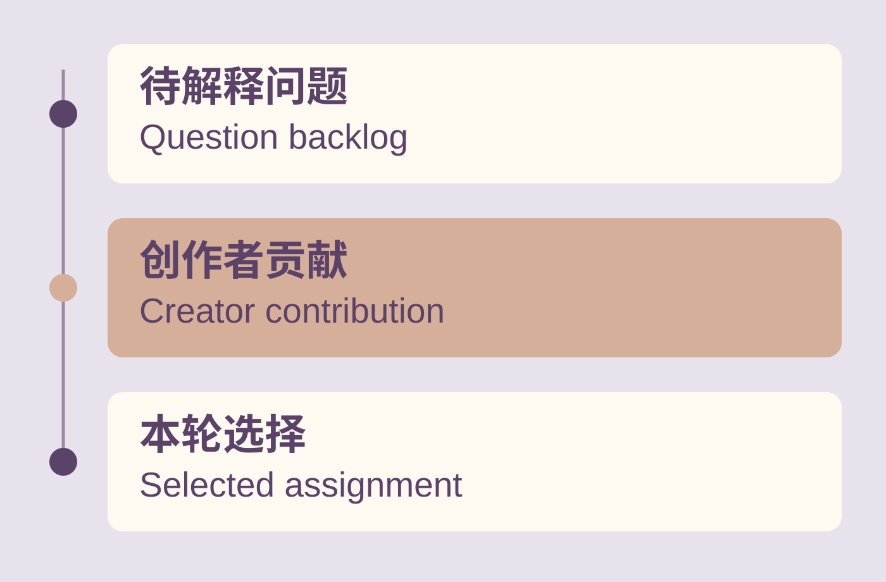

# A Social Media Planner for Creator Learning

Status: local review draft; confirm the publication date before release.

Use a social-media planner to retain questions, evidence, creator contribution and next actions, separating promising ideas from committed production.

A creator-marketing social media planner can first answer why a piece deserves production, then hand selected work to a publishing calendar. Retain the viewer question, source, possible creator contribution, uncertainty and next owner for each idea. Entering an idea does not mean a creator accepted it or a brand committed to publish. Tools can hold drafts and inspiration, while selection still needs evidence, relevance and production conditions. A planner supports decisions rather than filling every space.

## Separate the idea pool from committed work

A planner can contain many ideas, while fewer and more definite pieces should enter production. Separating them prevents a creator from treating a saved topic as a formal commission.

States such as research, discussion and selected need definitions. One green label should not simultaneously mean promising idea, confirmed budget, creator acceptance and permission to publish.

The [creator-brief writing method](https://www.quickkol.com/blog/write-a-useful-campaign-brief/#answer) turns a selected question into executable work. Planning first asks whether to continue; a brief then specifies deliverable, conditions and owner.

This need not create a cumbersome approval process. It lets the team retain immature ideas without communicating them as external commitments. A useful boundary is simple enough that anyone reading the record knows whether they are being asked to explore, discuss or produce, instead of inferring the request from where a card happens to sit in a tool.

## Rewrite inspiration as a viewer question

Inspiration can come from work, comments, product use or a creator suggestion, but this looks good is insufficient for production. Ask what a viewer needs to understand and why the brand belongs in the explanation.

A travel-packing photograph might suggest a question about separating frequently used items from backups. The task is not copying its person and itinerary, but finding a relevant explanation.

Make the question specific enough for a creator to assess their contribution. If it requires experience they lack or facts the brand cannot confirm, revise it instead of allowing visual appeal to conceal weak substance.

A useful question may remain in the pool for some time while still needing reassessment before production. Once interesting does not establish present relevance to product, market or audience. This gives saved inspiration a role as a starting point without turning the original image into an instruction to recreate another person's expression.

## Keep a source that leads back to actual work

Record the work, question or observation behind an idea, with time and scope. Do not turn team speculation into a widespread audience demand or invent discussion volume to strengthen a proposal.

[Meta’s 2026 Edits creation guide](https://about.fb.com/news/2026/04/one-year-of-edits-built-for-and-with-creators/) describes organizing saved content and ideas. A tool can help collect material while the team still explains its relevance to the current assignment.

One source need not prove the whole topic, but it lets another researcher return and assess whether the original context supports the question. Omit irrelevant details rather than copy an entire private conversation.

If a source is unavailable, retain that limitation. The editorial idea can still be discussed without promoting an unverifiable memory into a validated audience insight. This distinction helps the team use inspiration honestly: a promising proposal remains promising, while the evidence behind it stays visible and open to further checking.

## Identify the creator contribution an idea needs

Do not write only large account, lifestyle creator or a broad category. Name the contribution: explaining a choice, showing an action, comparing conditions or producing photographs for a brand channel.

Research relevant work rather than infer capability from a name or count. Subject relevance may not fit the required format, and attractive photography may not provide the explanation needed.

The planner can retain a role requirement without choosing a person yet. Once the task is clear, research candidates and willingness without describing someone mentioned in an idea as an agreed partner.

If a creator proposes a better angle, revise question and contribution. Planning should support joint judgment instead of leaving the person to accept a script that already dictates their experience. A strong role description makes it easier to recognize useful work and easier for a creator to explain how their own approach could answer the brand's question.

## Separate known information, hypotheses and open questions

For each idea, retain established information, editorial hypotheses and open conditions. A table's preference for a conclusion should not turn missing evidence into certainty.

You may know that someone asked about carrying, hypothesize that a comparison between bag types would help, and not know whether the creator has relevant experience. These statements require different next actions.

The brand can supply product facts, a researcher can inspect work and the creator can assess willingness. A missing type of information should not be filled by an unrelated metric.

The record need not be long. Three clear layers are often more useful for deciding whether to produce than a persuasive topic story without support. Keeping uncertainty visible also helps prevent a later brief from quoting an exploratory assumption as if it were already a customer finding or a personal view confirmed by the creator.

## Use drafts for exploration without implying readiness

[Meta’s Threads creator guide](https://about.fb.com/news/2024/08/new-threads-features-for-creators-and-businesses/amp/) introduced drafts and content-planning functions in 2024. It shows how ideas can be retained without establishing that a draft is agreed or ready for public release.

Write an explanation outline first to check focus before deciding whether filming is needed. Do not produce many final assets while facts, contribution and conditions remain unresolved.

If a tool supports comments or internal discussion, identify the requested feedback: relevance, experience or product facts. A general please review can generate opinions without helping a decision.

Drafts should retain their exploratory status. Convert selected work into a definite assignment and keep a short reason when an idea leaves the pool. That makes the planner a record of choices rather than an archive of unexplained unfinished files, and helps a new team member understand whether an old draft remains available for development.

## Select the next work for relevance and feasibility

Selection does not require an apparently precise aggregate score. Establish relevance, creator contribution, available brand facts and reasonable production conditions first.

[Meta’s Instagram creator-guidance announcement](https://about.fb.com/news/2024/10/best-practices-education-hub-creators-instagram/) emphasizes different creation topics and personalized guidance. Platform material can inform observation without proving that a particular idea will receive more distribution.

Retain a relevant idea whose conditions are not ready. Conversely, an easy-to-produce topic without content value need not fill the calendar. Keep the decision connected to the actual assignment.

Before production, identify what this round should help the team learn, such as whether a process deserves further explanation. An exploratory assignment should not be packaged as a solution already known to succeed. This gives the creator a meaningful question and gives the brand a way to assess the work beyond whether it resembled the original planning card.

Saving an idea and commissioning work are different decisions; planning should clarify the next step.

## Keep a short reason for ideas not selected

Reasons for not selecting can be specific: irrelevant product connection, missing facts, no suitable creator or duplication of existing work. Unselected should not mean failed by default.

If one condition is pending, identify it and its owner. An idea requiring new evidence need not automatically return to today's task list and trigger the same uncertainty repeatedly.

When it overlaps existing content, connect the new question to the original and decide whether an update or addition is needed instead of producing the same work for another keyword.

Retaining a stopping reason also respects creator time. An immature idea should not repeatedly be sent to several people for unpaid sample work merely to help the brand decide whether it is worth pursuing. The planner should support the team's own preliminary judgment before turning exploration into a request for someone else's production effort.

## Return learning to the question instead of only totals

After delivery, return to the original question: was the explanation complete, what do readers still ask, which conditions need adding and what could change next time? Do not end by entering total views in one cell.

The [creator-measurement method](https://www.quickkol.com/blog/creator-campaign-measurement/#answer) keeps metrics in scope. Numbers provide observations without establishing that every comment agrees or every brand change came from this work.

Connect learning to a candidate next task. If a step remains unclear, explore a supplementary explanation before asking the same creator to repeat the same selling point.

Retain limitations where evidence is insufficient. The planner should clarify learning rather than require every collaboration to become a success story. A useful closing note distinguishes something learned about content from something still unknown about business impact, allowing the next idea to develop from evidence rather than a flattering account of the previous assignment.

## Connect the next round through a hypothetical record

Imagine travel-creator work raising a question about where frequently used items belong. The planner retains the original and question, the possible demonstration and product facts the brand must confirm.

Research a creator with the relevant setting before commissioning. If conditions are insufficient, retain the idea without treating a name in a table as a signed partner or assigning a date nobody can promise.

If work is completed, return learning to the question; if not selected, retain the reason. This hypothetical contains no client data and illustrates how an idea becomes an assignment through decisions.

The influencer-marketing value of a social media planner is preserving source, contribution and next action with content judgment. It clarifies worthwhile work without turning every inspiration into a publishing promise. A future owner can then understand why the idea exists, what is already established and what must happen before it deserves a place in actual commissioned production.

## A useful creator-content idea record

| Field | What to retain | Decision supported |
| --- | --- | --- |
| Question | What the viewer needs to understand | Whether to continue |
| Source | Work, observation and time | Can the basis be checked? |
| Contribution | Required creator work | How to research candidates |
| Unknown | Pending facts and conditions | What to establish first |
| Next action | Action and owner | Research, discuss or produce |

Planning method, not a prediction score, benchmark or confirmed partnership.

## Hand an idea to the next owner

Make clear whether the task is exploratory or commissioned.

- [ ] Turn inspiration into a specific question.
- [ ] Retain source and observation scope.
- [ ] Define the creator contribution.
- [ ] Separate facts, hypotheses and unknowns.
- [ ] Explain selection or deferral.
- [ ] Return learning to the original question.

## Research date and limitations

Sources reviewed November 18, 2026. Methods, tables and decision rules are editorial recommendations. Hypothetical examples are not actual client results or industry benchmarks. Source geography and periods are specified where relevant.

## Start creator research with a clear task

Use QuickKOL to interpret a brief, discover relevant creators and research their work and contact routes. Verify data, commercial terms and outcomes at their source.

[Explore QuickKOL](https://www.quickkol.com/#capabilities)

## Sources

- [Meta’s 2026 Edits creation guide](https://about.fb.com/news/2026/04/one-year-of-edits-built-for-and-with-creators/)
- [Meta’s Threads creator guide](https://about.fb.com/news/2024/08/new-threads-features-for-creators-and-businesses/amp/)
- [Meta’s Instagram creator-guidance announcement](https://about.fb.com/news/2024/10/best-practices-education-hub-creators-instagram/)
