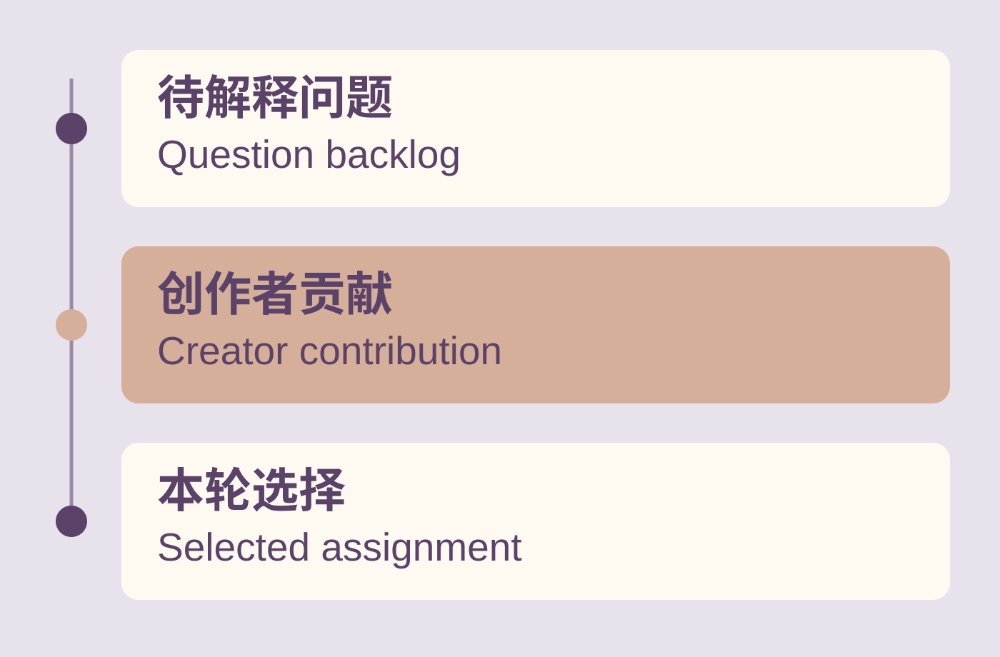

# 社交规划怎样组织下一轮达人内容

状态：本地审阅稿；正式发布日期待确认。

用社交内容规划表保留问题、证据、创作者贡献与下一步，把值得研究的想法和已经承诺制作的内容分开。

达人营销的 social media planner，可以先帮助团队决定“下一条为什么值得做”，再把选中的任务交给发布日历。每个想法保留观众问题、来源、可能的创作者贡献、仍不确定的部分与下一步负责人。一个想法进入表格，不等于创作者已接单，也不等于品牌已经承诺发布。工具可以保存草稿和灵感，真正的内容选择仍要结合证据、相关性与制作条件。规划的价值在于支持决定，而不是把所有格子填满。

## 先区分想法库与已承诺任务

规划表可以有很多想法，真正进入制作的内容应该更少、更明确。把两者分开，避免创作者看到一个暂存选题，就以为品牌已经正式委托。

可以标明待研究、待讨论与已选定，但每个状态都说明含义。一个绿色标签不应同时代表想法不错、预算已确认、本人接单和可以发布。

[达人 Brief 写作方法](https://www.quickkol.com/zh/blog/write-a-useful-campaign-brief/#answer)帮助把选定问题变成可执行任务。规划阶段先判断值不值得继续，进入 Brief 才明确实际交付、条件与负责人。

这不是增加繁琐审批。它是让团队能够保存未成熟想法，同时不把它们误传成已经对外承诺的工作。

## 把灵感改写成观众问题

灵感可以来自作品、评论、产品使用或创作者提议，但“这个很好看”还不足以决定制作。先问观众需要理解什么，以及品牌为什么适合参与。

例如一张旅行收纳照片，可以带出如何区分常用物品与备份物品的问题。不是复制照片中的人物与行程，而是寻找一个与产品相关的解释。

把问题写得足够具体，创作者才知道自己能否贡献。若涉及不具备的经验或品牌也无法确认的事实，先调整问题，不用视觉吸引力掩盖内容不足。

一个有用的问题可以保留很久，但需要在实际制作前重新判断。曾经有趣，不说明今天仍然符合市场、产品与观众需要。

## 保留来源，让判断可以回到实际作品

记录灵感来自哪条作品、哪个问题或哪次观察，注明时间与范围。不要把团队的推测写成观众普遍要求，也不为了增强选题说服力虚构讨论热度。

[Meta 的 2026 年 Edits 创作说明](https://about.fb.com/news/2026/04/one-year-of-edits-built-for-and-with-creators/)介绍了整理保存内容和灵感的工作方式。工具可以帮助收集，团队仍需说明为什么某个素材与当前任务有关。

一条来源不一定证明整个选题，但能让下一位研究者回到原处，判断当时语境是否支持这个问题。无关细节可以省略，不需要复制整段私人对话。

如果来源已经不可见，保留这一限制。可以继续讨论编辑想法，但不能把无法复核的记忆升级成已经验证的受众洞察。

## 说明想法需要的创作者贡献

不要只写要找大号、生活方式达人或某个宽泛品类。说明实际贡献：解释一个选择、展示真实动作、比较不同条件，还是制作供品牌渠道使用的照片。

之后研究相关作品，而不是从名字或人数直接推定能力。一个人在主题上相关，也可能不适合需要的形式；一个作品看起来漂亮，也未必包含解释任务。

规划表可以先保留角色需求，暂不指定个人。等任务清楚，再研究候选与本人意愿，不把被列入想法的人写成已经同意合作。

如果创作者提出更好的角度，允许更新问题与贡献。规划应该支持共同判断，而不是让人只能接受一份已经把个人体验写完的脚本。

## 分别记录已知、推测与待确认

每个想法可以保留已经知道的事实、编辑推测与待确认条件。不要因为表格希望有一个结论，就把没有资料的部分写成明确答案。

例如已经知道观众问过携带方式，推测他们可能需要比较不同包型，但还不知道创作者是否有对应经验。这三句话支持不同下一步。

品牌可以提供准确产品信息，研究者继续看作品，创作者则判断是否愿意承担任务。不要把一种信息的缺失交给另一种不相关指标来补。

这种记录不需要很长。清楚的三层信息，通常比一段很有说服力却没有依据的选题故事，更能帮助团队决定是否进入制作。

## 草稿可以先探索，不必假装已准备发布

[Meta 的 Threads 创作者说明](https://about.fb.com/news/2024/08/new-threads-features-for-creators-and-businesses/amp/)在 2024 年介绍过草稿和内容规划功能。它说明想法可以先被保留，但草稿存在不代表内容已获确认或已经适合公开。

团队可以先写一个解释框架，检查问题是否足够聚焦，再决定是否需要拍摄。不要在事实、贡献和条件都未明确时，先制作大量最终素材。

若工具支持评论或内部讨论，说明希望反馈什么：问题相关性、实际经验，还是产品事实。一个泛泛“请看一下”可能得到意见，却没有帮助决定下一步。

草稿应当保留探索身份。选定之后再转换成明确任务，退出的想法也可以有简短原因，方便以后不重复相同讨论。

## 选择下一条时比较相关性与可完成性

选择不必靠一套看起来精确的总分。先确认问题是否相关、创作者是否能贡献、品牌事实是否可获得，以及现在是否有合理制作条件。

[Meta 的 Instagram 创作者建议入口](https://about.fb.com/news/2024/10/best-practices-education-hub-creators-instagram/)强调不同创作主题与个性化建议。平台资料可以帮助观察，但不能替品牌证明某个想法一定获得更多触达。

如果一个选题相关但条件未到，可以保留；如果制作方便但没有内容价值，也不必为了填日历选它。让决定与实际任务相连。

进入制作之前明确本轮希望学到什么，例如某个过程是否值得进一步解释。不要把一个探索性任务包装成已经知道会成功的方案。

保存想法与承诺制作是不同决定；规划应让下一步更清楚。

## 给暂时不做的想法留一个简短原因

不做可以有具体原因：与本次产品无关、缺少事实、没有合适创作者，或与已有内容重复。不要把所有未选想法都标成失败。

如果只是等待某项条件，说明是什么以及由谁处理。需要新的资料才重启的想法，不必每天自动回到待办，让团队反复确认相同未知。

发现与既有文章重复时，可以把新问题连接到原作品，判断需要更新还是补充，而不是为了新的关键词再次制作相同内容。

保留停止理由，也能保护创作者时间。一个未成熟想法不应反复发给多人要求免费试写，只为了帮助品牌决定它是否值得继续。

## 复盘写回具体问题，不只保留总数

作品完成以后，回到最初问题：解释是否完整，观众还问什么，哪些条件需要补充，下一次可以改变什么。不要只把总浏览填回一格就结束。

[达人测量方法](https://www.quickkol.com/zh/blog/creator-campaign-measurement/#answer)帮助把指标放回范围。数字可以提供观察，但不能自动证明所有评论都赞同，或品牌全部变化来自这一条内容。

把实际学习连接到下一项候选任务。例如一个步骤仍不清楚，就先研究补充解释，而不是直接要求同一位创作者重复同一卖点。

若没有资料支持某个结论，就保留限制。规划表应该让团队学得更清楚，不是让每次合作都必须被写成成功故事。

## 用一条假设记录连接下一轮

假设一条旅行创作者作品引出常用物品怎样放置的问题。规划表保存原作品与问题，记录可能需要的实际演示，以及品牌必须确认的产品信息。

团队先研究一位有对应场景的创作者，再决定是否委托。条件不足就保留，不把名字填进表格当成已签约，也不先安排一个无法承诺的发布日期。

如果作品完成，复盘写回这条问题；如果暂不制作，保留原因。这个例子没有真实客户数据，只说明一个想法如何经过选择成为任务。

Social media planner 的达人营销价值，是让内容判断保留来处、贡献与下一步。它让值得做的工作更清楚，而不把全部灵感都变成必须发布的承诺。

## 一条达人内容想法的必要记录

| 信息 | 写什么 | 支持的决定 |
| --- | --- | --- |
| 问题 | 观众需要理解什么 | 是否值得继续 |
| 来源 | 作品、观察与时间 | 能否回到依据 |
| 贡献 | 需要哪种创作者工作 | 如何研究候选 |
| 未知 | 仍待确认的事实与条件 | 先补什么 |
| 下一步 | 具体动作与负责人 | 研究、讨论或制作 |

规划方法，不是预测分数、行业基准或已经获得的合作承诺。

## 把想法交给下一位负责人

让对方知道是在探索还是正式制作。

- [ ] 把灵感写成具体问题。
- [ ] 保留来源与观察范围。
- [ ] 说明创作者需要贡献什么。
- [ ] 分开事实、假设与未知。
- [ ] 为选择或暂缓写明原因。
- [ ] 把复盘学习写回原问题。

## 研究日期与使用边界

资料核验于 2026 年 11 月 18 日。文中方法、表格和决策规则为编辑建议，标为假设的示例不是实际客户结果或行业基准。外部资料的适用地区与时期按各段说明。

## 从任务开始达人研究

用 QuickKOL 理解 Brief、发现相关达人并研究作品与联系路径；数据、合作条件和结果仍需核验。

[了解 QuickKOL](https://www.quickkol.com/#capabilities)

## 来源

- [Meta 的 2026 年 Edits 创作说明](https://about.fb.com/news/2026/04/one-year-of-edits-built-for-and-with-creators/)
- [Meta 的 Threads 创作者说明](https://about.fb.com/news/2024/08/new-threads-features-for-creators-and-businesses/amp/)
- [Meta 的 Instagram 创作者建议入口](https://about.fb.com/news/2024/10/best-practices-education-hub-creators-instagram/)
