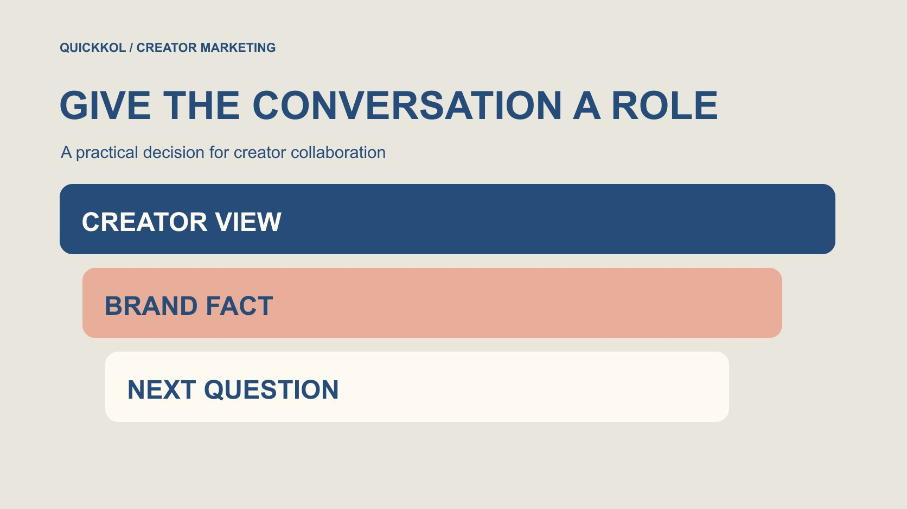
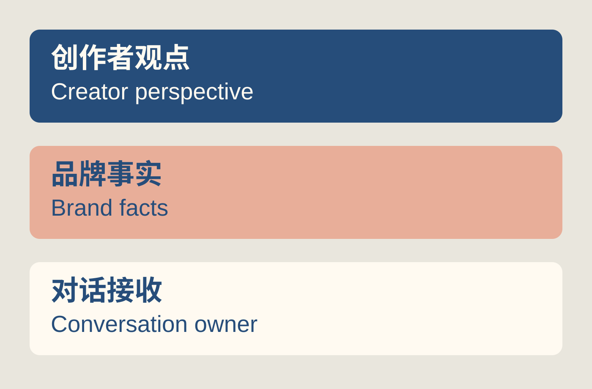

# Threads for Creator Partnership Conversations

Status: local review draft; confirm the publication date before release.

Give Threads a role in creator explanation and community conversation, separating the creator’s perspective, brand facts, response ownership and observed results.

QuickKOL editorial graphic; not actual account metrics or a platform interface.

Here, threads. refers to Meta’s Threads. In influencer marketing it can carry a written perspective, further explanation and replies instead of serving only as a repost destination for other platforms. Define a worthwhile question, then agree who contributes actual experience, confirms product facts and handles follow-up. Interaction and Insights can inform observation, but reply volume is not brand support and views are not purchases. Build the partnership around an explanation the creator can contribute rather than choosing a post count before finding a subject.

## Start with a question worth discussing in text

Threads can have a defined partnership role when a question needs explanation of trade-offs, clarification or experience. Existing video does not automatically justify reposting it as additional value.

An equipment brand might ask a creator to discuss arranging limited counter space. The task is not to make everyone supply an identical answer, but to reveal actual conditions and reasons for choosing.

Identify what a reader gains before selecting the collaboration format. One specific perspective with useful follow-up may fit the assignment better than several promotional sentences without response ownership. That is a planning judgment, not a promise of distribution.

Write an invitation the creator can assess. If they lack relevant experience, change the question or contribution rather than ask them to repeat an unexperienced conclusion in a personal voice. A good question has room for a genuine answer, including conditions where the product or proposed approach is not the option the creator would choose.

## Distinguish a creator perspective from brand facts

The brand can confirm specifications, service scope and offer conditions; the creator can explain judgments from actual use. Collaboration connects these roles without making them interchangeable.

Separate factual reference material from the space for personal expression in the brief. If the creator is unsure about a model or condition, ask the brand rather than improvise. If the brand wants to change an experience statement, return it to the person speaking.

The [Threads account-and-publishing roles article](https://www.quickkol.com/blog/threads-instagram-profile-publishing-roles/#answer) establishes who speaks on which account. This guide adds responsibility inside the content so a seemingly personal view does not contain an unverified commercial promise.

I prefer this storage approach and every model supports it require different evidence. Check where those statements come from while retaining the creator's voice and the relevant conditions. That makes review more precise than asking everyone to sound consistently enthusiastic or asking an editor to replace uncertainty with a stronger claim merely because it reads more smoothly.

## Use platform features to support the conversation

[Meta’s Threads feature updates](https://about.fb.com/news/2025/03/new-threads-features-more-personalized-experience-you-control/) describe profile links, Insights and reply controls in dated 2025 releases. They explain product direction while actual availability still needs checking in the current account.

A brand should decide how the discussion should work before selecting relevant features. Product information may need a clear destination, the creator may add a written explanation and someone must handle subsequent questions.

A feature's existence does not guarantee that every follower sees a post. Discovery across apps also does not establish identical distribution for each partnership. Features support possible ways of working rather than certain outcomes.

For the executing team, identify what this assignment needs, where it will be checked and the alternative if it is unavailable. A simple collaboration does not need every product feature inserted into it. Keep the interaction itself at the center: a reader should understand why the creator raised the subject and where a useful answer can be found.

## Write a post that can sustain explanation

The opening post should provide context: the situation, the creator's judgment and the product's actual role. A broad question alone gives readers little reason to know what a useful response would address.

Include a concrete observation and an unresolved question where appropriate, without deliberately withholding essential facts to generate replies. The post should be independently useful instead of forcing a reader into another installment to understand its basic meaning.

If media is included, explain its relevance in text. When adapting from another platform, check whether the original subtitles, link and context remain available.

Plan follow-up around real questions and important conditions rather than mechanically adding post volume. Contribution can come from making an issue understandable, not splitting one selling point across many posts. A creator should have enough material to respond thoughtfully while remaining free to say that a question requires a brand fact, a different expert or information they do not possess.

## Include response work in the assignment

If follow-up participation is expected, agree on an approximate scope and period before publication rather than assume permanent availability afterward. Reading, assessing and answering are real work.

The brand can handle specifications, service and offer terms; the creator can explain their own demonstration or experience. Personal order issues should move to an appropriate service route without asking the creator to collect private details in public replies.

Define a handoff when an answer is unavailable: acknowledge what needs confirmation and involve the right owner. An automated reply should not imply that the creator personally understood and answered a particular question.

Responsibilities can adapt as discussion develops. If a specification question repeats, the brand can provide a formal clarification while the creator decides whether additional use context is needed. Copying brand language into every reply is not the same as participating in a conversation, and the assignment should not reward repetition simply because it creates more visible activity.

A useful conversation needs a specific contribution and clear follow-up ownership.

## Retain selection scope when researching feeds

[Meta’s Threads custom-feed guide](https://about.fb.com/news/2025/02/share-custom-feeds-on-threads/) describes sharing and discovering public feeds. That can help locate work around a subject without representing the whole market or every creator.

If the team researches home content through one feed, record who selected it, the work observed and the observation time. Shared expression in a curated collection is not proof that every audience has the same preference.

Use actual work as a research entry point and confirm author, subject and project relevance. Appearing in one feed does not establish collaboration, mutual endorsement or membership in a commercial network.

A useful output is a small set of works to inspect and specific questions to pursue. Discovery starts research; candidate assessment still concerns contribution, conditions and the current assignment. This keeps the team from replacing an evidence-based shortlist with a convenient collection whose original selection logic may differ from the brand's needs.

## Make the commercial relationship clear in public

Paid collaboration, gifts or another material relationship do not disappear because a post uses an informal conversational voice. Readers still need to understand the relationship behind the recommendation.

[FTC’s influencer disclosure guide](https://www.ftc.gov/business-guidance/resources/disclosures-101-social-media-influencers) explains relevant principles for applicable US contexts. Brand and creator should check the actual published expression instead of treating an internal contract as notice to the audience.

If follow-up adds a new recommendation or offer, check whether the context remains clear. Do not remove relationship information merely to make the conversation appear spontaneous.

This is not one sentence prescribed for every region and format. Confirm the real relationship and applicable requirements while preserving the creator's own view. Disclosure also does not give a brand unlimited editorial control over personal opinion. The aim is a conversation whose commercial context and substantive contribution are both understandable, including to someone encountering a later reply without having read every earlier post.

## Review the conversation without equating replies with support

[Meta’s Threads creator guide](https://about.fb.com/news/2024/08/new-threads-features-for-creators-and-businesses/amp/) introduced observations such as views, replies, reposts and quotes. These are different actions, not totals that automatically establish brand approval or commercial return.

Start review with actual questions: which explanations prompted useful discussion, which replies revealed information gaps and which needed accurate brand facts? Disagreement can generate replies too; volume alone does not establish sentiment.

The [social-engagement measurement method](https://www.quickkol.com/blog/read-creator-engagement-data/#answer) helps explain counting scope in a report. Retain the work, observation period and definitions rather than rank one discussion against a project with a wholly different format.

Finish with a content decision: update an explanation, film an omitted step or refrain from extending the subject. Larger numbers are not a substitute for assessing the creator's actual contribution. This makes the review useful to the next brief instead of reducing a conversation to a single score that neither the creator nor the brand can interpret.

## Connect the workflow through a hypothetical home partnership

Imagine a brand asking a creator to discuss equipment choices for a small space. The brand supplies dimensions and model facts, the creator explains actual placement trade-offs and both agree who answers specifications versus experience.

After publication, readers ask about cleaning space. The creator can explain their process while the brand confirms which components detach. Uncertainty remains explicit instead of becoming an improvised conclusion for every user.

Review identifies what readers needed explained and whether a video demonstration would help next time. Without sales or attribution evidence, discussion activity is not reported as conversion performance.

This is an editorial hypothetical. It shows how Threads can add a useful written contribution without requiring every partnership to add a platform, a posting target or an identical script. If the creator finds that the question does not match their experience, the team can revise the contribution before publishing. That is a valid planning outcome rather than a reason to press ahead with a personal claim the creator cannot support. The brand can still explain its own facts on its own account while looking for a better fit. The resulting work has a reason to exist: a relevant creator helps people understand a specific choice, and the brand supports that explanation with facts and responsible follow-up.

## Contribution roles in a Threads partnership

| Content | Primary confirmer | Handoff |
| --- | --- | --- |
| Personal experience | Creator | Actual conditions and wording |
| Product facts | Brand | Model, specifications and source |
| Follow-up questions | Agreed responder | Answer or handoff scope |
| Review | Project owner | Observation and next content decision |

Suggested work roles, not a platform guarantee or actual campaign result.

## Before starting a Threads conversation

Establish why this creator has something useful to contribute.

- [ ] Define a specific question.
- [ ] Separate perspective and brand facts.
- [ ] Check account and available features.
- [ ] Agree response scope and owners.
- [ ] Check commercial-context disclosure.
- [ ] Use observations for the next decision without guarantees.

## Research date and limitations

Sources reviewed November 18, 2026. Methods, tables and decision rules are editorial recommendations. Hypothetical examples are not actual client results or industry benchmarks. Source geography and periods are specified where relevant.

## Start creator research with a clear task

Use QuickKOL to interpret a brief, discover relevant creators and research their work and contact routes. Verify data, commercial terms and outcomes at their source.

[Explore QuickKOL](https://www.quickkol.com/#capabilities)

## Sources

- [Meta’s Threads feature updates](https://about.fb.com/news/2025/03/new-threads-features-more-personalized-experience-you-control/)
- [Meta’s Threads custom-feed guide](https://about.fb.com/news/2025/02/share-custom-feeds-on-threads/)
- [FTC’s influencer disclosure guide](https://www.ftc.gov/business-guidance/resources/disclosures-101-social-media-influencers)
- [Meta’s Threads creator guide](https://about.fb.com/news/2024/08/new-threads-features-for-creators-and-businesses/amp/)
