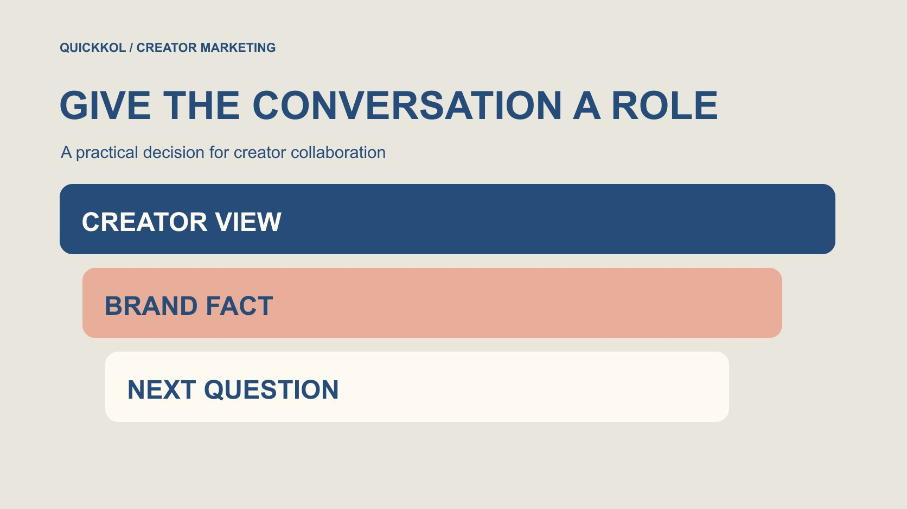
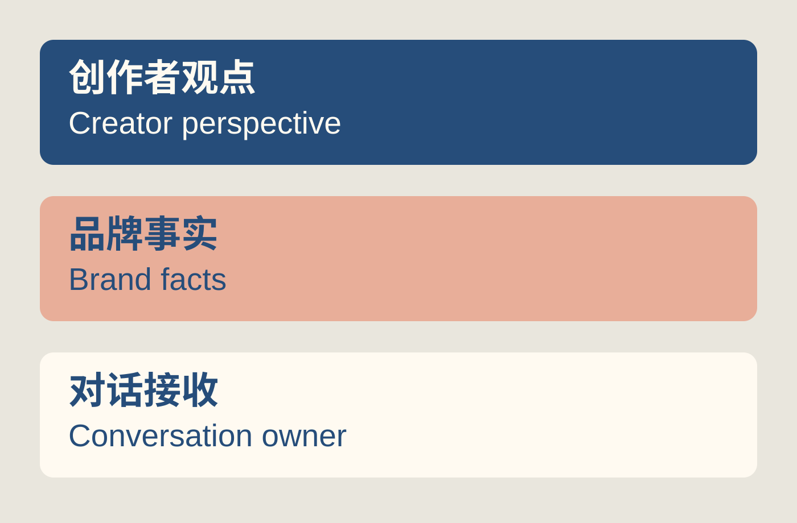

# Threads 在达人合作中的角色

状态：本地审阅稿；正式发布日期待确认。

把 Threads 放进达人合作的文字解释与社区对话中，分清创作者观点、品牌事实、回应责任与实际观察。

QuickKOL 编辑图形；不呈现真实账号指标或平台界面。

这里的“threads.”指 Meta 的 Threads。对达人营销，它可以承担文字观点、补充解释和问题回应，不必只是其他平台视频的转发口。品牌先确定值得讨论的问题，再约定谁表达真实体验、谁确认产品事实、谁处理后续提问。平台的互动和 Insights 可以帮助观察，但回复数量不等于支持品牌，浏览也不等于购买。一次合作应围绕创作者能提供的具体解释来设计，而不是先安排发帖数量再寻找话题。

## 从值得文字讨论的问题开始

如果一个问题需要解释取舍、澄清误解或补充经验，Threads 可以在合作中承担明确任务。不要只是因为团队已有视频，就默认再转发一次等于新增内容价值。

例如器具品牌可以请创作者谈自己怎样安排有限的台面空间。重点不是让所有人给出同一答案，而是让真实的使用条件与选择理由可见。

先写清观众会获得什么，再决定合作形式。一个具体观点加上有用回应，可能比几个没有后续责任的宣传句子更符合任务，但需要按实际工作确认，不能承诺传播表现。

将问题写成创作者可以判断的邀请。如果对方没有相关经验，可以调整问题或换贡献方式，不要要求其用个人口吻重复没有经历过的结论。

## 区分创作者观点与品牌事实

品牌可以确认规格、服务范围和活动条件，创作者可以说明实际使用中的判断。两者需要合作，但不能互相代替。

准备 Brief 时把事实资料与可自由表达的部分分开。若创作者不确定某个型号或条件，让品牌回答，而不是临时猜测；若品牌希望改动个人体验，则回到本人确认。

[Threads 账户与发布职责文章](https://www.quickkol.com/zh/blog/threads-instagram-profile-publishing-roles/#answer)帮助明确谁在什么账户发言。这里进一步把每条内容中的责任说清，避免一段看似个人观点的文字实际上包含未经确认的承诺。

例如“我喜欢这种收纳方式”与“所有型号都适用”需要不同依据。审稿时检查这些句子的来源，保留真实语气，也保留适用条件。

## 平台功能怎样服务对话

[Meta 的 Threads 功能更新](https://about.fb.com/news/2025/03/new-threads-features-more-personalized-experience-you-control/)在 2025 年分次介绍了资料链接、Insights 与回复控制等功能。它提供理解产品方向的依据，实际可用入口仍要在当前账户确认。

品牌需要先决定讨论希望如何进行，再考虑哪些功能相关。例如产品资料可以有明确去处，创作者可以补充文字解释，后续问题则需要有人实际处理。

不要把某个功能存在当成内容会被所有粉丝看到的保证，也不要把跨应用出现理解为每次合作都拥有同样分发。功能支持的是可能的工作方式，不是确定结果。

对负责执行的人，交接只需说明本次需要什么、在哪里确认、无法使用时怎么办。无需把所有平台功能都堆进一条简单合作。

## 把正文写成可继续的解释

第一条内容应给足语境：在什么情况下遇到问题、创作者怎么判断、与产品有什么实际关系。只抛一个笼统问题，很难让读者知道值得回应什么。

正文可以包含具体观察与尚未解决的问题，但不要故意省略关键事实来制造追问。观众应当获得独立有用的信息，而不是被迫进入下一条才能理解基本意思。

如果有图片或视频，确认文字仍说明它为何相关。跨平台复制时尤其要检查原来的字幕、链接和上下文是否仍然存在。

安排后续解释时，优先补充真实提问和关键条件，不机械增加帖子数量。一次合作的内容贡献可以来自把问题讲清，而不是把同一句卖点拆成许多条。

## 回复范围也是合作范围

如果希望创作者参与后续对话，在合作前约定大致范围与时间，而不是发帖后默认对方持续在线。回应需要阅读、判断和组织表达，是实际工作。

品牌可以承担规格、售后和活动条件，创作者可以回答自己的演示或体验。需要客服处理的个人订单，不应让其在公开回复里继续索取私人信息。

为没有答案的情况准备交接：先说明需要确认，再转给合适负责人。不要用自动回复让人以为创作者本人已经理解并回答了具体问题。

讨论变化时也可以调整分工。例如重复出现同一个规格问题，品牌补充正式说明，创作者则决定是否需要增加自己的使用背景，而不是复制品牌话术到每个回复。

有用的对话需要具体贡献，也需要后续回应责任。

## 用信息流研究话题时保留选择范围

[Meta 的 Threads 自定义信息流说明](https://about.fb.com/news/2025/02/share-custom-feeds-on-threads/)介绍公开信息流的分享与发现。它可以帮助围绕相关主题找作品，但不能代表整个市场或所有创作者。

如果团队用一个信息流研究家居话题，记录它由谁选择、看到哪些作品以及观察时间。一个精选集合的共同表达，不等于所有受众都持有相同偏好。

把实际作品当成研究入口，继续确认作者、主题与项目相关性。不要因为同处一个信息流，就给作者写入已经合作、互相认可或属于同一商业网络的关系。

适合的输出是几条可以继续看的作品与具体问题。发现功能帮助研究开始，真正的候选判断仍需要看创作者贡献、条件与当前任务。

## 公开说明商业关系

当内容来自付费合作、赠品或其他实质关系，不能因为采用轻松对话口吻就忽略说明。读者仍需要理解这场推荐与品牌的关系。

[FTC 的达人披露指南](https://www.ftc.gov/business-guidance/resources/disclosures-101-social-media-influencers)针对美国适用情境说明相关原则。品牌与创作者应在实际发布内容中确认合适表达，不把一份内部合同当成读者已经知情。

如果后续回复带来新的推荐或活动信息，继续检查上下文是否清楚。不要为了让对话看起来随意，而删掉影响理解的关系说明。

这里不把一个固定句子套到所有地区与形式。根据实际关系和规则确认，同时保留创作者自己的意见；披露不应被当成替品牌批准所有表达的理由。

## 复盘对话质量，不把回复当成支持

[Meta 的 Threads 创作者说明](https://about.fb.com/news/2024/08/new-threads-features-for-creators-and-businesses/amp/)曾介绍浏览、回复、转发和引用等观察方式。它们描述不同动作，不应合计后直接写成品牌认同或合作回报。

复盘可以先看实际问题：哪些解释被继续讨论，哪些回复暴露信息缺口，哪些需要品牌提供准确事实。读者不同意也可能产生回复，数量本身不说明情绪方向。

[社媒互动指标方法](https://www.quickkol.com/zh/blog/read-creator-engagement-data/#answer)帮助在报告中说明计数范围。比较时保留作品、观察期与所用口径，不把一次讨论与另一个形式完全不同的项目简单排高低。

最后给出内容上的下一步，例如更新常见说明、补拍一个步骤或暂时不延伸话题。不要用更大的数字代替对创作者实际贡献的判断。

## 用一次假设家居合作串起流程

假设一个品牌请创作者讨论小空间的器具选择。品牌提供尺寸和型号，创作者解释自己实际的摆放取舍，双方提前确认谁回答规格、谁补充体验。

帖子发布后，观众对清洁空间提出问题。创作者可以解释自己的过程，品牌则确认可拆部件的事实。如果仍有不确定，明确等待，不临时扩展成所有人的适用结论。

复盘记录观众需要什么解释，以及下一次是否值得用视频展示。没有销售或归因资料，就不把讨论热度写成转化效果。

这个例子是编辑假设。如果创作者发现问题不符合自己的经验，可以在发布前调整贡献。这也是有效的策划结果，不必勉强发表无法支持的个人结论；品牌仍可在自己账户解释事实，再寻找更相关的合作。它说明 Threads 可以为达人合作增加一种有用的文字贡献，而不是要求所有合作都新增一个平台、一个发帖指标或相同的内容脚本。

## 一场 Threads 合作的贡献分工

| 内容 | 主要确认者 | 交接内容 |
| --- | --- | --- |
| 个人体验 | 创作者 | 真实条件与表达 |
| 产品事实 | 品牌 | 型号、规格与依据 |
| 后续提问 | 约定的回应者 | 回答或转交的范围 |
| 复盘 | 项目负责人 | 观察与下一项内容决定 |

工作分工建议，不是平台保证或实际合作结果。

## 开始 Threads 对话之前

先确认为什么值得请这位创作者来讲。

- [ ] 提出一个具体问题。
- [ ] 区分观点与品牌事实。
- [ ] 确认账户与实际可用功能。
- [ ] 约定回应范围与负责人。
- [ ] 确认商业关系表达。
- [ ] 用观察支持下一步，不写保证。

## 研究日期与使用边界

资料核验于 2026 年 11 月 18 日。文中方法、表格和决策规则为编辑建议，标为假设的示例不是实际客户结果或行业基准。外部资料的适用地区与时期按各段说明。

## 从任务开始达人研究

用 QuickKOL 理解 Brief、发现相关达人并研究作品与联系路径；数据、合作条件和结果仍需核验。

[了解 QuickKOL](https://www.quickkol.com/#capabilities)

## 来源

- [Meta 的 Threads 功能更新](https://about.fb.com/news/2025/03/new-threads-features-more-personalized-experience-you-control/)
- [Meta 的 Threads 自定义信息流说明](https://about.fb.com/news/2025/02/share-custom-feeds-on-threads/)
- [FTC 的达人披露指南](https://www.ftc.gov/business-guidance/resources/disclosures-101-social-media-influencers)
- [Meta 的 Threads 创作者说明](https://about.fb.com/news/2024/08/new-threads-features-for-creators-and-businesses/amp/)
