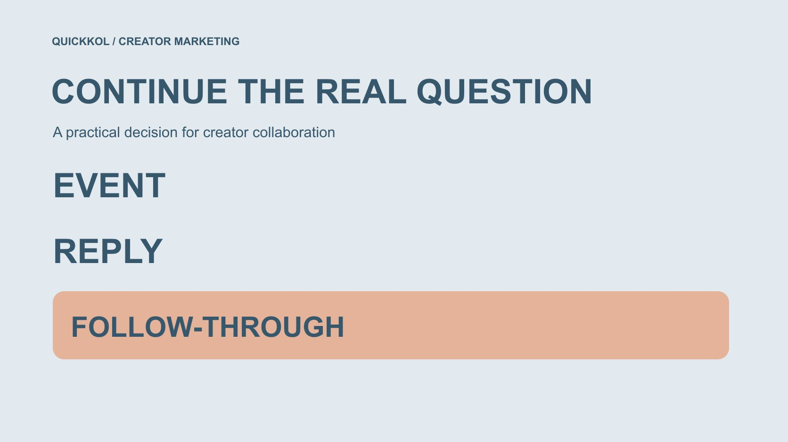
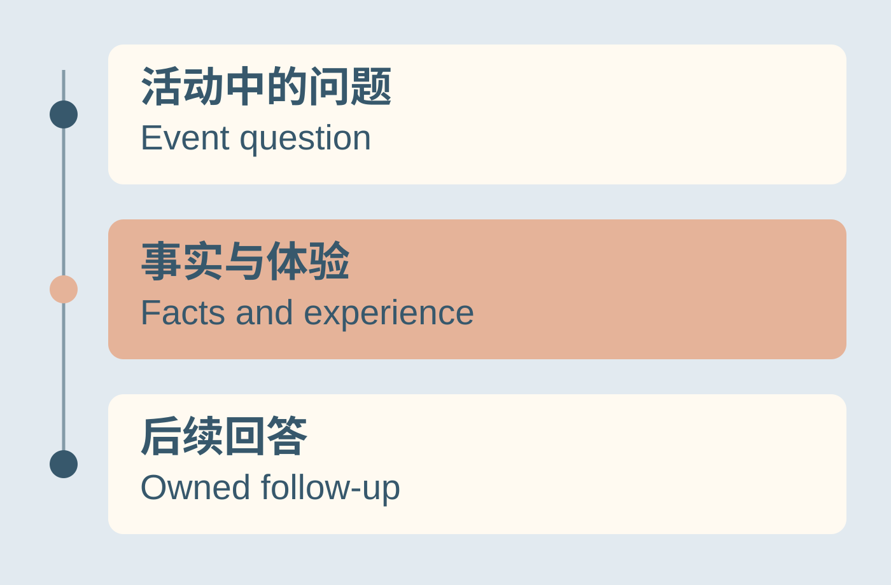

# Threads: Continue a Creator Event Conversation

Status: local review draft; confirm the publication date before release.

Read theeads as Threads and organize creator follow-up around questions left by an event, with clear quotation, fact-checking and response ownership.

QuickKOL editorial graphic; not actual account metrics or a platform interface.

Here, theeads is interpreted as Threads. After a creator event, use it to explain a specific unresolved question rather than repeat an event recap. Establish the question’s source and public scope, invite a creator with relevant experience to explain, have the brand confirm product or event facts and assign follow-up replies. Views, replies and quotes are different observations, not automatic support or purchases. The work should make sense to people absent from the event while preserving commercial context and actual conditions.

## Find a question still worth answering after the event

Event follow-up need not begin with a group photograph or thank-you message. Identify a question genuinely left open: an unclear demonstration, conditions needing explanation or a choice worth discussing.

Make the question specific and distinguish what the brand wants to promote from what people need to understand. These may connect, but the need for more content does not justify inventing that everyone asked something.

A question from one participant can still be worth exploring without inflated representativeness. Its value depends on whether the answer would help other readers too.

For a creator partnership, the question must also match contribution. Attendance does not qualify someone to answer every factual point; select what relates to the creator's observation, demonstration or experience. A clear question provides a better starting point than asking an attendee to produce another endorsement simply because the event has ended.

## Provide context for readers who were not there

Establish the necessary background: the kind of event, what happened and the question now being explained. Readers should not need every earlier post to understand it.

Describe observation conditions, such as seeing an action in a limited demonstration rather than conducting a long-term test. If a new use occurs afterward, distinguish it instead of merging two experiences.

The [Threads publishing-roles article](https://www.quickkol.com/blog/threads-instagram-profile-publishing-roles/#answer) identifies which account speaks. Brand and creator accounts can explain different perspectives without supplying incompatible versions of one fact.

Keep context sufficient rather than reproduce the entire event program. Readers should quickly understand why the post exists and why the creator contributes. This also prevents an account of attending a demonstration from quietly becoming a broader product recommendation that the person has not actually evaluated under the conditions implied by the wording.

## Recheck event records before turning them into public work

Internal notes can include participant questions, provisional discussion and unconfirmed facts; they should not be published wholesale. Decide what deserves explanation and what still needs the person or brand to confirm.

For a participant quotation, check meaning and public scope. A question can be summarized without unrelated personal details, and making a conversation more vivid does not justify adding words somebody never said.

The [U.S. Copyright Office’s copyright overview](https://www.copyright.gov/what-is-copyright/) explains protection for original expression. Visible event photography, recordings and other work do not give a brand unrestricted editing, publication or advertising permission.

For creator follow-up material, confirm channel and intended use. Invitation, attendance and a later commission can be different matters requiring an explicit assignment. The resulting content should preserve the contribution people agreed to provide instead of treating everything produced around an event as one reusable brand asset.

## Define an explanation the creator can contribute

Do not request only another Threads post. Ask the creator to explain how they understood an action, why they chose an approach or what they observed afterward.

The brand supplies accurate specifications and conditions while the creator expresses their experience. If the question concerns something they never did, allow uncertainty or a separate factual explanation from the brand.

[Meta’s Threads feature updates](https://about.fb.com/news/2025/03/new-threads-features-more-personalized-experience-you-control/) describe relevant developments around links, Insights and reply controls. Features can support the work without generating a genuine perspective for the creator.

The assignment should identify content, such as a contextual explanation and an agreed amount of follow-up. Do not price a post count first and then assume every new question belongs inside the same task. A creator should know what contribution has been requested before deciding whether their experience and time make them a good person to provide it.

## Separate questions, answers and pending facts

Follow-up can contain an evidence-supported answer, experience needing creator input or facts waiting for brand confirmation. Do not compress all of these into replied.

For example, someone asks whether a component fits every model. The creator can identify the version demonstrated without using attendance as evidence about the whole range.

Assign an owner and next action to pending facts. Acknowledging that a check is underway is preferable to improvising certainty to maintain reply speed.

Retain distinctions between questions that are actually different. The brand may need to update formal information while the creator adds process context; copying one template everywhere may help none of the people asking. Keeping these categories visible also allows the team to close a factual issue while recognizing that a separate experiential question still deserves a more considered answer.

Event follow-up adds value by completing an explanation, not prolonging post volume.

## Preserve context when sharing and quoting

A useful explanation may be quoted or reposted. Keep an important condition close to its conclusion rather than place every limit in a distant reply.

[Meta’s Threads creator guide](https://about.fb.com/news/2024/08/new-threads-features-for-creators-and-businesses/amp/) describes observations including replies, reposts and quotes. These represent different actions; being quoted does not establish agreement.

If the brand moves an explanation elsewhere, confirm quotation scope, source and meaning. Public availability is not automatic permission for continuing use in brand advertising or a product page.

Clarify an excerpt when appropriate without claiming control over every sharing route. Focus on accuracy in the versions you publish and authorize. That gives the creator and brand a workable responsibility: preserve the meaning of their own contribution and handle known issues, rather than promise that no outside reader will ever encounter an incomplete fragment.

## Keep partnership context with the follow-up

Event follow-up may remain part of a commercial relationship. Changing the format to written conversation should not make payment, gifts or another material connection disappear from readers' understanding.

[FTC’s influencer disclosure guide](https://www.ftc.gov/business-guidance/resources/disclosures-101-social-media-influencers) explains relevant principles for applicable US contexts. Inspect the actual content and relationship rather than assume a past statement settles every later work.

Preserve the scope of experience too. An event demonstration, later use and ongoing collaboration can have different conditions that should not merge for a more complete brand story.

Distinguish independent creator expression from a commissioned follow-up assignment. A brand should not package every mention as an approved partnership or supply an endorsement the person never made. This keeps the event's useful conversation connected to truthful context instead of treating continuing visibility as evidence of a commercial agreement that may not exist.

## Set response scope and a way to close

Agree on an approximate response period and task before work starts rather than extend one event into indefinite availability. Brand service and fact-checking need their own owners too.

As discussion closes, organize answered questions, supporting sources and pending work. Not every question needs another post, and repeating an answer simply to prolong activity adds little.

If information is wrong, record the correction and affected work. An older post should not remain the sole source for a new explanation, nor should a correction be buried in unrelated discussion.

Closing does not erase learning. Retain questions and judgments useful for the next brief so the event improves future content rather than leave only lively screenshots. A defined endpoint also makes the creator's contribution easier to recognize: they completed a meaningful explanation and agreed follow-up, rather than being judged by whether the thread remained active indefinitely.

## Check the workflow through a hypothetical demonstration

Imagine a home brand demonstrating a storage approach at an event. One participant cannot see the removal action clearly. The brand commissions a creator with relevant experience to explain their process on Threads and supplies model facts.

The creator describes the conditions of their action; the brand answers whether another model differs. Pending information remains pending rather than expanding personal experience into a claim for every product.

The [creator conversation-strategy article](https://www.quickkol.com/blog/creator-networking-strategy-peer-conversations/#answer) helps arrange relevant exchange. Here follow-up solves a public question with clear responsibilities rather than turning discussion into assumed private promotional relationships.

This example has no real project result. Review can assess completeness of explanation and appropriate response without deriving sales or brand support from many replies. The useful outcome is a question made understandable to people who attended and those who did not, with a creator contribution that remains accurately described. That is enough to justify a thoughtful follow-up without inflating its effects. If the original question turns out to concern a different model, correct the scope before publication instead of asking the creator to answer from an experience they did not have.

## Turn event questions into the next content decision

Select questions for the next round instead of copying every reply into a calendar. Check continuing relevance, whether another creator is needed and whether the brand has adequate factual support.

Some questions need another video shot, others a precise paragraph, and others a service or product-team answer. Threads helps reveal the question without requiring every answer to remain in one format.

Hand off the question, source scope, completed explanation and next owner. A future producer should not depend on an attendee's memory to understand why the work is needed.

Theeads is treated here as a Threads event-follow-up task: a creator helps explain something genuinely relevant while the brand owns facts, commercial context and subsequent work. That leaves a practical record of the conversation's value, rather than a requirement to keep posting about an event after the useful questions have already been resolved.

## Assign event follow-up questions

| Question | Confirmer | Useful output |
| --- | --- | --- |
| Demonstration process | Relevant creator | Contextual explanation |
| Model and specification | Brand | Accurate facts and source |
| Public quotation | Speaker and editor | Retained meaning and scope |
| Unanswered question | Assigned owner | Next verification action |

Editorial work roles, not platform rules, actual event data or a result guarantee.

## Before publishing event follow-up

Give each question a source and each answer a scope.

- [ ] Retain real questions without exaggerating representativeness.
- [ ] Supply context for absent readers.
- [ ] Confirm quotation and asset scope.
- [ ] Separate creator experience and brand facts.
- [ ] Agree response ownership and closure.
- [ ] Make a specific next-content decision.

## Research date and limitations

Sources reviewed November 18, 2026. Methods, tables and decision rules are editorial recommendations. Hypothetical examples are not actual client results or industry benchmarks. Source geography and periods are specified where relevant.

## Start creator research with a clear task

Use QuickKOL to interpret a brief, discover relevant creators and research their work and contact routes. Verify data, commercial terms and outcomes at their source.

[Explore QuickKOL](https://www.quickkol.com/#capabilities)

## Sources

- [U.S. Copyright Office’s copyright overview](https://www.copyright.gov/what-is-copyright/)
- [Meta’s Threads feature updates](https://about.fb.com/news/2025/03/new-threads-features-more-personalized-experience-you-control/)
- [Meta’s Threads creator guide](https://about.fb.com/news/2024/08/new-threads-features-for-creators-and-businesses/amp/)
- [FTC’s influencer disclosure guide](https://www.ftc.gov/business-guidance/resources/disclosures-101-social-media-influencers)
