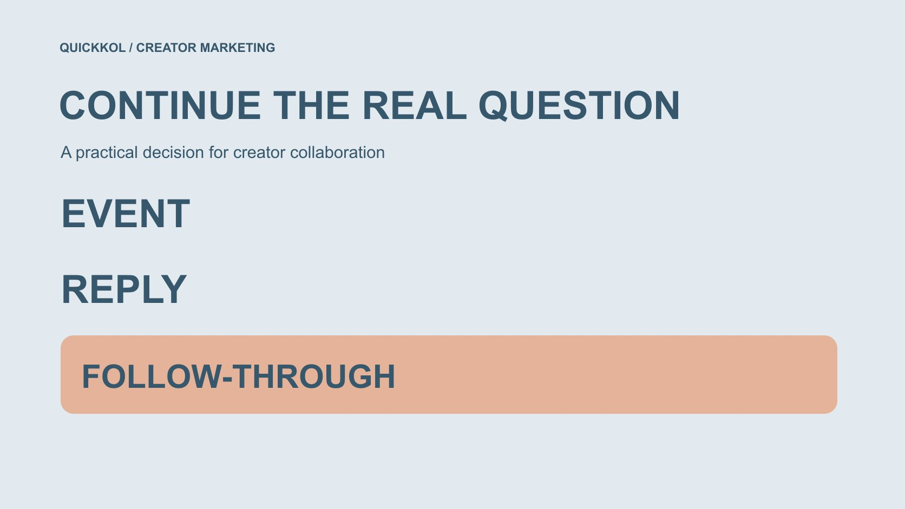
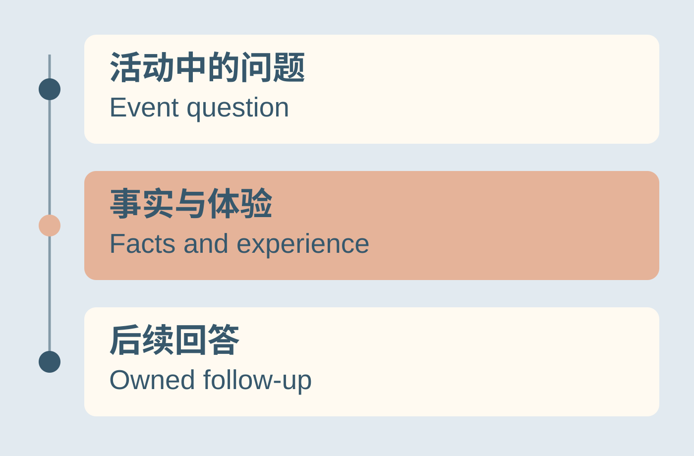

# Threads 怎样承接达人活动讨论

状态：本地审阅稿；正式发布日期待确认。

将“theeads”按 Threads 理解，用活动中真正留下的问题组织达人后续对话，明确引用、事实核对与回应责任。

QuickKOL 编辑图形；不呈现真实账号指标或平台界面。

这里把“theeads”理解为 Threads。达人活动结束后，可以用它继续解释活动中留下的具体问题，而不是只重复一份活动总结。先确认问题来源与可公开范围，请有相关体验的创作者补充解释，品牌负责核对产品或活动事实，再约定谁接后续回复。讨论中的浏览、回复和引用是不同观察，不能直接视为支持品牌或购买。后续内容应让没有参加活动的人也能理解，并保留商业关系与真实条件。

## 活动结束后先找仍然值得回答的问题

活动后续不一定从合影和感谢语开始。先整理真实留下的问题：某个演示没有看清、不同使用条件需要解释，或一个选择理由值得展开。

把问题写具体，区分品牌想继续宣传什么与观众真正需要知道什么。两者可能相接，但不能因为活动结束还需要内容，就编造“很多人都问”。

如果只有一位参与者提出，也可以研究这个问题。无需夸大其代表性；重点是它能否形成对其他读者也有用的解释。

对达人合作，问题还需要符合创作者贡献。曾经到场不说明能够回答所有事实，品牌应选择真正与其观察、演示或经验有关的部分。

## 让没参加活动的人也看得懂

第一段交代必要背景：这是哪种活动、当时做了什么、现在解释哪个问题。不要要求读者看过全部旧内容才能理解。

可以描述观察条件，例如是在一个有限演示中看到的动作，而不是长期使用测试。若后续有新的尝试，分开说明，不把两次体验混成同一件事。

[Threads 发布职责文章](https://www.quickkol.com/zh/blog/threads-instagram-profile-publishing-roles/#answer)帮助明确哪个账户发言。品牌账户与创作者账户可以从不同角度说明，但需要避免同一事实出现互相矛盾的版本。

背景以必要为限，不必把整个活动流程重新写一遍。读者应很快知道这条内容为什么存在，以及创作者为什么适合参与解释。

## 把活动记录转成公开内容需要再确认

内部笔记可以包含参与者提问、临时讨论与未确认事实，不应整段原样公开。整理时先判断哪些内容适合继续解释，哪些仍需本人或品牌确认。

若准备引用一位参与者的话，核对原意与公开范围。可以概括问题而不展示无关个人资料，也不要为了让对话更生动给别人补上没说过的句子。

[美国版权局的版权说明](https://www.copyright.gov/what-is-copyright/)介绍原创表达受到保护。活动照片、录影和他人作品可见，不代表品牌可以任意剪辑、公开或重新用于广告。

对创作者后续素材，确认实际渠道与使用范围。活动邀请、到场与后续内容委托可以是不同事项，需要按这次工作明确。

## 给创作者一个可解释的贡献

不要只要求创作者“再发一条 Threads”。可以请其说明当时怎样理解一个动作、为什么选择某种做法，或后来补充了什么观察。

品牌提供准确的规格与条件，创作者决定怎样表达自己的体验。如果问题涉及本人没有做过的事情，允许明确说不知道，或由品牌提供事实说明。

[Meta 的 Threads 功能更新](https://about.fb.com/news/2025/03/new-threads-features-more-personalized-experience-you-control/)介绍了文字表达、链接、Insights 与回复控制等相关方向。功能可以帮助组织工作，但不能替创作者形成真实观点。

交付要求应指向内容本身，例如一段有上下文的解释和约定范围内的后续回应。不要先按发帖数量计价，再把不断增加的新问题默认加进同一任务。

## 区分问题、回应与待确认事项

后续对话可以包含三种状态：已经有资料支持的回答、需要创作者补充的体验，以及等待品牌确认的事实。不要把全部都写成一句“已回复”。

例如观众问某部件是否适用于所有型号。创作者可以说明演示时使用哪个版本，但不能单凭到场体验回答全部产品范围。

给待确认事项安排负责人和下一步。可以先说正在核对，不需要为了保持回复速度临时给出未经确认的明确结论。

如果多个问题其实不同，保留区别。品牌可能需要更新正式说明，创作者则补充个人过程；用同一段模板复制到每条回复，未必帮助任何一位提问者。

活动后续的价值来自补齐解释，不是延长发帖数量。

## 分享与引用要保留原来的语境

一个有用解释可能被引用或转发。公开内容尽量让关键条件紧挨结论，不要把限制全部留在很远的另一条回复里。

[Meta 的 Threads 创作者说明](https://about.fb.com/news/2024/08/new-threads-features-for-creators-and-businesses/amp/)介绍过回复、转发与引用等不同观察。它们代表不同动作，不能只看到被引用就认为观点获得认同。

如果品牌想把创作者解释搬到其他渠道，先确认引用范围、来源和原意。不要因为内容已经公开，就默认为品牌广告或商品页的长期使用许可。

对读者转发的片段，可以在适当时补充清楚说明，但不要声称能够控制全部传播路径。重点是让自己发布和授权使用的版本准确。

## 商业合作背景继续跟随内容

活动后续仍然可能是商业合作的一部分。不要因为形式变成文字对话，就让付费、赠品或其他实质关系从读者眼前消失。

[FTC 的达人披露指南](https://www.ftc.gov/business-guidance/resources/disclosures-101-social-media-influencers)针对美国适用情境说明相关原则。应检查实际内容与关系，不把“以前已经说过”作为所有后续作品都无需确认的理由。

同时保留真实体验范围。到场演示、后来试用与持续合作，可以有不同条件，不能为了让品牌叙事更完整就合并。

如果只是创作者自主表达，与受委托的后续任务也需要区分。品牌不应把所有提到自己的内容都包装成已经批准的合作，也不能替本人确认没有说过的背书。

## 为回应安排范围与结束方式

合作前可以约定创作者参与回应的大致时间与任务，不让一次活动延伸成无限期在线。品牌自己的客服与事实确认也应有负责人。

讨论接近结束时，可以整理已回答的问题、补充来源与仍待处理事项。不是每个问题都需要继续发新内容，也不必为了延长互动重复同一答案。

如果发现信息有误，记录具体更正与受影响内容。不要让一个旧帖子继续作为新解释的唯一出处，也不把更正藏在无关讨论中。

结束不是删除学习。保留能供下一次 Brief 使用的问题和判断，让活动对话真正改善后续内容，而不是只留下几张热闹的截图。

## 用一个假设演示活动检查流程

假设家居品牌在活动中展示一种收纳方式，一位参与者没看清拆卸动作。品牌请有相关体验的创作者在 Threads 解释自己的过程，并提供型号事实。

创作者说明自己在什么条件下操作，品牌回答另一个型号是否相同。若资料尚未确认，保留待处理，不让个人体验被扩大为全部产品承诺。

[达人社交对话策略](https://www.quickkol.com/zh/blog/creator-networking-strategy-peer-conversations/#answer)可以帮助安排合适交流。这里的后续不是私下推广关系，而是公开解决一个实际问题，并明确谁对什么负责。

如果核对后发现原问题涉及另一个型号，就在发布前更正范围，不让创作者从没有发生的体验作答。这个例子没有真实项目结果。复盘可以看说明是否补齐、问题是否得到合适回应，不能从回复很多直接推导销售或品牌支持。

## 用活动问题支持下次内容判断

最终整理哪些问题值得进入下一轮，而不是直接把全部回复复制成内容日历。判断是否仍相关、是否需要不同创作者，以及品牌有没有足够事实支撑。

有些问题适合视频补拍，有些适合一段准确文字，也有些应由客服或产品团队处理。Threads 对话帮助看见问题，不要求所有答案都留在同一种形式。

交接时给出问题、来源范围、已完成解释与下一步负责人。下一位制作人不应依赖活动参加者记忆才能理解为什么要做这条内容。

Theeads 在本篇被落实为 Threads 的活动后续任务：让创作者帮助解释真正相关的问题，并让品牌为事实、关系和后续工作负责。

## 活动后续问题怎样分工

| 问题 | 确认者 | 适合输出 |
| --- | --- | --- |
| 演示过程 | 相关创作者 | 带条件的实际解释 |
| 型号与规格 | 品牌 | 准确事实与来源 |
| 公开引用 | 被引用者与负责编辑 | 保留原意与范围 |
| 尚未有答案 | 指定负责人 | 下一项确认动作 |

编辑工作分工；不是平台规定、实际活动数据或结果保证。

## 发出活动后续内容之前

让每个问题有来源、每个回答有范围。

- [ ] 保留真实问题，不夸大代表性。
- [ ] 交代未到场读者需要的背景。
- [ ] 确认引用与素材使用范围。
- [ ] 分开创作者体验与品牌事实。
- [ ] 约定回应责任与结束方式。
- [ ] 给后续内容一个具体决定。

## 研究日期与使用边界

资料核验于 2026 年 11 月 18 日。文中方法、表格和决策规则为编辑建议，标为假设的示例不是实际客户结果或行业基准。外部资料的适用地区与时期按各段说明。

## 从任务开始达人研究

用 QuickKOL 理解 Brief、发现相关达人并研究作品与联系路径；数据、合作条件和结果仍需核验。

[了解 QuickKOL](https://www.quickkol.com/#capabilities)

## 来源

- [美国版权局的版权说明](https://www.copyright.gov/what-is-copyright/)
- [Meta 的 Threads 功能更新](https://about.fb.com/news/2025/03/new-threads-features-more-personalized-experience-you-control/)
- [Meta 的 Threads 创作者说明](https://about.fb.com/news/2024/08/new-threads-features-for-creators-and-businesses/amp/)
- [FTC 的达人披露指南](https://www.ftc.gov/business-guidance/resources/disclosures-101-social-media-influencers)
