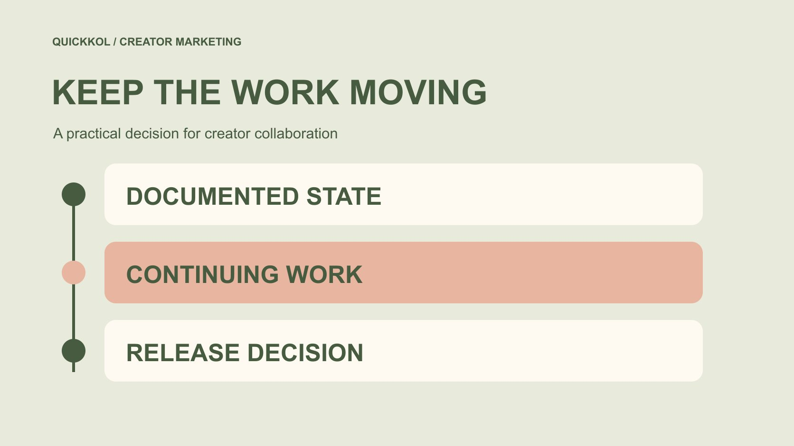
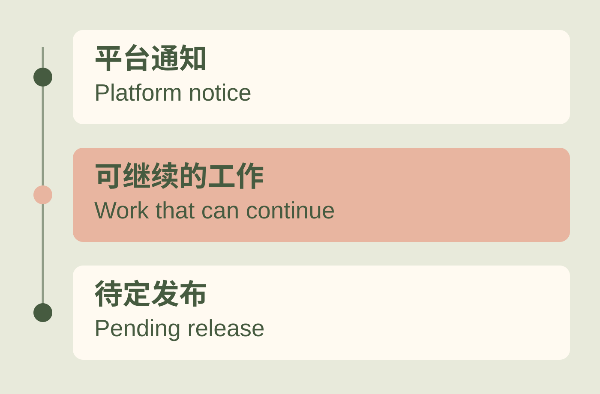

# TikTok Distribution Issues: Continue the Creator Work

Status: local review draft; confirm the publication date before release.

When TikTok publication or recommendations are affected, check official information and separately manage platform review, asset delivery, publishing commitments and brand work.

QuickKOL editorial graphic; not actual account metrics or a platform interface.

If a creator partnership is underway and you are asking my account is shadowbanned TikTok, check the specific work and platform notice before diagnosing from low views. The account holder uses the available review, appeal or support route, while the brand identifies separate effects on production, asset delivery and agreed publication. Unaffected agreed work need not automatically stop; work that must wait needs an explicit decision. Alternative publication must fit rules, permission and the agreement, without evading restrictions or promising recovery within a fixed period.

## Separate the account question from the project question

The account question is what happened and which notice or process the platform offers. The project question is which agreed tasks can continue, which wait and how both parties handle the next step.

An unexplained symptom should not automatically mean the entire partnership failed. Conversely, delivery pressure should not erase a real publishing limit or justify continuing to promise the original plan publicly.

The [creator-project status method](https://www.quickkol.com/blog/creator-campaign-status-system/#answer) connects information to a task. Identify work, account and period before assessing impact instead of deriving cause and responsibility from one shadowban label.

The creator can provide relevant information without the brand taking over the account. Shared understanding of the work impact is usually more useful than collecting unrelated screenshots. This gives both sides a manageable conversation while preserving the distinction between platform review and decisions they can actually make together about their assignment.

## Use the notice to distinguish work and account states

[TikTok’s content-action and appeal guide](https://support.tiktok.com/en/safety-hc/account-and-user-safety/content-violations-and-bans) separates removal from For You recommendation ineligibility and describes reason review and appeal. A notice for one work does not automatically mean every account function is unavailable.

Record the notice, affected work and date, asking the account holder to check the current state where needed. Without a notice, retain uncertainty rather than rewrite low views as a proven penalty.

The project update needs actual impact: ability to publish, visibility of the original or information still missing. Do not add causes the platform did not state merely to complete a report.

If the state changes later, record that change. Restored visibility does not establish restored recommendations, and pending review is not approval. A precise distinction lets the brand revise the affected work decision without claiming more about the account than the information supports.

## Keep an individual feed experience in scope

Someone reporting that they cannot see a creator supplies a lead to check, not proof of invisibility to every user. Establish what they viewed, when and whether the actual work is visible.

[TikTok’s content-recommendation guide](https://support.tiktok.com/en/using-tiktok/exploring-videos/how-tiktok-recommends-content) describes personalization. Different users can encounter different work, so one person's For You feed cannot establish the whole recommendation state.

For changing counts, compare matching observation periods and suitable work instead of a new post's short-window result with long accumulation. A decrease can be recorded while its cause still needs evidence.

Use these observations to ask questions rather than characterize the creator. Arrange work according to confirmed impact, not one colleague's browsing experience. That keeps project continuity grounded in information that relates to the deliverable instead of a test that cannot represent every audience member's personalized experience.

## Let the account holder use the formal platform route

[TikTok’s account-enforcement system announcement](https://newsroom.tiktok.com/supporting-creators-with-an-updated-account-enforcement-system-ca?lang=en-CA) described account information and notices in 2023. It is historical product context; current controls and available processes still need checking in the actual account.

The account holder reviews the explanation and uses the platform's supported review or help route. The brand can organize partnership facts without claiming actions the person never completed.

After submission, record pending status and confirmed outcomes without a fixed-duration promise or treating repeated identical submissions as definite progress.

Do not use evasion as a delivery plan. Repeating the work through another account or concealing necessary relationships does not replace formal handling and agreement about task changes. The project's practical role is to preserve accurate information and make reasonable work decisions, while the platform process remains responsible for its own determination.

## Identify production work that can still be completed

A publication or recommendation issue does not necessarily prevent research organization, shot planning or agreed asset production. Check each task rather than stop everything or continue everything automatically.

If the brand commissioned a demonstration file for its own channel and conditions and permission remain valid, discuss delivery separately from public posting on the creator's account.

An unfinished experience should not acquire a prewritten conclusion because publication is uncertain. Continuing work still needs actual substance and adequate conditions, not just the appearance that nothing stopped.

Identify what can continue, what waits and what is no longer needed. The creator should understand what remains commissioned so additional work does not emerge from conflicting assumptions. This makes continuity a deliberate agreement about real deliverables instead of an attempt to keep every original calendar item looking active regardless of its present usefulness.

Check the impact before choosing specific work to continue, wait or renegotiate.

## Reconfirm commitments when publication changes

If the agreement depends on creator publication at a particular time, discuss the actual change with the brand. Identify current impact, feasible options and pending information without silently moving a date or reporting the original plan complete.

Compensation and scope follow the parties' actual agreement; this article assigns no automatic responsibility from a status label. New work, channel or version requires clear discussion.

For separate publication on a brand channel, confirm content use, creator identity and asset scope. That can be a legitimate new arrangement without being presented as a technique to circumvent restrictions.

Assign a decision owner and conditions for another check. Waiting is permissible when an answer is unavailable; an unguaranteed recovery date need not fill a project table. The revised plan should describe what both parties can realistically undertake rather than conceal uncertainty behind a new timestamp. If a release time has already been announced publicly, the brand should separately check which information needs updating and who owns it. Changing a private project sheet does not update a public announcement, product destination or event page. Handle those specific inconsistencies through the relevant owner instead of assuming the creator can resolve every downstream effect. This keeps audience-facing information aligned with the actual plan while account review remains pending.

## Preserve useful work and records before changing them

Retain partnership source files, agreed versions and the relevant notice scope to inform later actions. Mass deletion, reposting or renaming should not become an unverified universal recovery step.

The [U.S. Copyright Office’s copyright overview](https://www.copyright.gov/what-is-copyright/) helps explain why uses of original work need appropriate rights. Project changes do not expand the brand's asset permission merely because an account has an issue.

For a video change, identify evidence and purpose before confirming a replacement. Platform uncertainty should not justify arbitrary changes to experience, disclosure or product conditions.

Records support the work without requiring a complete private history. Sufficient project material lets brand and creator continue discussion without ongoing access to a personal account. That preserves the information needed for legitimate review while keeping commercial delivery and account handling within their appropriate responsibilities.

## Give the brand an actionable update

An update can include the work, confirmed symptom, actual notice, task impact, next action and owner. Keep unknowns distinct from established facts.

For example, production continues, agreed publication is pending, the account holder handles formal review and the brand checks its destination and internal arrangements. That describes tasks rather than predicts recovery time.

The [creator-delivery tracking method](https://www.quickkol.com/blog/step-by-step-campaign-tracking-evidence-log/#answer) keeps these records connected. Update the affected part so the team sees real progress without old and new conclusions circulating together.

If a client decision is needed, provide concrete options and effects. Forwarding only account problem makes others guess which work stopped. A useful status note should leave the next owner able to act, even if nobody can yet answer the broader question of why distribution changed or when the platform process will conclude.

## Illustrate continuity in a hypothetical pending campaign

Imagine an equipment demonstration already filmed when the creator reports a publication-related issue. Check actual status, then separately confirm file delivery, experience wording and the public release time.

If the file remains deliverable under the agreement, identify that delivery; if public release waits, record the condition. Confirm any new channel use instead of disguising it as completion of the original plan.

When review produces information, update the relevant decision. Without new information, the project can still handle destinations, internal references and unaffected agreed work without inventing recovery.

This example has no actual account result. It shows continuity as clarity about feasible work, pending work and work needing another agreement. The creator is not asked to guarantee an unknown platform outcome, and the brand is not left assuming every other task has disappeared because one part of publication is uncertain.

## Return to facts whether work resumes or closes

If work can resume, recheck time, version, product conditions and willingness rather than assume the old schedule remains valid. Information changed during the wait needs updating.

If the task closes or changes, identify completed delivery, outstanding scope and next steps through the actual agreement. This article does not adjudicate the commercial relationship.

The practical partnership answer to my account is shadowbanned TikTok addresses platform information and work continuity together: formal checking, accurate updates and reasonable arrangements without recovery guarantees.

Give each action a purpose and each conclusion a scope. Brand and creator can then make reliable decisions under uncertainty without using speculation to explain every outcome. The resulting record should show what they actually did and agreed, rather than describe a resolved account issue simply because the project needed a reassuring conclusion.

## Work roles after a publishing issue

| Work | Owner | Decision needed |
| --- | --- | --- |
| Platform notice and review | Account holder | Use the current formal route |
| Production and asset delivery | Creator and brand | What continues under the agreement |
| Publication time | Agreed owners | Wait, revise or confirm |
| New channel or use | Relevant agreeing parties | Whether scope is agreed |
| Project update | Project owner | Facts, unknowns and next action |

Continuity framework without recovery timelines, circumvention methods or contractual determinations.

## Check before continuing the partnership

Arrange account handling and actual delivery separately.

- [ ] Identify work, period and actual notice.
- [ ] Have the holder use formal routes.
- [ ] Review unaffected agreed tasks individually.
- [ ] Reconfirm publication and use changes.
- [ ] Retain project versions and records.
- [ ] Update facts without recovery guarantees.

## Research date and limitations

Sources reviewed November 18, 2026. Methods, tables and decision rules are editorial recommendations. Hypothetical examples are not actual client results or industry benchmarks. Source geography and periods are specified where relevant.

## Start creator research with a clear task

Use QuickKOL to interpret a brief, discover relevant creators and research their work and contact routes. Verify data, commercial terms and outcomes at their source.

[Explore QuickKOL](https://www.quickkol.com/#capabilities)

## Sources

- [TikTok’s content-action and appeal guide](https://support.tiktok.com/en/safety-hc/account-and-user-safety/content-violations-and-bans)
- [TikTok’s content-recommendation guide](https://support.tiktok.com/en/using-tiktok/exploring-videos/how-tiktok-recommends-content)
- [TikTok’s account-enforcement system announcement](https://newsroom.tiktok.com/supporting-creators-with-an-updated-account-enforcement-system-ca?lang=en-CA)
- [U.S. Copyright Office’s copyright overview](https://www.copyright.gov/what-is-copyright/)
