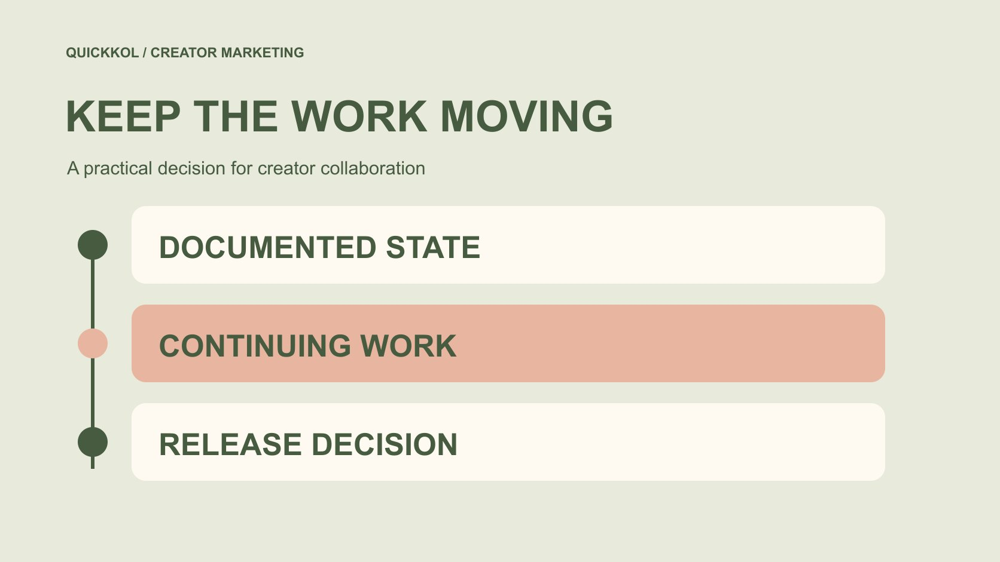
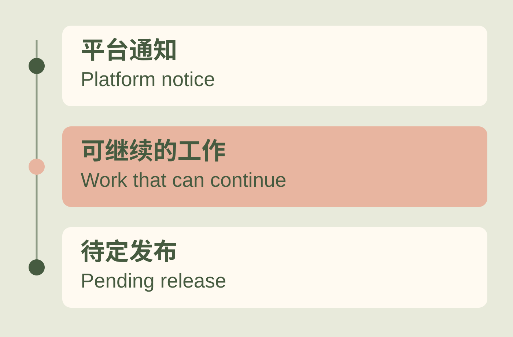

# TikTok 分发异常时合作怎样继续

状态：本地审阅稿；正式发布日期待确认。

TikTok 发布或推荐受影响时，先核对正式信息，再把平台处理、素材交付、发布约定与品牌侧工作分别安排。

QuickKOL 编辑图形；不呈现真实账号指标或平台界面。

如果你正在履行达人合作，却担心 my account is shadowbanned TikTok，先核对具体作品与平台通知，不从低浏览直接作诊断。账户持有人使用当前提供的查看、申诉或支持途径；品牌同时确认素材制作、交付和约定发布各自受什么影响。可以继续的已约定工作不必自动全部暂停，需要等待的部分则明确说明。任何替代发布都应符合规则、授权与双方约定，不用于规避限制，也不承诺申诉后在固定时间恢复。

## 先把账号问题与项目问题分开

账号问题是实际发生了什么、平台提供什么通知与处理方式。项目问题是哪些已约定任务还能做、哪些需要等，以及双方怎样安排下一步。

不要让一个尚未解释的现象自动变成全部合作失败。也不要因为希望按时交付，就忽视真实的发布限制或继续对外承诺原计划。

[达人项目状态方法](https://www.quickkol.com/zh/blog/creator-campaign-status-system/#answer)帮助将信息连接到具体任务。先确认实际作品、账户和时期，再讨论影响，不从一句“被限流”推导所有原因与责任。

创作者可以提供项目相关资料，品牌不需要接管账户。能够共同理解当前工作影响，通常比收集大量无关截图更有帮助。

## 按通知区分作品与账户的状态

[TikTok 的内容处理与申诉说明](https://support.tiktok.com/en/safety-hc/account-and-user-safety/content-violations-and-bans)区分作品被移除与不适合 For You 推荐，并介绍原因查看和申诉。某条作品的通知不能自动写成账户所有功能都不可用。

记录实际通知、对应作品和日期，必要时让账户持有人继续核对当前状态。没有通知时，保留未确认，不把低浏览改写成已经证明的处罚。

项目更新只需要保留实际影响。例如能否继续发布、原作是否仍可见，或当前缺少什么资料。不要为了报告完整而补入平台没有说明的原因。

如果状态后来变化，记录变化本身。不能从一次恢复可见推导全部推荐已恢复，也不能把仍在等待的复核写成已经通过。

## 明确个人信息流观察的范围

有人说自己看不到这位创作者，可以作为待核对线索，但不是所有用户都看不到的证据。先确认对方在查看什么、何时查看，以及实际作品是否可见。

[TikTok 的内容推荐说明](https://support.tiktok.com/en/using-tiktok/exploring-videos/how-tiktok-recommends-content)介绍个性化分发。不同用户看到的内容可以不同，所以合作团队不能从一个人的 For You 信息流推断全部推荐状态。

对于计数变化，比较相同观察期与合适内容，不将新作品短期结果对照长期累计数字。可以记录下降，但原因仍然需要对应资料。

品牌应把这类观察用于提出问题，而不是给创作者定性。任务安排依据可确认影响，不能由一位同事的一次浏览经历决定整个项目。

## 平台处理由账户持有人走正式途径

[TikTok 的账户处理系统公告](https://newsroom.tiktok.com/supporting-creators-with-an-updated-account-enforcement-system-ca?lang=en-CA)在 2023 年介绍过状态信息与通知等方向。它是历史产品背景，当前具体入口和可用处理方式仍应按实际账户确认。

由账户持有人查看对应说明，按平台提供的方式提出有依据的复核或支持请求。品牌可以协助整理与合作有关的事实，但不替本人声称已经完成未做过的操作。

提交后记录等待状态和可确认结果，不承诺固定时长，也不把再次提交相同内容当成项目一定取得进展。

不要把绕开真实限制作为交付方案。另找账号重复发布或隐去必要关系，并不能代替正式处理和双方对任务变化的明确约定。

## 盘点仍然能完成的制作工作

发布或推荐问题，不一定让资料整理、镜头规划或已经约定的素材制作全部不可做。逐项核对，而不是自动暂停，也不是自动继续全部。

例如品牌需要一份供自己渠道使用的演示文件，若制作条件和授权仍然成立，可以讨论继续交付；这与创作者账户上的公开发布是不同任务。

如果实际体验尚未完成，就不能因为发布待定而先写好结论。继续工作仍然需要真实内容与足够条件，不是为了让项目看起来没有停顿。

把能继续的部分、需要等待的部分和不再需要的部分分别说明。创作者应知道本轮仍被委托什么，避免后来出现双方理解不同的额外工作。

先核对影响，再决定继续、等待或重新约定的具体任务。

## 需要调整公开发布时重新确认承诺

若约定依赖创作者在特定时间发布，需要与品牌讨论实际变化。说明当前影响、可行选择和仍待确认部分，不默默把日期移走，也不声称原计划已经完成。

费用与范围按双方实际约定处理，本文不推断某类状态自动触发谁的责任。新的工作、渠道或版本，都需要清楚沟通。

若考虑品牌渠道的独立发布，确认内容用途、创作者身份和素材范围。这可以是合法的新安排，但不能被当成绕开平台限制的技巧。

给发布决定安排负责人和下一次确认条件。没有答案时可以等待，不需要用一个无法保证的恢复日期填满项目表格。如果品牌已经公开过发布时间，另外检查哪些公告、目标页或活动资料需要更新，由相应负责人处理。私人项目表格改变，不会自动更新公开信息，也不应默认全部后续影响都由创作者解决。这样即使账号复核仍在等待，观众看到的安排也能与实际计划一致。

## 保留素材与记录，避免无依据改动

保存合作相关原文件、确认版本与实际通知范围，便于判断后续动作。不要把大规模删除、重发或改名当成未经核验的万能恢复步骤。

[美国版权局的版权说明](https://www.copyright.gov/what-is-copyright/)帮助理解原创作品使用需要对应权利。即使项目调整，品牌仍需按实际用途处理创作者素材，不因账户问题就扩大授权。

如果需要修改视频内容，先指出依据与原因，再确认新版本。不要让不确定的平台问题成为随意改变体验、披露或产品条件的理由。

记录服务工作，不需要收集全部私人历史。品牌和创作者共同保留足够的项目资料，就能继续讨论，不必让合作负责人长期访问个人账户。

## 给品牌一个能执行的状态更新

更新可以包含对应作品、可确认现象、实际通知、当前任务影响、下一步与负责人。未知单独写，不与已确认事实混在一起。

例如可以写素材制作继续、约定发布待确认、账户持有人处理正式复核，品牌检查目标页与内部安排。这是任务状态，不是对恢复时间的预测。

[达人交付追踪方法](https://www.quickkol.com/zh/blog/step-by-step-campaign-tracking-evidence-log/#answer)帮助保持这些记录相连。每次更新只改受影响部分，让团队看得见真实进展，不让旧结论与新结论同时流传。

若需要用户或客户决定，给出具体选项与影响。不要仅转发一句“账号有问题”，让其他人自行猜测哪些工作已经停下。

## 用一个待发布合作说明工作连续性

假设一条器具演示已经拍摄，创作者报告发布相关问题。先核对真实状态，品牌与本人分别确认文件交付、体验表达和公开发布时间。

若文件仍可按约定完成，就明确交付；若公开发布需要等，就记录等待条件。需要新的渠道用途时另行确认，不把它伪装成原计划已经完成。

复核有结果后，更新相关决定。如果仍无新信息，项目可以继续处理目标页、内部资料和不受影响的已约定工作，不编造已经恢复。

这个例子没有真实账号结果。它展示连续性不是假装一切正常，而是让可做、待做与需要重新约定的工作各自清楚。

## 恢复或结束都回到实际事实

如果状态允许继续，重新核对发布时间、素材版本、产品条件和双方意愿，不把旧排期直接当成仍然有效。等待期间变化的信息需要更新。

如果决定结束或调整任务，明确已完成交付、未完成范围与下一步，按实际约定沟通。文章不替双方作商务裁决。

My account is shadowbanned TikTok 在达人合作中的实用答案，是同时处理平台信息与工作连续性：正式核对、如实更新、合理安排，不作恢复保证。

让每个行动有目的，每个结论有范围，品牌和创作者就能够在不确定中继续作可靠决定，而不需要用推测解释所有结果。

## 发布问题出现后的工作分工

| 工作 | 负责人 | 需要的决定 |
| --- | --- | --- |
| 平台通知与复核 | 账户持有人 | 按当前正式途径处理 |
| 素材制作与交付 | 创作者与品牌 | 哪些仍按约定继续 |
| 公开发布时间 | 双方指定负责人 | 等待、调整或确认 |
| 新渠道或新用途 | 有权确认的各方 | 范围是否明确 |
| 项目更新 | 项目负责人 | 事实、未知与下一步 |

工作连续性框架，不提供恢复时长、规避方法或合同责任结论。

## 继续合作之前的核对

把账号处理与实际交付分别安排。

- [ ] 确认作品、时期与实际通知。
- [ ] 由持有人使用正式处理方式。
- [ ] 逐项盘点仍能完成的已约定工作。
- [ ] 重新确认发布与用途变化。
- [ ] 保存项目所需版本与记录。
- [ ] 更新事实，不承诺恢复结果。

## 研究日期与使用边界

资料核验于 2026 年 11 月 18 日。文中方法、表格和决策规则为编辑建议，标为假设的示例不是实际客户结果或行业基准。外部资料的适用地区与时期按各段说明。

## 从任务开始达人研究

用 QuickKOL 理解 Brief、发现相关达人并研究作品与联系路径；数据、合作条件和结果仍需核验。

[了解 QuickKOL](https://www.quickkol.com/#capabilities)

## 来源

- [TikTok 的内容处理与申诉说明](https://support.tiktok.com/en/safety-hc/account-and-user-safety/content-violations-and-bans)
- [TikTok 的内容推荐说明](https://support.tiktok.com/en/using-tiktok/exploring-videos/how-tiktok-recommends-content)
- [TikTok 的账户处理系统公告](https://newsroom.tiktok.com/supporting-creators-with-an-updated-account-enforcement-system-ca?lang=en-CA)
- [美国版权局的版权说明](https://www.copyright.gov/what-is-copyright/)
