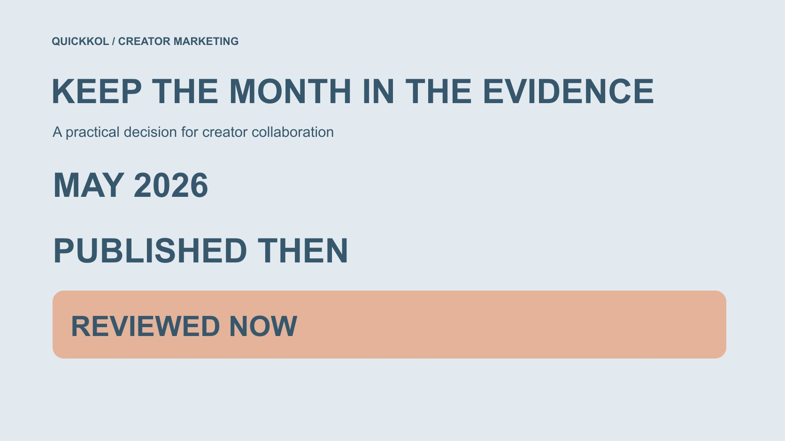
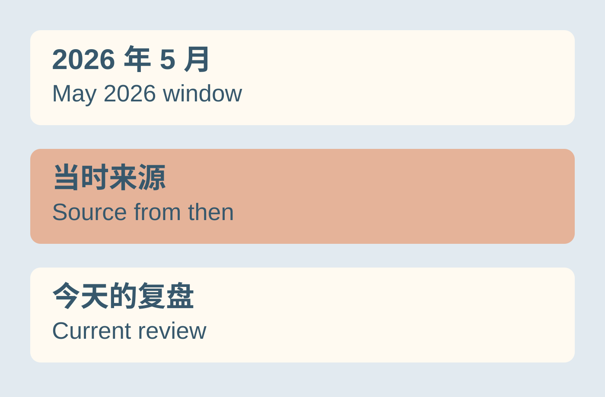

# May 2026 TikTok Creator Trends

Status: local review draft; confirm the publication date before release.

Review May 2026 using dated primary sources, separating annual forecasts, examples published that month and actual monthly performance before shaping a creator brief.

QuickKOL editorial graphic; not actual account metrics or a platform interface.

Read current TikTok trends May 2026 as historical research, not today’s live chart. Verifiable official material includes the annual forecast published in January, a May 5 discovery-and-commerce research announcement and a May 19 small-business showcase. These support discussion of real-use context, creator explanation and community interaction. They do not establish a sound ranking for the whole month or a universal brand-performance benchmark. Date and scope the evidence before turning a usable insight into a creator assignment.

## Define May as the research window

This article was researched on November 18, 2026, and examines the completed month of May. A popular-content page opened today may have changed; relabeling current results as May does not create a historical record.

Define the question first: directions brands discussed then, creator work worth studying or audio performance in a particular market? These require different evidence.

An exact monthly chart needs historical records covering the relevant period and geography. Without them, state that no ranking is supplied rather than fill the gap with memory or search order.

Historical material can still improve a creator brief. It can explain why a creative direction was proposed and what merits renewed research, without independently deciding that the next campaign should repeat it. Keeping this distinction visible prevents a useful retrospective from becoming an inaccurate claim of live trend monitoring or a list of supposedly universal opportunities.

## Use the annual forecast as direction, not a May result

[TikTok’s 2026 annual trend forecast](https://newsroom.tiktok.com/introducing-tiktok-next-2026-our-trend-forecast-for-marketers-for-the-year-ahead?lang=en) was published on January 14 and names Reali-TEA, Curiosity Detours and Emotional ROI. It is an annual forecast, not a retrospective count of all May content.

A brand can derive research questions: how a creator shows a real process, explains an unexpected question or makes the reason to consider a product understandable. These are editorial applications, not platform guarantees that a format will succeed.

Do not automatically move earlier examples used in an annual report into May. Publication date, example date and underlying research period need separate treatment.

A brief can say that the direction is inspired by annual research and remains to be explored, rather than call it May's top-ranked trend. This does not weaken the creative idea. It tells a creator what contribution is needed and leaves room for their judgment about whether the subject fits their work and audience.

## Use May commerce research to frame creator questions

[TikTok’s May commerce-research announcement](https://newsroom.tiktok.com/watch-it-love-it-want-it-how-tiktok-is-blending-discovery-connection-and-commerce?lang=en-150), published May 5, describes 2026 Ipsos research with TikTok: a questionnaire covering 9,000 social-media users across 12 markets. It discusses discovery, consideration and buying.

That background can focus a brand on how creators explain use context and questions before purchase. Self-reported attitudes are not evidence that a particular creator post caused buying, nor a share of all May content.

No study percentage is therefore turned into a campaign forecast here. A more useful question is what a viewer still needs to understand after a demonstration, and whether a creator can answer it through an actual process.

Assessing the brand's own collaboration requires its work, audience scope and observation period. Platform research supplies background to the question, not the project's result. This is especially important when the brand operates in only one of the markets discussed or uses a different product category and publication format.

## Learn from May examples without generalizing their results

[TikTok’s May small-business showcase](https://newsroom.tiktok.com/built-on-tiktok-celebrating-the-thriving-small-business-community?lang=en), published May 19, highlights selected creators and owners, including food and baking businesses. It is a showcase of chosen examples, not a randomly sampled monthly dataset.

A brand can examine contribution: how a person explains their work or makes the process behind a product visible. A featured owner's commercial experience should not become a growth forecast for every creator partnership.

Some statistics in the announcement concern other periods. Publication in May therefore does not make every number a May statistic.

For planning, the most useful output is a researchable creative question rather than a copied success narrative. Inspect the original work and its context before discussing an adaptation with a suitable creator. The selected examples establish that the publisher highlighted those stories at that time, while the brand still needs to decide which storytelling elements are relevant, feasible and appropriate for its own assignment.

Published in May does not mean every cited observation was measured in May.

## Translate a trend description into creator work

More authentic is not an executable deliverable. Define what authenticity means for the task: showing a complete step, explaining a choice or stating the actual conditions of use.

The [TikTok trend-research log method](https://www.quickkol.com/blog/tiktok-trends-regional-research-log/#answer) turns a broad observation into a sourced question. Do not jump from a trend phrase to identical scripted lines that make the creator perform an experience already decided by the brand.

For an everyday-equipment explanation, a creator could show preparation and cleanup rather than copy another person's kitchen, lifestyle and conclusion. The assignment and actual conditions should determine the shots.

Each contribution should be recognizable in the work while allowing revision if the premise does not fit. The trend then provides background to a question, and the creator supplies meaningful editorial judgment. A concise brief can name the question, the relevant product facts and the work needed to answer it, without pretending an abstract annual signal dictates a single correct visual style.

## Check historical audio and commercial use separately

This article has no verified full-month May audio chart, so it does not name a supposedly top-ranked sound. One historical post cannot establish monthly popularity by itself.

If the team holds a saved audio source from that period, record the work's date, market and actual use. A visible post provides a creative lead while the brand's commercial usage scope still needs checking.

The [U.S. Copyright Office’s copyright overview](https://www.copyright.gov/what-is-copyright/) explains protection for original expression. Researching historical creative work does not supply rights to its music or footage; making a new work and taking the original are separate choices.

Discuss the storytelling device independently from the specific sound. If the original audio does not fit the new assignment, examine how the creator can preserve its narrative function instead of forcing an old choice. A useful retrospective should broaden the team's understanding of creative options, not make commercial execution depend on copying a historical recording whose availability or rights have not been established.

## Keep time and market with every conclusion

May trends can mean one country, a language community or a content category. Keep those scopes in the record instead of presenting a local observation as participation by every user.

Material without a stated scope can remain a lead for verification rather than a basis for precise comparison. Specific sourcing helps a brand decide whether a finding relates to its creators and intended audience.

Distinguish publication date from observation period. An article published in May can cite first-quarter data, and work made in May can circulate later. These should not be merged into a monthly performance claim.

The most useful project conclusion is often narrower: a question worth asking a travel creator to explain, for example. Clear boundaries do not reduce creative freedom; they reduce unsupported generalization. When two records cover different markets, keep them as two observations rather than average them into a new global conclusion. A creator whose work serves one language community may reasonably need a different question from a creator in another, even when both briefs draw on the same historical month. Record the scope next to the claim itself so it remains visible when the note is copied into a brief, presentation or conversation with a creator who did not see the original research.

## Test usefulness with a hypothetical brief

Imagine a brand commissioning an explanation of how to choose items before travel. The annual forecast offers a direction around practical value, while May research supplies background on questions before purchase. Neither selects a product or creator for the brand.

The brief can request one real preparation process, an explanation of trade-offs and the actual conditions. The brand supplies accurate specifications; the creator chooses a familiar way to make the explanation understandable.

The [creator-strategy workflow](https://www.quickkol.com/blog/influencer-marketing-strategy-hypothesis-portfolio/#answer) connects that question to candidates, deliverables and review. Attach research as background rather than turn a broad percentage into a result the creator is required to achieve.

This example has no client data. It shows historical trend material influencing a concrete question instead of being copied as a chart. The creator, assignment and current conditions still require confirmation. The resulting brief should remain useful even if a historical sound or visual convention is no longer appropriate for the next publication.

## Retain the evidence gaps in the review

A useful retrospective can state what is missing: a complete monthly chart, historical interaction records for individual works or a controlled study showing that a trend caused sales. Gaps do not need to be filled with guesses.

Specify what is established: which announcements appeared in May, which material was an annual forecast and which content was a selected example. The team can then see what further evidence a more precise conclusion would require.

If new historical records become available, update the affected part while retaining source and observation period. One new record does not promote every earlier recommendation into a proven fact.

The reliable brand-side answer to current TikTok trends May 2026 is a scoped creative retrospective: identify usable directions, explain evidence limits and give a relevant question to a creator to develop together. That is a stronger basis for collaboration than an invented ranking, because the next decision can be traced to actual material and an explicit project need.

## Three evidence types in this review

| Material | Supports | Does not replace |
| --- | --- | --- |
| January annual forecast | Annual creative questions | A complete May chart |
| May commerce research | Research context and survey scope | Campaign attribution |
| Selected May examples | Work directions worth researching | A representative benchmark |

Record publication and observation dates separately; this review supplies no unverified historical sound ranking.

## Before briefing a historical trend

Keep evidence and scope with the creative direction.

- [ ] Define the May market and question.
- [ ] Separate forecast, announcement and result.
- [ ] Check original work and timing.
- [ ] Translate trend language into a contribution.
- [ ] Check music and asset usage separately.
- [ ] Retain unknowns without guarantees.

## Research date and limitations

Sources reviewed November 18, 2026. Methods, tables and decision rules are editorial recommendations. Hypothetical examples are not actual client results or industry benchmarks. Source geography and periods are specified where relevant.

## Start creator research with a clear task

Use QuickKOL to interpret a brief, discover relevant creators and research their work and contact routes. Verify data, commercial terms and outcomes at their source.

[Explore QuickKOL](https://www.quickkol.com/#capabilities)

## Sources

- [TikTok’s 2026 annual trend forecast](https://newsroom.tiktok.com/introducing-tiktok-next-2026-our-trend-forecast-for-marketers-for-the-year-ahead?lang=en)
- [TikTok’s May commerce-research announcement](https://newsroom.tiktok.com/watch-it-love-it-want-it-how-tiktok-is-blending-discovery-connection-and-commerce?lang=en-150)
- [TikTok’s May small-business showcase](https://newsroom.tiktok.com/built-on-tiktok-celebrating-the-thriving-small-business-community?lang=en)
- [U.S. Copyright Office’s copyright overview](https://www.copyright.gov/what-is-copyright/)
