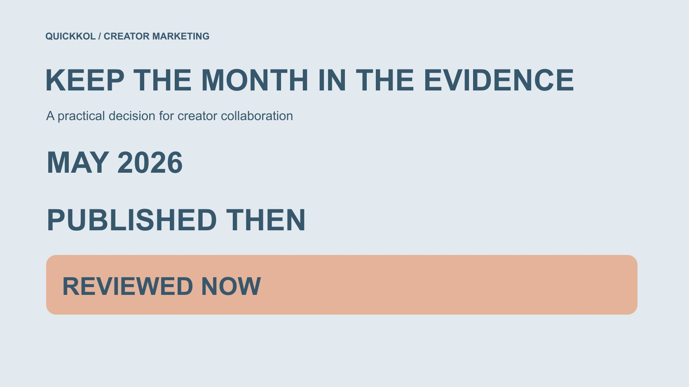
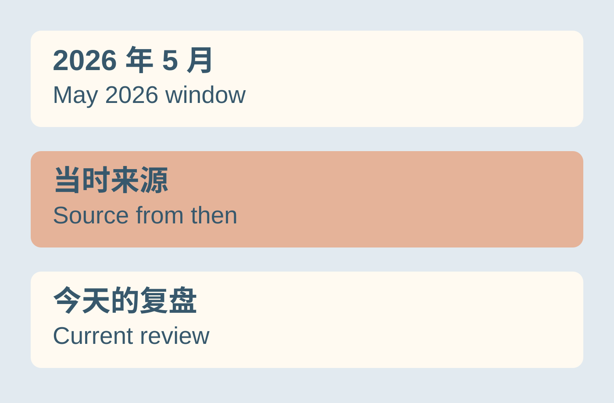

# 2026 年 5 月 TikTok 趋势怎样复盘

状态：本地审阅稿；正式发布日期待确认。

用有日期的官方资料回看 2026 年 5 月，把年度预测、当月案例与真实月度表现分开，再为达人 Brief 提炼问题。

QuickKOL 编辑图形；不呈现真实账号指标或平台界面。

现在回看 current TikTok trends May 2026，应当把它当成历史研究，而不是今天的实时榜单。可核验的官方资料包括 1 月发布的年度预测、5 月 5 日的发现与商业研究公告，以及 5 月 19 日的小企业展示。它们能帮助讨论真实使用情境、创作者解释和社区互动，但不能证明某个音频在整个 5 月最热门，也不能提供所有品牌通用的表现基准。品牌应先注明来源时期和范围，再把可用洞察变成具体达人任务。

## 先把五月写成研究窗口

本篇核验日期是 2026 年 11 月 18 日，研究对象是已经过去的 5 月。今天打开的热门页面可能已经变化，不能把当前结果换上五月标题就当作历史记录。

开始时写明要回答的问题：当时品牌讨论了哪些内容方向、哪些创作者工作值得研究，还是某个具体市场的音频表现？三者需要的证据不同。

若需要精确月榜，应有覆盖对应时间和地区的历史记录。没有这种资料，就明确不提供排名，而不是用记忆或搜索排序补全。

对于达人 Brief，历史资料仍有价值。它可以帮助解释为什么当时提出某种创意，以及今天是否值得重新研究，但不能单独决定下一次活动一定沿用。

## 年度预测提供方向，不是五月结果

[TikTok 的 2026 年年度趋势预测](https://newsroom.tiktok.com/introducing-tiktok-next-2026-our-trend-forecast-for-marketers-for-the-year-ahead?lang=en)发布于 1 月 14 日，提出 Reali-TEA、Curiosity Detours 和 Emotional ROI 等方向。它属于年度预测，不是对五月全部内容的事后统计。

品牌可以从中提出待研究问题：创作者怎样展示真实过程，怎样解释观众原来没想到的问题，怎样说明产品为何值得考虑。这些是编辑转化，不应写成平台保证某种内容必然成功。

也不要把报告中用于支撑年度观点的往年案例自动改写成五月发生。来源的发布日期、案例发生时间和底层研究时期，需要分别看。

在 Brief 中，可以写“受年度研究启发，探索这一表达”，而不是“五月排名第一的趋势”。这样的措辞不削弱创意，反而让创作者知道需要实际解决什么。

## 五月研究怎样支持达人提问

[TikTok 的 5 月商业研究公告](https://newsroom.tiktok.com/watch-it-love-it-want-it-how-tiktok-is-blending-discovery-connection-and-commerce?lang=en-150)于 5 月 5 日发布，介绍 Ipsos 与 TikTok 的 2026 年研究：覆盖 12 个市场的 9,000 位社交媒体用户，使用问卷。它讨论发现、考虑与购买之间的关系。

这些资料可以帮助品牌关注创作者怎样解释使用情境和购买前疑问。但问卷中的自报态度不是某条达人作品实际带来购买的证据，也不是整个五月内容的占比。

因此这里不把一个研究百分比写成品牌项目预期。更实用的是问：观众在看完演示后，还有什么需要理解，创作者能否用实际过程回答？

若品牌希望衡量自己的合作，需要对应作品、受众范围与观察时期。平台研究可以提供问题背景，不能代替本项目的结果。

## 五月案例可以看什么，不能推导什么

[TikTok 的 5 月小企业展示](https://newsroom.tiktok.com/built-on-tiktok-celebrating-the-thriving-small-business-community?lang=en)发表于 5 月 19 日，列举了创作者和经营者的内容，例如餐饮、烘焙和其他小企业。它是选定案例的展示，不是随机抽取的月度样本。

品牌可以研究内容贡献，例如人物怎样解释自己的工作、怎样让观众看见产品背后的过程。不要把被选中者的商业经历直接变成所有达人合作的增长预测。

文章中有一些数据属于其他时期，这也提醒研究者不能因为文章发表于五月，就把所有数字都标为五月统计。

对合作策划，案例最有用的输出是一个可研究的创意问题，而不是复制一个成功叙事。需要进一步看原作品、确认真实语境，再与适合的创作者讨论。

发表于五月，不代表其中全部数据都观察于五月。

## 把趋势转成创作者实际贡献

“更真实”并不是可直接执行的交付要求。品牌要进一步说明真实指什么：完整展示某个步骤、解释选择理由，还是让创作者说出自己的实际使用条件。

[TikTok 趋势研究记录方法](https://www.quickkol.com/zh/blog/tiktok-trends-regional-research-log/#answer)帮助把宽泛观察变成有出处的问题。不要从一个趋势词直接跳到指定同款台词，让创作者只负责表演品牌预先决定的体验。

例如品牌想解释器具日常使用，可以请创作者展示实际准备和收拾过程，而不是要求其复制另一个人的厨房、生活方式和结论。具体拍什么由任务与实际条件共同决定。

每项贡献应能在成片中辨认，也应留有不适用时调整的空间。这样趋势只是提出问题的背景，创作者仍在提供有价值的内容判断。

## 历史音频与商业使用分别核验

本篇没有一份经过核验的五月全月音频榜单，因此不提供所谓当月第一热门声音。即使找到当时的一条作品，也不能仅凭一个例子确定全月热度。

如果团队已经持有当时保存的音频来源，记录作品日期、市场和实际用途。可见作品提供内容线索，仍需另行确认品牌商业使用范围。

[美国版权局的版权说明](https://www.copyright.gov/what-is-copyright/)介绍原创表达保护。研究历史创意，不等于获得音乐或他人画面的使用权；重新制作与直接取用原作品也要分开。

可以把表现手法与具体声音拆开讨论。若原音频不适用于新任务，研究创作者怎样保留叙事作用，而不是为了复刻五月记忆勉强沿用。

## 时间与市场要跟着结论走

同样叫五月趋势，可能指一个国家、某个语言圈或一种内容领域。研究表里保留这些范围，不把局部观察改写为所有用户都在参与。

对没有说明范围的资料，可以把它作为待核验线索，不急于用于精确比较。来源越具体，品牌越能判断它是否与自己的创作者和受众有关。

还要区分发布时间与观察期。五月发布的文章可能引用一季度数据；五月创作的作品也可能后来才得到传播，不能随意把两者混成当月表现。

两个来源涉及不同市场时，保留为两条观察，不自行平均成全球结论。同一个月的资料，也可能让不同语言社区的创作者面对不同问题。项目里最有用的结论通常更窄，例如某个问题值得请旅行创作者解释。清楚限定，不会减少创意空间，而是减少没有依据的宏观判断。

## 用一个假设 Brief 检查研究是否有用

假设一个品牌希望邀请创作者解释旅行前怎样选择随身物品。年度预测提供关注实际价值的方向，五月研究提供购买前提问的背景，但都没有替品牌选好某个产品或达人。

Brief 可以要求展示一次真实准备、解释取舍，并注明实际条件。品牌提供准确规格，创作者决定怎样用自己熟悉的表达让观众看懂。

[达人策略工作流](https://www.quickkol.com/zh/blog/influencer-marketing-strategy-hypothesis-portfolio/#answer)帮助把这类问题连接到候选、交付与复盘。研究材料作为背景附上，不能把一个宏观百分比变成创作者必须达到的结果。

这个例子没有客户数据。它展示历史趋势资料怎样影响一个具体问题，而不是怎样复制一张趋势榜。最后仍需要确认创作者、任务和当前实际条件。

## 把没有找到的证据也写进复盘

一份好的回顾可以明确写：没有完整月榜，没有逐条作品的历史互动记录，也没有证明某个趋势导致销售的对照研究。未知不需要用推测补满。

把已经确认的内容写具体：哪些公告在五月发布、哪份资料是年度预测、哪些内容只是案例。团队才能知道后续若要更精确结论，还缺少什么。

如果以后获得新的历史资料，更新受影响的部分，并保留来源与观察期。不要因为找到一份新记录，就把此前所有建议都升级为已证实事实。

Current TikTok trends May 2026 的可靠品牌答案，是一份有范围的创作回顾：提出可用方向、说明证据边界，再把真正相关的问题交给创作者共同完成。

## 这次回顾的三类资料

| 资料 | 支持什么 | 不能替代 |
| --- | --- | --- |
| 1 月年度预测 | 年度创意问题 | 五月全月榜单 |
| 5 月商业研究公告 | 研究背景与问卷范围 | 本项目归因 |
| 5 月选定案例 | 可继续研究的作品方向 | 代表性行业基准 |

资料日期与实际观察期分别记录；本篇不提供未经核验的历史音频排名。

## 把历史趋势交给达人之前

让创意方向保留它的依据与范围。

- [ ] 写明五月的市场与问题。
- [ ] 区分预测、公告与实际结果。
- [ ] 核对原作品与时间。
- [ ] 把趋势词转成具体内容贡献。
- [ ] 另行核对音乐与素材使用。
- [ ] 保留未知，不写保证。

## 研究日期与使用边界

资料核验于 2026 年 11 月 18 日。文中方法、表格和决策规则为编辑建议，标为假设的示例不是实际客户结果或行业基准。外部资料的适用地区与时期按各段说明。

## 从任务开始达人研究

用 QuickKOL 理解 Brief、发现相关达人并研究作品与联系路径；数据、合作条件和结果仍需核验。

[了解 QuickKOL](https://www.quickkol.com/#capabilities)

## 来源

- [TikTok 的 2026 年年度趋势预测](https://newsroom.tiktok.com/introducing-tiktok-next-2026-our-trend-forecast-for-marketers-for-the-year-ahead?lang=en)
- [TikTok 的 5 月商业研究公告](https://newsroom.tiktok.com/watch-it-love-it-want-it-how-tiktok-is-blending-discovery-connection-and-commerce?lang=en-150)
- [TikTok 的 5 月小企业展示](https://newsroom.tiktok.com/built-on-tiktok-celebrating-the-thriving-small-business-community?lang=en)
- [美国版权局的版权说明](https://www.copyright.gov/what-is-copyright/)
