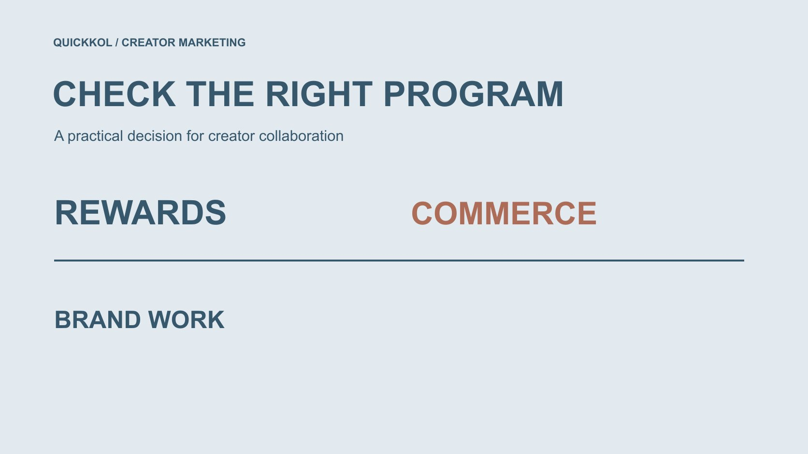
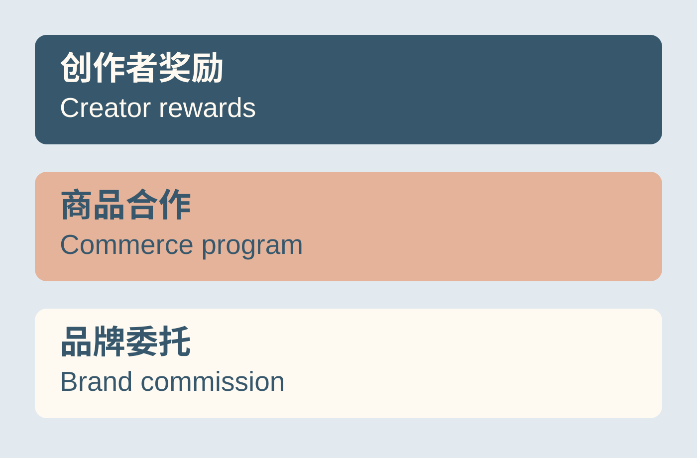

# TikTok Monetization Requirements by Program

Status: local review draft; confirm the publication date before release.

Separate Creator Rewards, TikTok Shop, TikTok One and brand commissions, checking requirements by program, market, account and actual work.

QuickKOL editorial graphic; not actual account metrics or a platform interface.

TikTok monetization requirements are not one threshold for every income route. Creator Rewards concerns qualifying-content rewards, TikTok Shop concerns e-commerce permissions and creator roles, TikTok One has collaboration-platform eligibility, and a brand commission needs an assignment, compensation and usage scope. The US Shop policy reviewed here, for example, separates Affiliate follower requirements from bound-account types; it should not be applied to every country or rewards program. Program access does not mean every sponsored video earns rewards or every partnership produces income.

## Identify the work behind the income route

Define the work first: qualifying-video rewards, commission through product content, entry to a collaboration platform or a direct brand commission. These can coexist in a creator business while having different conditions.

Do not answer how many followers to earn with one number immediately. A follower condition belongs to a program, while a brand assignment also needs relevant work, contribution and agreement.

The [TikTok monetization-partnership article](https://www.quickkol.com/blog/tiktok-monetization-sponsored-work-eligibility/#answer) separates income routes from commercial work. This guide concerns eligibility checks, not predicted earnings, reward amounts or guaranteed access in every market.

Before confirming a deliverable, check that the record concerns this account rather than a different market or creator role. Keep a separate record for each route, with program, market, account type and review date. An update to one should not accidentally change the decision for another. This makes a brand conversation more precise too: a creator can explain the work they offer without needing one platform-program label to represent every service they can legitimately provide.

## Separate Rewards access from video qualification

[TikTok’s Rewards-versus-Fund explanation](https://support.tiktok.com/en/business-and-creator/creator-rewards-program/how-is-the-creator-rewards-program-different-from-the-tiktok-creator-fund) describes original, high-quality videos longer than one minute and excludes Duets, Stitches and sponsored content from its original-content definition. Do not therefore treat anticipated rewards from a brand video as established income.

Creators should check current market, account and application conditions in the program, then the particular work. This research did not establish a complete current Rewards threshold table for every market and does not fill that gap with another program's numbers.

For the brand, the important question is whether this is a commercial assignment with clear compensation and use. Joining a rewards program should not make unknown platform revenue a substitute for the commissioned work's fee.

Separate ability to apply, acceptance and qualification of this video. One established layer does not complete the next. Keeping those states distinct prevents a general monetization label from becoming an unsupported earnings promise inside a creator brief.

## Distinguish creator types in US Shop

[TikTok Shop’s US creator-eligibility policy](https://seller-us.tiktok.com/university/essay?knowledge_id=6939143037667118&lang=en), in its September 2026 version, applies to the United States and distinguishes Affiliate, Marketing and Official roles. It lists at least 1,000 followers for Affiliates while bound-account types have different conditions; this is not one follower rule for every Shop user.

Age, location, identity and compliance conditions also apply, so meeting a count does not complete eligibility. A brand should identify the role required by its assignment rather than rely on a follower screenshot.

For a particular product function, confirm the account's actual available scope. Application, verification and capability needed for this task remain different questions.

US conditions should not transfer automatically to another market or answer Creator Rewards eligibility. Keep program, market and role beside a cited number. That provides a useful qualification check without turning a limited policy example into a worldwide monetization rule.

## Initial access does not establish every capability

The same US Shop policy describes pilot stages and capability limits, showing that an available entry point can still come with conditions. Joining should not become a claim that every campaign and publishing capability is open.

List the function the partnership actually requires, such as product content, a particular campaign opportunity or a public demonstration. Ask the holder to check current capability rather than use the program name as a substitute.

If a function is unavailable, discuss another assignment instead of having the creator promise an operation they do not yet have. Sampling, production and publication can have different arrangements.

This guide does not reproduce every restriction as a global checklist. For a specific threshold, return to the market and current account policy, retaining date and result. The useful brand-side outcome is knowing whether the creator can perform the requested work now, not merely whether the person once obtained access to a broadly named program.

## TikTok One requirements are not Rewards requirements

[TikTok One’s eligibility guide](https://support.tiktok.com/en/business-and-creator/tiktok-one) lists standing, age, followers and recent activity, noting regional variation for age and follower conditions. Its listed 10,000 followers, 1,000 post views in 30 days and three posts in 30 days should not become requirements for every monetization route.

These help check collaboration-platform access without establishing fit for any brand or guaranteed orders after joining. Research work, discuss contribution and confirm willingness for the actual assignment.

Inability to enter one platform does not establish that every content-production service is unavailable. Assess the commercial task and platform capability separately.

State whether the candidate record confirms access, capability or an actual partnership. Eligible should not carry every research and commercial conclusion. A brand can then ask the relevant next question instead of treating a program threshold as a complete substitute for understanding what the creator can contribute.

One program’s threshold is not a universal condition for all creator work.

## Give a brand commission its own assignment and compensation

A direct partnership needs clarity about production, appearing, publishing and use of assets. Asking whether monetization is enabled is insufficient without explaining what the creator should do.

Discuss compensation for actual work without treating estimated platform rewards, future sales or unconfirmed commission as already paid. For an affiliate arrangement, state order and settlement conditions without guaranteeing results.

The [UGC production-roles article](https://www.quickkol.com/blog/ugc-content-creator-on-camera-production-role/#answer) separates these tasks. File delivery and publication on a personal account can be agreed independently, with term and modifications also defined.

Program eligibility does not replace relevance. A creator with a function but no relevant work still needs research; a relevant creator should not inherit unspecified additional duties. This gives the brand a sounder procurement question than whether the person has crossed a particular count, and gives the creator a clearer way to describe what their proposed fee actually covers.

## Separate eligibility records from private verification documents

A brand usually needs to know whether the assignment's function is available, not retain every identity-verification document. The creator handles platform-required documents and personal information through formal processes.

A handoff can record program, market, current capability, confirmation date and pending issues. Retain relevant evidence where needed without adding credentials to an ordinary content task table.

Attribute a creator-supplied statement instead of presenting it as direct platform certification obtained by the brand. A visible official state also supports only its actual scope.

This keeps eligibility checking useful rather than an unlimited collection of personal information. Retain enough to support the assignment's decision and update affected parts when conditions change. A compact, well-sourced capability record is often easier to use than a folder of sensitive material whose presence still does not establish what the account can do today.

## Check three different tasks for mixed-up thresholds

Imagine a brand needing a demonstration file, a US Shop affiliate work and a creator's independent rewards video. These are three tasks, not a package one count can qualify.

The file needs production and usage agreement; US Shop work needs the role's actual commerce capability; the rewards video needs current program and content checks without assuming a sponsored assignment earns the same reward.

These examples guarantee neither acceptance nor earnings. They help a team identify whether it lacks eligibility information or a defined brief.

State the gap before deciding whom to ask. A creator should not prove every platform-monetization capability for work the brand has not defined. Separate task records also allow one activity to proceed appropriately while another remains pending, rather than making an unrelated program condition block the entire commercial discussion.

## Keep program, market and date when updating

Eligibility may need rechecking because program, market, account state or rules change. Record the actual change without applying one market's update to every partnership.

Confirm the necessary capability before important execution rather than repeatedly request identical proof in every conversation. Without a new change signal, use a reasonable reviewed record to plan work.

Numbers in this article need their context: US Shop Affiliate and TikTok One are different programs, while access and content reward qualification differ too. Do not copy only the values into a brief.

Retain pending status for unverified information. Incomplete public material should not be filled with older Fund rules, another market's policy or another platform's requirements to manufacture a complete current checklist. The record is useful because its boundaries are visible, not because every cell has a definite number.

## End with an assignment-specific eligibility decision

The conclusion should identify the required program and capability, established information, remaining gap and next owner. Do not write only that someone can or cannot monetize.

Relevance, production quality and commercial conditions still need separate assessment. Eligibility is part of execution, not a substitute for creator-partnership research.

The reliable brand-side answer to TikTok monetization requirements checks conditions by income route and separates platform programs from brand commissions. Eligible creators do not automatically have reward-qualifying sponsored videos or guaranteed partnership income.

Continue with a defined assignment, current capability and explicit agreement. Both parties can then identify what work can proceed instead of guessing around a follower threshold borrowed from the wrong program. That is a more useful result than a single number presented as permission for every possible way a creator might work with a brand.

## Identify the monetization route first

| Route | Check | Does not establish |
| --- | --- | --- |
| Creator Rewards | Current program and video conditions | Guaranteed rewards for sponsored work |
| US Shop | Creator role and commerce capability | Identical thresholds worldwide |
| TikTok One | Platform access and market conditions | An agreed brand partnership |
| Brand commission | Assignment, compensation and use | Platform-guaranteed earnings |

Reviewed November 18, 2026; market and program scopes remain separate, without an exhaustive global threshold list or earnings guarantee.

## Before confirming a TikTok creator assignment

Make eligibility checks serve the actual work.

- [ ] Identify the income and work route.
- [ ] Record program, market and account type.
- [ ] Separate application, access and content qualification.
- [ ] Check the capability needed now.
- [ ] Define production compensation and asset use.
- [ ] Retain unknowns and the next check.

## Research date and limitations

Sources reviewed November 18, 2026. Methods, tables and decision rules are editorial recommendations. Hypothetical examples are not actual client results or industry benchmarks. Source geography and periods are specified where relevant.

## Start creator research with a clear task

Use QuickKOL to interpret a brief, discover relevant creators and research their work and contact routes. Verify data, commercial terms and outcomes at their source.

[Explore QuickKOL](https://www.quickkol.com/#capabilities)

## Sources

- [TikTok’s Rewards-versus-Fund explanation](https://support.tiktok.com/en/business-and-creator/creator-rewards-program/how-is-the-creator-rewards-program-different-from-the-tiktok-creator-fund)
- [TikTok Shop’s US creator-eligibility policy](https://seller-us.tiktok.com/university/essay?knowledge_id=6939143037667118&lang=en)
- [TikTok One’s eligibility guide](https://support.tiktok.com/en/business-and-creator/tiktok-one)
