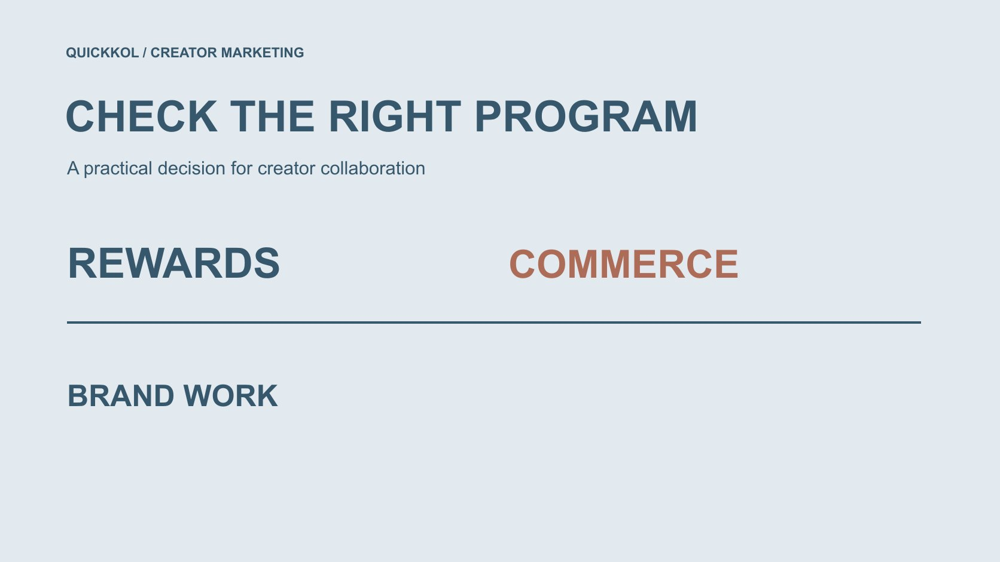
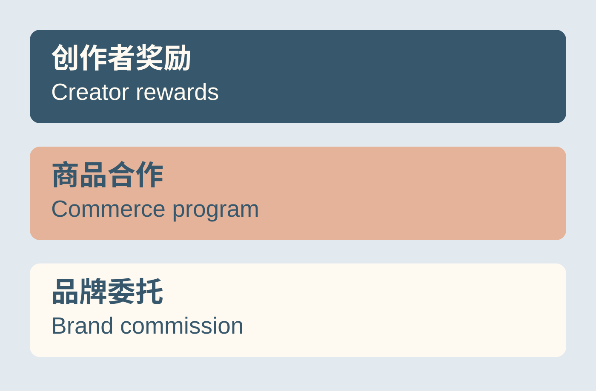

# TikTok 变现资格怎样按项目核对

状态：本地审阅稿；正式发布日期待确认。

把 Creator Rewards、TikTok Shop、TikTok One 与品牌委托分开，按项目、地区、账户和具体内容核对变现条件。

QuickKOL 编辑图形；不呈现真实账号指标或平台界面。

TikTok monetization requirements 没有一个适用于全部收入的统一门槛。Creator Rewards 针对符合条件的内容奖励，TikTok Shop 涉及电商权限与具体创作者类型，TikTok One 有自己的合作平台资格；品牌委托则还需明确任务、报酬和使用范围。例如本篇核验的美国 Shop 政策把 Affiliate 的最低粉丝数与其他绑定类型分开，不能套到所有国家或奖励计划。账号能申请某项目，也不表示每条商业视频都能获得奖励，或每次合作都会产生收入。

## 先确定收入来自哪一种工作

先写清你想做什么：获得符合条件的视频奖励、通过商品内容获得佣金、进入合作平台，还是接受品牌直接委托。它们可能同时出现在一个创作者业务里，但条件不同。

不要从“多少粉丝能赚钱”直接跳到一个数字。粉丝条件属于具体项目，品牌任务则还需要相关作品、实际贡献与明确约定。

[TikTok 变现合作文章](https://www.quickkol.com/zh/blog/tiktok-monetization-sponsored-work-eligibility/#answer)帮助把收入路径与商业工作分开。本篇关注资格核对，不提供预期收入、平台奖励金额或所有地区统一的申请保证。

确认交付前，检查记录对应本次账户，而不是另一个市场或创作者类型。为每条路径建立独立记录，写明项目、地区、账户类型与核验日期。这样一个计划的更新，不会误改另一个计划的判断。

## Creator Rewards 资格与单条内容资格分开

[TikTok 的 Rewards 与旧基金差异说明](https://support.tiktok.com/en/business-and-creator/creator-rewards-program/how-is-the-creator-rewards-program-different-from-the-tiktok-creator-fund)讨论原创、高质量、超过一分钟的视频，并在原创内容定义中排除 Duet、Stitch 与赞助内容。不能因此把品牌视频预期奖励算成已经确定的收入。

创作者应在当前项目入口核对自己的地区、账户与申请条件，再核对具体作品。本文没有取得一个适用于所有地区的完整当前 Rewards 门槛表，不用其他项目的数字补齐。

对品牌最重要的决定是：这条作品是否是有明确报酬和用途的商业任务。不要因为创作者加入奖励计划，就要求其用未知平台收入替代本次制作报酬。

把能申请、已获准和这条内容符合奖励条件分开。即使某一层成立，也不能自动完成后面的判断。

## 美国 Shop 要先区分创作者类型

[TikTok Shop 美国创作者资格政策](https://seller-us.tiktok.com/university/essay?knowledge_id=6939143037667118&lang=en)的 2026 年 9 月版本适用于美国，区分 Affiliate、Marketing 与 Official 类型。其 Affiliate 路径列出至少 1,000 粉丝，其他绑定类型有不同条件，不能写成全部 Shop 用户统一粉丝数。

政策也有年龄、地区、身份与合规要求，因此达到一个粉丝数并不等于全部资格完成。品牌需要核对实际任务涉及哪种类型，而不是只看一个数量截图。

若需要某种商品功能，确认该账户当前实际可用范围。申请、完成核验与具备本次所需能力，仍然是不同问题。

这些美国条件不应直接移植到别的市场，也不应拿来回答 Creator Rewards。引用数字时，项目、地区与类型要跟着一起保留。

## 入门权限不等于已经拥有全部能力

同一份美国 Shop 政策还描述了试行阶段与能力限制，说明获得某种入口之后仍可能需要按当前状态工作。不能把加入成功直接写成所有活动和发布能力都开放。

对达人合作，先列出真正需要的功能，例如商品内容、某类活动参与或公开演示。再请持有人核对当前可用范围，不以项目名称代替实际检查。

如果某项能力暂不可用，可以讨论调整任务，而不是让创作者承诺自己尚未拥有的操作方式。产品样品、制作和发布也可以有不同安排。

本篇不把政策里的全部限制复制成全球清单。需要具体门槛时，回到对应市场与账户当前政策，保留核验日期和实际结果。

## TikTok One 的条件不是 Rewards 条件

[TikTok One 的资格说明](https://support.tiktok.com/en/business-and-creator/tiktok-one)列出账户状态、年龄、粉丝与近期活动条件，其中年龄和粉丝条件注明可能随地区不同。其说明中的 10,000 粉丝、30 天内 1,000 次帖子观看和 3 条发布，不能转写为所有变现的统一要求。

这些条件帮助核对合作平台入口，不证明某位创作者适合任何品牌，也不保证加入后一定有订单。品牌任务仍需研究作品、沟通贡献和确认本人意愿。

如果账户无法进入某个平台，不要由此认定其所有内容制作服务都不存在。具体商业任务与平台功能需要分别判断。

对候选记录，写清当前确认的是入口、能力还是实际合作。不要让一个“符合资格”状态承担全部研究与商务结论。

不要把一个项目的门槛写成全部达人工作的统一条件。

## 品牌委托要有自己的任务与报酬安排

直接合作需要明确谁制作、谁出镜、谁发布、谁能够使用素材。不要只询问创作者是否开通变现，却没有说明本次希望其完成什么。

报酬可以按实际工作讨论，但不能把平台预计奖励、未来销售或未确认佣金自动当成已支付。若采用联盟方式，也要说明订单与结算条件，不承诺结果。

[UGC 制作职责文章](https://www.quickkol.com/zh/blog/ugc-content-creator-on-camera-production-role/#answer)帮助拆开这些工作。制作文件和在个人账户发布可以分别约定，品牌使用期限与修改范围也需要清楚。

项目资格不代替内容相关性。拥有某个功能，但缺少与任务相关的作品，仍需要继续研究；反过来，相关创作者也不应被要求接受未说明的额外职责。

## 把资格记录与隐私资料分开

品牌通常需要知道本次功能能否使用，不需要长期保存创作者全部身份核验资料。平台要求的证件或个人信息，由本人按正式流程处理。

合作交接可以记录项目、地区、当前功能范围、确认时间和未决事项。必要时保留相关证据，但不要把账号凭据加入普通内容任务表。

如果资料来自创作者本人说明，注明来源，不冒充品牌已经获得平台直接认证。若有可见正式状态，也只写它实际支持的结论。

这让资格核对服务工作，而不是变成无边界的个人资料收集。信息足够支持本次决定即可，后续变化再更新受影响部分。

## 用三个不同任务检验门槛有没有混用

假设品牌需要一份演示文件、一次美国 Shop 联盟内容，以及一条创作者自主奖励视频。这是三个任务，不是同一个数字可以回答的合作包。

演示文件核对制作与使用约定；美国 Shop 内容核对该类型的实际电商权限；奖励视频则按 Rewards 当前内容与项目条件判断，不能把赞助任务假定为可领同一奖励。

这些只是任务示例，没有保证谁能够获准或赚多少钱。它们帮助团队发现自己到底缺少资格资料，还是缺少明确 Brief。

先把缺口写清，再决定下一步询问谁。不要要求创作者为一个品牌没有定义的工作证明全部平台变现能力。

## 更新时保留地区、项目与日期

资格可能因项目、地区、账户状态或规则变化而需要重新核对。记录实际变化，不把一个市场的新政策套到全部合作。

品牌在重要执行前确认所需能力即可，不需要每次沟通都重复索要相同证明。若没有新的变化线索，就根据合理核验记录安排工作。

文章里的数字也需要保留语境：美国 Shop Affiliate 与 TikTok One 不是同一项目，进入条件与内容奖励条件也不同。复制到 Brief 时不要只剩数值。

如果某项资料尚未核实，就保留待确认。公开说明不完整时，不能用旧基金、其他市场或别的平台规则拼成一个看似完整的当前清单。

## 最后交付项目对应的资格决定

结论应说明本次需要哪个项目和能力，已经确认什么，还缺什么，以及由谁继续核对。不要只写这个人能变现或不能变现。

内容相关性、制作质量与商务条件还需各自判断。资格是实际执行的一部分，不能替代完整达人合作研究。

TikTok monetization requirements 的可靠品牌答案，是按收入路径核对条件，并把平台计划与品牌委托分开。创作者有资格，不等于某条赞助视频有奖励，也不保证合作收入。

用清楚任务、当前能力与明确约定继续讨论，品牌和创作者才能知道哪些工作真正可以开展，而不是围绕一个被混用的粉丝门槛反复猜测。

## 先问哪种变现路径

| 路径 | 需要核对 | 不能自动说明 |
| --- | --- | --- |
| Creator Rewards | 当前项目与具体视频条件 | 赞助视频必得奖励 |
| 美国 Shop | 创作者类型与实际电商权限 | 全部市场同一门槛 |
| TikTok One | 平台入口及地区条件 | 品牌合作已经确认 |
| 品牌委托 | 任务、报酬与使用范围 | 平台保证收入 |

核验于 2026 年 11 月 18 日；地区与项目分别适用，不提供全市场完整门槛或收入保证。

## 确认 TikTok 达人任务之前

让资格核对直接服务具体工作。

- [ ] 确定收入与任务路径。
- [ ] 记录项目、地区与账户类型。
- [ ] 分开申请、准入与内容资格。
- [ ] 核对当前所需功能。
- [ ] 明确制作报酬与素材用途。
- [ ] 保留未知与下一项核对。

## 研究日期与使用边界

资料核验于 2026 年 11 月 18 日。文中方法、表格和决策规则为编辑建议，标为假设的示例不是实际客户结果或行业基准。外部资料的适用地区与时期按各段说明。

## 从任务开始达人研究

用 QuickKOL 理解 Brief、发现相关达人并研究作品与联系路径；数据、合作条件和结果仍需核验。

[了解 QuickKOL](https://www.quickkol.com/#capabilities)

## 来源

- [TikTok 的 Rewards 与旧基金差异说明](https://support.tiktok.com/en/business-and-creator/creator-rewards-program/how-is-the-creator-rewards-program-different-from-the-tiktok-creator-fund)
- [TikTok Shop 美国创作者资格政策](https://seller-us.tiktok.com/university/essay?knowledge_id=6939143037667118&lang=en)
- [TikTok One 的资格说明](https://support.tiktok.com/en/business-and-creator/tiktok-one)
