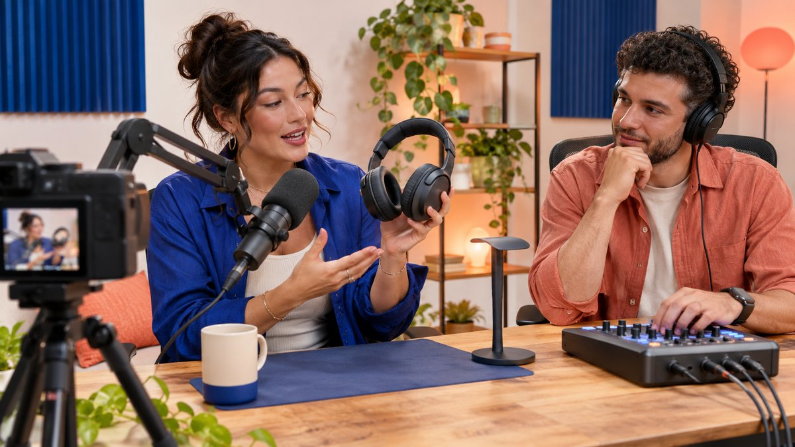

# TikTok Sounds in Creator Campaigns

Status: local review draft; confirm the publication date before release.

Align the expressive job, music source, usage scope and delivery version of sound in creator partnerships. Discoverability or popularity does not establish commercial permission.

For TikTok sounds in creator marketing, define what audio should explain, demonstrate or support, then confirm permission for the actual commercial use. Finding a sound in the app, seeing other people use it or reading an original-sound label does not by itself establish brand permission. Put selection, region, placement, asset version and confirmation ownership in the brief. An unfinished rights decision does not become an approved deliverable because editing is complete.

## Define the job of sound in the creator’s work

Creator work may depend on spoken explanation, an actual device sound, environmental context or a supporting rhythm. Decide what the audience needs to hear before assuming every partnership must follow a popular song.

A technology demonstration might preserve operating sounds; a travel explanation needs intelligible information; an exercise piece might use rhythm to organize movement. These are creative examples, not findings that a sound guarantees viewing improvement.

The creator can propose a direction suited to their expression while the brand confirms facts and commercial purpose. Discuss how music serves the work rather than supplying an ambiguous use trending audio instruction.

The [creator short-video shot-list method](https://www.quickkol.com/blog/make-a-reel-creator-explanation-shot-list/#answer) helps establish essential actions and explanations before arranging audio. That order gives selection a connection to production and makes it easier to explain why a particular sound does not fit. It also allows a strong spoken or environmental version to remain a deliberate creative choice instead of being treated as an unfinished video lacking a song.

## Separate commercial use from ordinary discovery

[TikTok’s commercial-music explanation](https://support.tiktok.com/en/business-and-creator/creator-and-business-accounts/commercial-use-of-music-on-tiktok?lang=en) recommends the Commercial Music Library for content promoting a brand, product or service and says its licenses for music outside that library do not cover commercial use in content.

A creator discovering a song through a personal account therefore does not confirm permission for a brand collaboration. Whether the team buys paid distribution is not the only question in deciding whether the work promotes a brand.

State planned uses in the brief: creator publication, brand reposting, an advertising version or an adaptation for another channel. A phrase such as social media use is too broad to replace the actual scope.

Mark undecided uses separately. Completing a version for a defined scope and discussing additions is easier to plan than discovering after delivery that its soundtrack cannot travel with it. This makes permission a production input, rather than a final administrative label added to a video whose creative choices are already difficult to change.

## Select commercial music for the actual region and placement

[TikTok’s Commercial Music Library guide](https://ads.tiktok.com/resources/help/article/how-to-use-the-commercial-music-library), updated in July 2026, directs users to select the campaign region and offers filters including usable placements, themes, genre, mood and duration. It describes Commercial Sounds for organic or paid content on TikTok.

Do not expand that description into identical availability for every track, region, account and use. Check the particular selection against the project instead of retaining only a search-results screenshot.

The guide also distinguishes the sound choices shown to different account types. The operator should find Commercial Sounds through current controls rather than treat another account's menu as evidence of their own permission.

Retain information identifying the selection, review time and intended scope. A large library-size statistic is unnecessary here; suitability for this creator production drives the decision. If the planned campaign region or placement changes later, revisit the selection rather than assuming that its earlier availability settled the expanded assignment.

## An original-sound label does not establish every right

[TikTok’s commercial-music explanation](https://support.tiktok.com/en/business-and-creator/creator-and-business-accounts/commercial-use-of-music-on-tiktok?lang=en) also says that using an original sound or music outside the Commercial Music Library with content disclosure enabled requires its Music Usage Confirmation: no copyright-protected music is present, or necessary licenses have been obtained and paid for.

A file uploaded by the creator therefore does not establish that every piece of music inside it is their own creation. Identify background songs, samples, another person's recording and music already embedded during editing.

If the partnership commissions original music, discuss composition, performance, recording and the brand's intended uses. This article provides questions to check rather than determining ownership of a specific work.

Renaming a song as original sound does not resolve an unconfirmed permission, and a low volume or short extract should not be assumed to create a commercial license automatically. The description of the audio and the basis for using it need separate support, even when the finished video feels informal or creator-led.

## Do not carry platform availability into every channel

[TikTok One’s collaboration-music guide](https://ads.tiktok.com/resources/help/article/about-music-copyright-for-tiktok-one-creator-collaborations?lang=en), updated in October 2026, says Commercial Sounds are intended for TikTok and should not be downloaded and reposted on other platforms. Availability and rights may vary by track, region, account or campaign.

If the brand plans to adapt creator assets across channels, say so before production. A video already mixed with platform music is not automatically a master that can be freely used in every advertisement.

The agreement can retain intelligible speech, environmental audio and a replaceable music version, with an authorized owner confirming each channel's selection. Separate tracks should serve actual later uses and production capability rather than being requested without purpose.

The [creator-ad permission method](https://www.quickkol.com/blog/what-is-whitelisting-creator-ad-permissions/#answer) helps discuss asset scope, but asset permission and music permission do not merge automatically. The creator's agreement cannot make a decision for an unrelated music rights holder. This distinction also prevents a brand from treating a broad content-use request as a complete account of every component embedded in the file.

## Check sound against the explanation before finishing the edit

Listen with the actual speech and essential actions instead of only previewing a music excerpt on its own. A background track can fit the mood while covering the words a viewer most needs to understand the product.

Ask the creator whether the sound still suits their expression and the brand whether key facts remain intelligible. There is no need to impose one mixing number on every production when recordings, devices and viewing conditions differ.

Check on a phone and ordinary headphones, retaining suitable support such as captions. A visual understandable without sound does not replace review of the audible version.

Make feedback specific: identify the covered sentence, awkward transition or actual sound to preserve. Music is not premium enough leaves a producer guessing about the requested change. Specific comments also let the team decide whether the problem needs a volume adjustment, a different arrangement or an entirely different selection rather than repeatedly exporting ambiguous revisions.

Listen with the actual explanation and action to judge whether music supports understanding, not just whether the song sounds good.

## Resolve review issues against a specific version

[TikTok One’s collaboration-music guide](https://ads.tiktok.com/resources/help/article/about-music-copyright-for-tiktok-one-creator-collaborations?lang=en) says the platform may review music in collaboration videos and reject copyrighted music used without appropriate licensing. A related rejection calls for reviewing the reason, revising and submitting again.

The guidance recommends replacing uncertain music with a Commercial Sound or removing it. Internal brand approval does not guarantee platform acceptance, and changing a song cannot promise distribution.

Record the affected file, track and actual notice. Similar file names do not establish that every version has been corrected, particularly when creator and advertising versions coexist.

If a music revision changes timing or shot length, also check that speech, captions and essential actions still correspond. Resolving the music issue does not automatically preserve every other factual and expressive part of the edit.

Let an authorized operator follow the current process. This article does not request unrelated credentials or offer ways around review or copyright problems; the project needs a correct deliverable. Retain the actual revised outcome before marking the issue resolved, so an instruction to replace music is not confused with evidence that the replacement was made and accepted.

## Hand over the reason and boundary of the selection

A delivery record can include track or sound identification, source, review date, campaign region, intended placement, corresponding file and confirmer. This is an execution recommendation rather than an official platform template.

The [U.S. Copyright Office’s copyright overview](https://www.copyright.gov/what-is-copyright/) discusses creative works including musical works and sound recordings. For a brand project, possessing or downloading a file is insufficient by itself to answer how it may be used.

Keep uncertain uses unconfirmed. If later advertising on another channel has not been arranged, do not mark it included or promise that the asset will never need another check.

Retain information needed for the project rather than unrelated personal details. The next operator primarily needs to know which audio version serves which assignment and what would trigger renewed confirmation. That is more useful than a folder labelled cleared that contains several differently mixed files and no explanation of the scope to which the label refers.

## Complete the decision in a hypothetical demonstration

Imagine a creator demonstrating a compact recording device, where actual sound and explanation matter more than following a particular popular track. Both parties first define the roles of speech, device audio and supporting rhythm.

The brand identifies the region and placements for this TikTok partnership, and the selection owner checks an appropriate Commercial Sound. An advertisement for another platform remains unconfirmed, so an appropriate version without that soundtrack is retained for a later selection.

Before handoff, phone listening reveals and corrects music covering an essential explanation. The team records the real file and usage scope. These steps are not actual client results and do not show that an audio track improves conversion.

TikTok sounds become useful in creator marketing when suitable expression and executable permission coexist. Audio should help viewers understand the work while the brand and creator know what they have delivered, confirmed and retained. A well-documented choice can then be adapted deliberately rather than copied into another use by assumption.

## Commercial-audio brief decisions

| Question | Record | Does not establish |
| --- | --- | --- |
| Audio task | Speech, actual sound or rhythm | Guaranteed viewing improvement |
| Music source | Track and permission basis | Discovery equals commercial permission |
| Usage scope | Region, placement and channel | Universal platform rights |
| Delivery version | File and replaceable components | Every version updated |
| Confirmation | Actual check and notice | Guaranteed acceptance or distribution |

Editorial recommendations; verify music rights for the track, region, account and campaign.

## Creator commercial-audio handoff

Turn selection into a clear production decision.

- [ ] State what viewers need to hear.
- [ ] Check commercial source and actual use.
- [ ] Identify all music embedded in original audio.
- [ ] Discuss cross-channel versions early.
- [ ] Listen with actual speech and visuals.
- [ ] Record file, confirmer and unconfirmed uses.

## Research date and limitations

Sources reviewed November 18, 2026. Methods, tables and decision rules are editorial recommendations. Hypothetical examples are not actual client results or industry benchmarks. Source geography and periods are specified where relevant.

## Start creator research with a clear task

Use QuickKOL to interpret a brief, discover relevant creators and research their work and contact routes. Verify data, commercial terms and outcomes at their source.

[Explore QuickKOL](https://www.quickkol.com/#capabilities)

## Sources

- [TikTok’s commercial-music explanation](https://support.tiktok.com/en/business-and-creator/creator-and-business-accounts/commercial-use-of-music-on-tiktok?lang=en)
- [TikTok’s Commercial Music Library guide](https://ads.tiktok.com/resources/help/article/how-to-use-the-commercial-music-library)
- [TikTok One’s collaboration-music guide](https://ads.tiktok.com/resources/help/article/about-music-copyright-for-tiktok-one-creator-collaborations?lang=en)
- [U.S. Copyright Office’s copyright overview](https://www.copyright.gov/what-is-copyright/)
