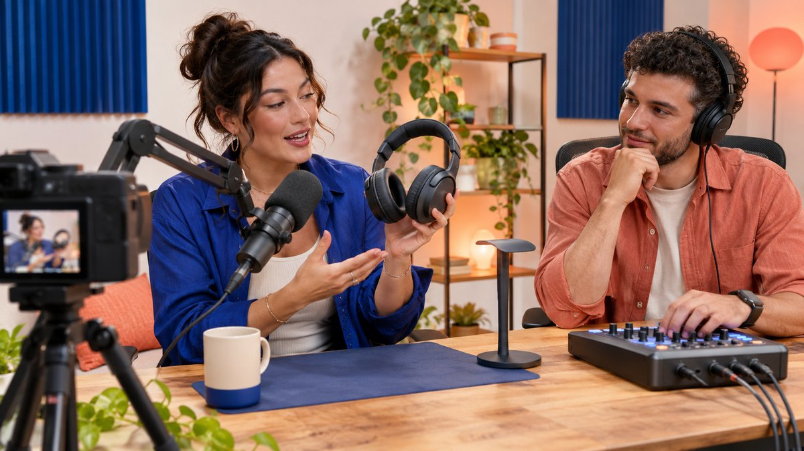

# TikTok 达人商业音频怎样选用

状态：本地审阅稿；正式发布日期待确认。

在达人商业作品中，把声音的表达任务、音乐来源、使用范围和交付版本一起确认，避免把可搜索或流行误当成商业授权。

选择 TikTok sounds 用于达人营销时，先定义声音要解释、表现或衬托什么，再确认这条商业内容的实际使用权限。能在应用里找到、已被其他人使用，或标为原声，都不能单独证明品牌可用。把选曲、地区、使用位置、素材版本与确认责任写入 Brief；没有确认的音乐，不应因剪辑已经完成而被默认为可交付。

## 先问声音在作品里承担什么

达人作品可能依靠口述解释、设备实际声音、环境线索或背景节奏。先确定观众需要听见什么，不要默认每条合作都必须跟随热门歌曲。

例如，科技演示需要保留产品操作的声音，旅行讲述需要让观众听清信息，运动作品可能用节奏组织动作。这里是创意选择示例，不是某种声音保证提升观看的结论。

达人可以提出适合自己表达的方向，品牌确认事实与商业任务。双方讨论音乐怎样服务作品，而不是只交一个“使用流行音频”的模糊要求。

[达人短视频分镜方法](https://www.quickkol.com/zh/blog/make-a-reel-creator-explanation-shot-list/#answer)能帮助先确定关键动作和解释，再安排声音。这样的顺序让选曲与拍摄有真实联系，也便于说明某一音频为什么不适合该项目。

## 把商业使用与普通发现分开

[TikTok 的商业用音说明](https://support.tiktok.com/en/business-and-creator/creator-and-business-accounts/commercial-use-of-music-on-tiktok?lang=en)推荐推广品牌、产品或服务时使用商业音乐库，并指出平台持有的库外音乐许可并不覆盖内容中的商业使用。

这意味着创作者的个人账户可以发现某条歌曲，并不能替品牌确认合作许可。是否付费投放，也不是判断作品是否推广品牌的唯一问题。

在 Brief 中说明内容用途：达人原发布、品牌转载、广告版本或其他渠道改编分别计划什么。不要用一句“社交媒体可用”替代实际范围。

对尚未确定的使用单独标记。先完成一个明确范围的版本，再讨论额外用途，比在交付后才发现配乐无法沿用更容易安排制作与反馈。

## 在实际地区与使用位置选择商业音乐

[TikTok 的商业音乐库使用指南](https://ads.tiktok.com/resources/help/article/how-to-use-the-commercial-music-library)于 2026 年 7 月更新，要求选择活动运行地区，并提供可用位置、主题、曲风、情绪与时长等筛选。商业声音可用于平台上的自然或付费内容。

不要把这一说明扩写为每首曲目在每个地区、每个账户和所有用途都一样。核对具体选择与实际项目条件，而不是只保存一张搜索结果截图。

指南也区分不同账户在加入声音时看到的选项。操作者应按当前界面寻找商业声音，不依赖另一账户的菜单作为自己已获许可的证据。

保留能识别所选曲目的资料、核对时间与拟用范围。这里不需要为了显得全面而引用一个曲库规模数字；选择是否适用，才影响本次达人制作。

## 原声标签不等于拥有全部权利

[TikTok 的商业用音说明](https://support.tiktok.com/en/business-and-creator/creator-and-business-accounts/commercial-use-of-music-on-tiktok?lang=en)还解释，在开启内容披露设置时，使用原声或商业音乐库之外的音乐，需要同意音乐使用确认：内容没有受版权保护的音乐，或已经取得并支付必要许可。

因此录制文件由创作者上传，不代表其中所有音乐都是自己创作。拍摄环境的歌曲、样本、他人录音或剪辑里已有的配乐，都应被识别。

如果合作确实制作原创音乐，也把创作、演奏、录音与品牌使用范围讨论清楚。本文不替具体作品判断权属，只提供需要核对的问题。

不要为了绕过未确认的音乐问题，将歌曲改名成原声，或假定较小音量、很短片段就能自动获得商业许可。表达与权利应分别有依据。

## 不要把一个平台的可用曲目带往所有渠道

[TikTok One 的合作音乐版权说明](https://ads.tiktok.com/resources/help/article/about-music-copyright-for-tiktok-one-creator-collaborations?lang=en)于 2026 年 10 月更新，明确商业声音面向 TikTok，不能下载后再发到其他平台；具体可用性和权限可能随曲目、地区、账户或活动变化。

品牌计划跨渠道使用达人素材时，要在制作前说明。不能只交付一条已经混入平台配乐的视频，再把它当成可自由用于任何广告的母版。

可以约定保留清楚的口述、环境声与可替换音乐版本，并由有权的人确认各渠道选曲。是否需要独立分轨，取决于真实后续用途与制作能力。

[达人广告许可方法](https://www.quickkol.com/zh/blog/what-is-whitelisting-creator-ad-permissions/#answer)帮助讨论作品使用范围，但作品许可与音乐许可不自动合并。获得达人同意，也不能替未参与授权的音乐权利人作决定。

## 在完成剪辑前检查声音与解释

先用实际口述和关键动作试听，不只听一段单独的音乐预览。背景曲可以适合气氛，却盖住观众理解产品时最需要的几个词。

让创作者确认声音是否仍符合表达，品牌核对关键事实能否听清。没有必要要求每个项目遵守同一个混音数字，实际录音、设备与观看条件不同。

在手机与常见耳机条件下检查，保留字幕等适当辅助。关闭声音时可理解的画面，也不能替代对有声版本的审阅。

把反馈说具体：哪句被遮盖、哪个转场不连贯、哪个实际声音需要保留。不要只说音乐不够高级，让制作人猜测品牌希望改变什么。

试听实际解释与动作，判断配乐是否帮助理解，而不只试听歌曲本身。

## 将审阅问题回到具体版本

[TikTok One 的合作音乐版权说明](https://ads.tiktok.com/resources/help/article/about-music-copyright-for-tiktok-one-creator-collaborations?lang=en)指出，平台可能审阅合作视频的音乐；未经适当许可的版权音乐可能导致拒绝。若遇到相关拒绝，需看原因，修改并重新提交。

说明建议在无法确认时更换商业声音或移除音乐。不要把品牌内部认可当成平台一定通过，也不要承诺换一首歌就保证获得分发。

记录受影响的文件、曲目与实际通知。相似文件名并不能证明所有版本都已同步修正，尤其当一条作品同时有达人版和广告版。

如果音乐修改改变了节奏或镜头长度，还要检查口述、字幕和关键动作是否仍相互对应。版权问题处理完，不表示剪辑中的其他事实与表达自动保持完整。

由有权的操作者按当前流程处理。本文不要求读者提交无关账户凭证，也不提供规避审阅或绕过版权问题的办法；项目需要的是可交付的正确版本。

## 交付时保存声音选择的理由与边界

交付记录可以包含曲目或声音识别、来源、核对日期、活动地区、拟用位置、对应文件与确认人。这是执行建议，不是平台官方标准模板。

[美国版权局的版权说明](https://www.copyright.gov/what-is-copyright/)将音乐作品与录音等创作纳入版权讨论。对品牌项目而言，能拿到文件或能下载，不足以单独回答可以怎样使用。

不确定的用途保留为未确认。例如后续其他渠道广告尚未安排，就不要把它写成已包含，也不要承诺该素材以后永远无需再核对。

维护记录由项目所需决定，不应收集无关私人资料。下一位执行者最需要知道的是哪份声音版本服务哪项任务，以及何时必须重新确认。

## 用一个假设演示项目走完决定

假设一位创作者演示小型录音设备，实际声音与解释比追随某首热门曲目更重要。双方先约定口述、设备声与背景节奏各自作用。

品牌说明这次 TikTok 合作的地区与拟用位置，选曲负责人核对相应商业声音。另一个平台的广告尚未确认，因此保留不含该配乐的适当版本，后续另行选用。

交付前用手机试听，修正盖住关键解释的部分，并记录真实文件与使用范围。这些步骤不代表真实客户结果，也没有证明某个音轨能提高转化。

TikTok sounds 的达人营销价值来自合适表达和可执行权限共同成立。让声音帮助观众理解作品，同时让品牌与创作者知道自己实际交付、确认和保留了什么。

## 商业声音 Brief 的决定

| 问题 | 需要记录 | 不能推导 |
| --- | --- | --- |
| 声音任务 | 口述、实际声或节奏 | 必然提升观看 |
| 音乐来源 | 具体曲目与许可依据 | 找到即商用 |
| 使用范围 | 地区、位置与渠道 | 所有平台通用 |
| 交付版本 | 对应文件与可替换部分 | 所有版本同步修改 |
| 确认结果 | 实际核对与通知 | 一定通过或分发 |

编辑建议；具体音乐权限依曲目、地区、账户与活动核对。

## 达人商业用音交接

先把声音选择变成清楚的制作决定。

- [ ] 说明声音必须让观众听懂什么。
- [ ] 核对商业音乐来源与实际使用范围。
- [ ] 识别原声文件里的全部音乐。
- [ ] 提前讨论跨渠道版本。
- [ ] 用实际口述与画面完成试听。
- [ ] 记录文件、确认人和未确认用途。

## 研究日期与使用边界

资料核验于 2026 年 11 月 18 日。文中方法、表格和决策规则为编辑建议，标为假设的示例不是实际客户结果或行业基准。外部资料的适用地区与时期按各段说明。

## 从任务开始达人研究

用 QuickKOL 理解 Brief、发现相关达人并研究作品与联系路径；数据、合作条件和结果仍需核验。

[了解 QuickKOL](https://www.quickkol.com/#capabilities)

## 来源

- [TikTok 的商业用音说明](https://support.tiktok.com/en/business-and-creator/creator-and-business-accounts/commercial-use-of-music-on-tiktok?lang=en)
- [TikTok 的商业音乐库使用指南](https://ads.tiktok.com/resources/help/article/how-to-use-the-commercial-music-library)
- [TikTok One 的合作音乐版权说明](https://ads.tiktok.com/resources/help/article/about-music-copyright-for-tiktok-one-creator-collaborations?lang=en)
- [美国版权局的版权说明](https://www.copyright.gov/what-is-copyright/)
