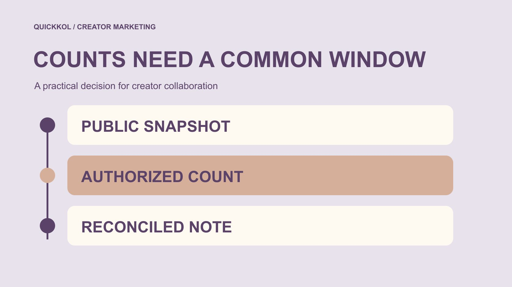
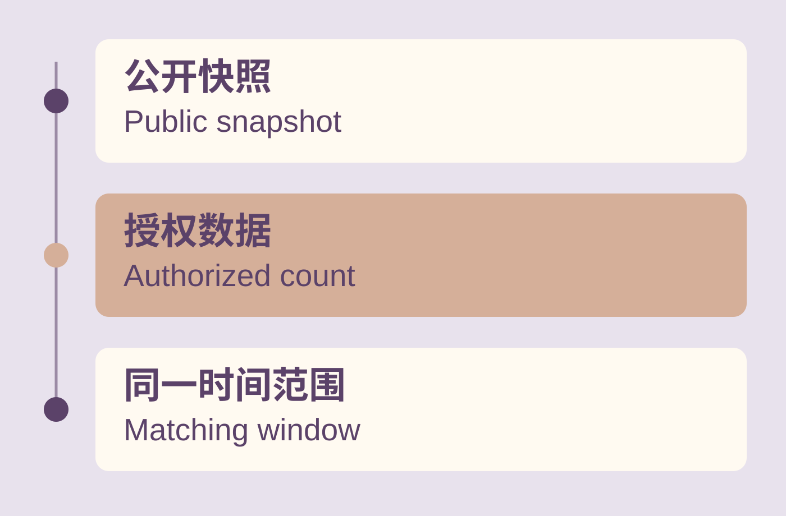

# YouTube Subscriber Tracker: Reconcile the Records

Status: local review draft; confirm the publication date before release.

Reconcile public subscriber snapshots, creator-supplied authorized information and campaign timing. Explain differences without attributing channel-wide changes to one partnership.

QuickKOL editorial graphic; not actual account metrics or a platform interface.

A YouTube subscriber tracker can help document changes in a creator channel’s scale, but first establish what it tracks: a shortened public count, API value, third-party snapshot or Studio and Analytics information the creator is authorized to share. Two figures for the same channel can differ in precision, time or metric scope. A difference is not automatically evidence of an anomaly, and net growth is not automatically new subscribers caused by a brand partnership.

## Define the decision before tracking the number

A brand may need to confirm a candidate channel's approximate scale, preserve context at the start of a partnership or explain a difference in a campaign review. Each question needs different evidence; buying a counter described as real time need not come first.

The [subscriber-count and active-audience article](https://www.quickkol.com/blog/youtube-subscribers-count-and-active-viewers/#answer) distinguishes scale from actual viewing. This article addresses reconciling several records so the campaign report knows whether it compares the same number.

Write the question the reader needs answered. Deciding whether a particular programme suits a partnership requires more than a subscriber trajectory: research the work, relevant audience and production scope too.

Do not turn tracking into an unsupported product promise. QuickKOL can help interpret the task and research relevant creators, while channel figures, authorized information and outcomes still need checking at their source. A defined question also limits unnecessary collection, because the team can ask for the evidence it actually needs instead of requesting broad account access without a reason.

## Establish that the records concern the same channel

Retain the actual channel URL and confirmable identity rather than only a display name. Similar names, cropped screenshots or source-free reports call for identity confirmation before a growth discussion.

Record each value's source, observation time and time zone, preserving its original display. Converting 123K into an apparently exact integer can lead a later reader to believe every digit was actually observed.

A third-party record needs its data source, sampling time and estimation status explained. If those are unknown, a real-time label is not evidence of an exact owner-side count.

Allow the state to remain unverified. Establishing a reliable match before interpreting differences is more valuable than joining different channels or times into an attractive curve. Keep the supplied artifact as well as the transcription, where appropriately authorized, so a reviewer can distinguish an original abbreviated display from precision introduced during report preparation.

## Recognize the display steps in public counts

[YouTube’s subscriber-count guide](https://support.google.com/youtube/answer/6051134?hl=en) distinguishes shortened public counts from the owner's viewing route. Its example shows 1,234 subscribers as 1.23K; within the 1,000–9,999 range, the public count updates in steps of ten new subscribers.

An unchanged abbreviation therefore cannot establish that nothing changed behind it. A visible jump when a display step is crossed cannot by itself establish abnormal growth over a short period either.

Keep the public abbreviation label in the brand's record. If the task is candidate-scale context, that precision may be adequate without filling unseen digits with an estimated fact.

If the project needs a finer explanation, state why appropriate creator-supplied information is needed. Public precision is a reporting boundary to preserve, rather than a defect that must be repaired with guesses. A reviewer should be able to see both the figure and the level of detail at which the team actually observed it.

## A numeric API value is not automatically exact

[YouTube Data API’s channel definition](https://developers.google.com/youtube/data/reference/rest/v3/channels) says statistics.subscriberCount is rounded down to three significant figures. A number returned through an interface therefore does not automatically contain every subscriber digit.

For example, applying that rule to a hypothetical actual value of 123,456 produces 123,000. This is an illustration of the rule, not a live observation of a named creator.

If a tool displays finer continuously changing numbers, establish the source and calculation first. Animation, second-by-second refreshing or integer formatting should not turn an estimate into a verified owner-side result.

The brand needs explainable evidence rather than the largest number of digits. Retain the field, source explanation and observation time so apparent precision is not reported as factual precision. Where an estimate is useful for exploratory context, label it accordingly and keep it separate from the source values that were actually obtained.

## Bound requests for authorized information

[YouTube’s subscriber-count guide](https://support.google.com/youtube/answer/6051134?hl=en) gives owners a route through Studio Analytics, the Overview real-time card and live subscriber count. Where needed, the brand can ask the creator to share appropriately scoped information without requesting a password.

Specify the period, channel and metric being checked. The creator can supply an authorized screenshot or export retaining date and scope while excluding unrelated personal or commercial information.

Do not directly compare a live count at one moment with a historical-period report. Establish whether each artifact describes a point-in-time stock or subscription actions over a period.

The request should also identify the recipient, retention purpose and handling after review. Checking one period does not automatically require a continuing account connection. Information supplied to explain one partnership differs from permission for indefinite access across future projects. Let the creator understand and confirm that distinction. If a narrower artifact answers the question, the brand can use it without expanding the request, and document any remaining limitation instead of treating broader access as a prerequisite for collaboration.

If the information is not supplied, record it as not obtained rather than relabelling a public value as an authorized exact count. Different evidence levels can coexist, but they must remain distinguishable. Deliver only the information and explanation needed for the actual review. This preserves a workable collaboration when a creator can answer a bounded question but cannot or does not agree to provide broader internal reporting.

## Distinguish channel actions from video-scoped actions

[YouTube Analytics’ subscriber-metric definitions](https://developers.google.com/youtube/analytics/metrics) describe subscribersGained and subscribersLost as subscription and unsubscription actions. Channel reports include the relevant sources, while a video dimension or filter limits the metric to actions from that video's watch page.

Adding metrics for several sponsored videos should therefore not automatically be treated as all channel subscription change in the period. People can act elsewhere, and the report scopes differ.

Preserve gains and losses rather than presenting only a net figure. A descriptive net action calculation can subtract losses from gains within the same scope, with period, unit and filtering stated.

That still does not establish incremental subscriptions caused by the partnership. Video-associated actions, channel-wide change and causal effect are different questions requiring different evidence. A single growth heading should not conceal the distinction. Explain what the arithmetic describes before comparing it with a public snapshot or a broader campaign objective.

Align identity, source, precision and time before interpreting change; reconciling records does not prove campaign attribution.

## Create a common observation period for the campaign

Establish the work's actual publication time before arranging the report window. Preparation completed, scheduled release and real public availability are different times and should not be mixed as the start of growth.

If sampling times differ between tools, preserve the difference. Obtain a common period where possible; where it cannot be supplied, explain that the comparison offers only limited context.

The [social-data reconciliation method](https://www.quickkol.com/blog/social-blade-accuracy-measurement-reconciliation/#answer) helps combine definitions, sources and times. Record relevant concurrent content, outside coverage or other activity instead of assigning every change to one brand partnership.

Changing the window does not automatically solve causality. It makes description more comparable, while claiming that new subscribers came from a particular collaboration still needs supporting design and evidence. The useful report can separate what happened during a campaign from what has actually been established as an effect of that campaign. The former is a dated observation; the latter is a stronger conclusion.

## Investigate record conditions before interpreting a difference

First check channel identity, units, abbreviation, overlapping periods and whether the metric is a stock or an action count. Many questions can be defined at this stage without assigning a label to the creator.

[YouTube’s subscriber-count guide](https://support.google.com/youtube/answer/6051134?hl=en) also describes verification of accounts and actions and possible metric corrections; closed accounts and identified spam subscriptions do not count towards the total. This article cannot diagnose a particular decrease from that general explanation.

If the existing material still does not explain the difference, retain an unresolved state and the evidence needed next. Suspicion should not become an established fact, and a curve alone should not accuse an individual.

A report can say that subscription change is presently unsuitable for judging partnership effect while continuing to review whether the content fulfilled its task accurately. An unresolved number need not become an unsupported conclusion about the entire collaboration. The next request should be proportionate to the question still open.

## Rehearse reconciliation using hypothetical records

Imagine a brand retaining a public channel snapshot and later receiving information from the same creator channel with different observation times and report scope. Preserve both originals rather than overwrite them with one supposedly correct number.

The project owner marks the distinction between abbreviated public and authorized information, then requests a reasonably aligned period. If only video-watch-page subscription actions are available, they are not described as all channel growth.

The handoff lists explained differences, remaining unknowns and their implications for the decision. Without attribution evidence, it reports observed change rather than saying the brand produced that many new subscribers.

This example contains no actual creator outcome. A YouTube subscriber tracker serves creator marketing by making records checkable, definitions explainable and the basis for partnership conclusions visible. The final record should enable another reviewer to reproduce the comparison and recognize its limits without needing the original analyst to translate an unlabeled chart from memory.

## Subscriber-tracking reconciliation fields

| Field | Retain | Avoid inferring |
| --- | --- | --- |
| Channel identity | Confirmed channel URL | Same name means same channel |
| Count source | Public, API, authorized or estimated | API value is necessarily exact |
| Time and precision | Time zone, snapshot and abbreviation | Unseen digits are zero |
| Metric scope | Stock, actions, channel or video | Video actions equal channel change |
| Campaign conclusion | Observation, unknowns and evidence | Automatic attribution of net growth |

Editorial reconciliation framework; examples are not actual channel outcomes and do not establish unique people or commercial attribution.

## Subscriber-tracking report handoff

Enable the next owner to check the same comparison.

- [ ] Define the brand decision and needed evidence.
- [ ] Retain channel URL and original display.
- [ ] Label source, precision, time and time zone.
- [ ] Distinguish stock from subscription actions.
- [ ] Check channel and video report scope.
- [ ] Preserve unknowns and attribution limits.

## Research date and limitations

Sources reviewed November 18, 2026. Methods, tables and decision rules are editorial recommendations. Hypothetical examples are not actual client results or industry benchmarks. Source geography and periods are specified where relevant.

## Start creator research with a clear task

Use QuickKOL to interpret a brief, discover relevant creators and research their work and contact routes. Verify data, commercial terms and outcomes at their source.

[Explore QuickKOL](https://www.quickkol.com/#capabilities)

## Sources

- [YouTube’s subscriber-count guide](https://support.google.com/youtube/answer/6051134?hl=en)
- [YouTube Data API’s channel definition](https://developers.google.com/youtube/data/reference/rest/v3/channels)
- [YouTube Analytics’ subscriber-metric definitions](https://developers.google.com/youtube/analytics/metrics)
