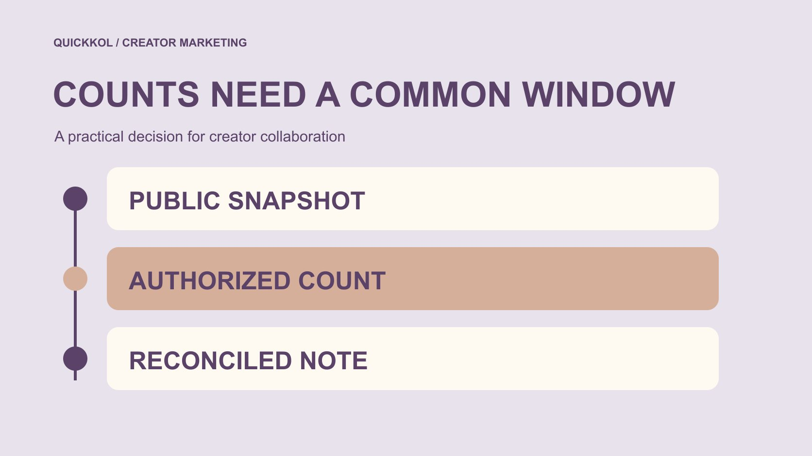
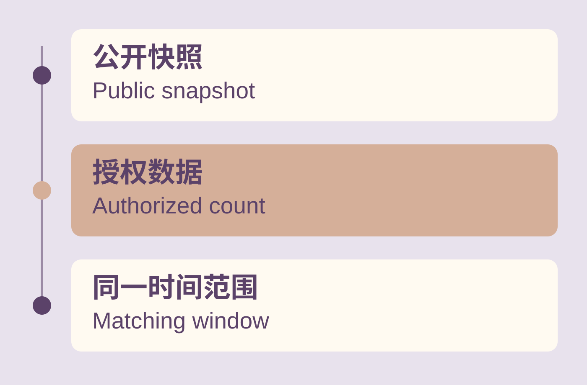

# 订阅追踪怎样对应达人项目记录

状态：本地审阅稿；正式发布日期待确认。

把公开订阅快照、创作者提供的授权资料和项目时间放回同一记录，解释数字差异，并避免将频道净变化直接归因给一条合作。

QuickKOL 编辑图形；不呈现真实账号指标或平台界面。

YouTube subscriber tracker 可以帮助记录达人频道规模如何变化，但先确认它追踪哪种数字：公开缩写、API 返回值、第三方快照，还是创作者获准分享的 Studio 与 Analytics 资料。相同频道的两个数字不一致，可能涉及精度、时间或指标范围；不能直接当作异常事实，更不能把净增长自动算成品牌合作带来的新增。

## 先明确订阅追踪的决策用途

品牌可能需要确认候选频道的大致规模、保存合作开始时的背景，或解释项目复盘中的数字差异。每项问题需要的资料不同，不必先采购一个声称实时的计数器。

[订阅数与活跃观众文章](https://www.quickkol.com/zh/blog/youtube-subscribers-count-and-active-viewers/#answer)解释规模和实际观看的区别。本篇处理多份记录如何对齐，让项目报告知道自己比较的是否同一个数字。

先记录读者需要回答的问题。若要判断某条节目是否适合合作，仅有频道订阅轨迹不够，还要研究作品、相关受众与制作范围。

不要把追踪做成额外的数据承诺。QuickKOL 可帮助理解任务与研究相关达人，具体频道数字、授权资料和结果仍需在其来源核验。

## 先确认记录属于同一个频道

保存实际频道地址与可确认的频道身份，不只保存显示名。显示名相似、截图被裁切或报告缺少来源时，先确认归属再讨论增长。

记录每个值的来源、观察时间与时区，并保留原始展示格式。把 123K 直接改成一个看起来精确的整数，会让后来的人误以为这些位数曾被实际观察。

第三方记录需要说明它从哪里取得资料、何时取样，以及是否估计。若无法确认，不把其标签“实时”当作后台精确计数的证据。

允许状态写为未核验。先建立可靠匹配，再分析差异，比把不同频道或不同时间的数据拼成一条漂亮曲线更有价值。

## 公开缩写存在明确的显示步长

[YouTube 的订阅数说明](https://support.google.com/youtube/answer/6051134?hl=en)区分公开缩写和创作者查看路径。官方示例中，1,234 名订阅者显示为 1.23K；在 1,000 至 9,999 区间，公开计数按每 10 名新增更新。

因此公开页面保持同一个缩写，不能证明后台完全没有变化。跨过显示步长时出现跳动，也不能单独证明短时间异常增长。

在品牌记录中保留“公开缩写”标签。如果只是为候选规模提供背景，可以使用这个精度，不必将看不见的位数补成估计事实。

需要更细的项目解释时，再说明为什么应请求适当的创作者资料。公开记录的限制不是一个必须用猜测修补的缺陷，而是报告应明确保留的口径。

## API 返回数字也不自动代表精确计数

[YouTube Data API 的频道定义](https://developers.google.com/youtube/data/reference/rest/v3/channels)说明，statistics.subscriberCount 向下取至三位有效数字。数字通过接口返回，并不等于它具备所有订阅位数的精度。

例如按这个规则，假设实际值为 123,456，三位有效数字的向下取值是 123,000。这是规则演算，不是本文观察到的某位达人实时记录。

如果工具显示更细且持续变化的数字，先了解其来源与计算。不能只因界面有动画、每秒刷新或显示整数，就将估计当成已验证后台结果。

品牌需要的不是最多位数，而是可解释的资料。保留接口字段、来源说明与观察时间，避免把精确外观误写为精确事实。

## 限定授权资料的任务与范围

[YouTube 的订阅数说明](https://support.google.com/youtube/answer/6051134?hl=en)提供创作者在 Studio 的 Analytics 总览中查看实时卡片和实时订阅计数的路径。品牌可以在有需要时请对方分享适当范围的资料，不需要索取密码。

说明要核对哪段时期、哪个频道和哪类指标。创作者可以提供获准分享的截图或导出，保留日期与范围，遮去无关个人或商业信息。

不要把某一刻的实时计数与另一份历史期报告直接比较。先确认每份资料描述的是时间点存量，还是一段时间里的订阅动作。

请求还应说明接收人、保存目的和审阅后怎样处理。若只需核对某个时期，就不默认申请持续账户连接。资料用于一次合作解释，与允许未来任何项目持续访问，是不同范围，应由对方了解并确认。

对方没有提供资料时，记录未取得，而不是把公开值改写成授权精确值。证据层级可以不同，但在报告中必须保持可辨认。最终只交付实际需要的资料及对应解释。

## 频道订阅动作与视频范围不同

[YouTube Analytics 的订阅指标定义](https://developers.google.com/youtube/analytics/metrics)将 subscribersGained 与 subscribersLost 分别定义为订阅和取消订阅动作。频道报告覆盖相应来源；限定单条视频的维度或筛选时，范围只包含该视频观看页的动作。

因此把几条赞助视频的指标相加，不应自动当成频道同期全部订阅变化。观众可能在其他位置完成动作，报告范围本身就不同。

保留增与减，不只展示一个净值。若计算描述性净动作，可用同范围新增减去取消，并写清时期、单位及过滤条件。

这仍不是合作造成的增量订阅。视频相关动作、频道总变化与因果效果是不同问题，需要不同证据，不能用同一个增长标题掩盖差别。

先统一身份、来源、精度与时间，再讨论变化；对齐记录不等于证明合作归因。

## 给项目划定共同观察期

先确定合作内容的实际发布时点，再安排报告窗口。准备完成、预定排期与真实公开不是同一个时间，不能混作增长起点。

如果不同工具的取样时间不一致，保留差异。尽可能补充共同时间范围的资料；无法补齐时，说明比较只能提供有限背景。

[社交数据对账方法](https://www.quickkol.com/zh/blog/social-blade-accuracy-measurement-reconciliation/#answer)有助于将定义、来源和时间放在一起。频道同期还有其他内容、外部报道或活动时，也记录这些背景，不把一切变化归给一位品牌合作方。

更换窗口并不会自动解决因果问题。它让描述更可比，但若要声称新增来自某项合作，仍需要支持该结论的设计与资料。

## 出现差异时先排查记录条件

先检查频道是否一致、单位是否相同、显示是否缩写、时期是否重叠，以及指标是存量还是动作。很多问题在这一步就能被清楚定义，而不需要给创作者贴标签。

[YouTube 的订阅数说明](https://support.google.com/youtube/answer/6051134?hl=en)也指出，平台会核验账号与动作，并可能更正指标；关闭账户与识别为垃圾订阅的账号不会计入总数。本文不能据一个下降诊断具体原因。

若现有资料仍解释不了差异，就保留未解决状态与需要补充的证据。不要把怀疑写成已证实事实，或用一张曲线指控个人。

报告可以说明目前不宜用订阅变化评估合作效果，同时继续审阅内容是否准确完成任务。一个未解决数字，不必被扩大成对整项合作的无依据结论。

## 用假设记录演练对账与交接

假设品牌保存一张公开频道快照，之后收到创作者的同频道资料，但观察时间与报告范围不同。先保留两份原记录，不强行覆盖成一个“正确数字”。

项目负责人标明公开缩写与授权资料的区别，再请求能合理对齐的时期。若只拿到视频观看页的订阅动作，就不把它写成频道全部增长。

最终交付中列出已解释差异、仍未知事项与对本次决策的影响。没有归因证据，就只说观察到变化，不说品牌带来了对应数量的新订阅。

这个例子没有真实达人结果。YouTube subscriber tracker 在达人营销中的价值，是让记录可核对、口径可解释，并帮助团队知道哪些合作结论已经有依据。

## 订阅追踪的对账字段

| 字段 | 保存内容 | 避免推断 |
| --- | --- | --- |
| 频道身份 | 确认的频道地址 | 同名即同一频道 |
| 数字来源 | 公开、API、授权或估计 | 接口数字一定精确 |
| 时间与精度 | 时区、快照与缩写 | 未显示位数为零 |
| 指标范围 | 存量、动作、频道或视频 | 视频动作等于频道总变化 |
| 合作结论 | 观察、未知与证据 | 净增长自动归因 |

编辑对账框架；算例不代表真实频道结果，不提供独立人数或商业归因。

## 订阅追踪报告交接

让下一位负责人能复查同一比较。

- [ ] 先明确品牌决策与所需证据。
- [ ] 保存频道地址与原始展示。
- [ ] 标注来源、精度、时间与时区。
- [ ] 区分存量和订阅动作。
- [ ] 核对频道与视频报告范围。
- [ ] 保留未知与归因限制。

## 研究日期与使用边界

资料核验于 2026 年 11 月 18 日。文中方法、表格和决策规则为编辑建议，标为假设的示例不是实际客户结果或行业基准。外部资料的适用地区与时期按各段说明。

## 从任务开始达人研究

用 QuickKOL 理解 Brief、发现相关达人并研究作品与联系路径；数据、合作条件和结果仍需核验。

[了解 QuickKOL](https://www.quickkol.com/#capabilities)

## 来源

- [YouTube 的订阅数说明](https://support.google.com/youtube/answer/6051134?hl=en)
- [YouTube Data API 的频道定义](https://developers.google.com/youtube/data/reference/rest/v3/channels)
- [YouTube Analytics 的订阅指标定义](https://developers.google.com/youtube/analytics/metrics)
