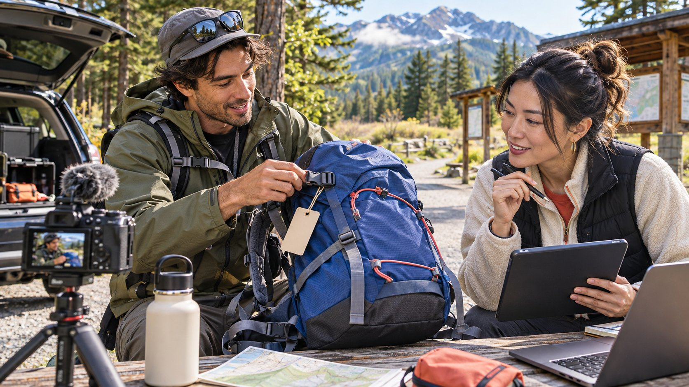
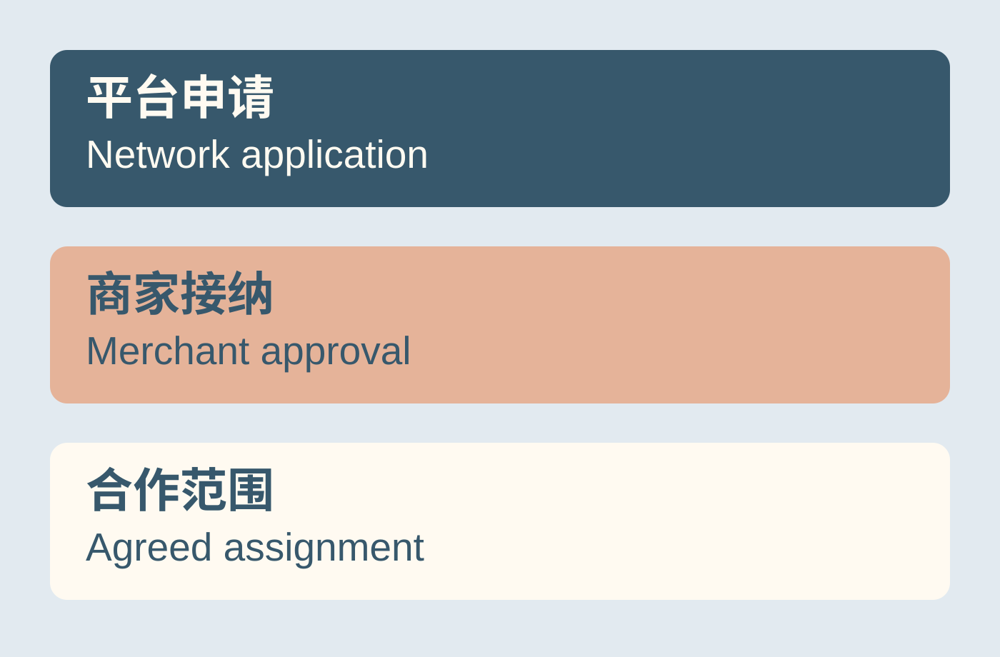

# AvantLink for Creator Partnerships

Status: local review draft; confirm the publication date before release.

When discussing an AvantLink creator partnership, distinguish network application, merchant programme, regional account and content scope instead of treating activation as every commercial condition.

AvantLink can provide network infrastructure for affiliate relationships involving brands, publishers and creators, but network application, merchant-programme acceptance and a commissioned piece of work are different decisions. Check real content, regional network, actual access state and proposed merchant before discussing commission, production, publication and rights. An account or product appearing on a platform does not establish creator acceptance, audience fit or a commercial outcome.

## Define both the affiliate relationship and content assignment

A brand might want a creator to explain a product and participate through a checkable affiliate referral route. That commercial relationship does not automatically specify what to make, whether to publish, who reviews it or where the work can be reused.

The [affiliate-content role method](https://www.quickkol.com/blog/affiliate-creator-content-partnership-ads-role-map/#answer) helps separate those jobs. Is the creator providing experience, explaining selection conditions or making a defined asset? Commission can be part of compensation without replacing production scope.

Use the work and audience task to decide whether discussion is worthwhile before checking platform state. A creator's presence in a network should not lead the brand to invent an assignment it did not need.

This article provides neither a hands-on platform score nor an income forecast. It uses public official material to organize checks and a partnership proposal, while account state, programme terms and outcomes need confirmation at their source. The resulting brief should explain why this creator's contribution matters independently of the mechanics used to record referrals.

## Check the real content behind a network application

[AvantLink’s application FAQ](https://support.avantlink.com/hc/en-us/articles/204952129-Affiliate-Application-FAQ), updated in September 2026, describes ownership confirmation followed by manual application review and discusses applications using established social profiles under qualifying conditions.

For the brand, that makes established work and association with the claimed property important research inputs. An empty profile or attractive screenshot is not sufficient partnership evidence. The platform makes the actual admission decision.

Do not turn official criteria into an invented follower threshold or promise that completing a checklist guarantees acceptance. The criteria also cannot establish that every account in the network fits this brand's assignment.

If inviting a creator who has not joined, explain the pending process rather than describe the invitation as activation. Application, verification, platform decision and actual content collaboration need separate states. A clear request tells the creator why the brand sees relevant work and which part of the proposed arrangement still depends on a process neither party should assume already complete.

## Confirm network state separately from merchant acceptance

[AvantLink’s compliance overview](https://support.avantlink.com/hc/en-us/articles/204641015-AvantLink-Compliance-Overview) distinguishes account review, partial access and special merchant conditions. Check the actual programme state rather than infer access to every merchant relationship from the ability to sign in.

Record the proposed merchant, programme and corresponding account. Special terms or additional confirmation belong within that scope, not inside a blanket joined AvantLink label.

Merchant acceptance also does not confirm a complete creator-production assignment. Publication quantity, delivery version, experience conditions, feedback and asset use still need discussion.

The platform-status record and content brief can link to one another while answering different questions. If one process is unfinished, the team can identify preparation that may continue and commercial actions that still require confirmation. This is especially useful when a recruitment conversation begins before programme setup is complete: both sides can discuss fit without reporting an active partnership, and neither has to infer an obligation from the other's technical progress.

One platform state cannot replace merchant terms, content acceptance or asset permission.

## Interpret limited access within its actual scope

[AvantLink’s limited-access guide](https://support.avantlink.com/hc/en-us/articles/47181231574171-Limited-Access-Affiliate-Information), updated in March 2026, explains that such an account is restricted to the merchant programmes that initially approved it and cannot directly apply to additional programmes. This is not unrestricted network access.

The stated conditions for requesting expanded-access review include completed payment and tax setup and at least five successful sales processed to the bank account configured. Meeting them supports a review request; it does not guarantee expanded approval.

These are requirements for a particular account state, not a universal starting threshold for every creator or an invitation to manufacture transactions to satisfy a count.

Appropriate account personnel handle sensitive information within the formal process. A brand research record generally needs the confirmed state and unfinished conditions, not the creator's banking details as proof of partnership value. Keep the dated requirement and its scope together so someone reading the proposal does not mistake an exception-handling rule for a general network-admission promise.

## A regional network does not prove audience geography

[AvantLink’s network explanation](https://support.avantlink.com/hc/en-us/articles/23004611751451-AvantLink-Networks-US-CA-AU-Explained) describes distinct United States, Canadian and Australian networks and differences in accounts and payment arrangements. Cross-network work requires checking the corresponding account rather than treating linked login information as one entity.

Network region is administrative and commercial context, not direct evidence that a creator's audience lives there. Creator location, filming location and audience market still need separate research.

The proposed product destination, currency, availability and conditions should also fit the audience task. A programme visible in one network does not establish an identical purchasing route for every market.

When comparing markets, retain original terms and observation dates. An arrangement from one merchant in one region should not become a platform-wide condition or earnings promise for every creator. This gives the brand a concrete market question to confirm before briefing content, instead of leaving the creator to discover after publication that the promised destination cannot serve the intended viewers.

## Keep commission terms separate from content rights

Check how the particular programme defines eligible referrals, confirmation and payment conditions, keeping those terms separate from production fees. The presence of a commission rate does not establish compensation for every content-production task.

[FTC’s influencer-disclosure guide](https://www.ftc.gov/business-guidance/resources/disclosures-101-social-media-influencers), in its United States context, emphasizes clear material-relationship disclosure and truthful, supported experience and product statements. Affiliate arrangements do not remove those content questions.

If the brand wants advertising, publication on other accounts or a longer use period, discuss the corresponding rights. Recording a referral link does not confer ownership of the work or unlimited adaptation of the creator's expression.

If one party expects commission-only participation and the other needs a production fee, discuss that difference before filming. Do not hide it inside try it first. Record which work is definite and which outcome remains conditional. Referral infrastructure does not automatically resolve a disagreement about production obligations, even when both parties can access the same programme.

Give compensation, content assignment, publishing scope and use permission separate fields in the proposal. Both parties then discuss actual work rather than discover during reuse that affiliate partnership meant different things to each. The arrangement can include several income components, but the reader should still understand which component relates to which obligation and what remains conditional.

## Use work evidence to assess the merchant fit

Examine whether the creator explains product-related questions, acknowledges conditions and gives viewers an accurate next step. Relevant work can be more useful than a broad outdoor or lifestyle label.

Do not only note whether a product appeared; identify its role. Actual use, concept introduction, an entertainment prop and a purchasing recommendation are different contributions, even when the objects look similar.

The [affiliate-website model method](https://www.quickkol.com/blog/affiliate-marketing-websites-publisher-models/#answer) helps distinguish publishing approaches. Let the task determine whether the brand needs an extended explanation, short demonstration or another form rather than allowing platform mechanics to determine the creative assignment first.

Keep uncertain experience, market and production conditions open. Strong work supports a discussion without establishing product acceptance, availability or guaranteed outcomes. Research should give outreach a reason rather than decide for the creator. A useful approach can name a specific piece and the question it explains, then ask whether a related contribution would fit the creator's intended work and the merchant's actual programme.

## Align the states in a hypothetical backpack project

Imagine a brand asking an outdoor creator to explain which trips suit a backpack. The team first reviews relevant work and the audience task, then confirms the creator's network and merchant-programme state.

If the account has access only to particular merchants, another brand should not be reported as immediately promotable. An unfinished platform condition can coexist with a discussion of content structure, without being described as an accepted commission.

Next, agree product experience, explanation, publication, commission conditions and asset use separately. The creator's observations must reflect actual experience, while the destination market matches the invitation.

This hypothetical contains no real creator, earnings or sales result. It shows AvantLink becoming one part of the workflow while brand fit, platform state and content commitments each receive confirmation. The responsible handoff would identify which owner confirms each part and what the creator can prepare now, rather than collapse all the work into a single activated status and leave its meaning for others to guess.

## Hand over a proposal with explicit scope

Retain work evidence, merchant and network, actual account state, open conditions and proposed content. Keep official-source dates so later owners can recognize changed terms.

Without an account test, do not claim that a current control, field or process is available in the user's account. Documentation and execution confirmation differ; the researcher should report which part was actually completed.

QuickKOL can help interpret a brief and research relevant creators and contact routes. Platform review, programme acceptance, payment terms and asset rights still need separate verification.

AvantLink's creator-marketing value cannot be inferred from one account state. It depends on a suitable contribution aligned with an understandable commercial arrangement. Give the next owner the basis, missing conditions and responsibility for continuing, so discovery can become executable work. A concise but complete proposal then allows the creator and merchant to resolve real questions without mistaking public platform descriptions for commitments already made to this particular partnership.

## Confirmation layers for an AvantLink creator partnership

| Layer | Check | Does not establish |
| --- | --- | --- |
| Creator fit | Relevant work and task | Accepted partnership |
| Network application | Authentic information and actual decision | Guaranteed admission |
| Merchant programme | Acceptance and access scope | Every programme available |
| Regional network | Corresponding account and market terms | Entire audience lives there |
| Content and compensation | Production, publication, commission and rights | One label covers every obligation |

Editorial review framework based on public sources, not an account test, admission guarantee or earnings promise.

## AvantLink checks before a proposal

Clarify platform and content states separately.

- [ ] Record work and proposed contribution.
- [ ] Check network, merchant and account state.
- [ ] Retain limited access and open conditions.
- [ ] Check target market and actual destination.
- [ ] Discuss production, commission and asset rights separately.
- [ ] Hand over evidence, dates and next owner.

## Research date and limitations

Sources reviewed November 19, 2026. Methods, tables and decision rules are editorial recommendations. Hypothetical examples are not actual client results or industry benchmarks. Source geography and periods are specified where relevant.

## Start creator research with a clear task

Use QuickKOL to interpret a brief, discover relevant creators and research their work and contact routes. Verify data, commercial terms and outcomes at their source.

[Explore QuickKOL](https://www.quickkol.com/#capabilities)

## Sources

- [AvantLink’s application FAQ](https://support.avantlink.com/hc/en-us/articles/204952129-Affiliate-Application-FAQ)
- [AvantLink’s compliance overview](https://support.avantlink.com/hc/en-us/articles/204641015-AvantLink-Compliance-Overview)
- [AvantLink’s limited-access guide](https://support.avantlink.com/hc/en-us/articles/47181231574171-Limited-Access-Affiliate-Information)
- [AvantLink’s network explanation](https://support.avantlink.com/hc/en-us/articles/23004611751451-AvantLink-Networks-US-CA-AU-Explained)
- [FTC’s influencer-disclosure guide](https://www.ftc.gov/business-guidance/resources/disclosures-101-social-media-influencers)
