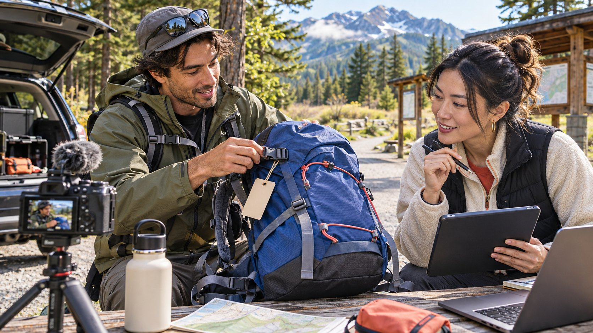
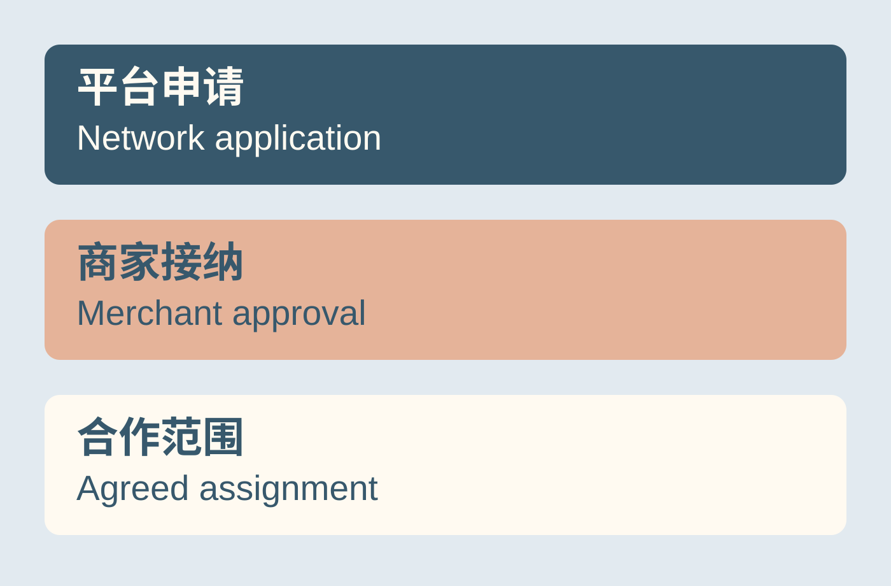

# AvantLink 怎样核对达人与商家匹配

状态：本地审阅稿；正式发布日期待确认。

品牌与达人讨论 AvantLink 合作时，分别确认网络申请、商家项目、地区账户和内容范围，不把一个激活状态当成所有合作条件。

AvantLink 可以作为品牌与发布者、达人开展联盟合作的网络背景，但网络申请、商家项目接纳与具体作品委托是不同决定。先核对对方真实内容、所处网络、实际访问状态与拟推广项目，再讨论佣金、制作、发布和许可。平台中出现一个账号或商品，不等于创作者已接受任务，也不等于品牌已经确认受众匹配或商业结果。

## 先写清联盟关系与内容任务

品牌可能希望达人介绍产品，并通过可核对的推荐路径参与联盟项目。但这种商业关系，没有自动说明要拍什么、是否发布、由谁审稿，或作品还能用于哪里。

[联盟内容角色方法](https://www.quickkol.com/zh/blog/affiliate-creator-content-partnership-ads-role-map/#answer)帮助把不同工作分开。达人是提供体验、解释选择条件，还是制作特定素材？佣金可能属于收入安排，却不能替代实际制作范围。

先用作品与受众任务判断是否值得讨论，再核对平台状态。不要为了某位创作者已经在网络中，就倒过来编出一个原本不需要的内容任务。

本篇不提供平台试用评分或收入预测。它以官方公开资料为依据，帮助品牌组织核验与合作提案；具体账户、项目条款和结果仍需要在实际来源确认。

## 网络申请首先核对实际内容

[AvantLink 的申请问答](https://support.avantlink.com/hc/en-us/articles/204952129-Affiliate-Application-FAQ)在 2026 年 9 月更新的资料中，说明先确认网站所有权，再由人工复核申请；也讨论已有社交账号在符合条件时的申请情形。

品牌因此可以把已建立内容与归属资料作为研究重点，不把空白主页或一个漂亮截图当成足够的合作依据。是否获准加入，仍由平台实际审阅决定。

不要把官方条件改成某个粉丝数门槛，或承诺“符合这张清单一定通过”。资料也不能证明平台里每位账号都适合当前品牌任务。

如果要邀请尚未加入的创作者，说明这是一项待完成的流程，不把邀请写成已经激活。申请、核验、平台决定与真正开展内容合作，需要保留各自状态。

## 网络状态与商家接纳分别确认

[AvantLink 的合规概述](https://support.avantlink.com/hc/en-us/articles/204641015-AvantLink-Compliance-Overview)区分账号复核、部分访问与特定商家条件等情况。品牌应检查实际项目状态，而不是看到某个账号可登录就推定它能参与所有商家合作。

记录拟合作的商家、项目与对应账号。若需要特殊条件或额外确认，留到相应范围内处理，不用一个笼统“已加入 AvantLink”替代。

商家接纳也不自动确认一次完整的达人制作委托。发布数量、交付版本、体验条件、反馈与素材使用，都应继续讨论。

平台状态表与内容 Brief 可以相互链接，但各自回答不同问题。这样即使一个流程暂未完成，团队也能清楚知道哪些准备工作可以继续，哪些商业动作仍需等待实际确认。

一个平台状态不能替代商家条件、内容接受或素材许可。

## 有限访问按其实际范围理解

[AvantLink 的有限访问说明](https://support.avantlink.com/hc/en-us/articles/47181231574171-Limited-Access-Affiliate-Information)在 2026 年 3 月更新时，解释此类账号只能参与最初批准的商家项目，不能直接申请其他项目。不要把它写成全网络自由访问。

该说明列出的扩展访问复核条件包括完成付款及税务设置，以及至少 5 笔成功销售已处理到所设银行账户。达到条件是申请复核的依据，不是保证获准扩展。

这是特定账户状态的官方要求，不应变成所有创作者开始合作的统一门槛，更不是鼓励品牌为了满足数字而制造交易。

相关敏感账户资料由合适的账号人员在正式流程内处理。品牌研究记录通常只需说明已确认的状态与未完成条件，不需要收集创作者银行资料来证明其合作价值。

## 地区网络不是受众地域证明

[AvantLink 的网络说明](https://support.avantlink.com/hc/en-us/articles/23004611751451-AvantLink-Networks-US-CA-AU-Explained)介绍美国、加拿大与澳大利亚三个不同网络，并说明各自账号与付款安排的区别。跨网络合作需要核对相应账户，不能只因登录信息可关联就视为同一实体。

网络地区属于平台管理与商业安排背景，不直接证明创作者观众都来自当地。创作者所在地、拍摄地点与受众市场仍要分别研究。

品牌拟推广的商品页面、币种、供货和适用条件，也应与实际观众任务一致。某个项目在一个网络可见，不代表所有地区都能完成相同购买路径。

比较不同市场时保留原始条款与观察日期。不要把某一商家、某一地区的安排，写成整个平台向所有创作者提供的统一条件或收益承诺。

## 佣金安排与内容许可不要混写

核对具体项目如何定义可计入的推荐、确认与付款条件，并将其与制作费用分开。不要因为出现佣金比例，就推定所有内容制作都已经获得补偿。

[FTC 的达人披露指南](https://www.ftc.gov/business-guidance/resources/disclosures-101-social-media-influencers)在美国语境下强调重要商业关系的清楚说明，以及真实、有依据的体验与产品表达。联盟关系不会取消这些内容问题。

品牌若希望将作品用于广告、其他账号或更长时期，需要讨论对应许可。可记录一条推荐链接，不等于拥有作品或可以无限改编创作者表达。

若一方期待仅按佣金合作，另一方需要制作费用，就在拍摄前明确讨论，不让条件差异藏在一句“先试试看”里。记录哪些工作已确定、哪些结果仍有条件；平台能记录推荐，不会自动解决双方对制作义务的分歧。

提案中可以让收入安排、内容任务、发布范围和使用许可分别有字段。这样双方谈的是具体工作，不会在后续复用时，才发现当初对“联盟合作”这个总称有完全不同的理解。

## 用内容证据判断是否适合商家

看创作者是否能解释商品相关问题、承认适用条件，并为观众提供准确下一步。相关内容可以比宽泛的“户外达人”或“生活达人”标签更有帮助。

不只看产品是否曾经出现，也看它承担什么角色。真实使用、概念介绍、娱乐道具与采购推荐不同，不应因为外观相似就视为同一种背书。

[联盟网站模式方法](https://www.quickkol.com/zh/blog/affiliate-marketing-websites-publisher-models/#answer)帮助区分发布方式。品牌可以根据实际任务决定需要长篇说明、短片展示还是其他内容，而不是让平台工具先决定整个创意。

未知的经验、市场或制作条件保留为待确认。好作品支持进一步讨论，不表示对方已经接受商品、确认档期或保证效果；研究应给外联提供理由，而不是替创作者作决定。

## 用假设背包项目对齐合作状态

假设品牌希望一位户外创作者解释背包适用于什么行程。团队先查看相关作品与观众任务，再确认创作者所处网络及对应商家状态。

若账号只有特定商家访问，就不把另一品牌写成可以立即推广。平台条件未完成时，可以讨论作品结构，却不能把待确认状态报告成已接受委托。

随后分别约定产品体验、解释内容、发布、佣金条件与素材使用。创作者对背包的实际观察需要真实，页面适用市场与作品邀请也应一致。

这个例子没有真实创作者、收入或销售结果。它说明 AvantLink 怎样成为合作流程的一部分，同时让品牌匹配、平台状态和具体内容承诺各自获得确认。

## 交接一份有范围的合作提案

交接中保留创作者作品依据、商家与网络、实际账号状态、待确认条件和拟购内容。官方资料的日期也应留存，方便后续发现条款变化。

未经实际账号测试，不声称平台某个当前按钮、字段或流程已在用户账户可用。资料说明与执行确认不同，研究者应清楚报告自己完成了哪部分工作。

QuickKOL 可以帮助品牌理解 Brief、研究相关创作者与联系路径；平台审核、具体项目接纳、付款条件和作品许可，仍需要分别核验。

AvantLink 的达人营销价值，不来自一个账号状态的推断，而来自适合的内容贡献与清楚商业安排相互对应。让下一位负责人知道有哪些依据、还缺什么，以及谁继续处理，合作才能从发现走向可执行。

## AvantLink 达人合作的确认层次

| 层次 | 核对资料 | 不等于 |
| --- | --- | --- |
| 创作者匹配 | 相关作品与任务 | 已接受合作 |
| 网络申请 | 真实资料与实际决定 | 保证通过 |
| 商家项目 | 接纳与访问范围 | 所有项目可用 |
| 地区网络 | 对应账号与市场条件 | 受众都在当地 |
| 内容与费用 | 制作、发布、佣金与许可 | 一个总称覆盖全部义务 |

编辑核验框架，基于公开资料；不是账户实测、接受或收入保证。

## 提案前的 AvantLink 核对

先让平台与内容状态各自清楚。

- [ ] 记录创作者内容与拟购贡献。
- [ ] 核对网络、商家与账号状态。
- [ ] 保留有限访问与待确认条件。
- [ ] 核对目标市场与实际页面。
- [ ] 分别讨论制作、佣金和素材许可。
- [ ] 交付依据、日期与下一位负责人。

## 研究日期与使用边界

资料核验于 2026 年 11 月 19 日。文中方法、表格和决策规则为编辑建议，标为假设的示例不是实际客户结果或行业基准。外部资料的适用地区与时期按各段说明。

## 从任务开始达人研究

用 QuickKOL 理解 Brief、发现相关达人并研究作品与联系路径；数据、合作条件和结果仍需核验。

[了解 QuickKOL](https://www.quickkol.com/#capabilities)

## 来源

- [AvantLink 的申请问答](https://support.avantlink.com/hc/en-us/articles/204952129-Affiliate-Application-FAQ)
- [AvantLink 的合规概述](https://support.avantlink.com/hc/en-us/articles/204641015-AvantLink-Compliance-Overview)
- [AvantLink 的有限访问说明](https://support.avantlink.com/hc/en-us/articles/47181231574171-Limited-Access-Affiliate-Information)
- [AvantLink 的网络说明](https://support.avantlink.com/hc/en-us/articles/23004611751451-AvantLink-Networks-US-CA-AU-Explained)
- [FTC 的达人披露指南](https://www.ftc.gov/business-guidance/resources/disclosures-101-social-media-influencers)
