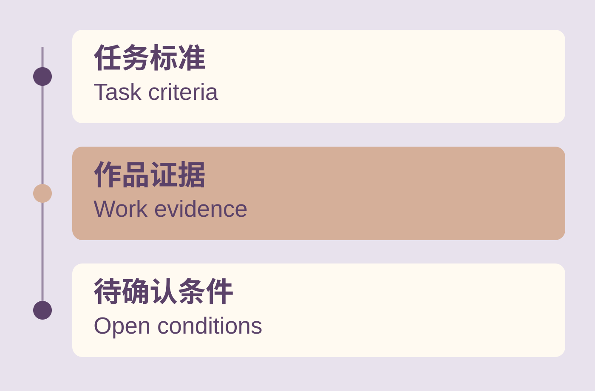

# Who Is the Best YouTuber for Your Brief?

Status: local review draft; confirm the publication date before release.

The best YouTuber depends on the assignment. Make weights and evidence visible so a team can understand changing preferences without presenting a subjective score as a universal verdict.

Who is the best YouTuber has no single answer for every brand assignment. Entertainment, product explanation and specialist experience can require different contributions; the largest channel is not automatically the best partner. Establish necessary conditions, compare task-relevant preferences from work evidence and check whether changing priorities changes the recommendation. This guide offers an editorial decision method and explicitly hypothetical arithmetic, without inventing scores for actual creators or presenting subjective ordering as an industry fact.

## Ask which assignment needs the best person

Complete the word best with a task: who can explain this use step, host this discussion or address a particular audience question through actual experience? Different assignments need not produce the same name.

The [brand-task shortlist guide](https://www.quickkol.com/blog/best-youtube-channels-brand-research-scorecard/#answer) explains building reasons for inclusion from work. This article addresses disagreements that remain after shortlisting, concentrating on how weights and evidence affect a recommendation.

Define the decision's scope, such as selecting an explanatory host rather than judging someone's entire professional ability. Not being chosen for this assignment does not establish poor content quality or a lack of long-term relevance.

Have the assignment owner confirm the objective so procurement, creative and business colleagues do not discover at the end that they were discussing three different partnerships. A shared question supports comparison better than a precise-looking total. It also gives the creator a fairer context if the brand later requests information: the request concerns a specific contribution, not proof of being universally superior.

## Keep necessary conditions outside a compensating score

Identity, availability, actual experience and particular production conditions may need confirmation before comparison. An unmet necessary condition cannot disappear because another preference scores highly.

[YouTube Data API’s channel definition](https://developers.google.com/youtube/data/reference/rest/v3/channels) helps establish the publishing identity, but a technical identifier does not prove contracting authority or personal participation. The actual parties must confirm who appears and who commits the deliverable.

Separate confirmed, awaiting confirmation and inapplicable conditions instead of scoring missing information as failure. Unknown availability can be the next question rather than a negative character assessment.

Establish that a meaningful comparison is possible before debating preferences. Otherwise a team can spend considerable effort on a total score before discovering that the selected candidate cannot perform an essential task or was researched through the wrong account. Necessary conditions also need an owner and a review point, so a provisional candidate does not quietly become fully confirmed merely because a spreadsheet has moved to its next tab.

## Return every judgment to actual work

Retain specific work evidence for judgments such as explanatory clarity, subject experience or adaptability. State where you looked, what you observed and which task the conclusion covers.

Do not infer ability from accent, appearance, age or identity labels, or assume that confident delivery establishes professional qualifications. A required qualification needs appropriate independent support.

[FTC’s influencer-disclosure guide](https://www.ftc.gov/business-guidance/resources/disclosures-101-social-media-influencers) emphasizes actual experience and substantiation in its United States context. A brand should not reward willingness to state any desired effect, or treat an experience that never happened as good expression.

Record work evidence separately from later collaboration conditions. Public content can demonstrate some performance without fully explaining feedback practice, internal production roles or availability; ask specific questions to confirm those points. This keeps the comparison connected to what a creator actually did while leaving space for new evidence, rather than making an attractive montage carry unsupported assumptions about every stage of a future assignment.

## Describe weights as the brand’s priorities

Weights express how much this assignment values a criterion, not a creator's objective worth. Explain why clarity, relevant experience or version adaptability matters before deciding whether numbers help.

If scoring is used, define the levels. One person's four should not merely mean what another person calls quite good; identical numbers otherwise describe different judgments.

Discuss priorities before viewing the final order so weights are not adjusted simply to support a preferred candidate. A genuine change in objectives can justify a revision, provided the reason and date remain visible.

Not every condition belongs in arithmetic. Essential facts, public-information limits and points requiring confirmation can remain in words instead of being forced into a total. Scoring supports discussion rather than removing responsibility. The team still needs to explain why the priorities fit the assignment and whether the available evidence is strong enough to use those priorities meaningfully, especially when a small numerical difference looks more decisive than the underlying observations.

A close comparison can remain tied or awaiting confirmation. There is no obligation to manufacture a precise winner when a specific follow-up conversation would resolve the decision better than more scoring.

## Use hypothetical arithmetic to expose changing priorities

For illustration only, suppose A scores five, three and two for explanatory clarity, context relevance and version adaptability, while B scores three, four and five. Neither the people nor the values represent actual creator assessments or benchmarks.

With weights of sixty, thirty and ten percent, A's weighted value is 4.1 and B's is 3.5. Changing the weights to twenty, thirty and fifty percent produces 2.9 for A and 4.3 for B.

The reversed order shows dependence on priorities, not that either person suddenly improved or deteriorated. Arithmetic cannot establish that the levels are reasonable or supply work evidence that does not exist.

Ask which priorities reflect the real assignment instead of choosing a formula that yields a preferred name. If the team still disagrees about the task, clarify the requirement rather than adding decimal places. The example demonstrates sensitivity, making a hidden preference visible so colleagues can discuss the actual trade-off before treating a ranking as a recommendation.

Scores express current priorities; check whether the recommendation survives a change in those priorities.

## Separate missing evidence from weaker performance

Unavailable audience information does not establish an unsuitable audience; the absence of a public example does not prove a task can never be performed. Retain evidence states instead of filling every unknown with zero.

[YouTube’s audience guide](https://support.google.com/youtube/answer/9314416?hl=en) notes that some information can be limited and gives different observation scopes for different audience views. Request appropriately relevant evidence rather than requiring every candidate to supply identical unrelated fields.

If a gap could change the decision, identify what is needed, who should confirm it and when to review again. If it does not affect this assignment, explain why it can remain open so research does not expand indefinitely.

One unanswered email should not become a claim of unprofessional conduct, and a third-party estimate should not become a creator-confirmed fact. State tracking lets the list update with new evidence instead of turning initial incompleteness into a permanent label. It also focuses follow-up on information capable of changing the recommendation rather than merely increasing document volume.

## Use disagreement to identify the actual trade-off

If creative colleagues value expression while business colleagues prioritize multiple versions, record their reasons and evidence separately. Simply averaging the views can conceal disagreement rather than resolve it.

First establish whether both groups are discussing the same deliverable. One clear principal film and a set of market adaptations may need different roles or production arrangements; one person need not receive the highest rating for everything.

The decision could be to confirm a condition, narrow the assignment or procure components separately. Not every disagreement needs to end by declaring one YouTuber absolutely best.

Retain the accepted trade-off in handover: for example, explanatory depth takes priority here while adaptation remains to be agreed. Later colleagues then understand the selection and do not reintroduce unpurchased scope during execution. A documented trade-off provides a more usable explanation than a total alone, because it connects the chosen contribution with the constraint the team knowingly accepted.

## Revisit the recommendation when the assignment changes

If the brand later adds a language, product or publishing form, the original weights and samples may no longer correspond. Retain the earlier decision and review affected components rather than making the earlier best a permanent purchasing conclusion.

The [comparable-channel research method](https://www.quickkol.com/blog/popular-youtube-channels-category-comparison/#answer) can help update sample boundaries without automatically establishing suitability for the new task. Assign reconfirmation to the appropriate owners.

Allow the creator to propose a more suitable expression too. Partnership is not necessarily a demand to reproduce an old piece admired by the researcher; it is a real contribution within an assignment both parties confirm.

If the recommendation changes, state whether the task, evidence or conditions changed. A clear explanation helps the team learn and prevents a business choice from becoming a comprehensive rejection of someone's ability. The process can remain consistent even when the chosen name differs, because consistency concerns the stated question and evidence standards rather than an obligation to preserve yesterday's order.

## Finish with an explainable choice

The final recommendation can identify whom to approach, which work supports the choice, the accepted trade-off and conditions still awaiting confirmation. A later approver should be able to follow the evidence and understand the judgment.

The creator-marketing answer to who is the best YouTuber concerns who can make the required contribution under current conditions, rather than who wins permanently on popularity, identity or a subjective total.

Retain priorities, evidence and unknowns so numbers support discussion and facts support conclusions. Do not apply the illustrative scores publicly to actual people or promise that selection guarantees views or sales.

This research helps a brand make a clearer invitation and lets the creator understand what is genuinely needed. Beginning with an explainable assignment makes a bounded partnership easier to discuss. The best outcome of the exercise is therefore a decision someone can inspect, question and update, with a specific next step rather than a universal title no evidence could justify.

## Hypothetical weighting sensitivity

| Item | A | B |
| --- | --- | --- |
| Clarity, hypothetical score | 5 | 3 |
| Context, hypothetical score | 3 | 4 |
| Adaptability, hypothetical score | 2 | 5 |
| Weights 60/30/10 | 4.1 | 3.5 |
| Weights 20/30/50 | 2.9 | 4.3 |

All people, scores and weights are editorial hypotheticals, not actual creators, platform standards or benchmarks; confirm necessary conditions separately.

## Make the best-choice reasoning reviewable

Use when the team disagrees about candidates.

- [ ] Define the contribution required now.
- [ ] Confirm necessary conditions separately.
- [ ] Retain work evidence for judgments.
- [ ] Explain whose priorities weights express.
- [ ] Change priorities to test the order.
- [ ] Hand over trade-offs, unknowns and next steps.

## Research date and limitations

Sources reviewed November 19, 2026. Methods, tables and decision rules are editorial recommendations. Hypothetical examples are not actual client results or industry benchmarks. Source geography and periods are specified where relevant.

## Start creator research with a clear task

Use QuickKOL to interpret a brief, discover relevant creators and research their work and contact routes. Verify data, commercial terms and outcomes at their source.

[Explore QuickKOL](https://www.quickkol.com/#capabilities)

## Sources

- [YouTube Data API’s channel definition](https://developers.google.com/youtube/data/reference/rest/v3/channels)
- [FTC’s influencer-disclosure guide](https://www.ftc.gov/business-guidance/resources/disclosures-101-social-media-influencers)
- [YouTube’s audience guide](https://support.google.com/youtube/answer/9314416?hl=en)
