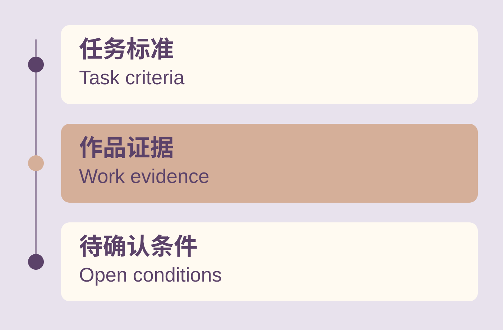

# 最佳 YouTuber 怎样按品牌任务判断

状态：本地审阅稿；正式发布日期待确认。

最佳 YouTuber 取决于任务。用明确权重和有限证据展示排序为何改变，让团队讨论取舍，而不是把主观总分包装成全球结论。

Who is the best YouTuber 没有适用于所有品牌任务的单一答案。娱乐、产品解释与专业经验可能需要不同贡献；最大的频道也不自动成为最佳合作对象。品牌应先确认必要条件，再用作品证据比较与任务有关的偏好，并检查改变权重后推荐是否变化。本篇提供编辑决策方法与明确标注的假设计算，不对真实创作者编造分数，也不把主观排序称为行业公认事实。

## 先问哪个任务需要最佳人选

把“最佳”补成完整问题：谁最适合解释这个使用步骤，谁最适合主持讨论，或谁能以真实经验回应某类观众疑问。不同任务不必产生同一个名字。

[YouTube 品牌任务筛选指南](https://www.quickkol.com/zh/blog/best-youtube-channels-brand-research-scorecard/#answer)说明如何从作品建立入围理由。本篇进一步处理团队入围后仍有分歧的情况，重点是权重与证据如何影响推荐。

写清这次决定的范围，例如选择解释主持者，而不是评价对方全部职业能力。某位创作者没有入选这次任务，不等于内容质量低或不值得长期关注。

让任务负责人确认目标，避免研究到最后才发现采购、创意和业务讨论的是三种不同合作。共同问题比一个看起来精确的总分更能支撑有效比较。

## 必要条件不要藏在可补偿的总分里

身份、可用档期、真实体验与特定制作条件，可能是必须先确认的事项。某项必要条件未满足时，不能因为另一个偏好分高就假装问题消失。

[YouTube Data API 的频道定义](https://developers.google.com/youtube/data/reference/rest/v3/channels)帮助确认研究对象身份，但技术标识不等于签约权或本人参与。需要谁出镜、谁承诺交付，仍由实际合作方确认。

将条件分成已确认、待确认与不适用，而不是把缺少资料直接记成失败。暂时不知道档期，可以成为下一步问题，不是负面人格评价。

先确认比较是否有意义，再讨论偏好。否则团队可能花很长时间争论一个总分，最后才发现入选者无法完成必需任务，或者推荐基于错误账号。

## 让每个判断回到实际作品

为解释清楚、主题经验或协作适应性等判断保留具体作品依据。写明看过哪里、观察到什么，以及结论只覆盖哪种任务。

不能仅因口音、外貌、年龄或身份标签推断能力；也不能因为表达自信就假定具备专业资格。需要的资格应另有适当证据。

[FTC 的达人披露指南](https://www.ftc.gov/business-guidance/resources/disclosures-101-social-media-influencers)强调美国语境下的真实体验与依据。品牌不应给“愿意说任何效果”的人更高分，也不能把没有发生过的体验当成优秀表达。

作品证据与后续合作条件分开记录。公开视频能说明部分表现，但通常不能完整解释反馈习惯、内部制作角色或可用时间，需要用具体问题向对方核实。

## 把权重写成品牌偏好

权重表达这次任务有多重视某项标准，不是创作者的客观价值。先说明为什么重视清楚解释、相关经验或版本适应，再决定是否需要数字化。

若使用评分，给每个档位写清含义。一个人的四分不能只是另一人的“感觉不错”，否则相同数字并不代表相同判断。

权重应在看到最终排序前讨论，避免为了支持喜欢的人而临时调整。确实需要改变目标时，可以更新，但保留理由与日期。

并非每项条件都适合量化。关键事实、公开资料限制与尚需对方确认的事项，可以用文字保留，不必强行折算进一个总分。评分是帮助讨论的工具，而不是消除责任的机器。

两位候选差距很小时，保留并列或继续核验也可以成立。不必制造一个精确胜者；下一次具体沟通可能比更多评分更能解决决定。

## 用假设数字看见偏好怎样改变排序

假设仅为演示，A 在解释清楚、情境相关、版本适应三项得分为五、三、二；B 为三、四、五。人物和数字都不是实际创作者评价或行业基准。

若权重为百分之六十、三十、十，A 的加权值为 4.1，B 为 3.5。若改成百分之二十、三十、五十，则 A 为 2.9，B 为 4.3。

排序改变说明决定依赖任务优先级，不说明任何人突然变好或变差。计算本身不能证明档位合理，也不能补齐不存在的作品依据。

团队应问哪组偏好对应真实任务，而不是挑选能产生想要名字的公式。若对任务本身仍无共识，下一步是澄清需求，不是添加更多小数位。

评分表达本次偏好；改变任务优先级后，应检查推荐是否仍成立。

## 将缺少资料与表现较弱分开

没有受众资料，不等于受众不适合；没有公开某种作品，也不等于永远无法完成。记录证据状态，避免将未知统一填零。

[YouTube 的受众说明](https://support.google.com/youtube/answer/9314416?hl=en)提醒部分资料可能有限，也为不同受众信息保留不同观察范围。品牌应询问与任务有关的适当资料，不要求每位候选提供完全相同的无关字段。

若缺口会改变决定，写清补什么、向谁核对、何时再看。若缺口不影响本次任务，就说明为何暂时不需要，避免研究无限扩大。

不能将未回复一次邮件直接写成不专业，也不能将第三方估计当作创作者确认事实。保留状态能让名单随着新证据更新，而不是让第一次资料不足变成永久标签。

## 用分歧记录找到真正的取舍

如果创意团队更看重表达，业务团队更看重多版本交付，可以分别写清理由与依据。不要简单取平均后假装已经有共识。

先看双方是否在讨论相同交付。一次清楚的主片与一组市场改编，可能需要不同角色或制作安排，不必由一个人同时获得全部最高评价。

决定也可以是先核验条件、缩小任务或分开采购。不是每次分歧都要通过宣布某位 YouTuber 绝对最佳来结束。

交接时保留被接受的取舍，例如这次优先解释深度，版本改编另行确认。这样后续团队理解为什么选人，也不会在执行阶段重新加入已决定不购买的范围。

## 任务改变后重新核对推荐

如果品牌后来增加语言、产品或发布形式，原权重与作品样本可能不再对应。保留原决定并复核受影响部分，不把早先的“最佳”变成永久采购结论。

[同类频道比较方法](https://www.quickkol.com/zh/blog/popular-youtube-channels-category-comparison/#answer)可以帮助更新样本边界，但不能自动证明新任务适合。需要重新确认的条件应由相应负责人处理。

也允许创作者提出更合适的表达方式。合作不是要求对方严格复刻研究者看中的旧作品，而是在双方确认的任务里完成真实贡献。

若推荐最终改变，写明是任务、证据还是条件变化。清楚原因有助于团队学习，也避免把业务选择误写成对某位创作者能力的全面否定。

## 以可解释的选择结束研究

最终建议可以是一句话，说明这次选谁、依据哪些作品、接受什么取舍，以及哪些条件仍待确认。后续审批者应能沿着资料理解判断。

Who is the best YouTuber 的达人营销答案，是谁能在当前条件下完成所需贡献，而不是谁在人气、身份或主观分数上永久胜出。

保留权重、证据与未知，让分数服务讨论，让事实支持结论。不要把假设评分用于公开评价真实个人，也不承诺选择后必然获得观看或销售。

这种研究能帮助品牌提出更清楚的合作邀请，也让创作者知道对方真正需要什么。双方从可解释的任务开始，才更容易形成范围明确的实际合作。

## 假设权重的敏感性演示

| 项目 | A | B |
| --- | --- | --- |
| 解释清楚，假设分 | 5 | 3 |
| 情境相关，假设分 | 3 | 4 |
| 版本适应，假设分 | 2 | 5 |
| 权重 60/30/10 | 4.1 | 3.5 |
| 权重 20/30/50 | 2.9 | 4.3 |

全部人物、分数与权重均为编辑假设，不代表真实创作者、平台标准或行业基准；必要条件仍须单独确认。

## 写出能被复核的最佳选择

在团队对候选有分歧时使用。

- [ ] 限定这次需要的贡献。
- [ ] 单独确认必要条件。
- [ ] 为判断保留作品依据。
- [ ] 说明权重代表谁的偏好。
- [ ] 改变优先级检查排序。
- [ ] 交接取舍、未知与下一步。

## 研究日期与使用边界

资料核验于 2026 年 11 月 19 日。文中方法、表格和决策规则为编辑建议，标为假设的示例不是实际客户结果或行业基准。外部资料的适用地区与时期按各段说明。

## 从任务开始达人研究

用 QuickKOL 理解 Brief、发现相关达人并研究作品与联系路径；数据、合作条件和结果仍需核验。

[了解 QuickKOL](https://www.quickkol.com/#capabilities)

## 来源

- [YouTube Data API 的频道定义](https://developers.google.com/youtube/data/reference/rest/v3/channels)
- [FTC 的达人披露指南](https://www.ftc.gov/business-guidance/resources/disclosures-101-social-media-influencers)
- [YouTube 的受众说明](https://support.google.com/youtube/answer/9314416?hl=en)
