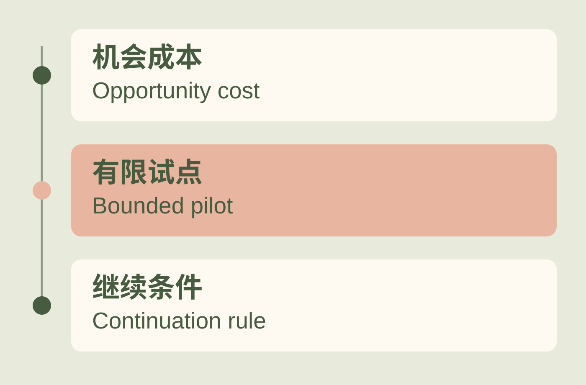

# Is Bluesky Worth a Creator Partnership Pilot?

Status: local review draft; confirm the publication date before release.

Decide whether a Bluesky creator partnership is worth the work by recording additional production, fact review, responses and coordination, alongside what those resources would otherwise complete.

Is Bluesky worth it has no universal answer for creator marketing. A bounded pilot may be worth discussing when a relevant creator can supply a useful explanation and the brand can support facts and responses. Record the additional work and what it displaces as well. Platform scale, one popular post or an existing account cannot independently settle the decision. This guide uses explicitly hypothetical working-time records to compare effort without forecasting income or treating all roles as interchangeable resources.

## Turn worth it into a particular decision

Define the decision: whether to research creators, commission one explanation or establish continuing content. These require different evidence and effort, so one broad platform verdict cannot answer all three.

The [Bluesky channel-fit method](https://www.quickkol.com/blog/what-is-blue-sky-kol-channel-fit/#answer) examines the relationship between task and channel. This article adds the workload and opportunity cost behind the decision, avoiding an automatic move from possible to worth doing now.

State what the team wants to learn and which next step could change. If continuation is certain whatever happens, the pilot is not genuinely informing a decision and its purpose needs clarification.

An existing account does not make additional work free. Past preparation can supply context, while the current assignment still needs accurate facts, creator contribution and a responsible response arrangement. The choice concerns what this task requires now, rather than an obligation to keep investing because an account was opened or an earlier discussion expressed enthusiasm about the network.

## Identify what would happen without this assignment

Opportunity cost is not merely everyone is busy; identify the work this time would otherwise complete, such as updating an existing creator video, improving a product explanation or resolving an established partnership question.

Choose a genuine feasible alternative and retain its task and resource conditions. Do not use an unprepared option nobody would execute as a foil, or force different objectives into one outcome unit.

Creator and brand time also need separate interpretation. Some roles cannot substitute for others; if a fact owner has only one available slot, an option with fewer total hours may still be unworkable.

State which work would be delayed so the decision-maker can accept the actual trade-off. Comparison does not presume the new channel lacks value; it makes the reason for any investment explainable. A concrete alternative also helps the team see whether the question concerns channel choice, a missing staff role or a deadline that would constrain either option regardless of platform.

## Separate additional work by responsibility

Record creator preparation and production, brand fact review, public responses and coordination. Use categories suited to this assignment rather than presenting them as an industry standard.

[Bluesky’s user FAQ](https://bsky.social/about/blog/5-19-2023-user-faq) describes a public network, reminding the team that discussion occurs publicly. Confirm the actual response arrangement instead of assuming a short post creates no follow-up work.

Separate additional work from tasks already required. Product material prepared for another piece may reduce repeated preparation, but its current version and market still need checking before use.

Retain estimates and actual records with sources and owners. Estimates support planning and actuals support learning; do not remove extra work retrospectively to make the initial choice look correct. The record can remain lightweight, provided another colleague can tell which hours were newly required by this option and which were shared with an assignment the team would have carried out anyway.

## Shared preparation does not make every adaptation free

A subject can share factual research while expression, creator experience and public context require new work. Converting a video into text does not automatically eliminate adaptation effort or use questions.

[Bluesky’s custom-feed explanation](https://bsky.social/about/blog/7-27-2023-custom-feeds) describes different reading routes. Discovery through one feed does not establish stable distribution, and its popularity cannot replace evidence for this assignment.

Ask the creator which references can be reused and which expression needs reorganization. Product version, relationships and follow-up also need appropriate review rather than being omitted because the piece is short.

Shared preparation may reduce additional effort, but identify what is actually shared. Do not count one research period twice across options or assign zero to everything unrecorded. This keeps comparison balanced: neither exaggerating the cost of trying a channel by charging it for all existing knowledge, nor making the trial appear effortless by ignoring the new work needed to express that knowledge accurately in another setting.

## Include relationship clarity and response work in planning

[FTC’s influencer-disclosure guide](https://www.ftc.gov/business-guidance/resources/disclosures-101-social-media-influencers) emphasizes clear commercial relationships and actual experience in its United States context. Preparing and reviewing that context is real work rather than an unexpected burden to add after publication.

The [Bluesky public-explanation method](https://www.quickkol.com/blog/bluesky-creator-public-conversation-context/#answer) discusses posts, replies and quotations. If replies belong in the pilot, specify period and question types, assigning brand fact ownership instead of giving the creator all maintenance.

Some work may emerge during the trial, such as a product question needing another reference. Allow reasonable discussion without guaranteeing no additional time will be required.

If resources are insufficient, narrow or postpone the task rather than require unlimited creator availability to cover an internal gap. The ledger should reflect a feasible arrangement instead of hiding work to make the plan attractive. This also clarifies which observed workload belongs to the channel and which arose because the brand had not prepared a fact needed by any version of the content.

## Use a hypothetical six-hour example to expose allocation

Suppose each option requires six additional person-hours. Option A, a Bluesky explanation, uses two creator hours, one fact-review hour, two response hours and one coordination hour. Option B, an existing-channel update, uses three, two, one and zero respectively.

These are editorial assumptions, not platform prices, efficiency benchmarks or client records. Zero for B means no additional coordination in this scenario, not that the channel never requires coordination.

Equal totals still allocate roles differently. If the product owner has one hour, B may need rescheduling; a creator with only two hours creates another constraint. The total alone cannot establish a tie or winner. Person-hours are also different from elapsed calendar time, which can include parallel work and waiting.

Ask what each six-hour option completes and which task is delayed. Without outcome evidence, do not multiply time by an imagined earnings rate to claim a higher platform return. The example makes a resource choice visible while preserving the distinct work and uncertainty behind it, rather than pretending an hour total measures impact.

Compare actual work and its alternative without treating platform scale or total hours as return.

## Give the pilot conditions that can change the decision

Before beginning, state which evidence could support continuation, narrowing or stopping: whether the question was explained, responses could be handled or a contribution deserved further discussion.

These are conditions for this decision, not universal success thresholds. Do not select whichever number increased afterwards and declare value, or reject the entire platform and every creator because one result was weaker.

Decide how unavailable evidence will be handled. Add an appropriate source or acknowledge that the pilot cannot answer a question rather than filling it with assumed income.

Match the decision to actual control. The brand can define work, check facts and maintain a route without guaranteeing participation, distribution or commercial outcomes. Retain those differences when evaluating worth. A pilot is useful when it reduces a relevant uncertainty enough to inform the next allocation, not simply when it creates activity that can be placed in a report and labelled evidence of success.

## Update the ledger when actual effort becomes known

After the pilot, use actual work to explain where estimates were accurate and what they omitted. Record extra replies, fact gathering and version changes separately so one total does not hide the cause.

Without sufficient outcome information, the team can still assess completion and resource feasibility. Unmeasured income is not zero income, and unknown value is not verified high value.

Identify which new evidence would actually change the allocation. If the team demands information unavailable in the alternative channel too, the gap may concern the overall study design rather than Bluesky itself. Revise that question before buying more trial content; otherwise additional work can grow without reducing the uncertainty that supposedly justified the pilot.

Compare whether alternative work was genuinely delayed and whether another arrangement is possible next time. Update assumptions rather than preserving the same hours indefinitely to defend the original choice.

Give the conclusion to the person responsible for resource allocation. Creators provide relevant work records and brands explain internal effort without expanding the task into unrelated personal time surveillance. The ledger should resolve a collaboration question, not become a general demand to justify every hour in someone's day. This keeps measurement proportionate while making the next decision more informed than the first.

## Answer worth it through contribution and trade-offs

An answer to is Bluesky worth it should identify the task, resources and accepted trade-off. Platform descriptions and popular conversations offer context without replacing evidence for this decision.

Continue narrowly if a relevant creator can provide a genuine explanation and the brand can support facts and responses. If conditions are unready, reduce or postpone the task without a permanent good-or-bad verdict about the platform.

Retain additional work, shared preparation and displaced tasks so later colleagues understand the commitment. Label assumptions and leave insufficiently supported outcomes open.

This keeps the decision centred on creator marketing: whether a contribution addresses a real question, whether the brand can support it and how the next work allocation should proceed, rather than increasing content merely to follow another channel. Worth becomes an explainable choice under current conditions, with a clear reason to revisit it when evidence, capacity or the assignment changes.

## Hypothetical additional person-hours

| Work | A: Bluesky explanation | B: existing-channel update |
| --- | --- | --- |
| Creator | 2 hours | 3 hours |
| Fact review | 1 hour | 2 hours |
| Responses | 2 hours | 1 hour |
| Additional coordination | 1 hour | 0 hours |
| Total | 6 person-hours | 6 person-hours |

All hours are editorial assumptions, not prices, benchmarks, an actual project or outcome forecasts; confirm each role’s capability and availability separately.

## Record an investment of work worth discussing

Use before starting and before deciding whether to continue.

- [ ] Define the decision and learning question.
- [ ] Identify the real alternative work.
- [ ] Separate additional and shared preparation.
- [ ] Retain role capacity and assumptions.
- [ ] Update estimates with actual work.
- [ ] Explain trade-offs and next conditions.

## Research date and limitations

Sources reviewed November 19, 2026. Methods, tables and decision rules are editorial recommendations. Hypothetical examples are not actual client results or industry benchmarks. Source geography and periods are specified where relevant.

## Start creator research with a clear task

Use QuickKOL to interpret a brief, discover relevant creators and research their work and contact routes. Verify data, commercial terms and outcomes at their source.

[Explore QuickKOL](https://www.quickkol.com/#capabilities)

## Sources

- [Bluesky’s user FAQ](https://bsky.social/about/blog/5-19-2023-user-faq)
- [Bluesky’s custom-feed explanation](https://bsky.social/about/blog/7-27-2023-custom-feeds)
- [FTC’s influencer-disclosure guide](https://www.ftc.gov/business-guidance/resources/disclosures-101-social-media-influencers)
