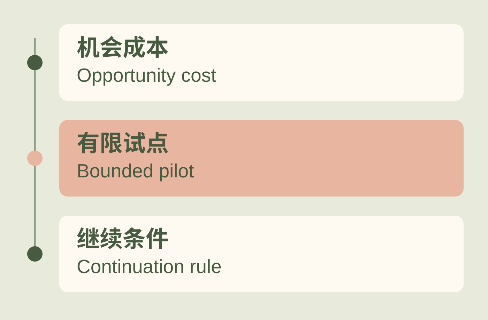

# Bluesky 是否值得做达人合作试点

状态：本地审阅稿；正式发布日期待确认。

判断 Bluesky 是否值得做达人合作，要把新增制作、事实审阅、回应与协调时间算清，再说明同一批资源原本可以完成什么。

Is Bluesky worth it 对达人营销没有统一答案。若一位相关创作者能在这里完成观众真正需要的解释，品牌有事实与回应支持，可以讨论有限试点；但应同时记录新增工作与被挤占的其他任务。平台用户规模、一次热帖或已有账号，都不能独自回答是否值得。本篇用明确假设的工时记录帮助比较投入，不预测收入，也不将时间总量当作所有角色都可以互换的资源。

## 把值得改成一个具体决定

先说清准备决定什么：是否研究创作者、是否委托一次解释，还是是否持续安排内容。三种决定需要的资料与投入不同，不能用一个笼统平台评价回答。

[Bluesky 渠道适配方法](https://www.quickkol.com/zh/blog/what-is-blue-sky-kol-channel-fit/#answer)讨论任务与渠道的关系。本篇进一步查看决定背后的工作量与机会成本，避免把“可以做”自动改写成“现在值得投入”。

写出这次希望学到的问题与可能改变的下一步。如果无论结果如何都会继续，试点就没有真正承担决策作用，需要先澄清目的。

已有账号也不代表新增工作免费。过去准备可以作为背景，但当前仍需要准确事实、创作者贡献与有人负责的回应安排；是否投入取决于这次实际需要什么。

## 明确不做这项工作时会做什么

机会成本不是一句“大家很忙”，而是这段时间原本可以完成的具体工作。例如更新现有达人视频、补充商品说明或处理已有合作问题。

选择一个真实可比替代方案，保留任务与资源条件。不要拿一个没有准备、根本不会执行的方案作陪衬，也不把两个不同目标的结果硬算成同一单位。

创作者与品牌各自的时间需要分别理解。有些角色不能替换，某位事实负责人只有一个空档时，总工时较少的方案也可能仍不可执行。

把被延后工作写清楚，决定者才能接受实际取舍。比较不是为了证明新渠道一定不值得，而是让任何投入都有能说明的理由。

## 把新增工作按责任分列

记录创作者准备与制作、品牌事实审阅、公开回应与协调。用适合本次任务的分类，不把这些栏目宣传成行业标准。

[Bluesky 的用户问答](https://bsky.social/about/blog/5-19-2023-user-faq)说明其公开网络性质，提醒团队讨论会面向公开环境。实际回应安排要按任务确认，不因为发布一条短帖就假定后续没有工作。

区分新增与本来就要做的工作。已经为另一条内容完成的产品资料，可以减少某些重复准备，但使用前仍需核对当前版本与市场。

记录估计与实际，来源和责任人一起保留。估计用于计划，实际记录用于学习，不应为了让原决定显得正确而事后把额外工作移出表格。

## 共享准备不等于全部内容可以免费复制

同一主题可以共享事实研究，但文字表达、创作者经验与公开语境可能需要新的工作。不要把已拍视频直接改成帖文，就假定没有改编成本或使用问题。

[Bluesky 的自定义信息流说明](https://bsky.social/about/blog/7-27-2023-custom-feeds)介绍不同阅读入口。内容被某个流发现，不代表获得稳定分发；品牌不能用一个入口的热度替代本次任务的证据。

让创作者说明哪些资料可复用、哪些表达需要重新组织。商品版本、关系与后续回应也需要适当审阅，不因文字短就省略。

共享部分可以降低新增工作，但要明确到底共享了什么。不把同一段研究时间重复计入两个方案，也不把所有未记录部分一律当作零。

## 计划商业说明与回应工作

[FTC 的达人披露指南](https://www.ftc.gov/business-guidance/resources/disclosures-101-social-media-influencers)在美国语境下强调清楚商业关系与真实体验。解释这些背景需要准备和审阅，不应被当作发布后才补的额外负担。

[Bluesky 公开解释方法](https://www.quickkol.com/zh/blog/bluesky-creator-public-conversation-context/#answer)讨论原帖、回复与引用语境。若试点包含回应，就明确时期与问题类型，安排品牌事实负责人，不将全部维护交给创作者。

有些工作可能在试点期间才显现，例如商品问题需要补资料。可以预留合理讨论空间，但不凭空保证一定没有额外时间。

如果资源不足，可以缩小任务或暂缓，而不是让创作者无限在线来补齐内部缺口。成本记录应反映真实可执行安排，不以隐藏工作换取漂亮计划。

## 用假设六小时看见资源分配

假设可比较的新增工作均为六个人时。方案 A 为 Bluesky 解释：创作者两小时、事实审阅一小时、回应两小时、协调一小时；方案 B 为现有渠道更新：分别为三、二、一、零小时。

这些是编辑假设，不是平台价格、行业效率或实际客户记录。方案 B 的零指这次没有新增协调，不代表该渠道从来不需要协调。

总数相同，角色分配却不同。品牌事实负责人若只有一小时，方案 B 可能需要重新安排；创作者若只能提供两小时，也有不同约束。不能仅按总数宣布平手或最佳。个人时也不是从开始到结束的日历时间，并行工作和等待会让两者不同。

还要问六小时分别完成什么，以及哪项任务被延后。没有结果证据时，不把小时乘一个想象收益率，宣称某个平台回报更高。

比较实际工作与替代任务，不把平台规模或总工时直接当成回报。

## 为试点写可改变决定的条件

在开始前说明什么资料会支持继续、缩小或停止。例如目标问题是否得到解释，实际回应是否可承接，是否发现值得再讨论的创作者贡献。

这些是本次任务的决策条件，不是通用成功门槛。不要事后挑一个增加的数字就宣布值得，也不以一次较弱表现否定整个平台或所有创作者。

预先说明资料无法取得时怎么办。可以补充一个适当来源，也可以承认试点不能回答某个问题，而不是用推测收入填补。

让决定对应实际控制范围。品牌可以安排清楚工作、核对事实与维护路径，但不能保证观众参与、平台分发或商业结果。判断应保留这几项差异。

## 实际投入出来后更新记录

试点结束后，用实际工作说明估计哪里准确、哪里遗漏。额外回应、补资料与版本修改分开记录，避免一个总时间掩盖真正原因。

如果作品未产生足够结果资料，仍可评价任务完成与资源可行性。不要将没有测到收入改写成收入为零，也不将未知称为已经证实的高价值。

同时说明哪项新资料真正会改变投入决定。如果需要另一个渠道也无法提供的证据，问题可能属于整体研究设计，而不是 Bluesky 本身；下一步先修正问题，不盲目增加试点内容。

再比较替代工作是否真的被延后，以及下次有没有不同安排。原先假设可以更新，不必为了维护第一次决定而永远采用相同小时数。

将结论交给有权分配资源的人。创作者提供自己完成的工作记录，品牌说明内部投入；双方资料不需要被扩为无关个人时间监控。

## 从贡献与取舍判断是否值得

Is Bluesky worth it 的答案，应说明对什么任务、用什么资源、接受什么取舍。平台介绍和热门讨论可以提供背景，不能替代这次决定的证据。

如果相关创作者能完成真实解释，品牌也能支持事实和回应，可以有范围地继续。若条件未准备好，可以缩小或暂缓，不必作永久平台好坏判断。

保留新增工作、共享准备和被延后任务，后续团队才知道投入意味着什么。任何假设都明确标注，结果不足处保持开放。

这样判断持续围绕达人营销：创作者贡献是否解决真实问题，品牌是否有能力支持，以及下一步怎样合理分配工作，而不是仅为追赶一个新渠道增加内容数量。

## 假设新增个人时比较

| 工作 | A：Bluesky 解释 | B：现有渠道更新 |
| --- | --- | --- |
| 创作者 | 2 小时 | 3 小时 |
| 事实审阅 | 1 小时 | 2 小时 |
| 回应 | 2 小时 | 1 小时 |
| 新增协调 | 1 小时 | 0 小时 |
| 合计 | 6 个人时 | 6 个人时 |

全部工时为编辑假设，不是价格、行业标准、实际项目或结果预测；角色能力与可用时间仍分别确认。

## 记录一次值得讨论的投入

在决定试点和继续前各用一次。

- [ ] 限定当前决定与要学的问题。
- [ ] 写明实际替代工作。
- [ ] 分列新增与共享准备。
- [ ] 保留角色容量与假设。
- [ ] 用实际工作更新估计。
- [ ] 说明取舍与下一步条件。

## 研究日期与使用边界

资料核验于 2026 年 11 月 19 日。文中方法、表格和决策规则为编辑建议，标为假设的示例不是实际客户结果或行业基准。外部资料的适用地区与时期按各段说明。

## 从任务开始达人研究

用 QuickKOL 理解 Brief、发现相关达人并研究作品与联系路径；数据、合作条件和结果仍需核验。

[了解 QuickKOL](https://www.quickkol.com/#capabilities)

## 来源

- [Bluesky 的用户问答](https://bsky.social/about/blog/5-19-2023-user-faq)
- [Bluesky 的自定义信息流说明](https://bsky.social/about/blog/7-27-2023-custom-feeds)
- [FTC 的达人披露指南](https://www.ftc.gov/business-guidance/resources/disclosures-101-social-media-influencers)
