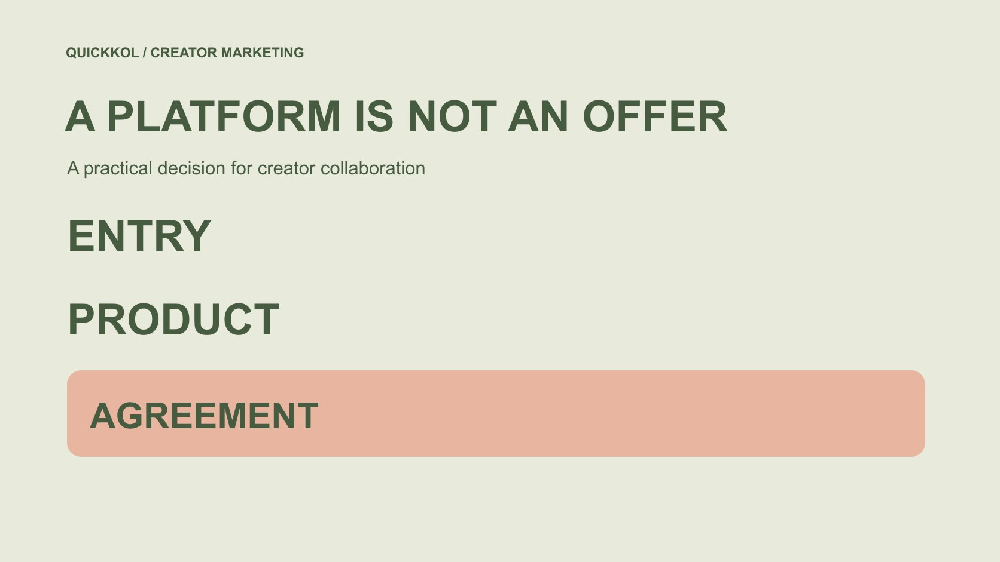
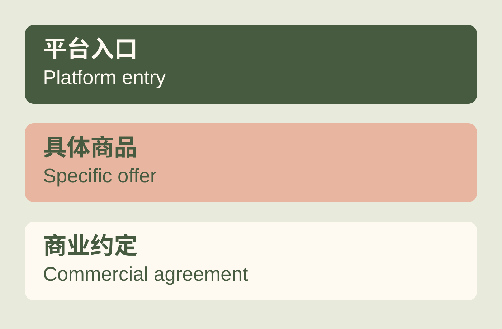

# ClickBank.com: Map a Creator Offer Route

Status: local review draft; confirm the publication date before release.

ClickBank.com is a platform entry, not automatically the destination for every creator product piece. Define the viewer’s next action, then check seller pages, affiliate links and the actual arrangement.

QuickKOL editorial graphic; not actual account metrics or a platform interface.

ClickBank.com is the official entry to ClickBank’s e-commerce platform and affiliate marketplace. Brands can use it to understand roles, but viewers finishing a creator piece about a particular product should not automatically be sent to the platform homepage. Confirm the seller, product version and intended next action before the appropriate owner supplies and checks the actual route. HopLinks, seller landing pages and payment links have different functions; a working link does not establish content approval, a purchase or creator earnings.

## Distinguish the platform entry from the viewer destination

[ClickBank’s official homepage](https://www.clickbank.com/) describes an e-commerce platform and affiliate marketplace with different seller and affiliate routes. A brand can begin research there, but the homepage may not explain the particular product shown in a creator's piece.

Define the next action: learn about a version, read product conditions or enter a confirmed purchase route. Different invitations need different destinations instead of one platform link pasted into every publication.

The [ClickBank offer-review guide](https://www.quickkol.com/blog/clickbank-brand-affiliate-offer-review/#answer) helps establish product and role. Here the focus is the subsequent handoff: does a click supply the information promised by the spoken invitation?

Official references in this article serve verification, without our affiliate promotion or earnings promise. A brand's own content should likewise explain its actual relationship instead of using the authority of a platform entry as independent quality endorsement for one product. This keeps the route connected to the viewer's question rather than the internal place where the partnership team began its research.

## Assign ownership of the particular product route

Identify who supplies the final destination, confirms product facts and can approve a required change. The creator should not choose an apparently matching search result as the official route.

Retain seller, product version, market and known conditions. If the page differs from the sample, resolve the discrepancy instead of leaving the voiceover on the original version and expecting viewers to work it out.

Brands, agencies and affiliates may hold different information and need a shared handoff. Supplying a URL does not establish authority to promise every product, commission or asset-use condition.

Assign a next step for unresolved points. Route preparation does not require readers to order, create an account or submit credentials through this article; it requires the right person to confirm the purpose and state. That prevents a creator from guessing business facts and gives later reviewers a contact for a destination question instead of sending every correction back to the person on camera.

## Understand what a HopLink does and does not establish

[ClickBank’s HopLink explanation](https://support.clickbank.com/en/articles/10535280-how-do-i-create-a-hoplink) describes an affiliate tracking URL that sends potential customers to a seller landing page and identifies a referrer for commission purposes. It is not content permission or a performance guarantee.

Have the appropriate party supply the actual link and confirm its product and affiliate identity. Do not copy someone else's example into a real publication, or skip destination review because a shortened display looks tidy.

Structure and display can vary, while the review still concerns the actual route and arrangement. Opening a page establishes reachability on that occasion, not perpetual availability or automatic credit for every future order.

Keep technical routing, the commercial relationship and content approval separate. A HopLink can belong to a correct arrangement that still needs genuine work, accurate product explanation and explicit agreement. This distinction helps a creator understand why receiving a functioning URL is only one preparation step, rather than evidence that the entire assignment is ready to publish or that its income outcome has already been secured.

## Do not confuse affiliate parameters with payment routes

[ClickBank’s affiliate tracking-parameter guide](https://support.clickbank.com/en/articles/10535262-affiliate-tracking-parameters) describes labels for source, campaign and creative, explicitly stating that these parameters apply to HopLinks and Direct Tracking Links rather than payment links. Adding text to any URL does not establish tracking.

For a brand team, names should match actual work. Coordinate campaign, creative version and source labels so the same asset does not acquire contradictory identities across documents.

This article supplies no ready-to-use account link or instruction to alter a production route. Appropriate owners generate and verify particular links through the official process.

A parameter is a recording arrangement rather than causal evidence. It can help distinguish labelled routes without explaining why someone bought or proving no other encounter influenced the decision. Keep the label definition in the handover so a later analyst knows whether it describes the intended source, the creative version or another agreed category, rather than inferring its meaning from a short code alone.

An entry begins research; the particular destination and agreement define how this content continues.

## Make the spoken promise survive arrival

When the creator invites viewers to examine a template, course or product, the destination should continue that explanation. A clear piece should not lead to a generic page where people must guess which item it concerns.

Check the version, what is supplied and important conditions, particularly statements already made in the work. When the page changes, the product owner should confirm whether the original voiceover remains accurate.

The [creator product-information path method](https://www.quickkol.com/blog/instagram-creator-commerce-question-to-product/#answer) reviews demonstration, facts and destination together. The same applies to ClickBank offers: correct link ownership does not establish support for every claim on the landing page.

If a discrepancy cannot yet be resolved, narrow the invitation or hold release instead of concealing the changed route. Viewers should understand where they are going and how it relates to the piece. This is a content-quality question as well as a routing question, since an accurate link to the wrong promise can still leave the overall recommendation misleading or unhelpful.

## A less visible link does not erase the relationship

[FTC’s influencer-disclosure guide](https://www.ftc.gov/business-guidance/resources/disclosures-101-social-media-influencers) emphasizes clear material relationships in its United States context. Affiliate interest, a fee or a gift does not become irrelevant because a link is shortened, moved or placed in a profile.

Confirm wording appropriate to the actual format and market. Viewers should not need to decode a complex URL to understand a possible relationship, and a platform name is not a complete disclosure.

Preserve actual experience too. Receiving an affiliate link does not prove personal use, and possessing an account does not authorize invented product effects.

This does not require public content to contain every technical detail. Viewers need understandable context and product information while the internal team retains fuller link, version and agreement records. Public expression and internal handoff can have different appropriate depths. A concise explanation can remain clear without exposing account identifiers, and a technically detailed internal worksheet cannot compensate for an ambiguous recommendation that leaves the audience unaware of the relationship.

## Hypothetical case: the next step after a template introduction

Imagine a creator introducing design templates while the proposal says only visit ClickBank.com. The brand later establishes that viewers need files and compatibility information for a particular version rather than a platform-registration entry.

This editorial example contains no actual affiliate link or order. The owner supplies the matching seller page and arrangement, the team aligns voiceover, captions and route, and unresolved conditions remain visible.

If an affiliate link is used, confirm labels and relationships separately instead of treating reachability as established earnings. The creator still needs actual experience rather than reading the page as a personal success story.

After release, review route records, content responses and available transaction information separately. The example reduces navigation confusion without guaranteeing a purchase or fixed commission. It demonstrates a better handoff: the content promise names a specific next step, and the route owner can explain why that destination fulfils it rather than relying on the general familiarity of the platform domain.

## Retain versions and confirmation when routes change

When the product, campaign or link arrangement changes, update affected content and record confirmation. Do not silently replace a destination while retaining inapplicable spoken claims and data labels.

Keep the earlier route's internal state and replacement time to explain historical observations. A new link does not transfer earlier views automatically into the new arrangement or rewrite visits that already occurred.

If additional content, voiceover or use is required, discuss actual scope again. Route maintenance should not automatically become unlimited creator revisions, or preserve a recommendation after the product changes without the person's confirmation.

Plan checks according to the partnership's actual needs without pretending there is continuous monitoring. A defined owner and current version are usually more workable than promising that a route will never change. They also let someone respond when a viewer reports a mismatch, with enough context to determine whether the content, destination or reference needs correction. This keeps maintenance practical and proportionate to the agreement.

## Turn the domain query into a clear content route

ClickBank.com helps a brand enter platform research, while a particular creator partnership needs a product, route and actual agreement. The homepage, affiliate URL and payment entry have different functions rather than replacing one another.

Define the viewer's next action, have the appropriate owner confirm product and routing, and preserve actual experience and clear relationships. Interpret tracking by its definitions instead of calling a label proof of influence.

Hand over the current version, owner and open conditions so later colleagues can maintain the route. An accessible URL is a beginning, not every approval, permission or earnings outcome.

This keeps a navigational keyword connected to creator marketing: viewers receive a sensible destination, creators know what invitation they can make and brands decide around the actual task instead of mechanically appending one platform domain to every piece. The final route should be explainable by its purpose and evidence, with commercial results left to appropriately scoped records rather than assumed from technical reachability.

## Different functions of four routes

| Route | Main question | Does not prove |
| --- | --- | --- |
| Platform homepage | Understand roles and platform | Particular product fit |
| Seller page | What product and conditions? | Every claim is supported |
| HopLink | Destination and affiliate source | Content approval or received income |
| Payment entry | Actual transaction route | Any tracking parameter works |
| Internal record | Version, owner and scope | Guaranteed future outcome |

Editorial route review; no actual affiliate link is generated, transaction performed or attribution or earnings promised.

## Confirm the actual destination before release

Make the invitation, product and route work together.

- [ ] Define the viewer’s next action.
- [ ] Confirm seller and product.
- [ ] Have the right owner supply the route.
- [ ] Separate affiliate and payment links.
- [ ] Check facts, relationships and labels.
- [ ] Hand over the current version and change owner.

## Research date and limitations

Sources reviewed November 19, 2026. Methods, tables and decision rules are editorial recommendations. Hypothetical examples are not actual client results or industry benchmarks. Source geography and periods are specified where relevant.

## Start creator research with a clear task

Use QuickKOL to interpret a brief, discover relevant creators and research their work and contact routes. Verify data, commercial terms and outcomes at their source.

[Explore QuickKOL](https://www.quickkol.com/#capabilities)

## Sources

- [ClickBank’s official homepage](https://www.clickbank.com/)
- [ClickBank’s HopLink explanation](https://support.clickbank.com/en/articles/10535280-how-do-i-create-a-hoplink)
- [ClickBank’s affiliate tracking-parameter guide](https://support.clickbank.com/en/articles/10535262-affiliate-tracking-parameters)
- [FTC’s influencer-disclosure guide](https://www.ftc.gov/business-guidance/resources/disclosures-101-social-media-influencers)
