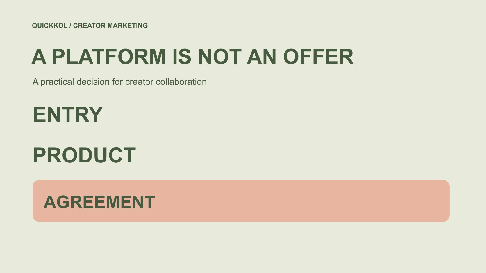
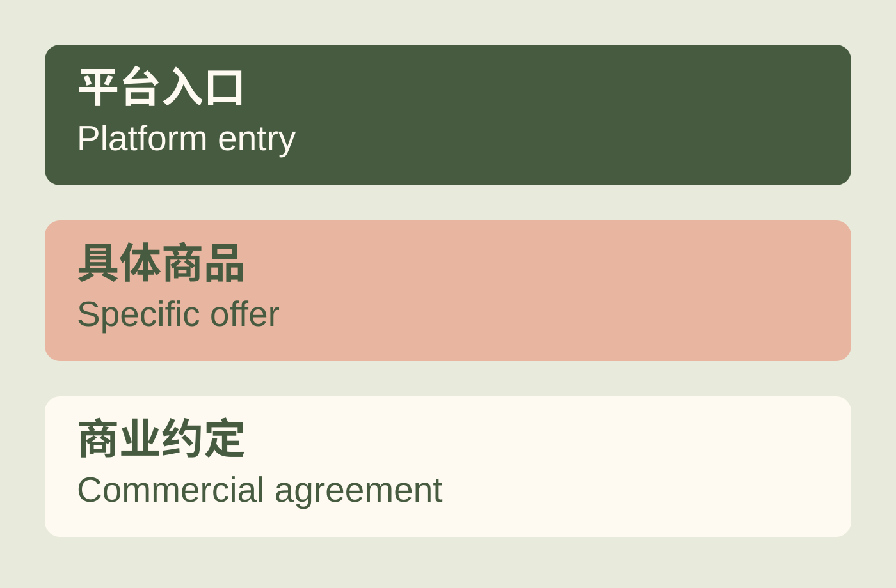

# ClickBank 入口怎样接入达人合作

状态：本地审阅稿；正式发布日期待确认。

ClickBank.com 是平台入口，不应自动成为每条达人商品内容的目的地。先确认观众要继续做什么，再核对卖家页面、推广链接与实际约定的关系。

QuickKOL 编辑图形；不呈现真实账号指标或平台界面。

ClickBank.com 是 ClickBank 电商平台与联盟市场的官方入口。品牌研究合作可以从这里理解角色，但观众看完某件商品的达人内容后，不一定应该被带到平台首页。先确认具体卖家、商品版本与下一步动作，再由适当负责人提供和核对实际推广路径。HopLink、商品落地页与付款链接有不同作用；链接能够工作，不等于内容已获准、观众已购买或创作者收益已经成立。

## 先识别平台入口与观众目的地

[ClickBank 的官方主页](https://www.clickbank.com/)介绍电商平台与联盟市场，并提供卖家、推广者等不同路径。品牌可以据此开始研究，但主页不一定解释达人正在展示的具体商品。

为作品写一个清楚的下一步：了解某个版本、阅读商品条件，还是进入已经确认的购买路径。不同邀请需要不同目的地，不把同一个平台链接贴到全部内容。

[ClickBank 品牌 Offer 审阅指南](https://www.quickkol.com/zh/blog/clickbank-brand-affiliate-offer-review/#answer)帮助确认具体商品与角色。这里关注研究结束后的交接：观众点击后，是否真的得到口播承诺的信息。

本篇链接官方资料用于核验，不含我们的联盟推广或收益承诺。品牌自己的内容同样应说明实际关系，让平台入口的权威外观不被误用为某个商品的独立质量背书。

## 明确商品路径负责人

明确谁提供最终入口，谁确认商品事实，以及谁能批准需要的改动。创作者不应从搜索结果随意挑一个看似相同的页面作为正式路径。

保留卖家与商品版本、适用市场和已知条件。若页面内容与样品不同，先解决差异，而不是让口播继续描述原版本，期待观众自行理解。

品牌、代理与推广者可能掌握不同资料，需要共同确认交接。一个人提供 URL，不等于他能承诺所有商品、佣金或素材使用条件。

为未确认部分安排下一步即可。准备路径不要求在文章里实际下单、创建账号或提交凭证；它要求正确的人确认实际用途与可用状态，避免由创作者猜测业务事实。

## 理解 HopLink 的作用与限制

[ClickBank 的 HopLink 说明](https://support.clickbank.com/en/articles/10535280-how-do-i-create-a-hoplink)将其描述为推广跟踪 URL，把潜在消费者带到卖家落地页，并为佣金识别推广来源。它不是创作者内容许可或效果保证。

由相应合作方提供实际链接，确认对应商品与推广身份。不要把别人的示例链接复制进正式作品，也不因短链接外观简洁就跳过目的地核对。

链接结构与显示方式可以不同，审阅重点仍是实际路径与安排。能打开页面，只说明某次访问可达，不能自动证明未来一直可用或每笔订单都会归属同一人。

品牌应把技术路由、商业关系与内容审批分开。HopLink 可以属于一个正确安排，但仍需要真实作品、准确商品说明与双方明确约定共同支持这次合作。

## 推广参数与付款入口不能混用

[ClickBank 的推广跟踪参数说明](https://support.clickbank.com/en/articles/10535262-affiliate-tracking-parameters)介绍来源、活动与创意等标记，并明确这些参数适用于 HopLinks 和 Direct Tracking Links，不适用于付款链接。不要把任意 URL 末尾加字就当成完成跟踪。

对品牌团队，重要的是命名与实际作品一致。活动名、创意版本与来源标记要由负责人协调，不让同一段素材在不同文件中获得互相矛盾身份。

文章不提供可直接用于真实账号的链接，也不要求读者修改生产路径。具体链接生成与核验由适当所有者在官方流程中完成。

参数是一项记录安排，不是因果证据。它能帮助区分被标记路径，不能独自说明观众为什么购买，或证明没有其他接触参与决定。

入口帮助开始研究；具体目的地与约定决定这次内容如何继续。

## 口播承诺要在落地页继续成立

创作者邀请观众了解某个模板、课程或商品时，目的地应继续提供相应信息。不要用清楚的作品把人带到一个需要重新猜商品的泛化页面。

核对版本、实际得到什么与重要条件，尤其是内容中已经作出的具体说明。页面更新后，原口播是否仍准确，需要由商品负责人确认。

[达人商品信息路径方法](https://www.quickkol.com/zh/blog/instagram-creator-commerce-question-to-product/#answer)将演示、事实与入口一起审阅。相同原则适用于 ClickBank 商品：链接归属正确，不代表页面上的每项主张都已获得依据。

如果某项差异暂时不能解决，可以缩小邀请或暂缓发布，不把入口变化藏起来。观众应能理解自己正前往哪里，以及该路径与所看内容有什么关系。

## 关系说明不因链接隐蔽而消失

[FTC 的达人披露指南](https://www.ftc.gov/business-guidance/resources/disclosures-101-social-media-influencers)在美国语境下强调重要商业关系应清楚表达。联盟利益、品牌费用或赠品，不因为链接被缩短、换入口或放在个人简介就自动变成无关背景。

品牌与创作者应按实际形式与市场确认说明。不要让观众依靠识别复杂 URL 才知道可能存在商业关系，也不把一个平台名称当成完整披露。

同时保留真实体验。得到推广链接不是亲自使用过商品的证据，具备账号也不等于可以描述没有发生的效果。

这不要求每条内容充满技术细节。需要的是观众能理解关系与商品信息，内部团队则保留更完整的链接、版本与约定记录。公开表达与内部交接各有适当深度。

## 假设案例：模板介绍的正确下一步

假设创作者介绍一套设计模板，原提案只写“访问 ClickBank.com”。品牌后来确认，观众需要的是具体版本的文件与兼容说明，而不是平台注册入口。

这是编辑示例，没有实际推广链接或订单。负责人提供对应卖家页面与正确安排，团队确认口播、字幕与路径一致，保留未解决条件。

若使用推广链接，单独确认来源标签与合作关系，不把技术可达当成收入已成立。创作者仍需实际体验，不能照着页面说自己已经成功使用。

发布后，路径记录、内容回应与可得交易资料分别复盘。这个例子说明如何减少观众迷路，不保证核对完成后必然购买或产生固定佣金。

## 变更路径时保留版本与确认

商品、活动或链接安排改变时，更新受影响内容并记录谁确认。不要悄悄替换目的地后继续沿用不适用的口播与数据标签。

保留旧路径的内部状态与替换时间，有助于理解历史观察。链接更新不等于旧观看自动进入新安排，也不应反向改写已经发生的访问事实。

若需要额外作品、配音或用途，重新讨论实际范围。路径维护不应自动变成创作者无限修改义务，更不能在换商品后保留本人未确认的推荐。

定期检查的频率按实际合作需要安排，不伪造持续监控能力。交接一个明确负责人和当前版本，通常比承诺路径永远不会变化更可执行。

## 把官网关键词转成清楚的内容路径

ClickBank.com 帮助品牌进入平台研究，但具体达人合作需要具体商品、路径与实际约定。官网、推广链接与付款入口各有作用，不应互相代替。

先明确观众下一步，再由相应负责人核对商品与路由，创作者保留真实体验和清楚关系。跟踪资料按其定义解释，不把记录标签直接称为影响力证明。

交接当前版本、负责人与待确认项，让后续团队能继续维护。一个可访问 URL 只是开始，不是全部审批、许可或收益结果。

这让导航型关键词仍然服务达人营销：观众获得合理去处，创作者知道怎样邀请，品牌也能围绕实际任务作决定，而不是在所有作品后面机械附上同一个平台地址。

## 四种入口的不同作用

| 入口 | 主要问题 | 不能证明 |
| --- | --- | --- |
| 平台官网 | 理解角色与平台 | 具体商品适配 |
| 卖家页面 | 商品与条件是什么 | 全部主张有效 |
| HopLink | 去向与推广来源 | 内容获准或收入到账 |
| 付款入口 | 实际交易路径 | 任意参数都适用 |
| 内部记录 | 版本、责任与范围 | 未来结果保证 |

编辑路径审阅，不生成真实推广链接，不执行交易，也不承诺归因或收益。

## 发布前核对实际去向

让邀请、商品与路径一起成立。

- [ ] 写清观众下一步动作。
- [ ] 确认卖家与具体商品。
- [ ] 由正确负责人提供路径。
- [ ] 区分推广与付款链接。
- [ ] 核对事实、关系与标签。
- [ ] 交接当前版本与变更责任。

## 研究日期与使用边界

资料核验于 2026 年 11 月 19 日。文中方法、表格和决策规则为编辑建议，标为假设的示例不是实际客户结果或行业基准。外部资料的适用地区与时期按各段说明。

## 从任务开始达人研究

用 QuickKOL 理解 Brief、发现相关达人并研究作品与联系路径；数据、合作条件和结果仍需核验。

[了解 QuickKOL](https://www.quickkol.com/#capabilities)

## 来源

- [ClickBank 的官方主页](https://www.clickbank.com/)
- [ClickBank 的 HopLink 说明](https://support.clickbank.com/en/articles/10535280-how-do-i-create-a-hoplink)
- [ClickBank 的推广跟踪参数说明](https://support.clickbank.com/en/articles/10535262-affiliate-tracking-parameters)
- [FTC 的达人披露指南](https://www.ftc.gov/business-guidance/resources/disclosures-101-social-media-influencers)
